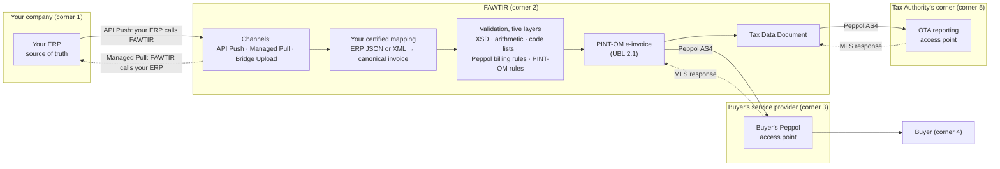

# FAWTIR ERP Developer Guide: getting started

## Overview

This guide is for developers who connect an existing ERP, accounting or POS system to FAWTIR. It
explains how to send invoices, credit notes and debit notes, how FAWTIR turns them into PINT-OM
e-invoices delivered over Peppol, and how your system learns the outcome.

If you are new to Peppol, start with the [Introduction](#introduction). If you want to send
a test invoice, go to the [Quick start](#quick-start).

### Contents

| Section | What it covers |
| --- | --- |
| [Introduction](#introduction) | What FAWTIR does, the three integration channels, and the architecture |
| [Quick start](#quick-start) | From onboarding to your first test invoice |
| [Environments](#environments) | TEST and production, base URLs and API versions |
| [Authentication](#authentication) | API keys, OAuth clients, permissions and authentication errors |
| [API reference](2-api-reference-and-data-mapping.md#api-reference) | Every endpoint an integration uses, with examples |
| [ERP data mapping](2-api-reference-and-data-mapping.md#data-mapping) | How your ERP fields map to PINT-OM, and the rules FAWTIR enforces |
| [Invoice synchronization](3-sync-lifecycle-and-errors.md#invoice-synchronization) | Push, pull, retries, duplicates and reconciliation |
| [ERP connector](3-sync-lifecycle-and-errors.md#erp-connector) | Managed Pull: letting FAWTIR collect invoices from your ERP |
| [Invoice lifecycle](3-sync-lifecycle-and-errors.md#invoice-lifecycle) | Statuses, Peppol delivery, recipient responses and tax data reporting |
| [Error reference](3-sync-lifecycle-and-errors.md#error-reference) | Every error code, what it means and what to do |
| [Invoice corrections](3-sync-lifecycle-and-errors.md#invoice-corrections) | Credit notes, debit notes and fixing rejected documents |
| [Webhooks](3-sync-lifecycle-and-errors.md#webhooks) | Optional event notifications, and polling |
| [Platform limits](3-sync-lifecycle-and-errors.md#platform-limits) | Sizes, rate limits, precision, dates and numbering |
| [TEST checklist](4-testing-go-live-and-reference.md#erp-integration-test-checklist) | Scenarios to pass before you go live |
| [Production go-live](4-testing-go-live-and-reference.md#production-go-live-checklist) | Moving from TEST to production safely |
| [Support and versioning](4-testing-go-live-and-reference.md#support-and-versioning) | API versions, changes and how to get help |
| [Official references](4-testing-go-live-and-reference.md#official-references) | PINT-OM, Peppol and Oman Tax Authority sources |
| [FAQ and glossary](4-testing-go-live-and-reference.md#faq-and-glossary) | Common questions and the terms used in this guide |

### How to read the rules in this guide

Rules in this guide come from four places. We label them so you know where each rule comes from:

- **Regulation (OTA)**: a requirement of the Oman Tax Authority.
- **PINT-OM rule**: a rule of the PINT-OM specification. These carry a rule ID such as `IBR-079-OM`.
- **FAWTIR rule**: how the FAWTIR platform behaves.
- **Recommendation**: our advice for building a reliable integration.

All company names, tax numbers, invoice numbers and credentials in the examples are fictitious.

## Introduction

This section explains what FAWTIR does with the invoices your ERP produces, which of the three
integration channels to use, and where the line falls between your ERP's job and FAWTIR's.

### What FAWTIR does

Oman's e-invoicing programme (Fawtara) uses a five-corner model. The Oman Tax Authority (OTA)
describes it like this: the supplier issues an invoice (corner 1); it goes through the supplier's
service provider (corner 2); it is validated and exchanged with the customer's service provider
(corner 3); the customer receives it (corner 4); and at the same time invoice data is sent to the
OTA system (corner 5). The OTA's service-provider FAQ gives the service providers the job "to
validate and exchange e-Invoices … while also reporting specific Tax data to OTA's system".
See [Official references](4-testing-go-live-and-reference.md#official-references).

FAWTIR is the supplier's service provider, corner 2. Your ERP is corner 1. For each document your
ERP sends, FAWTIR:

1. converts your ERP's own invoice data into FAWTIR's canonical invoice model, using a mapping
   that your company has certified;
2. validates the result in five layers: XML schema, arithmetic, code lists, the generic Peppol
   billing rules, and the PINT-OM rules for Oman;
3. builds the PINT-OM e-invoice (UBL 2.1 XML);
4. sends it over the Peppol network (AS4 protocol) to the buyer's Peppol access point, corner 3;
5. builds a Tax Data Document (TDD) for the invoice and sends it over the same Peppol network to
   the Tax Authority's corner, corner 5.

FAWTIR then records what comes back: the transport receipt, the buyer access point's Message
Level Status (MLS) response, and the MLS response from the Tax Authority's corner. The
[Invoice lifecycle](3-sync-lifecycle-and-errors.md#invoice-lifecycle) section explains each of these.

> **Warning:** There is no direct API to the Tax Authority and FAWTIR never receives a tax verdict.
> The TDD reaches the Tax Authority's corner as a Peppol message. A successful Peppol delivery is
> not OTA acceptance, and a queued document is not a delivered one.

### Why an ERP integrates

Your ERP already holds the invoice: the customer, the lines, the prices and the VAT. Integrating
means that every invoice the ERP issues reaches FAWTIR without anyone typing it again, and that
FAWTIR's outcome can flow back to the ERP. The ERP stays the system where invoices are created.
FAWTIR handles the Peppol and PINT-OM work that the ERP was not built for.

### The three channels

There is no installable connector, agent or SDK for ERP integration. You connect through one of
three channels, and you can use more than one.

| Channel | Who moves the document | What you build | Documents | Use it when |
|---|---|---|---|---|
| **API Push** | Your ERP calls FAWTIR's REST API, one document per request | A small sender in or beside your ERP that posts each document with an `ERP_INGESTION` API key | Invoices, credit notes, debit notes, self-billed invoices and self-billed credit notes | You can run code that reacts when an invoice is issued. This is the usual choice. |
| **Managed Pull** | FAWTIR calls your ERP's HTTPS JSON endpoint on a schedule and collects new invoices | A REST endpoint on your side that lists invoices with a cursor, and a connection set up in FAWTIR | Tax invoices only | Your ERP already exposes invoices over a REST API, and you cannot or prefer not to add outbound calls. |
| **Bridge Upload** | A person signed in to the FAWTIR web app uploads one exported document | An export of the invoice from your ERP, as JSON or XML | Invoices only (not credit notes, debit notes or self-billed documents), one per upload, up to 4 MiB | Low volume, a pilot, or recovering a single document by hand. |

All three channels use the same certified mapping and the same validation, and produce the same
PINT-OM document.

> **Note:** Automatic collection for Managed Pull is switched on by FAWTIR. Ask FAWTIR whether it
> is available to your organisation before you design for it. See
> [ERP connector](3-sync-lifecycle-and-errors.md#erp-connector).

Example mappings for Odoo 17 and Oracle Fusion invoice exports are available as a starting point.
FAWTIR does not claim support for any named ERP product: you certify a mapping for your own ERP's
data.

### Architecture



For some transaction types the document is not delivered to a buyer over Peppol at all: for
example a simplified (B2C) invoice, a profit-margin invoice, a deemed supply or a self-billed
import. FAWTIR then addresses it to the routing substitute the transaction type requires, and the
TDD is still reported. The [Invoice lifecycle](3-sync-lifecycle-and-errors.md#invoice-lifecycle) section covers this.

### What your ERP owns and what FAWTIR does

| Your ERP owns | FAWTIR does |
|---|---|
| The invoice data: customer, lines, prices, quantities, VAT category and rate, and all amounts | Converts that data with your certified mapping. It checks the arithmetic but does not recalculate your amounts. |
| The invoice number. FAWTIR uses the number your mapping supplies, unchanged. | Refuses a second document with the same invoice number in the same issue year for your company (`409 DUPLICATE_INVOICE`). |
| Its own document identity: `source.external_document_id` and `source.external_version` | Uses that identity to recognise a document it already has, so a resend does not create a second invoice. |
| The decision to issue, correct or cancel | Generates the invoice UUID (BTOM-002) and the other identifiers PINT-OM requires. |
| Remaining the source of truth | Delivers over Peppol, reports the TDD, and records the responses. FAWTIR does not write back into your ERP. |
| Two values an ERP document does not usually carry: the issue time and the 20-position transaction type (BTOM-001), sent in `supplement` | Applies the PINT-OM rules for that transaction type. |

**FAWTIR rule:** amounts are taken from your mapping and only rescaled when the XML is written:
document totals at 2 decimals and line amounts at 3. If your ERP's figures do not add up, the
document is refused. FAWTIR does not correct them.

#### You do not need to recreate your master data in FAWTIR

A pushed document carries its own seller, buyer and line data, which your mapping converts. Your
customers and items do not have to exist in FAWTIR's customer list or product catalogue for an
invoice to be accepted.

One thing does have to exist: **your company's own Peppol participant**.

**FAWTIR rule:** the seller endpoint on each document must be the Peppol participant your company
was verified for. On a self-billed document, where your company is the buyer, FAWTIR checks the
buyer endpoint instead. A document that names any other sender, or a company with no verified
participant, is refused.

> **Note:** If your mapping does not supply a buyer endpoint, FAWTIR looks up the buyer's VAT
> number in your FAWTIR customer list and uses a Peppol participant it has verified there. Keeping
> customers in FAWTIR is therefore optional, and only helps when your ERP export has no buyer
> endpoint.

### How a pushed document reaches the right company

You do not name your company in the request. FAWTIR works it out from the credential:

- An API key belongs to exactly one company. FAWTIR files every document sent with that key under
  that company.
- An OAuth client also belongs to exactly one company, and so does every access token it obtains.
- The seller on the document must be your company's verified Peppol participant (see above). A key
  for company A cannot send an invoice in the name of company B.

Branches work differently for pushed documents:

- **Branch invoice-number prefixes do not apply.** They are used only when FAWTIR numbers an
  invoice that someone creates in the FAWTIR web app. A pushed document keeps the number your ERP
  gave it.
- **A pushed document belongs to no branch.** API keys and OAuth clients are company credentials
  and see all branches. A person whose access is limited to some branches is refused when they
  submit through the API or Bridge Upload (`403 branch-not-in-scope`). Such a person issues
  invoices from the web app instead.

### Where to go next

- [Quick start](#quick-start): send your first test invoice.
- [Environments](#environments): TEST, production and base URLs.
- [Authentication](#authentication): API keys and OAuth clients.
- [ERP data mapping](2-api-reference-and-data-mapping.md#data-mapping): how your fields become PINT-OM.

## Quick start

This tutorial takes you from an onboarded FAWTIR company to a first invoice pushed from your ERP
and accepted by FAWTIR. It uses API Push, the usual channel. Plan about an afternoon, most of it
on the mapping.

All company names, tax numbers, invoice numbers, identifiers and credentials in this section are
fictitious.

### What you will do

1. Check the prerequisites.
2. Ask FAWTIR to enable ERP integration and document submission.
3. Create a mapping for your ERP's invoice data and certify it.
4. Create an `ERP_INGESTION` API key.
5. Send an invoice with `curl`.
6. Read the `202 Accepted` response.
7. Check the invoice's status.

### 1. Prerequisites

| You need | Why |
|---|---|
| A FAWTIR company account that has finished onboarding | Every document belongs to one company. |
| Your company's Peppol participant verified by FAWTIR | FAWTIR refuses a document whose seller is not your verified participant. |
| A plan that includes API access | API keys can only be created on such a plan. |
| A person who can manage settings (`admin.settings.manage`) | Mappings and API keys are created by a person signed in to the web app. A machine credential cannot create them. |
| Your base URL, `{BASE_URL}` | See [Environments](#environments). Use TEST for this tutorial. |
| `curl`, and one exported invoice from your ERP as JSON | To build and test the mapping, then to send. |

### 2. Ask FAWTIR to enable ERP integration and submission

Two switches are FAWTIR's, not yours:

- **ERP integration.** Until FAWTIR enables it, the ERP screens in the web app say "ERP
  integration is not enabled", and ERP ingestion keys cannot be created.
- **Document submission.** Document submission is switched on by FAWTIR for the whole
  environment, not company by company; while it is off, these routes answer 404. Your company must
  also be ready to issue (onboarding finished, Peppol participant verified), or a submission is
  refused with `409`.

Ask FAWTIR to enable ERP integration for your company in TEST, and to confirm that document
submission is on there. See
[Support and versioning](4-testing-go-live-and-reference.md#support-and-versioning) for how to reach FAWTIR.

### 3. Create and certify a mapping

FAWTIR does not define a fixed invoice JSON. Your ERP sends its **own** invoice JSON (or XML), and
a mapping that your company owns converts it to FAWTIR's canonical invoice model. Creating and
certifying a mapping is a person's job in the web app.

**FAWTIR rule:** a submission is refused until its mapping has passed certification for the kind
of document and the transaction type you send.

#### 3.1 Prepare a sample of your ERP's invoice

This tutorial uses an invoice shaped like the Odoo 17 example that FAWTIR provides, filled with the
example data used throughout this guide. Your ERP's JSON will look different. That is expected:
the mapping is what adapts to it.

```json
{
  "name": "INV-2026-000145",
  "move_type": "out_invoice",
  "invoice_date": "2026-11-10",
  "invoice_date_due": "2026-12-10",
  "currency_id": [12, "OMR"],
  "ref": "PO-2026-0381",
  "amount_untaxed": 225.000,
  "amount_tax": 11.250,
  "amount_total": 236.250,
  "company_data": {
    "name": "Al Waha Trading",
    "legal_name": "Al Waha Trading LLC",
    "vat": "OM1999000101",
    "company_registry": "1234567",
    "street": "Al Khuwair",
    "street2": "PO Box 123",
    "city": "Muscat",
    "zip": "133",
    "country_code": "OM",
    "phone": "+96800000000",
    "email": "billing@alwaha.example"
  },
  "partner_data": {
    "name": "Sahil Engineering",
    "legal_name": "Sahil Engineering SAOC",
    "vat": "OM1999000202",
    "street": "Sohar Industrial Area",
    "street2": "Building 7",
    "city": "Sohar",
    "zip": "311",
    "country_code": "OM"
  },
  "invoice_line_ids": [
    {
      "sequence": 1,
      "name": "Steel pipe 2 inch",
      "product_id": [101, "Steel pipe 2 inch"],
      "default_code": "SP-2IN",
      "quantity": 10,
      "x_unece_unit_code": "H87",
      "price_unit": 12.500,
      "price_subtotal": 125.000,
      "x_btom_goods_or_service": "G",
      "x_btom_hs_code": "730630000002",
      "x_btom_industrial_classification": "466203",
      "x_btom_service_type": "00000000",
      "tax_ids": [{ "name": "VAT 5%", "amount": 5.0, "tax_group": "S" }]
    },
    {
      "sequence": 2,
      "name": "Installation service",
      "product_id": [205, "Installation service"],
      "default_code": "SV-INST",
      "quantity": 4,
      "x_unece_unit_code": "HUR",
      "price_unit": 25.000,
      "price_subtotal": 100.000,
      "x_btom_goods_or_service": "S",
      "x_btom_industrial_classification": "432205",
      "x_btom_service_type": "72000000",
      "tax_ids": [{ "name": "VAT 5%", "amount": 5.0, "tax_group": "S" }]
    }
  ]
}
```

The `x_btom_*` and `x_unece_unit_code` fields are custom fields added to the ERP's invoice lines.
A standard ERP does not hold the PINT-OM item codes: the goods-or-services flag (BTOM-019), the
industrial classification (BTOM-033), the service type code, the 12-digit HS code for goods, and
the UN/ECE unit code. A goods line still carries a service type code: `00000000`.

**FAWTIR rule:** a line that has a goods-or-services flag but no service type code is refused with
`422 SUBMISSION_NOT_SUPPORTED`.

> **Warning:** Every goods line needs an HS code (**PINT-OM rule** IBR-079-OM), and the code must
> be on the Oman HS code list (**PINT-OM rule** CL-08-OM-HS). IBR-079-OM exempts Simplified Tax
> Invoices, but PINT-OM 1.0.1 as published also contains rule IBR-174-OM, which applies the same
> check without the Simplified exemption. Until this is clarified, provide an HS code on every
> goods line. **FAWTIR rule:** an HS code that is not exactly 12 digits is refused before
> validation, with `422 MAPPING_FAILED`.

Save this JSON as a file, for example `erp-invoice-INV-2026-000145.json`. You use it twice: as
the mapping sample now, and inside the request in step 5.

#### 3.2 Open the mapping screens

In the web app, go to **Settings → ERP integration → Mapping**. This opens **ERP mapping**, with
the screens **Overview · Fields · Preview · Certify · Advanced · History · Samples**.

1. Open **Samples** and choose **Upload a sample**. Upload your JSON file (one file, up to
   256 KiB), give it a unique **Label**, and choose **Upload**. Samples are visible to all
   administrators, so remove personal data first.
2. Build the mapping in one of two ways:
   - **Guided:** on **Overview**, choose **Start guided mapping**. On **Fields**, map each business
     term to a path in your sample, then choose **Save**. When every required field is mapped, the
     web app shows "Compiled and activated. Certify next."
   - **Hand-written:** on **Overview**, choose **Upload a hand-written profile**, or open
     **Advanced** (the **Hand-written profile** screen). Paste a JSONata expression into
     **Profile text**, use **Dry-run with this text** to try it against a sample, then choose
     **Save and activate**.

For this tutorial, start from the Odoo 17 example mapping and change the lines block in two
places. The example pins every line's unit to `H87` (piece) and reads no HS code, so this document
adds two line fields, `x_unece_unit_code` and `x_btom_hs_code`, and the mapping must read them:

```text
"unitCode": $l.x_unece_unit_code,
```

and, inside `"item"`:

```text
"itemClassifications": $l.x_btom_hs_code
    ? [ { "code": $l.x_btom_hs_code, "schemeId": "HS" } ],
```

Set `"baseQuantityUnitCode"` in `"price"` the same way as `"unitCode"`. If your ERP holds its
own unit names instead, the mapping needs a lookup from them to UN/ECE Recommendation 20 codes. See
[ERP data mapping](2-api-reference-and-data-mapping.md#data-mapping).

#### 3.3 Preview

Open **Preview**, choose your sample, and choose **Run preview**. The screen shows "What your ERP
sent" next to "What Fawtir would file". A preview runs the mapping and the canonical model only.
The PINT-OM rules run at certification.

#### 3.4 Certify

Open **Certify**. Certification is one test per route (Invoice, Credit note, Debit note,
Self-billing).

1. On the **Invoice** route, choose **Run test invoice**. The dialog is titled **Run test
   invoice · Invoice**.
2. Choose your sample.
3. Under **Transaction type (BTOM-001)**, choose **Full tax invoice**.
4. Enter the **Issue time**, for example `10:15:00`.
5. Choose **Run**.

The run takes a few seconds. A pass shows **Passed** and "This mapping is certified for Invoice at
hash …". A failure lists findings by layer. Fix what they name and choose **Run again**.

> **Note:** Certification is tied to the exact mapping that runs. When you change the mapping,
> every route goes stale and must be certified again before invoices of that kind can be sent.

### 4. Create an ERP_INGESTION API key

1. Go to **Settings → ERP integration → API push** and choose **Create key**.
2. In **Create an ERP ingestion key**:
   - **Name**: say which system uses it, for example `Al Waha ERP test`.
   - **Documents it may send**: **Invoices** is already ticked. Add **Credit notes**, **Debit notes** or
     **Self-billed invoices** only if this system will send them.
   - **Expires on**: leave empty for the default (365 days), or choose a date up to 730 days ahead.
3. Choose **Create key**.
4. **Your new key** shows the key once. Choose **Copy key**, store it in your secret store, then
   choose **I have copied the key**.

The key can submit documents only. It cannot read anything. See
[Authentication](#authentication).

> **Warning:** Keep the key on your server. Never put it in a browser, a mobile app, a shared file
> or a ticket. If it leaks, revoke it (**Revoke key**) and create a new one.

### 5. Send the invoice

Wrap your ERP's JSON in FAWTIR's request envelope. The ERP document goes in `document` untouched.
The envelope adds what an ERP document does not carry.

Save this as `invoice-INV-2026-000145.json`. It is the same request as in the
[API reference](2-api-reference-and-data-mapping.md#api-reference), and its `document` is the JSON from step 3.1:

```json
{
  "format": "JSON",
  "supplement": {
    "issue_time": "10:15:00",
    "transaction_type": "1XXXXXXXXXXXXXXXXXXX"
  },
  "source": {
    "external_document_id": "ERP-INV-000145",
    "external_version": "1"
  },
  "document": {
    "name": "INV-2026-000145",
    "move_type": "out_invoice",
    "invoice_date": "2026-11-10",
    "invoice_date_due": "2026-12-10",
    "currency_id": [12, "OMR"],
    "ref": "PO-2026-0381",
    "amount_untaxed": 225.000,
    "amount_tax": 11.250,
    "amount_total": 236.250,
    "company_data": {
      "name": "Al Waha Trading",
      "legal_name": "Al Waha Trading LLC",
      "vat": "OM1999000101",
      "company_registry": "1234567",
      "street": "Al Khuwair",
      "street2": "PO Box 123",
      "city": "Muscat",
      "zip": "133",
      "country_code": "OM",
      "phone": "+96800000000",
      "email": "billing@alwaha.example"
    },
    "partner_data": {
      "name": "Sahil Engineering",
      "legal_name": "Sahil Engineering SAOC",
      "vat": "OM1999000202",
      "street": "Sohar Industrial Area",
      "street2": "Building 7",
      "city": "Sohar",
      "zip": "311",
      "country_code": "OM"
    },
    "invoice_line_ids": [
      {
        "sequence": 1,
        "name": "Steel pipe 2 inch",
        "product_id": [101, "Steel pipe 2 inch"],
        "default_code": "SP-2IN",
        "quantity": 10,
        "x_unece_unit_code": "H87",
        "price_unit": 12.500,
        "price_subtotal": 125.000,
        "x_btom_goods_or_service": "G",
        "x_btom_hs_code": "730630000002",
        "x_btom_industrial_classification": "466203",
        "x_btom_service_type": "00000000",
        "tax_ids": [{ "name": "VAT 5%", "amount": 5.0, "tax_group": "S" }]
      },
      {
        "sequence": 2,
        "name": "Installation service",
        "product_id": [205, "Installation service"],
        "default_code": "SV-INST",
        "quantity": 4,
        "x_unece_unit_code": "HUR",
        "price_unit": 25.000,
        "price_subtotal": 100.000,
        "x_btom_goods_or_service": "S",
        "x_btom_industrial_classification": "432205",
        "x_btom_service_type": "72000000",
        "tax_ids": [{ "name": "VAT 5%", "amount": 5.0, "tax_group": "S" }]
      }
    ]
  }
}
```

| Member | Meaning |
|---|---|
| `format` | `JSON`, or `XML` when `document` is a string holding your XML. Defaults to `JSON`. |
| `document_kind` | `STANDARD_INVOICE` on `/api/v1/invoices`. Defaults to `STANDARD_INVOICE`. |
| `document` | Your ERP's own invoice. Your certified mapping reads it. |
| `supplement.issue_time` | The issue time, `HH:mm:ss` (IBT-168). Required. |
| `supplement.transaction_type` | The 20-position transaction type (BTOM-001). Required. |
| `source.external_document_id` | Your ERP's identifier for this document, up to 200 characters. |
| `source.external_version` | Its version, up to 80 characters. Change it when the content changes. |

About `transaction_type`: PINT-OM code list CL-03-OM defines 20 positions, each a flag. Position 1
is Full tax invoice, 2 Simplified tax invoice, 3 Self-billed, 4 Third-party, 5 Summary,
6 Continuous supply, 7 Export, 8 Deemed supply, 9 Import of services (reverse charge), 10 Profit
margin, 11 Profit-margin self-invoice, 12 E-commerce, 13 Import of goods, 14 Special zone supplies,
15 Prepayment, and 16 to 20 are reserved. The specification writes the flags as `1` and `0`.
**FAWTIR rule:** send `1` for a set flag and `X` for an unset one; FAWTIR writes `0` in the
e-invoice. A full tax invoice is therefore `1XXXXXXXXXXXXXXXXXXX`.

Unknown members are refused with `400`. The full list of members, including those a credit note
needs, is in the [API reference](2-api-reference-and-data-mapping.md#api-reference).

Send it:

```bash
curl -i -X POST "{BASE_URL}/api/v1/invoices" \
  -H "Content-Type: application/json" \
  -H "X-API-Key: fawt_sk_<your-key>" \
  -H "Idempotency-Key: waha-inv-000145-v1-7f3c9a2e" \
  -H "X-Correlation-Id: 3f1c2a9e-7b4d-4c1a-9e2f-6a8b0c4d2e17" \
  --data @invoice-INV-2026-000145.json
```

| Header | Required | Notes |
|---|---|---|
| `X-API-Key` | Yes | Your `ERP_INGESTION` key. Never send `Authorization` as well. |
| `Idempotency-Key` | Yes | 16 to 128 characters: letters, digits and `.` `_` `:` `-`. One value per submission attempt. Send the **same** value when you retry the same request. |
| `Content-Type` | Yes | `application/json`. |
| `X-Correlation-Id` | No | A UUID of your choice, so you can quote it to support. |

**FAWTIR rule:** a request to `/api/v1/invoices` may be up to 4 MiB. The other submission routes,
`/api/v1/creditnotes`, `/api/v1/debitnotes` and `/api/v1/selfbilling`, accept up to 1 MiB. See
[Platform limits](3-sync-lifecycle-and-errors.md#platform-limits).

### 6. Read the response

A new, valid document is answered `202 Accepted`:

```http
HTTP/1.1 202 Accepted
Location: /api/v1/invoices/invc_01JCQ7Z8K4M2N6P9R3T5V7X9YB
Content-Type: application/json
X-Correlation-Id: 3f1c2a9e-7b4d-4c1a-9e2f-6a8b0c4d2e17
X-Fawtir-Trace-Id: 3f1c2a9e-7b4d-4c1a-9e2f-6a8b0c4d2e17
```

```json
{
  "id": "invc_01JCQ7Z8K4M2N6P9R3T5V7X9YB",
  "invoice_uuid": "3f6d2a9e-8c41-5b7e-9a12-6c0e4f8b2d17",
  "instance_uuid": "a9c41e07-2b5d-4f63-8e1a-7d3b9c0f5e24",
  "document_kind": "STANDARD_INVOICE",
  "state": "QUEUED",
  "warnings": [],
  "peppol_send": {
    "target_participant": "0248:OM1999000202",
    "status": "queued"
  },
  "tdd": {
    "status": "queued",
    "sla_deadline": "2026-11-10T06:30:04Z"
  },
  "links": {
    "self": "/api/v1/invoices/invc_01JCQ7Z8K4M2N6P9R3T5V7X9YB",
    "document": "/api/v1/invoices/invc_01JCQ7Z8K4M2N6P9R3T5V7X9YB/document",
    "tdd": "/api/v1/invoices/invc_01JCQ7Z8K4M2N6P9R3T5V7X9YB/tdd"
  },
  "validated_at": "2026-11-10T06:15:04Z",
  "source": {
    "external_document_id": "ERP-INV-000145",
    "external_version": "1",
    "disposition": "ACCEPTED"
  }
}
```

What it means:

- The document passed mapping and all five validation layers. Store `id` against your ERP record.
- `state: "QUEUED"`: FAWTIR has queued both the Peppol delivery and the TDD. Nothing has been
  delivered yet.
- `peppol_send.status` and `tdd.status` are always `"queued"` in this response. They do not
  change. The live status is at `links.self`.
- `source.disposition: "ACCEPTED"`: this request created the invoice.

If you send the same `source` identity with the same content again, FAWTIR answers `200 OK` with
`source.disposition: "DUPLICATE"` and describes the earlier submission. No second invoice is
created. A refused document is answered `4xx` with a problem body and creates nothing. See
[Error reference](3-sync-lifecycle-and-errors.md#error-reference).

### 7. Check the status

Status reads need a **Bearer token**, not an API key. An API key cannot read anything. The token
comes from a person signed in to FAWTIR, or from an OAuth client that holds the `invoice.read`
permission. [Authentication](#authentication) shows how to register an OAuth client and get
a token.

```bash
curl -s "{BASE_URL}/api/v1/invoices/invc_01JCQ7Z8K4M2N6P9R3T5V7X9YB" \
  -H "Authorization: Bearer <access-token>"
```

```json
{
  "id": "invc_01JCQ7Z8K4M2N6P9R3T5V7X9YB",
  "invoice_uuid": "3f6d2a9e-8c41-5b7e-9a12-6c0e4f8b2d17",
  "instance_uuid": "a9c41e07-2b5d-4f63-8e1a-7d3b9c0f5e24",
  "invoice_number": "INV-2026-000145",
  "document_kind": "STANDARD_INVOICE",
  "state": "SENT",
  "b2c": false,
  "receiver": "0248:OM1999000202",
  "warnings": [],
  "received_at": "2026-11-10T06:15:03Z",
  "validated_at": "2026-11-10T06:15:04Z",
  "sending_at": "2026-11-10T06:15:09Z",
  "sent_at": "2026-11-10T06:15:12Z",
  "delivered_at": null,
  "failure_reason": null,
  "tdd": [
    {
      "variant": "SUBMIT",
      "status": "SUBMITTED",
      "sla_deadline": "2026-11-10T06:30:04Z",
      "submitted_at": "2026-11-10T06:16:40Z",
      "failure_reason": null
    }
  ],
  "links": {
    "self": "/api/v1/invoices/invc_01JCQ7Z8K4M2N6P9R3T5V7X9YB",
    "document": "/api/v1/invoices/invc_01JCQ7Z8K4M2N6P9R3T5V7X9YB/document",
    "tdd": "/api/v1/invoices/invc_01JCQ7Z8K4M2N6P9R3T5V7X9YB/tdd"
  }
}
```

Here `state: "SENT"` means the buyer's access point confirmed receipt of the AS4 message. It is
not yet `DELIVERED`, which needs the buyer access point's positive MLS response. The TDD leg is
`SUBMITTED`: it has been sent to the Tax Authority's corner, and its MLS response has not arrived.
Poll until both reach a final status. The [Invoice lifecycle](3-sync-lifecycle-and-errors.md#invoice-lifecycle) section lists
every status and which ones are final.

**Recommendation:** poll with a backoff, for example after 1, 5 and 15 minutes and then hourly,
rather than in a tight loop.

### Next steps

- [Authentication](#authentication): key rotation, OAuth clients for status reads, errors.
- [ERP data mapping](2-api-reference-and-data-mapping.md#data-mapping): map your real ERP data.
- [Invoice synchronization](3-sync-lifecycle-and-errors.md#invoice-synchronization): retries, duplicates and reconciliation.
- [Invoice lifecycle](3-sync-lifecycle-and-errors.md#invoice-lifecycle): every status and what is final.
- [TEST checklist](4-testing-go-live-and-reference.md#erp-integration-test-checklist): the scenarios to pass before going live.

## Environments

This section tells you which FAWTIR environment to point your ERP at, how to build request URLs, and
what you need from FAWTIR before your requests are accepted.

### TEST and production

| | TEST | Production |
|---|---|---|
| Purpose | Building and testing your integration | Real invoices with legal effect |
| API host | `https://api.fawtir.om` | Ask FAWTIR |
| Peppol network | Ask FAWTIR | Ask FAWTIR |
| Data | Test data only | Your real business data |

> **Note:** `https://api.fawtir.om` is the TEST environment, not production. Ask FAWTIR for the
> production API host when you plan your go-live.

#### What TEST is

- The environment where you build the integration, certify your mapping, and run the
  [TEST checklist](4-testing-go-live-and-reference.md#erp-integration-test-checklist).
- An environment whose configuration and enabled features FAWTIR may change.
- Before you send from TEST, ask FAWTIR which Peppol network TEST is connected to and which buyer
  participants you may address from it.

#### What TEST is not

- It is not production. An invoice sent from TEST is a test document, not a tax invoice you have
  issued.

Ask FAWTIR whether TEST has an availability commitment.

**Recommendation:** use fictitious companies, customers and amounts in TEST, as this guide does.
Never send real customer data or real invoices through TEST. Agree any load test with FAWTIR
first.

### Base URL and request URLs

This guide writes `{BASE_URL}` in every example. Replace it with the host of the environment you
use, for example `https://api.fawtir.om` for TEST. Every API path starts with `/api/v1`:

```text
{BASE_URL}/api/v1/invoices
{BASE_URL}/api/v1/creditnotes
{BASE_URL}/api/v1/auth/token
```

**FAWTIR rule:** API-key requests are admitted on exact paths only. Do not add a trailing slash,
a `;` parameter or percent-encoding to the path. `POST {BASE_URL}/api/v1/invoices/` (with the
slash) is refused with `401`.

**Recommendation:** keep the base URL in configuration, not in code, so moving from TEST to
production is a configuration change. Keep separate credentials for each environment, and never
use a production credential in TEST.

Call the API host directly. Ask FAWTIR before you call the API through any other domain.

### Versioning

The API version is part of the path: `/api/v1`. There is no version header and no version query
parameter. See [Support and versioning](4-testing-go-live-and-reference.md#support-and-versioning) for what may change within
`v1`.

### How access is granted

Your requests are accepted only when all of these are in place. The first three are done by FAWTIR.

| Step | Who | What happens if it is missing |
|---|---|---|
| Your company is onboarded and its Peppol participant is verified | FAWTIR, with your company | Submissions are refused with `409 TENANT_NOT_OPERATIONAL` while onboarding is unfinished, and a document whose seller is not your company's verified participant is refused. |
| ERP integration is enabled for your company | FAWTIR | The ERP screens say "ERP integration is not enabled"; ERP ingestion keys cannot be created; every push from an ERP ingestion key, and any push or upload with `source`, is refused with `403 erp-entitlement-required`. |
| Document submission is enabled | FAWTIR | The submission routes answer `404`. FAWTIR switches submission on for the whole environment, not per company. |
| Your plan includes API access | Your company's plan | API keys and OAuth clients cannot be created, and existing `GENERAL` keys and OAuth clients are refused (`409 plan-limit-reached`). An existing `ERP_INGESTION` key is not checked against the plan; it needs ERP integration instead. |
| A mapping is certified for the document kind and transaction type | A person in your company | Submissions are refused with `422 SUBMISSION_NOT_SUPPORTED`. |
| A credential exists | A person in your company | Requests are refused with `401`. |

### Moving to production

Ask FAWTIR for the production host, how ERP integration is enabled there, whether your mapping
must be certified again in production, and how go-live is signed off. See
[Production go-live](4-testing-go-live-and-reference.md#production-go-live-checklist).

What you can plan for already:

- New credentials in production. Do not reuse TEST keys or OAuth client secrets.
- Setting up ERP integration, your mapping and its certification in production, unless FAWTIR
  tells you they carry over.
- A configuration change of `{BASE_URL}`, with no code change.
- Passing the [TEST checklist](4-testing-go-live-and-reference.md#erp-integration-test-checklist) first.

## Authentication

This section explains the two machine credentials FAWTIR offers, which one to use for what, how to
create, rotate and revoke them, and the exact errors you get when authentication or authorisation
fails.

All credentials, identifiers and company names in this section are fictitious. Placeholders such as
`fawt_sk_<your-key>` and `<your-client-secret>` stand for real values you never publish.

### Two credentials

| | API key | OAuth client |
|---|---|---|
| Sent as | `X-API-Key: fawt_sk_…` | `Authorization: Bearer <access-token>`, from a `client_credentials` token request |
| Can call | `POST` on exactly four paths: `/api/v1/invoices`, `/api/v1/creditnotes`, `/api/v1/debitnotes`, `/api/v1/selfbilling` | Any `/api/v1` route that the permissions (scopes) it holds allow, with the limits listed under [What an OAuth client can reach](#what-an-oauth-client-can-reach) |
| Can read | Nothing | What its permissions allow, for example invoice status with `invoice.read` |
| Can send `source` (your ERP's document identity) | Yes, with the `ERP_INGESTION` profile | No |
| Created in | The web app (**Settings → ERP integration → API push**) or the API | The API only. The web app has no screen for OAuth clients. |
| Created by | A person signed in to FAWTIR | A person signed in to FAWTIR |

#### Which one to use

**Recommendation:** push documents with an `ERP_INGESTION` API key. To read their status, the
platform allows an OAuth client that holds only `invoice.read`.

The reasons: an API key cannot read, so it cannot be used to leak data; on the submission routes
only an `ERP_INGESTION` key can send `source`, which gives you FAWTIR's duplicate protection for your ERP documents; and an
OAuth client with only `invoice.read` cannot submit anything.

### API keys

#### Profiles

| Profile | What it may hold | Expiry | Use |
|---|---|---|---|
| `ERP_INGESTION` | Only `invoice.submit`, `creditnote.submit`, `debitnote.submit`, `selfbilling.submit` | Always expires: 365 days by default, at most 730 days | Pushing ERP documents. This is the key the web app creates. |
| `GENERAL` | Permissions a machine may hold, but it can still only call the four `POST` paths | None unless you set one | Older integrations. It cannot send `source`. |

**FAWTIR rule:** an `ERP_INGESTION` key that asks for any other permission is refused with `400`:
"An ERP_INGESTION API key may not hold … This profile exists to push documents and is limited to
[…]; issue a separate credential for anything else."

Some permissions can never be held by any machine credential, whatever its profile. These include
every `erp.*` and `mapping.*` permission. Asking for one is refused with `400`: "An API key may
not hold <code>. It is an administrative capability reserved for human operators; assign it to a
role instead."

#### Format and header

Send the key in the `X-API-Key` header on every request:

```http
POST /api/v1/invoices HTTP/1.1
Host: <host name from {BASE_URL}, without https://>
X-API-Key: fawt_sk_<your-key>
Idempotency-Key: waha-inv-000145-v1-7f3c9a2e
Content-Type: application/json
```

A key looks like `fawt_sk_<company-id>.<12-character prefix>.<secret>`. Treat the whole string as
opaque. The web app shows the prefix and the last four characters so you can tell keys apart.

#### Creating a key

A key is created by a person who can manage settings (`admin.settings.manage`). **FAWTIR rule:**
a machine credential cannot create one; it is refused with `403 human-principal-required`.

In the web app: **Settings → ERP integration → API push → Create key**. The steps are in the
[Quick start](#quick-start). The web app always creates `ERP_INGESTION` keys.

Through the API, with a signed-in person's session:

```bash
curl -i -X POST "{BASE_URL}/api/v1/apikeys" \
  -H "Authorization: Bearer <administrator-access-token>" \
  -H "Idempotency-Key: waha-apikey-create-000001" \
  -H "Content-Type: application/json" \
  -d '{
    "label": "Al Waha ERP test",
    "profile": "ERP_INGESTION",
    "scopes": ["invoice.submit", "creditnote.submit"],
    "expiresAt": "2027-11-10T00:00:00Z"
  }'
```

| Field | Rule |
|---|---|
| `label` | Required. Name the system that uses the key. |
| `profile` | `ERP_INGESTION` or `GENERAL`. Defaults to `GENERAL` when omitted. |
| `scopes` | Required, at least one. |
| `expiresAt` | Optional. Must be in the future. For `ERP_INGESTION`, at most 730 days ahead; omit it for 365 days. |

The answer is `201 Created` with `Cache-Control: no-store`:

```json
{
  "id": "6b1d4c2e-0f3a-4e8b-9c7d-2a5e8f1b3c90",
  "key": "fawt_sk_<your-key>",
  "prefix": "a1b2c3d4e5f6",
  "label": "Al Waha ERP test",
  "scopes": ["invoice.submit", "creditnote.submit"],
  "expiresAt": "2027-11-10T00:00:00Z",
  "warning": null,
  "profile": "ERP_INGESTION",
  "replacesKeyId": null,
  "previousKeyGraceEndsAt": null
}
```

`key` is shown in this response only. FAWTIR stores a hash and cannot show it again.

Before issuing a key, FAWTIR checks, in this order: that your subscription allows new credentials
(else `409 subscription-restricted`); that your plan includes API access (else
`409 plan-limit-reached`); for `ERP_INGESTION`, that ERP integration is enabled for your company
(else `403 erp-entitlement-required`, "ERP is not enabled for this organization."); then the
permissions and the expiry.

#### Rotating a key

Rotation creates a replacement key with the same permissions, profile and expiry (the replacement
of a key that has already expired is given 90 days), and gives the old key a grace period so you
can switch without downtime.

1. In **API push**, choose **Rotate key** on the key. Through the API:
   `POST {BASE_URL}/api/v1/apikeys/{id}/rotate` with an `Idempotency-Key` header.
2. Copy the replacement from **Your replacement key**. The response carries `replacesKeyId` and
   `previousKeyGraceEndsAt`.
3. Deploy the new key to your ERP.
4. Either let the grace period run out, or choose **Complete rotation** to stop the old key now.
   Through the API: `POST {BASE_URL}/api/v1/apikeys/{oldId}/rotation/complete` (`204`).

**FAWTIR rule:** the grace period is 24 hours by default and never more than 7 days. A key that
had already expired gets no grace. At most two keys of one rotation chain work at the same time.
A revoked key cannot be rotated (`409`, "A revoked API key cannot be rotated. Issue a new key
instead."), and a key that was already rotated cannot be rotated again (`409`, "This API key has
already been rotated. Rotate its replacement … instead.").

**FAWTIR rule:** rotating, completing a rotation and revoking are done by a signed-in person. A
machine credential that tries is refused with `401` and nothing changes.

Rotation does not affect duplicate protection: FAWTIR recognises your documents by your company and
your `source` identity, not by the key that sent them.

#### Revoking a key

**Revoke key** in the web app, or `DELETE {BASE_URL}/api/v1/apikeys/{id}` (`204`). The key stops
working at once and cannot be restored. Revoking a key also ends the grace of a key it replaced.

#### Key statuses

| Status | Web app label | Authenticates |
|---|---|---|
| `ACTIVE` | Active | Yes |
| `ROTATION_GRACE` | Being replaced | Yes, until the grace ends |
| `ROTATED` | Replaced | No |
| `REVOKED` | Revoked | No |
| `EXPIRED` | Expired | No |

#### Checks on every request

Each request with a key is checked again:

1. The key must be valid, unexpired and not revoked, else `401 invalid-api-key`.
2. Your company's subscription must allow API use, else `409 subscription-restricted`.
3. A `GENERAL` key also needs a plan that includes API access, else `409 plan-limit-reached`. The
   key is kept and works again once the plan includes it.
4. An `ERP_INGESTION` key is not checked against the plan's API access. Instead, ERP integration
   must be enabled for your company when it pushes, else `403 erp-entitlement-required`.

Each key may make 600 requests a minute. See [Platform limits](3-sync-lifecycle-and-errors.md#platform-limits).

### OAuth clients

#### Registering a client

An OAuth client is registered through the API by a person who can manage settings, using their
signed-in session. **FAWTIR rule:** a machine credential cannot register one
(`403 human-principal-required`). The web app has no screen for OAuth clients.

Ask FAWTIR how to register an OAuth client for your company.

```bash
curl -i -X POST "{BASE_URL}/api/v1/auth/clients" \
  -H "Authorization: Bearer <administrator-access-token>" \
  -H "Idempotency-Key: waha-oauth-client-000001" \
  -H "Content-Type: application/json" \
  -d '{
    "name": "Al Waha ERP status reader",
    "scopes": ["invoice.read"],
    "bindIp": true,
    "allowedCidrs": ["203.0.113.10/32"]
  }'
```

| Field | Rule |
|---|---|
| `name` | Required. |
| `scopes` | Required, at least one. Permissions reserved for people cannot be granted. |
| `bindIp` | `true` binds tokens to a network (see [IP binding](#ip-binding)). |
| `allowedCidrs` | Optional. Only with `bindIp: true`, else `400` "Allowed IP networks require IP binding to be enabled." |

The answer is `201 Created` with `Cache-Control: no-store`:

```json
{
  "clientId": "fawtir_<tenant>_<id>",
  "clientSecret": "<your-client-secret>",
  "name": "Al Waha ERP status reader",
  "scopes": ["invoice.read"],
  "bindIp": true,
  "allowedCidrs": ["203.0.113.10/32"]
}
```

The secret is shown only in this response. Registration needs the same subscription and plan
checks as an API key: `409 subscription-restricted` or `409 plan-limit-reached` when they fail.

#### Getting an access token

`POST {BASE_URL}/api/v1/auth/token` with the `client_credentials` grant. Credentials go in the
body. FAWTIR does not accept them in an `Authorization: Basic` header.

As JSON:

```bash
curl -s -X POST "{BASE_URL}/api/v1/auth/token" \
  -H "Content-Type: application/json" \
  -d '{
    "grant_type": "client_credentials",
    "client_id": "fawtir_<tenant>_<id>",
    "client_secret": "<your-client-secret>",
    "scope": "invoice.read"
  }'
```

As a form, as in RFC 6749:

```bash
curl -s -X POST "{BASE_URL}/api/v1/auth/token" \
  -H "Content-Type: application/x-www-form-urlencoded" \
  --data-urlencode "grant_type=client_credentials" \
  --data-urlencode "client_id=fawtir_<tenant>_<id>" \
  --data-urlencode "client_secret=<your-client-secret>" \
  --data-urlencode "scope=invoice.read"
```

`scope` is optional and space-separated. Leave it out to receive every permission the client was
registered with. Asking for one it does not hold is refused with `400` "Requested OAuth scope is
not allowed." Only `client_credentials` is supported; any other `grant_type` is refused with `400`
"Only client_credentials is supported." The JSON body also accepts `grantType`, `clientId` and
`clientSecret`.

The answer is `200 OK` with `Cache-Control: no-store`. Each value appears under two names, the
FAWTIR name and the RFC 6749 name:

```json
{
  "accessToken": "<access-token>",
  "refreshToken": "fawtir_ort_<refresh-token>",
  "tokenType": "Bearer",
  "expiresIn": 900,
  "refreshTokenExpiresAt": "2026-11-11T06:00:00Z",
  "scope": "invoice.read",
  "access_token": "<access-token>",
  "refresh_token": "fawtir_ort_<refresh-token>",
  "token_type": "Bearer",
  "expires_in": 900
}
```

The access token lasts 15 minutes (`expires_in: 900`). Send it as
`Authorization: Bearer <access-token>`. It names your company and its permissions, so you never
send a company identifier yourself.

#### Refreshing and revoking

- **Refresh.** `POST {BASE_URL}/api/v1/auth/refresh` with `{"refreshToken": "fawtir_ort_<refresh-token>"}`.
  A refresh token lasts 24 hours and can be used once. Reusing a spent refresh token revokes every
  token descended from the same token request. The refresh answer uses FAWTIR names only:
  `accessToken`, `refreshToken`, `tokenType`, `accessTokenIssuedAt`, `accessTokenExpiresAt`,
  `refreshTokenExpiresAt`. It has no `expires_in`.
- **Revoke a token.** `POST {BASE_URL}/api/v1/auth/revoke` with `client_id`, `client_secret` and
  `token` (and optionally `token_type_hint`). The answer is `200` with no body.
- **Rotate the client secret.** `POST {BASE_URL}/api/v1/auth/clients/{clientId}/rotate-secret` with an
  `Idempotency-Key` header. The answer is `200` with `clientId`, `clientSecret`, `name` and
  `scopes`. The new secret replaces the old one at once: there is no grace period, so update your
  ERP straight away. Access tokens already issued keep working until they expire.
- **Disable the client.** `DELETE {BASE_URL}/api/v1/auth/clients/{clientId}` (`204`). This also
  revokes the client's outstanding tokens. Use it, not secret rotation, if the secret may have
  leaked.

**FAWTIR rule:** rotating the secret and disabling the client are done by a signed-in person. A
machine credential that tries is refused with `401` and nothing changes.

**Recommendation:** the simplest correct client requests a new token with `client_credentials`
shortly before the current one expires, and does not use refresh tokens at all. Cache the token
for its lifetime; do not request one per call.

#### IP binding

When a client is registered with `bindIp: true`:

- with `allowedCidrs`, a token can be requested only from those networks, and is then usable only
  from them;
- without `allowedCidrs`, each token is bound to the network of the host that requested it.

A token used from another network is refused with `401 oauth-client-ip-mismatch`. A token request
from outside `allowedCidrs` is refused with `401 authentication-failed`.

#### The plan check

**FAWTIR rule:** an OAuth client works only while your plan includes API access and your
subscription allows API use. Both are checked when a token is requested, when it is refreshed, and
on every request. A failure is `409 plan-limit-reached` or `409 subscription-restricted`. The
client is kept and works again once the plan or subscription allows it.

#### What an OAuth client can reach

FAWTIR admits a valid OAuth client token on any `/api/v1` route. What it can then do is limited by:

- the permissions it holds: for example `invoice.read` for `GET /api/v1/invoices` and
  `GET /api/v1/invoices/{id}`, and `invoice.submit` for `POST /api/v1/invoices`;
- permissions reserved for people, which it can never hold (every `erp.*` and `mapping.*`
  permission among them);
- operations reserved for a signed-in person, which it is refused with
  `403 human-principal-required`: creating API keys, registering OAuth clients, and changing or
  certifying mappings;
- Bridge Upload, which only a signed-in person can use;
- `source`, which only an `ERP_INGESTION` API key may send. An OAuth client that sends it is
  refused with `422 SUBMISSION_NOT_SUPPORTED`.

**Recommendation:** grant an OAuth client only the permissions it needs. A status reader needs
`invoice.read` and nothing else. Do not grant `admin.settings.manage` to a machine.

### Tenant isolation

Every credential belongs to exactly one company:

- An API key carries its company, and FAWTIR looks it up only in that company.
- An OAuth client, and every token it obtains, belongs to the company that registered it.
- Every read and write runs inside that company only. A request for another company's invoice by
  id is answered as if the invoice did not exist.
- The seller on a pushed document must be your company's verified Peppol participant.

You never send a company identifier, and you cannot choose one.

### Branch access

Documents pushed through the API belong to no branch, and branch invoice-number prefixes do not
apply to them. API keys and OAuth clients are company credentials and are not limited to branches.
A person whose access is limited to some branches is refused when they submit through the API or
Bridge Upload, with `403 branch-not-in-scope`.

### Storing credentials safely

**Recommendation:**

- Keep API keys and client secrets in a secret store or an encrypted configuration, on the server
  that calls FAWTIR. Never in a browser, a mobile app, source control, a shared document or a
  support ticket.
- Use one credential per system and per environment, so you can revoke one without stopping the
  others.
- Set an expiry and rotate before it. FAWTIR keeps nothing but a hash, so a lost key cannot be
  recovered: rotate it.
- Never log the `X-API-Key` or `Authorization` header, a client secret or a token.
- Use IP binding for OAuth clients when your ERP calls from fixed addresses.

### Correlation headers

Send `X-Correlation-Id` with a UUID you generate, one per request. FAWTIR uses it in its logs and
returns it:

| Header | Set by | Value |
|---|---|---|
| `X-Correlation-Id` (response) | FAWTIR's edge | Your value if it is a well-formed UUID; otherwise an id FAWTIR generates |
| `X-Fawtir-Trace-Id` (response) | FAWTIR's API | The same value as above for requests that reach the API |

Most problem bodies from the API also carry `correlationId`, and the submission routes add
`trace_id` with the same value.

Refusals written before your request reaches the API carry no correlation member in the body.
These are `401 unauthenticated` with `code: UNAUTHENTICATED`, `401 invalid-api-key`,
`401 oauth-client-ip-mismatch`, `400 ambiguous-credentials`, the `409` refusals of a request made
with a key or token (see the table below), and `413` and `429` refusals. Some of them, such as
`413` and `429` from the edge, carry no correlation header either. Record your own
`X-Correlation-Id` so you always have it.

### Authentication and authorisation errors

Problem bodies use `application/problem+json`. The `type` is always
`https://api.fawtir.om/problems/<slug>`. Only some bodies carry a machine-readable `code`. Branch on
`status` and the `type` slug, and use `code` when it is present.

| Status and `type` slug | `title` | `code` | When |
|---|---|---|---|
| `401 unauthenticated` | Authentication required | `UNAUTHENTICATED` | No credential, an invalid or expired access token, or an API key sent to a path that does not accept API keys |
| `401 invalid-api-key` | API key rejected | `INVALID_API_KEY` | The API key is unknown, expired or revoked |
| `401 authentication-failed` | Authentication rejected | none | Wrong client id or secret at `/auth/token`, a token request from outside `allowedCidrs`, a disabled client, an invalid refresh token |
| `401 unauthenticated` | Authentication rejected | none | `/auth/refresh` called with no refresh token |
| `401 oauth-client-ip-mismatch` | OAuth client IP rejected | none | An IP-bound token used from another network |
| `400 ambiguous-credentials` | Ambiguous credentials | none | Both `Authorization` and `X-API-Key` were sent |
| `400 malformed-request` | Malformed request | `MALFORMED_REQUEST` | The body is not valid JSON, or has an unknown member |
| `403 insufficient-permission` | Access denied | none | The credential lacks the route's permission. `detail` names it, for example "Missing required permission: invoice.read" |
| `403 human-principal-required` | Access denied | none | A machine credential called an operation reserved for a person |
| `403 erp-entitlement-required` | Access denied | none | ERP integration is not enabled for your company |
| `403 branch-not-in-scope` | Access denied | none | A person limited to some branches submitted through the API |
| `409 plan-limit-reached` | API not included in the plan | none | On a request with a `GENERAL` key or an OAuth client token, when the plan does not include API access |
| `409 plan-limit-reached` | Conflict | none | On creating a key, registering a client, or requesting or refreshing a token, when the plan does not include API access |
| `409 subscription-restricted` | Conflict | `SUBSCRIPTION_SUSPENDED`, `SUBSCRIPTION_CANCELLED` or `SUBSCRIPTION_NOT_STARTED` | The subscription is read-only. The body also has `action`, for example `USE_API` |

There are two `401 unauthenticated` bodies with `code: UNAUTHENTICATED`. The one from FAWTIR's
edge is exactly this, with no other members:

```json
{
  "type": "https://api.fawtir.om/problems/unauthenticated",
  "title": "Authentication required",
  "status": 401,
  "detail": "The access token is missing, invalid, expired, or its session is inactive.",
  "code": "UNAUTHENTICATED"
}
```

The same refusal from the API itself has the same members plus `instance` and `timestamp`. Do not
rely on either being present.

An invalid API key:

```json
{
  "type": "https://api.fawtir.om/problems/invalid-api-key",
  "title": "API key rejected",
  "status": 401,
  "detail": "The API key is invalid, expired, or revoked.",
  "instance": "/api/v1/invoices",
  "timestamp": "2026-11-10T06:16:01.902Z",
  "code": "INVALID_API_KEY"
}
```

A rejected token request, with no `code`:

```json
{
  "type": "https://api.fawtir.om/problems/authentication-failed",
  "title": "Authentication rejected",
  "status": 401,
  "detail": "The request could not be authenticated.",
  "instance": "/api/v1/auth/token",
  "timestamp": "2026-11-10T06:20:00.000Z",
  "correlationId": "3f1c2a9e-7b4d-4c1a-9e2f-6a8b0c4d2e17"
}
```

Both credentials at once, with no `code`:

```json
{
  "type": "https://api.fawtir.om/problems/ambiguous-credentials",
  "title": "Ambiguous credentials",
  "status": 400,
  "detail": "Send either a Bearer token or an API key, not both.",
  "instance": "/api/v1/invoices",
  "timestamp": "2026-11-10T06:16:01.902Z"
}
```

A `GENERAL` key or OAuth client on a plan without API access, with no `code`:

```json
{
  "type": "https://api.fawtir.om/problems/plan-limit-reached",
  "title": "API not included in the plan",
  "status": 409,
  "detail": "This company's plan does not include API access. The API key is kept and works again once the company moves to a plan that includes it.",
  "instance": "/api/v1/invoices",
  "timestamp": "2026-11-10T06:16:01.902Z"
}
```

For an OAuth client the detail says "The OAuth client is kept" instead.

**Recommendation:** on `401`, do not retry with the same credential: fix or replace it. On `409`
for the plan or subscription, stop sending and alert a person; nothing is wrong with your request.
Every other refusal on the submission routes is in the [Error reference](3-sync-lifecycle-and-errors.md#error-reference).
