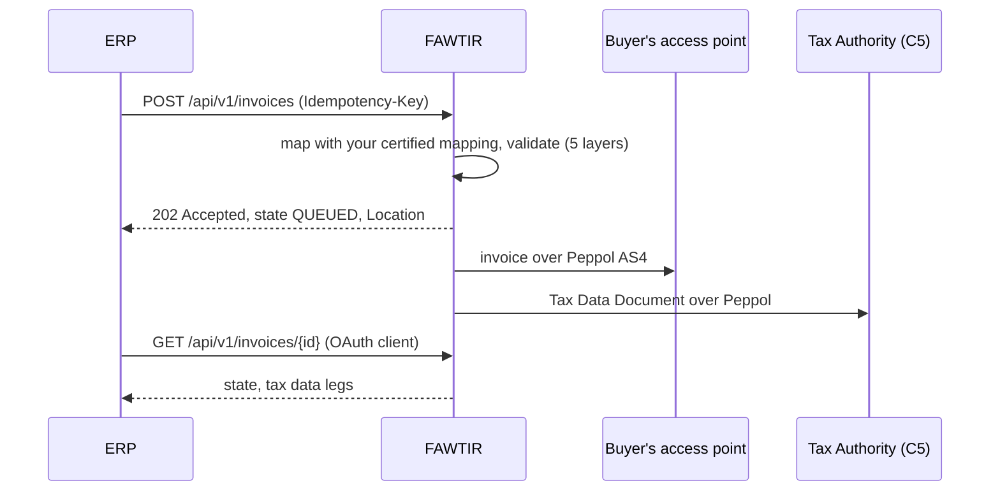
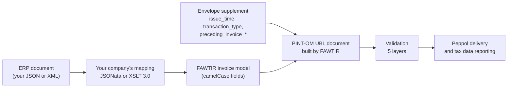

# FAWTIR ERP Developer Guide: API reference and data mapping

## API reference

This page lists every endpoint an ERP integration calls: the four submission routes, Bridge Upload,
the status reads, the ERP reports and the credential endpoints. For each one it gives the
authentication, permission, parameters, body, an example, the answers and the retry rules.

All names, tax numbers, invoice numbers, identifiers and credentials in the examples are
fictitious. `{BASE_URL}` stands for the API host of your environment (see
[Environments](1-getting-started.md#environments)). Every path starts with `/api/v1`.

Credentials, permissions and the authentication errors are explained in
[Authentication](1-getting-started.md#authentication). This page repeats only what you need to make each call.
The full list of error codes is in the [Error reference](3-sync-lifecycle-and-errors.md#error-reference).

### Endpoint inventory

"Who can call it" uses three credential types:

- **API key**: an `X-API-Key: fawt_sk_…` header. It works on the four submission routes only, and only for `POST`.
- **OAuth client**: an `Authorization: Bearer <token>` header with a token from `POST /api/v1/auth/token`.
- **Signed-in user**: a person signed in to FAWTIR (the web app's session, or the user's Bearer token).

| Method | Path | Purpose | Who can call it | Permission |
| --- | --- | --- | --- | --- |
| `POST` | `/api/v1/invoices` | Submit a tax invoice | API key, OAuth client, signed-in user | `invoice.submit` |
| `POST` | `/api/v1/creditnotes` | Submit a credit note | API key, OAuth client, signed-in user | `creditnote.submit` |
| `POST` | `/api/v1/debitnotes` | Submit a debit note | API key, OAuth client, signed-in user | `debitnote.submit` |
| `POST` | `/api/v1/selfbilling` | Submit a self-billed invoice or self-billed credit note | API key, OAuth client, signed-in user | `selfbilling.submit` |
| `POST` | `/api/v1/invoices/bridge` | Bridge Upload of one invoice | Signed-in user only | `invoice.submit` |
| `GET` | `/api/v1/invoices` | List submissions | OAuth client, signed-in user | `invoice.read` |
| `GET` | `/api/v1/invoices/{id}` | One submission and its tax data legs | OAuth client, signed-in user | `invoice.read` |
| `GET` | `/api/v1/invoices/{id}/document` | The PINT-OM XML that was sent | OAuth client, signed-in user | `invoice.read` |
| `GET` | `/api/v1/invoices/{id}/tdd` | The Tax Data Document XML | OAuth client, signed-in user | `invoice.read` |
| `GET` | `/api/v1/invoices/{id}/qr` | The QR code as PNG | OAuth client, signed-in user | `invoice.read` |
| `GET` | `/api/v1/invoices/{id}/pdf` | A PDF rendering | OAuth client, signed-in user | `invoice.read` |
| `GET` | `/api/v1/compliance/activity` | Recipient and tax-data acknowledgements, as a list | OAuth client, signed-in user | `invoice.read` |
| `GET` | `/api/v1/compliance/activity/summary` | Acknowledgement counts for a period | OAuth client, signed-in user | `invoice.read` |
| `GET` | `/api/v1/compliance/activity/{invoiceUuid}` | Acknowledgements for one document | OAuth client, signed-in user | `invoice.read` |
| `GET` | `/api/v1/erp/source-documents` | ERP source documents and what became of them | OAuth client, signed-in user | `invoice.read` |
| `GET` | `/api/v1/erp/source-documents/summary` | Source document counts | OAuth client, signed-in user | `invoice.read` |
| `GET` | `/api/v1/erp/source-documents/reconciliation` | Source documents that need attention | OAuth client, signed-in user | `invoice.read` |
| `GET` | `/api/v1/erp/source-documents/{recordId}` | One source document in detail | OAuth client, signed-in user | `invoice.read` |
| `GET` | `/api/v1/erp/extraction/runs` | Run reports | OAuth client, signed-in user | `invoice.read` |
| `GET` | `/api/v1/erp/extraction/runs/{runId}` | One run report | OAuth client, signed-in user | `invoice.read` |
| `POST` | `/api/v1/auth/token` | Get an OAuth access token | OAuth client (client id and secret in the body) | none |
| `POST` | `/api/v1/auth/refresh` | Exchange an OAuth refresh token | OAuth client (refresh token in the body) | none |
| `POST` | `/api/v1/auth/revoke` | Revoke an OAuth token | OAuth client (client id and secret in the body) | none |
| `POST`, `GET`, `DELETE` | `/api/v1/apikeys…` | Create, list, rotate and revoke API keys | Signed-in user | `admin.settings.manage` |
| `POST`, `DELETE` | `/api/v1/auth/clients…` | Register, rotate and disable OAuth clients | Signed-in user | `admin.settings.manage` |
| `POST`, `GET`, `DELETE` | `/api/v1/webhooks…` | Webhook registration, available on request | Signed-in user | `webhooks.manage` |

> **Note:** Document submission through the API is switched on by FAWTIR for a whole environment,
> not per organisation. While it is off, the four submission routes, Bridge Upload,
> `GET /api/v1/invoices` and `GET /api/v1/invoices/{id}` answer `404`. The document reads
> (`/document`, `/tdd`, `/qr`, `/pdf`), compliance activity and the ERP reports do not depend on
> that switch.

The platform's access rules allow an OAuth client holding `invoice.read` to call the read routes
above. Confirm this set-up with FAWTIR during onboarding.

Not covered in this release of the guide:

- the batch routes `POST /api/v1/invoices/batch` and `POST /api/v1/invoices/batches`. An API key
  cannot reach them. Their rules for other credentials are not documented here yet;
- the invoice authoring routes used by the FAWTIR web app;
- connection, mapping, recovery and other console routes. They are for signed-in people and are
  described in the web app.

#### Common rules

| Rule | Detail |
| --- | --- |
| Content type | Request bodies are JSON: `Content-Type: application/json`. `/api/v1/auth/token` also accepts `application/x-www-form-urlencoded`. |
| Field names | Submission and report bodies use `snake_case`. The credential endpoints use `camelCase`, with the exceptions noted for `/auth/token` and `/auth/revoke`. |
| Unknown fields | A request body with a field the endpoint does not define is refused with `400 malformed-request`. |
| One credential | Send either `X-API-Key` or `Authorization`, never both. Both together answer `400 ambiguous-credentials`. |
| Correlation | You may send `X-Correlation-Id` with a UUID. FAWTIR echoes it, or its own id, in the `X-Correlation-Id` response header. Responses from the API also carry `X-Fawtir-Trace-Id`, and many error bodies carry the same value as `correlationId` (refusals made before your request reaches the API, such as `401`, `413` and `429`, do not). Quote it when you contact support. |
| Errors | Errors are `application/problem+json` with `type`, `title`, `status` and `detail`. Submission refusals add a machine code in `error`, and some also in `code`. See the [Error reference](3-sync-lifecycle-and-errors.md#error-reference). |
| Timestamps | Response timestamps are ISO-8601 instants in UTC, for example `2026-11-10T06:15:04Z`. |
| Limits | Body sizes, rate limits and paging bounds are listed in [Platform limits](3-sync-lifecycle-and-errors.md#platform-limits). |

### Submission routes

The four routes take the same request body and give the same response. They differ in the document
type they accept and the permission they need.



A `202` means FAWTIR validated the document and queued it. It does not mean it was delivered.
Delivery and tax data reporting happen afterwards; read them with the status reads below. The
statuses are explained in [Invoice lifecycle](3-sync-lifecycle-and-errors.md#invoice-lifecycle).

#### Authentication and permission

| Credential | How |
| --- | --- |
| API key | `X-API-Key: fawt_sk_<your-key>`. The key must hold the route's permission. Only a key created with the `ERP_INGESTION` profile may send the `source` block. |
| OAuth client | `Authorization: Bearer <access-token>`. The client must hold the route's permission. It cannot send `source`. |
| Signed-in user | A person with the route's permission and access to all branches. A person limited to some branches is refused with `403`. |

When the request carries `source`, or comes from an `ERP_INGESTION` key, your organisation must also
have ERP integration enabled by FAWTIR. Otherwise the answer is `403 erp-entitlement-required`.

#### Headers

| Header | Required | Value |
| --- | --- | --- |
| `Idempotency-Key` | Yes | 16 to 128 characters from `A-Z a-z 0-9 . _ : -`. One key per document attempt. See [Retry and idempotency](#retry-and-idempotency-for-submissions). |
| `X-API-Key` or `Authorization` | Yes | One of the two, never both. |
| `Content-Type` | Yes | `application/json` |
| `X-Correlation-Id` | No | A UUID of your choice, to trace the request. |

#### Request body

The body is an envelope around your ERP's own document. FAWTIR does not define the invoice JSON:
`document` carries your ERP's export unchanged, and your organisation's certified mapping converts it
to PINT-OM. See [ERP data mapping](#data-mapping).

| Field | Type | Required | Rules |
| --- | --- | --- | --- |
| `format` | string | No | `JSON` (default) or `XML`. `CSV` and `EDIFACT` are refused with `422 SUBMISSION_NOT_SUPPORTED`. FAWTIR uses your mapping for this format. |
| `document` | object or string | Yes | With `JSON`: your ERP's document as a JSON object. With `XML`: the XML text as one JSON string. The XML must be UTF-8; a declaration naming another encoding is refused. |
| `document_kind` | string | No | `STANDARD_INVOICE` (default), `CREDIT_NOTE`, `SELF_BILLING_INVOICE` or `SELF_BILLING_CREDIT_NOTE`. Leave it out except on `/selfbilling` for a self-billed credit note. A value that contradicts the route is refused with `422 SUBMISSION_NOT_SUPPORTED`. |
| `supplement` | object | Yes | Values the mapping does not produce. See below. |
| `supplement.issue_time` | string `HH:mm:ss` | Yes | The invoice issue time (IBT-168), for example `10:15:00`. |
| `supplement.transaction_type` | string | Yes | 20 characters, each `1` or `X` (pattern `^[X1]{20}$`). See below. |
| `supplement.preceding_invoice_number` | string | For corrections | Number of the invoice being corrected (IBT-025). |
| `supplement.preceding_invoice_date` | string `yyyy-MM-dd` | For corrections | Issue date of that invoice (IBT-026). |
| `supplement.preceding_invoice_uuid` | string (UUID) | For corrections | `invoice_uuid` of that invoice (BTOM-031). |
| `supplement.credit_note_reason_code` | string | For corrections | Reason code (BTOM-032) from code list CL-02-OM: `CAN`, `VAT`, `VAL`, `QTY` or `OTH`. |
| `supplement.profit_margin` | boolean | No | `true` for a profit-margin invoice. Absent means `false`. |
| `source` | object | No | Your ERP's identity for the document. Accepted only from an `ERP_INGESTION` API key; from anyone else it is refused with `422 SUBMISSION_NOT_SUPPORTED`. |
| `source.external_document_id` | string | Yes, inside `source` | Your ERP's stable id for the document, at most 200 characters, not blank. Use an id that does not change when the document is corrected. |
| `source.external_version` | string | No | Your ERP's revision of that document, at most 80 characters. Blank counts as absent. Use a new value when the content changes. |
| `receiver_override` | object | No | `scheme` and `value`, both required inside it. It replaces the Peppol receiver FAWTIR would resolve for the document. Leave it out: FAWTIR resolves the receiver itself. |

**Correction references.** On credit notes, debit notes and self-billed credit notes, the three
`preceding_invoice_*` fields and `credit_note_reason_code` are required together (**PINT-OM rule**
IBR-032-OM and IBR-023-OM). If the corrected invoice was submitted through FAWTIR,
`preceding_invoice_uuid` must equal the `invoice_uuid` FAWTIR returned for it (**FAWTIR rule**).
See [Invoice corrections](3-sync-lifecycle-and-errors.md#invoice-corrections).

**Transaction type.** `transaction_type` is the PINT-OM transaction type (BTOM-001), a 20-position
flag string (code list CL-03-OM). Position 1 is a full tax invoice, 2 simplified, 3 self-billed,
4 third party, 5 summary, 6 continuous supply, 7 export, 8 deemed supply, 9 import of services
(reverse charge), 10 profit margin, 11 profit-margin self-invoice, 12 e-commerce, 13 import of
goods, 14 special zone supplies, 15 prepayment; 16 to 20 are reserved. Exactly one of positions 1
and 2 must be set. The published code list writes the flags as `0` and `1`. FAWTIR's API takes `X`
for "not set" and converts it to `0` (**FAWTIR rule**). A full tax invoice with no other flag is
`1XXXXXXXXXXXXXXXXXXX`.

**Server-generated values.** You never send the invoice UUID (BTOM-002), the instance UUID or the
seller UUID. FAWTIR generates them.

#### Response

| Status | When |
| --- | --- |
| `202 Accepted` | FAWTIR validated the document and queued it for Peppol delivery and tax data reporting. |
| `200 OK` | Only with `source`: the same `external_document_id`, `external_version` and content already produced an invoice. Nothing new was submitted, and the body describes the earlier submission (`source.disposition` is `DUPLICATE`). |

Both carry a `Location` header with the submission's URL (`links.self`).

| Field | Type | Meaning |
| --- | --- | --- |
| `id` | string | Submission id, `invc_` followed by 26 characters. Use it for the status reads. |
| `invoice_uuid` | UUID | The invoice UUID (BTOM-002). Corrections reference it. |
| `instance_uuid` | UUID | FAWTIR's reference for this submission instance. It is not the document's `cbc:UUID`, which is `invoice_uuid`. |
| `document_kind` | string | `STANDARD_INVOICE`, `CREDIT_NOTE`, `SELF_BILLING_INVOICE` or `SELF_BILLING_CREDIT_NOTE`. |
| `state` | string | Delivery state. `QUEUED` on a new submission; on a `200` replay, the earlier submission's current state. |
| `warnings` | array of strings | Validation warnings that did not stop the document. |
| `peppol_send.target_participant` | string | The receiver's Peppol participant, `scheme:value`. |
| `peppol_send.status` | string | Always `queued`. It is a receipt value, not a live status. |
| `tdd.status` | string | Always `queued`. It is a receipt value, not a live status. |
| `tdd.sla_deadline` | timestamp | The time by which FAWTIR aims to transmit the Tax Data Document. |
| `links.self`, `links.document`, `links.tdd` | string | Relative URLs of the status reads. |
| `validated_at` | timestamp | When validation passed. |
| `source` | object | Present only when the request had `source`: `external_document_id`, `external_version` (absent when you sent none) and `disposition` (`ACCEPTED` or `DUPLICATE`). |

#### Errors

The answers you will meet most often. Each one is described, with what to do, in the
[Error reference](3-sync-lifecycle-and-errors.md#error-reference).

| Status | Code (`error` or `code`) or `type` | Typical cause |
| --- | --- | --- |
| `400` | `validation-failed` | Missing `Idempotency-Key`, a required field missing or a field breaking its rule (for body fields, the body lists `errors[]`). |
| `400` | `INVALID_IDEMPOTENCY_KEY` | Key shorter than 16, longer than 128, or with other characters. |
| `400` | `MALFORMED_REQUEST` | Body is not valid JSON, or has an unknown field. |
| `400` | `ambiguous-credentials` | Both `X-API-Key` and `Authorization` sent. |
| `401` | `INVALID_API_KEY` / `UNAUTHENTICATED` | Key invalid, expired or revoked; token missing or expired. |
| `403` | `insufficient-permission`, `erp-entitlement-required` | Credential lacks the permission; ERP integration not enabled. |
| `404` | `resource-not-found` | Document submission is not switched on in this environment. |
| `409` | `DUPLICATE_IDEMPOTENCY` | The key was used with a different body, or the same key is still being processed. |
| `409` | `DUPLICATE_INVOICE` | The same invoice, or the same invoice number in the same issue year, was already submitted. When FAWTIR can name it, the body has `existing_submission`. |
| `409` | `SOURCE_IDENTITY_CONFLICT`, `SOURCE_DOCUMENT_IN_PROGRESS`, `SOURCE_DOCUMENT_ALREADY_REFUSED` | Source ledger answers, see [Retry and idempotency](#retry-and-idempotency-for-submissions). |
| `409` | `QUOTA_EXCEEDED`, `subscription-restricted`, `TENANT_NOT_OPERATIONAL`, `SALES_APPROVAL_REQUIRED` | Account state; fix it, then retry. |
| `413` | `payload-too-large` | Body above the size limit for the route. |
| `422` | `VALIDATION_FAILED` | The document failed PINT-OM validation. `layer_results[]` lists the findings. |
| `422` | `MAPPING_FAILED` | Your mapping could not convert the document, or no active mapping exists for the `format`. |
| `422` | `SUBMISSION_NOT_SUPPORTED` | For example: the active mapping is not certified for this format and transaction type, missing correction references, `document_kind` contradicts the route, `source` from a credential that may not send it. |
| `429` | `rate-limited`, `api-key-rate-limited` | Rate limit reached; wait for `Retry-After`. |
| `503` | `MAPPING_CAPACITY_UNAVAILABLE`, `VALIDATION_UNAVAILABLE`, `EMISSION_BLOCKED`, `OUTBOUND_TRANSPORT_UNAVAILABLE` | Temporary; retry the same request with the same key. |

A refused submission creates no invoice and uses no quota. Submission refusals carry
`quota_charged: false` where it applies. With a `source` block, the refusal is still recorded
against the source identity (see the source ledger below).

Example `422` body (shortened):

```json
{
  "type": "https://api.fawtir.om/problems/validation-failed",
  "title": "Invoice validation failed",
  "status": 422,
  "detail": "The invoice failed the five-layer validation pipeline at layer L5_PINT_OM. Correct the findings and resubmit.",
  "instance": "/api/v1/invoices",
  "timestamp": "2026-11-10T06:15:04Z",
  "trace_id": "5f0c9e1a-6d2b-4c7e-9a31-2b8d4e6f0a17",
  "correlationId": "5f0c9e1a-6d2b-4c7e-9a31-2b8d4e6f0a17",
  "error": "VALIDATION_FAILED",
  "layer_results": [
    { "layer": 1, "layer_name": "L1_XSD", "status": "pass" },
    { "layer": 2, "layer_name": "L2_ARITHMETIC", "status": "pass" },
    { "layer": 3, "layer_name": "L3_CODE_LISTS", "status": "pass" },
    { "layer": 4, "layer_name": "L4_EN16931_BIS", "status": "pass" },
    {
      "layer": 5, "layer_name": "L5_PINT_OM", "status": "fail",
      "issues": [
        { "rule": "IBR-079-OM", "field_id": "…", "xpath": "…", "message": "…", "severity": "ERROR" }
      ]
    }
  ],
  "quota_charged": false
}
```

#### Retry and idempotency for submissions

Two separate protections stop one document becoming two invoices.

**1. `Idempotency-Key` (24 hours, every caller).**

- FAWTIR keeps the response of a successful request for 24 hours, per organisation, route and
  document kind. The same key on `/invoices` and on `/creditnotes` counts as two different keys.
  Bridge Upload has its own namespace.
- Same key and same body within 24 hours: you get the stored response again. No second document is
  submitted.
- Same key and a different body: `409 DUPLICATE_IDEMPOTENCY`. Use a new key.
- Same key while the first request is still being processed: also `409 DUPLICATE_IDEMPOTENCY`,
  with a `detail` saying the operation is already in progress. Wait and retry with the same key.
  The two cases differ only in `detail`.
- A refused request (any `4xx` or `5xx`) stores nothing under the key. After fixing the cause you
  may reuse the same key. With a `source` block, a refusal caused by the document itself is final
  for that `external_version`: send the corrected document under a new `external_version`.

**2. Source ledger (no time limit, `ERP_INGESTION` API key with `source`).**

| You send | Answer |
| --- | --- |
| A new `external_document_id` and `external_version` | `202`, `source.disposition: "ACCEPTED"` |
| The same id, version and content again | `200`, `source.disposition: "DUPLICATE"`, describing the earlier submission |
| The same id and version with different content | `409 SOURCE_IDENTITY_CONFLICT`. Send the corrected content with a new `external_version`. |
| An id and version another request is processing | `409 SOURCE_DOCUMENT_IN_PROGRESS`. Retry later with the same request. |
| The same id, version and content that was refused before | `409 SOURCE_DOCUMENT_ALREADY_REFUSED` with `earlier_outcome`. Fix the document and send a new `external_version`. |

The ledger identity belongs to your organisation, not to the key: it survives key rotation. "Same
content" covers the route, document kind, format, the `supplement` values and the document itself.
Key order inside `document` counts; whitespace does not.

**Recommendation:** after a network timeout with an unknown outcome, send exactly the same request
with the same `Idempotency-Key`. With an `ERP_INGESTION` key, also send `source`, so that a retry
after the 24-hour window still cannot create a second invoice.

> **Warning:** Do not resend a document only because no recipient response arrived. Do not resend
> after `DUPLICATE_INVOICE`: the document already exists. See
> [Invoice synchronization](3-sync-lifecycle-and-errors.md#invoice-synchronization).

#### POST /api/v1/invoices

Submits a tax invoice. FAWTIR emits a UBL `Invoice`. The mapping must produce an invoice type code
that is not a credit note, debit note or self-billing code (381, 383, 261 and 389 are refused here).

**Permission:** `invoice.submit`.

```bash
curl -X POST "{BASE_URL}/api/v1/invoices" \
  -H "X-API-Key: fawt_sk_<your-key>" \
  -H "Idempotency-Key: waha-inv-000145-v1-7f3c9a2e" \
  -H "Content-Type: application/json" \
  --data @invoice-INV-2026-000145.json
```

`invoice-INV-2026-000145.json`. The `document` is shaped like the Odoo 17 example export that
FAWTIR's example mapping reads:

```json
{
  "format": "JSON",
  "supplement": {
    "issue_time": "10:15:00",
    "transaction_type": "1XXXXXXXXXXXXXXXXXXX"
  },
  "source": {
    "external_document_id": "ERP-INV-000145",
    "external_version": "1"
  },
  "document": {
    "name": "INV-2026-000145",
    "move_type": "out_invoice",
    "invoice_date": "2026-11-10",
    "invoice_date_due": "2026-12-10",
    "currency_id": [12, "OMR"],
    "ref": "PO-2026-0381",
    "amount_untaxed": 225.000,
    "amount_tax": 11.250,
    "amount_total": 236.250,
    "company_data": {
      "name": "Al Waha Trading",
      "legal_name": "Al Waha Trading LLC",
      "vat": "OM1999000101",
      "company_registry": "1234567",
      "street": "Al Khuwair",
      "street2": "PO Box 123",
      "city": "Muscat",
      "zip": "133",
      "country_code": "OM",
      "phone": "+96800000000",
      "email": "billing@alwaha.example"
    },
    "partner_data": {
      "name": "Sahil Engineering",
      "legal_name": "Sahil Engineering SAOC",
      "vat": "OM1999000202",
      "street": "Sohar Industrial Area",
      "street2": "Building 7",
      "city": "Sohar",
      "zip": "311",
      "country_code": "OM"
    },
    "invoice_line_ids": [
      {
        "sequence": 1,
        "name": "Steel pipe 2 inch",
        "product_id": [101, "Steel pipe 2 inch"],
        "default_code": "SP-2IN",
        "quantity": 10,
        "x_unece_unit_code": "H87",
        "price_unit": 12.500,
        "price_subtotal": 125.000,
        "x_btom_goods_or_service": "G",
        "x_btom_hs_code": "730630000002",
        "x_btom_industrial_classification": "466203",
        "x_btom_service_type": "00000000",
        "tax_ids": [{ "name": "VAT 5%", "amount": 5.0, "tax_group": "S" }]
      },
      {
        "sequence": 2,
        "name": "Installation service",
        "product_id": [205, "Installation service"],
        "default_code": "SV-INST",
        "quantity": 4,
        "x_unece_unit_code": "HUR",
        "price_unit": 25.000,
        "price_subtotal": 100.000,
        "x_btom_goods_or_service": "S",
        "x_btom_industrial_classification": "432205",
        "x_btom_service_type": "72000000",
        "tax_ids": [{ "name": "VAT 5%", "amount": 5.0, "tax_group": "S" }]
      }
    ]
  }
}
```

> **Note:** `x_unece_unit_code` and `x_btom_hs_code` are not read by the published Odoo 17 example
> mapping: that mapping fixes every line's unit to `H87` and maps no HS code. A mapping for this
> document must map both. Provide a 12-digit HS code from the Oman HS list on every goods line
> (IBR-079-OM, with the IBR-174-OM caveat), and a service type code on every line that carries a
> goods or services code (the goods line above uses `00000000`). The rules, and the refusals when
> either is missing or wrong, are in
> [ERP data mapping](#hs-codes-and-goods-or-service-classification).

Answer:

```http
HTTP/1.1 202 Accepted
Location: /api/v1/invoices/invc_01JCQ7Z8K4M2N6P9R3T5V7X9YB
Content-Type: application/json
```

```json
{
  "id": "invc_01JCQ7Z8K4M2N6P9R3T5V7X9YB",
  "invoice_uuid": "3f6d2a9e-8c41-5b7e-9a12-6c0e4f8b2d17",
  "instance_uuid": "a9c41e07-2b5d-4f63-8e1a-7d3b9c0f5e24",
  "document_kind": "STANDARD_INVOICE",
  "state": "QUEUED",
  "warnings": [],
  "peppol_send": { "target_participant": "0248:OM1999000202", "status": "queued" },
  "tdd": { "status": "queued", "sla_deadline": "2026-11-10T06:30:04Z" },
  "links": {
    "self": "/api/v1/invoices/invc_01JCQ7Z8K4M2N6P9R3T5V7X9YB",
    "document": "/api/v1/invoices/invc_01JCQ7Z8K4M2N6P9R3T5V7X9YB/document",
    "tdd": "/api/v1/invoices/invc_01JCQ7Z8K4M2N6P9R3T5V7X9YB/tdd"
  },
  "validated_at": "2026-11-10T06:15:04Z",
  "source": {
    "external_document_id": "ERP-INV-000145",
    "external_version": "1",
    "disposition": "ACCEPTED"
  }
}
```

With an OAuth client instead of an API key, replace the `X-API-Key` header with
`-H "Authorization: Bearer <access-token>"` and remove the `source` block.

#### POST /api/v1/creditnotes

Submits a credit note. FAWTIR emits a UBL `CreditNote`. The mapping must produce type code 381.
The four correction references in `supplement` are required.

**Permission:** `creditnote.submit`.

```bash
curl -X POST "{BASE_URL}/api/v1/creditnotes" \
  -H "X-API-Key: fawt_sk_<your-key>" \
  -H "Idempotency-Key: waha-cn-000012-v1-4b8e1d07" \
  -H "Content-Type: application/json" \
  --data @creditnote-CN-2026-000012.json
```

The example credits two returned pipes from INV-2026-000145: 2 × 12.500 = 25.000 net, VAT 1.250,
total 26.250. The `document` follows the same Odoo shape, with `move_type` `out_refund` (which the
example mapping turns into type code 381). Parts identical to the invoice are shortened.

```json
{
  "format": "JSON",
  "supplement": {
    "issue_time": "09:30:00",
    "transaction_type": "1XXXXXXXXXXXXXXXXXXX",
    "preceding_invoice_number": "INV-2026-000145",
    "preceding_invoice_date": "2026-11-10",
    "preceding_invoice_uuid": "3f6d2a9e-8c41-5b7e-9a12-6c0e4f8b2d17",
    "credit_note_reason_code": "CAN"
  },
  "source": {
    "external_document_id": "ERP-CN-000012",
    "external_version": "1"
  },
  "document": {
    "name": "CN-2026-000012",
    "move_type": "out_refund",
    "invoice_date": "2026-11-20",
    "currency_id": [12, "OMR"],
    "amount_untaxed": 25.000,
    "amount_tax": 1.250,
    "amount_total": 26.250,
    "company_data": { "...": "as in the invoice" },
    "partner_data": { "...": "as in the invoice" },
    "invoice_line_ids": [
      {
        "sequence": 1,
        "name": "Steel pipe 2 inch, returned",
        "product_id": [101, "Steel pipe 2 inch"],
        "quantity": 2,
        "x_unece_unit_code": "H87",
        "price_unit": 12.500,
        "price_subtotal": 25.000,
        "x_btom_goods_or_service": "G",
        "x_btom_hs_code": "730630000002",
        "x_btom_industrial_classification": "466203",
        "x_btom_service_type": "00000000",
        "tax_ids": [{ "name": "VAT 5%", "amount": 5.0, "tax_group": "S" }]
      }
    ]
  }
}
```

The answer has the same shape as for an invoice, with `"document_kind": "CREDIT_NOTE"`.

> **Warning:** For a credit note against an invoice your ERP issued, FAWTIR does not check the
> credited amount against the original invoice, and does not cap several credit notes against one
> invoice (**FAWTIR rule**). Your ERP is responsible for that. If the referenced invoice was created in
> FAWTIR's own invoicing, the API refuses the note with `422
> CORRECTION_ORIGINAL_AUTHORED_USE_CORRECTION_ROUTE`; correct it in FAWTIR instead. See
> [Invoice corrections](3-sync-lifecycle-and-errors.md#invoice-corrections).

#### POST /api/v1/debitnotes

Submits a debit note. A debit note is not a separate PINT-OM document: FAWTIR emits a UBL `Invoice`
whose type code is 383. The mapping must produce 383, and the four correction references in
`supplement` are required.

**Permission:** `debitnote.submit`.

```bash
curl -X POST "{BASE_URL}/api/v1/debitnotes" \
  -H "X-API-Key: fawt_sk_<your-key>" \
  -H "Idempotency-Key: waha-dn-000003-v1-9c2a6f51" \
  -H "Content-Type: application/json" \
  --data @debitnote.json
```

The body has the same shape as the credit note example, with the supplement referencing
INV-2026-000145 and a reason code such as `VAL`. The published Odoo 17 example mapping handles only
`out_invoice` and `out_refund`; a mapping for debit notes must emit type code 383 for them. The answer
has `"document_kind": "STANDARD_INVOICE"`.

#### POST /api/v1/selfbilling

Submits a self-billed document: one a buyer issues on the supplier's behalf. By default the route
submits a self-billed invoice (type code 389). Send `"document_kind": "SELF_BILLING_CREDIT_NOTE"` to
submit a self-billed credit note (type code 261), which needs the four correction references.

**Permission:** `selfbilling.submit`.

```bash
curl -X POST "{BASE_URL}/api/v1/selfbilling" \
  -H "X-API-Key: fawt_sk_<your-key>" \
  -H "Idempotency-Key: waha-sb-000021-v1-2e7d8a3c" \
  -H "Content-Type: application/json" \
  --data @selfbilling.json
```

```json
{
  "format": "JSON",
  "document_kind": "SELF_BILLING_INVOICE",
  "supplement": {
    "issue_time": "11:00:00",
    "transaction_type": "1X1XXXXXXXXXXXXXXXXX"
  },
  "document": { "...": "your ERP's self-billed invoice export" }
}
```

Notes:

- Position 3 of `transaction_type` marks a self-billed invoice.
- FAWTIR refuses some combinations before validation (**FAWTIR rule**): self-billed with simplified
  (position 2), self-billed with import (positions 9 or 13), self-billed with profit margin
  (position 10), and the profit-margin self-invoice (position 11).
- A self-billing agreement must be recorded in FAWTIR for the supplier. Without it the document is
  refused.
- The answer's `document_kind` is `SELF_BILLING_INVOICE` or `SELF_BILLING_CREDIT_NOTE`.

### Bridge Upload

#### POST /api/v1/invoices/bridge

Uploads one invoice that your ERP exported, as a signed-in person. The web app's
**Settings → ERP integration → Bridge upload** page calls this route. It is not for machines: an API
key cannot reach it, and an OAuth client is refused.

| Item | Detail |
| --- | --- |
| Authentication | Signed-in user only. API keys and OAuth clients are refused. |
| Permission | `invoice.submit`, with access to all branches. |
| Also required | ERP integration enabled for your organisation, and a certified mapping for the format. |
| Headers | `Idempotency-Key` (same rules as the submission routes, its own namespace), `Content-Type: application/json`. |
| Body | The submission body above. `source` is **required**; without it the answer is `400`. |
| Documents | Tax invoices only, one per request. `format` `JSON` or `XML`. |
| Size | At most 4 MiB per request. |

Example body (XML carried as a string):

```json
{
  "format": "XML",
  "document": "<?xml version=\"1.0\" encoding=\"UTF-8\"?><SalesInvoice>…</SalesInvoice>",
  "supplement": {
    "issue_time": "10:15:00",
    "transaction_type": "1XXXXXXXXXXXXXXXXXXX"
  },
  "source": {
    "external_document_id": "ERP-INV-000145",
    "external_version": "1"
  }
}
```

The answers are those of the submission routes: `202` with `source.disposition: "ACCEPTED"`, `200`
with `"DUPLICATE"`, and the three source ledger conflicts. Bridge Upload and API Push keep separate
source ledgers, so the same `external_document_id` pushed through the API and uploaded through
Bridge Upload counts as two documents.

### Status reads

These routes need a Bearer token: a signed-in user, or an OAuth client holding `invoice.read`. An
API key cannot read anything; on these paths it is answered with `401 UNAUTHENTICATED`.

**Polling is the primary way to learn an outcome.**

**Recommendation:** poll with an OAuth client that holds only `invoice.read`. The platform allows
this; confirm the set-up with FAWTIR during onboarding.

A submission belongs to your organisation. Another organisation's id, or an id that does not exist,
answers `404 resource-not-found`.

#### GET /api/v1/invoices

Lists your submissions, newest first by arrival.

**Permission:** `invoice.read`. A signed-in user limited to some branches sees no API submissions.

| Query parameter | Type | Rules |
| --- | --- | --- |
| `state` | string | One of `QUEUED`, `SENDING`, `SENT`, `DELIVERED`, `DELIVERED_UNCONFIRMED`, `UNDELIVERABLE`, `C4_UNREACHABLE`. Upper case, exact. |
| `document_kind` | string | `STANDARD_INVOICE`, `CREDIT_NOTE`, `SELF_BILLING_INVOICE` or `SELF_BILLING_CREDIT_NOTE`. Upper case, exact. |
| `invoice_number` | string | Not blank. |
| `receiver` | string | Participant id `scheme:value`, for example `0248:OM1999000202`. |
| `received_from` | instant or date | ISO-8601 instant (`2026-11-01T00:00:00Z`) or date (`2026-11-01`, read as the start of that UTC day). |
| `received_to` | instant or date | As above. A date includes that whole UTC day. Must not be before `received_from`. |
| `page` | integer | 0 to 500. Default 0. |
| `page_size` | integer | 1 to 100. Default 20. |

An unknown value or an out-of-range page is a `400 validation-failed` naming the allowed values. It
is never clamped. To reach submissions older than page 500, narrow `received_from` and `received_to`.

```bash
curl "{BASE_URL}/api/v1/invoices?invoice_number=INV-2026-000145&received_from=2026-11-01&received_to=2026-11-30" \
  -H "Authorization: Bearer <access-token>"
```

```json
{
  "items": [
    {
      "id": "invc_01JCQ7Z8K4M2N6P9R3T5V7X9YB",
      "invoice_uuid": "3f6d2a9e-8c41-5b7e-9a12-6c0e4f8b2d17",
      "invoice_number": "INV-2026-000145",
      "document_kind": "STANDARD_INVOICE",
      "state": "SENT",
      "b2c": false,
      "receiver": "0248:OM1999000202",
      "received_at": "2026-11-10T06:15:03Z",
      "validated_at": "2026-11-10T06:15:04Z",
      "sending_at": "2026-11-10T06:15:09Z",
      "sent_at": "2026-11-10T06:15:12Z",
      "delivered_at": null,
      "failure_reason": null,
      "links": { "self": "/api/v1/invoices/invc_01JCQ7Z8K4M2N6P9R3T5V7X9YB" }
    }
  ],
  "page": 0,
  "page_size": 20,
  "has_more": false
}
```

There is no total count. Read the next page while `has_more` is `true`.

#### GET /api/v1/invoices/{id}

Returns one submission with its tax data (TDD) legs. `{id}` is the `id` from the submission answer.

**Permission:** `invoice.read`.

```bash
curl "{BASE_URL}/api/v1/invoices/invc_01JCQ7Z8K4M2N6P9R3T5V7X9YB" \
  -H "Authorization: Bearer <access-token>"
```

```json
{
  "id": "invc_01JCQ7Z8K4M2N6P9R3T5V7X9YB",
  "invoice_uuid": "3f6d2a9e-8c41-5b7e-9a12-6c0e4f8b2d17",
  "instance_uuid": "a9c41e07-2b5d-4f63-8e1a-7d3b9c0f5e24",
  "invoice_number": "INV-2026-000145",
  "document_kind": "STANDARD_INVOICE",
  "state": "SENT",
  "b2c": false,
  "receiver": "0248:OM1999000202",
  "warnings": [],
  "received_at": "2026-11-10T06:15:03Z",
  "validated_at": "2026-11-10T06:15:04Z",
  "sending_at": "2026-11-10T06:15:09Z",
  "sent_at": "2026-11-10T06:15:12Z",
  "delivered_at": null,
  "failure_reason": null,
  "tdd": [
    {
      "variant": "SUBMIT",
      "status": "SUBMITTED",
      "sla_deadline": "2026-11-10T06:30:04Z",
      "submitted_at": "2026-11-10T06:16:40Z",
      "failure_reason": null
    }
  ],
  "links": {
    "self": "/api/v1/invoices/invc_01JCQ7Z8K4M2N6P9R3T5V7X9YB",
    "document": "/api/v1/invoices/invc_01JCQ7Z8K4M2N6P9R3T5V7X9YB/document",
    "tdd": "/api/v1/invoices/invc_01JCQ7Z8K4M2N6P9R3T5V7X9YB/tdd"
  }
}
```

| Field | Meaning |
| --- | --- |
| `state` | Peppol delivery state: `QUEUED`, `SENDING`, `SENT`, `DELIVERED`, `DELIVERED_UNCONFIRMED`, `UNDELIVERABLE` or `C4_UNREACHABLE`. |
| `tdd[]` | One entry per tax data leg. `variant` is `SUBMIT`, `RESUBMIT` or `DISREGARD`. The array is empty until the leg is recorded. |
| `tdd[].status` | `PENDING`, `SUBMITTED`, `GENERATION_FAILED`, `ACCEPTED`, `DELIVERED_UNCONFIRMED`, `REJECTED`, `TO_DISREGARD`, `DISREGARD_SUBMITTED`, `DEAD_LETTERED` or `NOT_TESTED`. |

The recipient's response code (MLS) is not in this body; it is in
[compliance activity](#get-apiv1complianceactivity). What each value means, and which are final, is
in [Invoice lifecycle](3-sync-lifecycle-and-errors.md#invoice-lifecycle).

> **Warning:** A TDD status of `ACCEPTED` means the Tax Authority's corner (C5) sent a positive
> Peppol response for the message. It is not a tax verdict. FAWTIR has no direct OTA API and
> receives no OTA decision.

**Recommendation:** poll `GET /api/v1/invoices/{id}` with increasing intervals, for example
1, 5 and 15 minutes, then hourly. Stop polling delivery once `state` is `DELIVERED`,
`DELIVERED_UNCONFIRMED`, `UNDELIVERABLE` or `C4_UNREACHABLE`. Use the list route with
`received_from` and `received_to` to catch up after an outage instead of polling every id.

#### GET /api/v1/invoices/{id}/document, /tdd, /qr, /pdf

Return a rendition of one submission. **Permission:** `invoice.read`. All four answer `200` with
`Content-Disposition: inline` and `Cache-Control: private, no-store`, and `404` when the
submission does not exist.

| Path | `Content-Type` | Content | `404` also when |
| --- | --- | --- | --- |
| `/api/v1/invoices/{id}/document` | `application/xml` | The PINT-OM XML FAWTIR generated and sent. This is the authoritative rendition. | n/a |
| `/api/v1/invoices/{id}/tdd` | `application/xml` | The Tax Data Document as sent towards the Tax Authority. | The TDD is still being generated or transported. |
| `/api/v1/invoices/{id}/qr` | `image/png` | The QR code. | The document carries no QR code. Only simplified invoices, profit-margin invoices and invoices to a buyer not registered for VAT carry one. |
| `/api/v1/invoices/{id}/pdf` | `application/pdf` | A plain A4 rendering, with the QR code when the document has one. | n/a |

The file name in `Content-Disposition` is the invoice number followed by the rendition's suffix
(`.xml`, `-tdd.xml`, `-qr.png`, `.pdf`).

```bash
curl -o INV-2026-000145.xml \
  "{BASE_URL}/api/v1/invoices/invc_01JCQ7Z8K4M2N6P9R3T5V7X9YB/document" \
  -H "Authorization: Bearer <access-token>"
```

#### GET /api/v1/compliance/activity

Lists the acknowledgements for your documents: the recipient's response on the invoice leg, and the
response from the Tax Authority's corner on the tax data leg. It shows documents you issued and
documents you received.

**Permission:** `invoice.read`, with access to all branches.

| Query parameter | Type | Rules |
| --- | --- | --- |
| `direction` | string | `ISSUED` or `RECEIVED`. |
| `attention` | boolean | `true` or `false`. |
| `invoice_ack` | string | Recipient response: `AP`, `AB`, `RE` or `NONE` (no response yet). |
| `tdd_ack` | string | Tax data response: `AP`, `AB`, `RE` or `NONE`. |
| `tdd_status` | string | A TDD status, as listed for `GET /api/v1/invoices/{id}`. |
| `tdd_state` | string | `NEVER_SUBMITTED`, `AWAITING_RESPONSE`, `AUTHORITY_REJECTED`, `INTERNALLY_STOPPED` or `ANSWERED`. |
| `document_kind` | string | As for `GET /api/v1/invoices`. |
| `invoice_number` | string | Not blank. |
| `from`, `to` | instant or date | ISO-8601 instant or date (UTC day; `to` as a date includes the day). |
| `page` | integer | 0 to 500. Default 0. |
| `page_size` | integer | 1 to 100. Default 20. |

Values are case-insensitive. An unknown value is a `400`.

```bash
curl "{BASE_URL}/api/v1/compliance/activity?direction=ISSUED&invoice_number=INV-2026-000145" \
  -H "Authorization: Bearer <access-token>"
```

The answer has `items`, `page`, `page_size` and `has_more`. Each item has `invoice_uuid`,
`direction`, `document_kind`, `document_type_code`, `invoice_number`, `counterparty`, `occurred_at`,
`validated_at`, `b2c`, `transport_state`, `invoice_leg`, `tdd_leg`, `attention` and `links`.

- `invoice_leg`: `ack`, `ack_at`, `reason`, `transport_state`, `delivered_at`.
- `tdd_leg`: `variant`, `status`, `validated_at`, `sla_deadline`, `submitted_at`, `sla_met`, `ack`,
  `ack_at`, `reason`, `delivered_at`, `transport_state`, `correction_held`, `report_state`.
- `links`: `document`, `tdd_xml`, `resubmit`.

`NONE` means no response has arrived. It is not a refusal.

#### GET /api/v1/compliance/activity/summary

Counts acknowledgements in a period. **Permission:** `invoice.read`, with access to all branches.

| Query parameter | Rules |
| --- | --- |
| `from`, `to` | Both required. `from` must be before `to`. The window may not exceed 366 days. |

The answer has `from`, `to`, `documents`, `tdd_ack` and `invoice_ack` (each `{ap, ab, re, none}`),
`dead_lettered`, `attention`, `sla` (`{met, missed, pending}`), `median_minutes_to_tdd_ack` and
`tdd_state` (`{never_submitted, awaiting_response, authority_rejected, internally_stopped}`).

#### GET /api/v1/compliance/activity/{invoiceUuid}

Returns every acknowledgement and transmission for one document. `{invoiceUuid}` is the
`invoice_uuid` from the submission answer; another value is a `400`. **Permission:** `invoice.read`,
with access to all branches.

The answer has `invoice_uuid`, `summary` (one list item), `tdd_lineage[]`, `mls[]` and
`transmissions[]`. Each `mls[]` entry has `channel`, `ack`, `received_at`, `sender`,
`sbdh_instance_identifier` and `reason`.

```bash
curl "{BASE_URL}/api/v1/compliance/activity/3f6d2a9e-8c41-5b7e-9a12-6c0e4f8b2d17" \
  -H "Authorization: Bearer <access-token>"
```

### ERP reports

The ERP reports show source documents: documents that arrived with an ERP identity (API Push with
`source`, Bridge Upload, Managed Pull). A push without `source` is not in these reports; read it
with `GET /api/v1/invoices`.

**Permission:** `invoice.read`, with access to all branches. An API key cannot read them, including
the `ERP_INGESTION` key that pushed the documents.

Common rules for the four `source-documents` routes and the two run routes:

| Rule | Detail |
| --- | --- |
| Enum values | Case-insensitive. An unknown value is a `400` listing the allowed values. |
| Dates | `from` and `to` take an ISO-8601 instant or a date (UTC day; `to` as a date includes the day). `from` must not be after `to`. |
| Window | Where `from` and `to` are required, the window may not exceed 367 days. |
| Paging | `page` 0 to 500 (default 0), `page_size` 1 to 100 (default 20). Answers carry `page`, `page_size` and `has_more`. |
| Timeout | A report that takes too long answers `503 ERP_REPORT_TIMEOUT`. Retry with a narrower window. |

#### GET /api/v1/erp/source-documents

| Query parameter | Rules |
| --- | --- |
| `from`, `to` | Required unless `run_id` is given. Filter on when FAWTIR received the document. |
| `source_kind` | `API_PUSH`, `BRIDGE_UPLOAD` or `MANAGED_PULL`. |
| `run_id`, `connection_id` | UUIDs. |
| `external_document_id`, `invoice_number` | Not blank. |
| `processing_state` | `DISCOVERED`, `CLAIMED`, `ACCEPTED`, `REJECTED`, `DUPLICATE` or `FAILED`. |
| `reason_code` | A reason code, see [Error reference](3-sync-lifecycle-and-errors.md#error-reference). |
| `retryable` | `true` or `false`. |
| `delivery_state` | A delivery state, as for `GET /api/v1/invoices`. |
| `sort` | `RECEIVED_NEWEST` (default) or `RECEIVED_OLDEST`. |
| `page`, `page_size` | See common rules. |

```bash
curl "{BASE_URL}/api/v1/erp/source-documents?source_kind=API_PUSH&external_document_id=ERP-INV-000145&from=2026-11-01&to=2026-11-30" \
  -H "Authorization: Bearer <access-token>"
```

```json
{
  "items": [
    {
      "record_id": "6e2b9f40-1c7a-4d35-8b0e-9f3a2c5d7e18",
      "source_kind": "API_PUSH",
      "connection_id": null,
      "run_id": "0c9d8e7f-6a5b-4c3d-9e2f-1a0b9c8d7e6f",
      "external_document_id": "ERP-INV-000145",
      "external_version": "1",
      "processing_state": "ACCEPTED",
      "reason_code": null,
      "stage": null,
      "failure_class": null,
      "retryable": false,
      "attempt_count": 1,
      "invoice": {
        "submission_id": "invc_01JCQ7Z8K4M2N6P9R3T5V7X9YB",
        "invoice_uuid": "3f6d2a9e-8c41-5b7e-9a12-6c0e4f8b2d17",
        "invoice_number": "INV-2026-000145",
        "missing": false
      },
      "delivery_state": "SENT",
      "display_status": "SENT",
      "received_at": "2026-11-10T06:15:03Z",
      "settled_at": "2026-11-10T06:15:04Z",
      "updated_at": "2026-11-10T06:15:12Z"
    }
  ],
  "page": 0,
  "page_size": 20,
  "has_more": false
}
```

`display_status` is one of `REJECTED`, `DUPLICATE`, `WAITING_FOR_MAPPING`, `RETRYABLE_FAILURE`,
`PROCESSING`, `ACCEPTED`, `SUBMITTED`, `SENT`, `DELIVERED_UNCONFIRMED`, `DELIVERED`, `OFF_NETWORK`
or `DELIVERY_FAILED`.

#### GET /api/v1/erp/source-documents/summary

Counts source documents. Query parameters: `from` and `to` (both required, at most 367 days apart),
`source_kind`, `connection_id`.

The answer has `received`, `accepted`, `rejected`, `duplicate`, `waiting_for_mapping`, `retryable`,
`processing`, `downstream` (delivery counts: `queued`, `sending`, `sent`, `delivered`,
`delivered_unconfirmed`, `undeliverable`, `c4_unreachable`, `without_invoice`, `total`,
`delivery_failed`, `off_network`) and `events` (`replays`, `conflicts`, `completeness`).

#### GET /api/v1/erp/source-documents/reconciliation

Lists source documents that need attention, oldest received first. Nothing is stored: a document
leaves the list as soon as its state moves on.

| Query parameter | Rules |
| --- | --- |
| `from`, `to` | Both required, at most 367 days apart. |
| `label` | `RECOVERY_PENDING`, `WAITING_FOR_MAPPING`, `RETRYABLE_FAILURE`, `ATTEMPTS_EXHAUSTED`, `ACCEPTED_WITHOUT_INVOICE`, `TRANSPORT_PENDING`, `RESPONSE_PENDING`, `DELIVERY_FAILED` or `TAX_REPORT_ATTENTION`. |
| `source_kind`, `connection_id` | As above. |
| `page`, `page_size` | See common rules. |

Each item has `record_id`, `source_kind`, `connection_id`, `run_id`, `external_document_id`,
`processing_state`, `reason_code`, `display_status`, `invoice`, `delivery_route`, `delivery_state`,
`tax_report_status`, `recipient_response_code`, `findings[]` (`label`, `since`), `received_at` and
`updated_at`. The answer also has `unevaluated_labels`. What each label means and what to do is in
[Invoice synchronization](3-sync-lifecycle-and-errors.md#invoice-synchronization).

#### GET /api/v1/erp/source-documents/{recordId}

Returns one source document in detail. `{recordId}` is a UUID.

The answer has `document` (one list item), `max_attempts`, `delivery` (`route`, `state`,
`failure_reason`, `received_at`, `validated_at`, `sent_at`, `delivered_at`), `tax_report`
(`variant`, `status`, `validated_at`, `sla_deadline`, `submitted_at`, `sla_met`, `obligations`),
`recipient_response` (`applicable`, `code`, `received_at`, `responses`), `timeline` (`items[]`,
`truncated`) and `validation_findings` (`items[]` of `layer`, `rule_id`, `field_path`,
`explanation`, and `truncated`).

#### GET /api/v1/erp/extraction/runs and /api/v1/erp/extraction/runs/{runId}

Run reports. A run is one Managed Pull collection cycle. Each API Push submission with `source` and each
Bridge Upload is also recorded as a run of one document.

| Query parameter | Rules |
| --- | --- |
| `source_kind` | As above. |
| `connection_id` | UUID. |
| `state` | `CREATED`, `RUNNING`, `COMPLETED`, `COMPLETED_WITH_ERRORS`, `FAILED` or `CANCELLED`. |
| `from`, `to` | Optional. Filter on when the run was created. |
| `page`, `page_size` | See common rules. |

Each run has `run_id`, `source_kind`, `connection_id`, `state`, `created_by`, `created_at`,
`started_at`, `completed_at`, `failure_reason` and `counters` (`discovered`, `accepted`, `rejected`,
`duplicate`, `unsettled`). The detail route answers `run` (one run, as above) and `downstream`,
the delivery counts listed for the summary.

```bash
curl "{BASE_URL}/api/v1/erp/extraction/runs?source_kind=MANAGED_PULL&state=COMPLETED_WITH_ERRORS" \
  -H "Authorization: Bearer <access-token>"
```

### Credential endpoints

The concepts (profiles, scopes, expiry, rotation) are in [Authentication](1-getting-started.md#authentication).
Creating an API key or an OAuth client is reserved for a signed-in person; a machine credential is
refused with `403 human-principal-required`. Rotating or revoking an API key, ending a rotation,
rotating an OAuth client secret and disabling a client also need a signed-in person: a machine
credential is refused with `401` and nothing is changed. **Recommendation:** manage credentials from the web app
or as a signed-in person, and give machines only the credential they use.

#### POST /api/v1/auth/token

Exchanges an OAuth client's id and secret for an access token (client credentials grant). No
`Authorization` header.

| Field | Required | Rules |
| --- | --- | --- |
| `grant_type` | Yes | `client_credentials`. Any other value is a `400`. |
| `client_id` | Yes | Your client id, `fawtir_<tenant>_<id>`. |
| `client_secret` | Yes | Your client secret. |
| `scope` | No | Space-separated permissions, a subset of those registered. Absent means all registered permissions. |

The body may be JSON, or `application/x-www-form-urlencoded` with the same names. JSON also accepts
`grantType`, `clientId` and `clientSecret`. The secret is never accepted in an `Authorization`
header.

```bash
curl -X POST "{BASE_URL}/api/v1/auth/token" \
  -H "Content-Type: application/x-www-form-urlencoded" \
  --data-urlencode "grant_type=client_credentials" \
  --data-urlencode "client_id=fawtir_<tenant>_<id>" \
  --data-urlencode "client_secret=<your-client-secret>" \
  --data-urlencode "scope=invoice.read"
```

```json
{
  "accessToken": "<access-token>",
  "refreshToken": "<refresh-token>",
  "tokenType": "Bearer",
  "expiresIn": 900,
  "refreshTokenExpiresAt": "2026-11-11T06:00:00Z",
  "scope": "invoice.read",
  "access_token": "<access-token>",
  "refresh_token": "<refresh-token>",
  "token_type": "Bearer",
  "expires_in": 900
}
```

The access token lives 15 minutes, the refresh token 24 hours. The answer carries
`Cache-Control: no-store`. Errors: `400` for another grant type or a scope that was not registered;
`401` for a wrong id or secret, or a call from outside the client's allowed networks; `409` when
your plan or subscription does not allow API access. Do not retry a `401` with the same secret.

#### POST /api/v1/auth/refresh

Exchanges an OAuth refresh token for a new access token and a new refresh token. Each refresh token
works once; presenting a used one revokes the whole token family.

```bash
curl -X POST "{BASE_URL}/api/v1/auth/refresh" \
  -H "Content-Type: application/json" \
  -d '{"refreshToken": "<refresh-token>"}'
```

The answer is camelCase only: `accessToken`, `refreshToken`, `tokenType` (`Bearer`),
`accessTokenIssuedAt`, `accessTokenExpiresAt`, `refreshTokenExpiresAt`, `sessionId` (`null`). It has
no `expires_in`. **Recommendation:** requesting a new token from `/auth/token` when the old one
expires is simpler than refreshing, and avoids the one-time-use rule.

#### POST /api/v1/auth/revoke

Revokes an access or refresh token. Body (JSON): `client_id`, `client_secret` and `token`, all
required, and an optional `token_type_hint`. The answer is `200` with an empty body.

#### API keys: /api/v1/apikeys

| Method and path | Purpose | Notes |
| --- | --- | --- |
| `POST /api/v1/apikeys` | Create a key | Signed-in person only. `Idempotency-Key` header required. `201`, `Cache-Control: no-store`. |
| `GET /api/v1/apikeys` | List keys | The key itself is never shown again, only a masked form. |
| `POST /api/v1/apikeys/{id}/rotate` | Create a replacement key | `Idempotency-Key` header required. `201` with the new key. The old key keeps working for a grace period (24 hours by default). |
| `POST /api/v1/apikeys/{id}/rotation/complete` | End the old key's grace now | `204`. `409` if the key was never rotated. |
| `DELETE /api/v1/apikeys/{id}` | Revoke a key | `204`. Takes effect immediately. |

All need `admin.settings.manage`. Create body (camelCase):

| Field | Required | Rules |
| --- | --- | --- |
| `label` | Yes | Not blank. |
| `scopes` | Yes | At least one permission. An `ERP_INGESTION` key may hold only `invoice.submit`, `creditnote.submit`, `debitnote.submit` and `selfbilling.submit`. |
| `expiresAt` | No | ISO-8601 instant in the future. An `ERP_INGESTION` key defaults to 365 days and may last at most 730 days. |
| `profile` | No | `GENERAL` (default) or `ERP_INGESTION`. |

```json
{
  "label": "Al Waha ERP push",
  "profile": "ERP_INGESTION",
  "scopes": ["invoice.submit", "creditnote.submit"],
  "expiresAt": "2027-11-10T00:00:00Z"
}
```

The answer contains `key` (shown once), `id`, `prefix`, `label`, `scopes`, `expiresAt`, `profile`
and `warning`, which is `null` except for a key without expiry. It also has `replacesKeyId` and
`previousKeyGraceEndsAt`, which are `null` except in a rotation answer. Store the key in a secret store as soon as you receive it.

#### OAuth clients: /api/v1/auth/clients

| Method and path | Purpose | Notes |
| --- | --- | --- |
| `POST /api/v1/auth/clients` | Register a client | Signed-in person only. `Idempotency-Key` header required. `201`, `Cache-Control: no-store`. |
| `POST /api/v1/auth/clients/{clientId}/rotate-secret` | Issue a new secret | `Idempotency-Key` header required. `200` with `clientId`, `clientSecret`, `name`, `scopes`. |
| `DELETE /api/v1/auth/clients/{clientId}` | Disable a client | `204`. |

All need `admin.settings.manage`. Register body (camelCase): `name` (required, not blank), `scopes`
(required, at least one), `bindIp` (boolean) and `allowedCidrs` (list; only with `bindIp: true`).

```json
{
  "name": "Al Waha ERP status reader",
  "scopes": ["invoice.read"],
  "bindIp": true,
  "allowedCidrs": ["203.0.113.10/32"]
}
```

The answer has `clientId`, `clientSecret` (shown once), `name`, `scopes`, `bindIp` and
`allowedCidrs`.

### Webhook registration

Webhooks are a secondary, optional channel, **available on request**. They are implemented, but
FAWTIR turns event sending on per deployment, and it is off by default. Some outcomes raise no
webhook. Keep polling as described above.

| Method and path | Purpose |
| --- | --- |
| `POST /api/v1/webhooks` | Register an endpoint. Body: `url` (required, at most 2048 characters), `events` (required, at least one event code), `description` (optional, at most 200 characters). `201`; the answer includes the signing `secret` once. |
| `GET /api/v1/webhooks` | List endpoints. |
| `GET /api/v1/webhooks/events` | The event catalogue, with an `emitted` flag for each event. |
| `GET /api/v1/webhooks/{webhookId}` | One endpoint with delivery counters. |
| `DELETE /api/v1/webhooks/{webhookId}` | Remove an endpoint. `204`. |
| `POST /api/v1/webhooks/{webhookId}/rotate-secret` | Issue a new signing secret. |
| `POST /api/v1/webhooks/{webhookId}/test` | Send a `webhook.test` event. `202`. |
| `GET /api/v1/webhooks/{webhookId}/deliveries` | Recent deliveries (`limit`, default 50). |

All need `webhooks.manage`, and all but the event catalogue need access to all branches. An API key
cannot reach these routes. The events FAWTIR emits, the payload, the signature and the retry schedule are described in
[Webhooks](3-sync-lifecycle-and-errors.md#webhooks).

## Data mapping

This page explains how the document your ERP already produces is turned into a PINT-OM e-invoice, which fields your mapping must output, and which rules apply to each of them. Use it while you write or review your company's mapping.

### How mapping works

Your ERP does not send a FAWTIR invoice format. It sends **its own document**, JSON or XML, inside a small submission envelope. Your company's **certified mapping** converts that document into FAWTIR's invoice model. FAWTIR then builds the PINT-OM UBL document from the model, validates it, and sends it.



| Format your ERP sends | Mapping language | What the mapping outputs |
|---|---|---|
| JSON | JSONata | A JSON object shaped like the FAWTIR invoice model |
| XML | XSLT 3.0 | JSON, using `<xsl:output method="json"/>` |

CSV and EDIFACT are not accepted on the submission routes.

A few values never come from the mapping. They travel in the envelope's `supplement` object, or FAWTIR sets them itself:

| Value | Where it comes from |
|---|---|
| Issue time (IBT-168) | `supplement.issue_time` |
| Transaction type bitmap (BTOM-001) | `supplement.transaction_type` |
| Preceding invoice number, date and UUID (IBT-025, IBT-026, BTOM-031) and the correction reason (BTOM-032) | `supplement.preceding_invoice_*` and `supplement.credit_note_reason_code` |
| Invoice UUID (BTOM-002) | Generated by FAWTIR. Under PINT-OM 1.0.1 it is a deterministic UUID version 5. |
| `cbc:CustomizationID`, `cbc:ProfileID` | Set by FAWTIR from the route you post to. Your mapping must still output `customizationId` and `profileId`, but their values are not used. |

The envelope itself is described in the [API reference](#api-reference).

> **Note:** The mapping is the only place where your ERP's field names meet PINT-OM. When you change a field in your ERP, change the mapping and certify it again.

#### Guided mapping and advanced mapping

There are two ways to write a JSON mapping. Both end as one JSONata expression, run by the same engine.

| | Guided mapping | Advanced mapping |
|---|---|---|
| Formats | JSON only | JSON (JSONata) and XML (XSLT 3.0) |
| How you write it | In the app, you pick, field by field, where each invoice value is found in a sample document from your ERP. | You write the JSONata expression or the XSLT stylesheet yourself and save it. |
| Platform values | FAWTIR fills in fixed values for you: the tax scheme `VAT`, the `HS` scheme on a goods classification, and the service type `00000000` when you map the goods/services flag but no service type. | You write every value yourself, including constants such as the `0248` participant scheme. |
| Best for | Flat exports where each value sits in one place | Lookups, conditions, several tax categories, XML sources |

In the app, both are under **ERP integration**, on the **Mapping** tab. The app's mapping screens author and certify the JSON mapping. An XML mapping is saved and certified through the mapping API by a signed-in user.

Your company has one active mapping per format. Every channel (API Push, Managed Pull and Bridge Upload) uses the active mapping for the format it receives. Each save creates a new version. A dry run (`POST /api/v1/peppol/mapping-profiles/{format}/dry-run`) shows the invoice model your mapping produces from a sample document, without saving or sending anything. It does not run the full validation.

#### Certification

**FAWTIR rule:** a document is accepted only if the mapping that converted it has passed **certification**: a test invoice run through the whole pipeline, including all five validation layers and the PINT-OM rules. Nothing is sent during certification.

A pass covers exactly:

| Dimension | What must match |
|---|---|
| Mapping content | The exact mapping text that ran. Any change, even one character, retires its certifications. Saving identical content keeps them. |
| Format | `JSON` or `XML` |
| Route and document kind | `INVOICE`, `CREDIT_NOTE`, `DEBIT_NOTE` or `SELF_BILLING`. Certify each route you use. |
| Transaction type | Positions 1 to 15 of the `transaction_type` bitmap, with `X` read as `0`. Positions 16 to 20 are ignored. |

So a mapping certified for full tax invoices (`1XXXXXXXXXXXXXXXXXXX`) does not cover Simplified invoices, export invoices or credit notes. A document outside its certified scope is refused with `422 SUBMISSION_NOT_SUPPORTED`, and the message names the certification call to run.

Certification is done by people. Saving, dry-running and certifying a mapping are refused for every machine credential (API key or OAuth client), whatever permissions it holds. A user with the mapping permissions certifies the mapping in the app (or through `POST /api/v1/peppol/mapping-profiles/{format}/certification?route=...` while signed in). Your ERP integration cannot certify its own mapping.

> **Warning:** Every mapping edit invalidates its certifications. Plan a certification run, for every route and transaction type you use, as part of each mapping release. Until it passes, documents are refused.

### Reading the field tables

- **FAWTIR model field** is the exact camelCase key your mapping must output. Nested keys are written with dots, and `[]` marks a list. Use only these names. The model does not accept keys it does not define, so a misspelt or extra key makes the mapping fail (`MAPPING_FAILED`) rather than being ignored.
- **ERP field** is a typical example of where the value lives in an ERP export. Your ERP's names will differ.
- **PINT-OM element** gives the business term and the UBL XPath, relative to the document root (`Invoice`, or `CreditNote` for a credit note). Shorthand: `{S}` = `cac:AccountingSupplierParty/cac:Party`, `{B}` = `cac:AccountingCustomerParty/cac:Party`, `{L}` = `cac:InvoiceLine` (`cac:CreditNoteLine` in a credit note).
- **Req.**: R = required, O = optional, C = conditional.
- Amounts are `Money` objects: `{ "amount": 125.000, "currencyCode": "OMR" }`. Both members are required, and the currency code has three letters.
- Dates are ISO strings, `yyyy-MM-dd`.
- The rule kind is labelled in the Validation column: **PINT-OM rule** (with its rule ID), **FAWTIR rule** or **Recommendation**.

All company names, numbers and codes in the examples on this page are fictitious.

### Field tables

#### Supplier (seller)

The supplier is your company, the FAWTIR tenant. Its object is `supplier.party`.

| ERP field (example) | FAWTIR model field | PINT-OM element | Type | Req. | Validation | Example | Notes |
|---|---|---|---|---|---|---|---|
| Company VAT number | `supplier.party.endpoint.schemeId` + `.value` | IBT-034, IBT-034-1 `{S}/cbc:EndpointID/@schemeID` | object | R | FAWTIR rule: required for the seller, and must be your company's verified Peppol participant. FAWTIR rule: the value is bare, a `0248:` prefix is refused. | `{"schemeId":"0248","value":"OM1999000101"}` | Scheme `0248` is Oman's VAT-based participant scheme. |
| Company display name | `supplier.party.partyName` | IBT-028 `{S}/cac:PartyName/cbc:Name` | string | R | FAWTIR rule: required | `Al Waha Trading` | |
| Company legal name | `supplier.party.registrationName` | IBT-027 `{S}/cac:PartyLegalEntity/cbc:RegistrationName` | string | R | FAWTIR rule: required | `Al Waha Trading LLC` | |
| Commercial registration | `supplier.party.companyId` | IBT-030 `{S}/cac:PartyLegalEntity/cbc:CompanyID` | string | O | | `1234567` | |
| Other identifiers | `supplier.party.partyIdentifications[]` `{schemeId, value, schemeName}` | IBT-029 `{S}/cac:PartyIdentification/cbc:ID` | list | O | FAWTIR rule: `value` required in each entry. PINT-OM rule CL-06-OM: `schemeName` is one of CR, TIN, CID, PASNUM, OTHID, ICID, SZLN. | `[{"schemeId":"0248","value":"OM1999000101"}]` | |
| Street | `supplier.party.postalAddress.streetName` | IBT-035 `{S}/cac:PostalAddress/cbc:StreetName` | string | R | PINT-OM rule IBR-010-OM: street, additional street, address line, city and postal code are all required for the seller | `Al Khuwair` | |
| Street 2 | `supplier.party.postalAddress.additionalStreetName` | IBT-036 `.../cbc:AdditionalStreetName` | string | R | IBR-010-OM | `PO Box 123` | |
| Address line | `supplier.party.postalAddress.addressLine` | IBT-162 `.../cac:AddressLine/cbc:Line` | string | R | IBR-010-OM | `Al Khuwair` | |
| City | `supplier.party.postalAddress.cityName` | IBT-037 `.../cbc:CityName` | string | R | IBR-010-OM | `Muscat` | |
| Postal code | `supplier.party.postalAddress.postalZone` | IBT-038 `.../cbc:PostalZone` | string | R | IBR-010-OM | `133` | |
| Region code | `supplier.party.postalAddress.countrySubentityCode` | BTOM-024 | string | O | FAWTIR rule and CL-13-OM: one of SHRFZ, SEZAD, SLLFZ, AFZ, MO, OTH | | |
| Country | `supplier.party.postalAddress.countryCode` | IBT-040 `.../cac:Country/cbc:IdentificationCode` | string(2) | R | FAWTIR rule: required, two letters | `OM` | |
| Phone | `supplier.party.contact.telephone` | IBT-042 `{S}/cac:Contact/cbc:Telephone` | string | R | PINT-OM rule IBR-011-OM: seller telephone always required | `+96800000000` | |
| Contact name, email | `supplier.party.contact.name`, `.electronicMail` | IBT-041, IBT-043 | string | O | | `billing@alwaha.example` | |

#### Buyer

| ERP field (example) | FAWTIR model field | PINT-OM element | Type | Req. | Validation | Example | Notes |
|---|---|---|---|---|---|---|---|
| Customer VAT number | `customer.party.endpoint.schemeId` + `.value` | IBT-049, IBT-049-1 `{B}/cbc:EndpointID/@schemeID` | object | O | FAWTIR rule: bare value, no scheme prefix | `{"schemeId":"0248","value":"OM1999000202"}` | If absent, FAWTIR resolves the buyer's address from the buyer VAT number and your customer records, or uses the routing rules for buyers who are not on Peppol. |
| Customer display name | `customer.party.partyName` | IBT-045 `{B}/cac:PartyName/cbc:Name` | string | R | FAWTIR rule: required on every document | `Sahil Engineering` | |
| Customer legal name | `customer.party.registrationName` | IBT-044 `{B}/cac:PartyLegalEntity/cbc:RegistrationName` | string | R | FAWTIR rule: required on every document | `Sahil Engineering SAOC` | |
| Customer registration | `customer.party.companyId` | IBT-047 | string | O | | | |
| Customer identifiers | `customer.party.partyIdentifications[]` | IBT-046 `{B}/cac:PartyIdentification/cbc:ID` | list | C | PINT-OM rule IBR-016-OM: buyer identifier or buyer VAT number required on the transaction types listed under [VAT registrations](#vat-registrations) | | |
| Customer address | `customer.party.postalAddress.*` (same keys as the supplier) | IBG-08, IBT-050 to IBT-055, IBT-163 | object | R | FAWTIR rule: the object and `countryCode` are required. PINT-OM rule IBR-019-OM: street, additional street, address line, city and postal code are required on full tax, third-party, self-billed, export, import of services (RCM), import of goods, profit-margin, profit-margin self-invoice, special-zone and summary invoices | `Sohar`, `311` | A Simplified invoice still needs the address object with a country code. |

#### VAT registrations

| ERP field (example) | FAWTIR model field | PINT-OM element | Type | Req. | Validation | Example | Notes |
|---|---|---|---|---|---|---|---|
| Company VAT number | `supplier.party.partyTaxScheme.companyId` and `.taxScheme` | IBT-031 `{S}/cac:PartyTaxScheme/cbc:CompanyID`, `cac:TaxScheme/cbc:ID` | object | C | PINT-OM rule IBR-003-OM: `OM` + 10 digits. PINT-OM rule IBR-006-OM: required except on import of goods, import of services (RCM) and profit-margin self-invoices. FAWTIR rule: both keys required when the object is present. | `{"companyId":"OM1999000101","taxScheme":"VAT"}` | `taxScheme` is always `VAT`. |
| Customer VAT number | `customer.party.partyTaxScheme.companyId` and `.taxScheme` | IBT-048 `{B}/cac:PartyTaxScheme/cbc:CompanyID` | object | C | PINT-OM rule IBR-003-OM: `OM` + 10 digits. IBR-016-OM and IBR-017-OM, see below. | `{"companyId":"OM1999000202","taxScheme":"VAT"}` | Leave it out for a consumer on a Simplified invoice. Never put a placeholder in it. |
| Agent (third party) | `supplier.thirdParty` `{name, vatin, taxScheme, postalAddress}` | BTOM-006 and agent address, `cac:AgentParty` | object | C | Needed for transaction type position 4. FAWTIR rule: `vatin` is `OM` + 10 digits, `taxScheme` is `VAT`, and the address needs street, additional street, address line, city, postal code and country (IBR-015-OM, IBR-003-OM, IBR-009-OM). | | |

**Format.** PINT-OM rule IBR-003-OM: "Seller VATIN (IBT-031), Buyer VATIN (IBT-048) and Third party VATIN (BTOM-006) MUST be 12 characters: 'OM' followed by exactly 10 digits." FAWTIR checks the third-party VAT number itself. The seller and buyer VAT numbers are checked by the PINT-OM validation layer, so a wrong format comes back as a `422 VALIDATION_FAILED` naming IBR-003-OM.

**When the buyer VAT number is required.**

| Rule | Applies to (BTOM-001) | Requirement |
|---|---|---|
| PINT-OM rule IBR-006-OM | All except import of goods, import of services (RCM), profit-margin self-invoice | The **seller** VAT number must be present. |
| PINT-OM rule IBR-016-OM | Full tax, third party, summary, continuous supply, export, profit margin, e-commerce | The buyer identifier (IBT-046) **or** the buyer VAT number (IBT-048) must be present. |
| PINT-OM rule IBR-017-OM | Self-billed invoice or credit note, import of services (RCM), profit-margin self-invoice, import of goods | The buyer VAT number (IBT-048) must be present. |

A Simplified invoice is in neither buyer list.

> **Recommendation:** For a VAT-registered business buyer, always send the buyer VAT number, even where IBR-016-OM would accept another identifier. It also lets FAWTIR find the buyer's Peppol address.

#### Invoice number

| ERP field (example) | FAWTIR model field | PINT-OM element | Type | Req. | Validation | Example | Notes |
|---|---|---|---|---|---|---|---|
| Document number | `header.invoiceNumber` | IBT-001 `cbc:ID` | string | R | FAWTIR rule: not blank. FAWTIR rule: unique per company and issue year, across all document kinds. | `INV-2026-000145` | Used exactly as sent. FAWTIR does not renumber an API document. |

**FAWTIR rule:** a second document with the same number in the same issue year, or with identical business content, is refused with `409 DUPLICATE_INVOICE`, whatever Idempotency-Key you use. When the business content is identical, the response also links to the existing submission. Credit notes and debit notes share the number space with invoices. See [Error reference](3-sync-lifecycle-and-errors.md#error-reference).

#### Branch identifiers

There is no branch field in the FAWTIR invoice model, and none in the PINT-OM document FAWTIR builds from an API submission.

- **FAWTIR rule:** a document submitted through the API belongs to no branch. FAWTIR's branch number series are used only for invoices created in the FAWTIR app. They are never applied to API documents.
- **FAWTIR rule:** a user limited to some branches cannot submit through these routes. The request is refused with `403` and type `https://api.fawtir.om/problems/branch-not-in-scope`.
- If your ERP numbers invoices per branch (for example with a branch prefix), that prefix is part of `header.invoiceNumber`. FAWTIR checks uniqueness per company and year, not per branch, so two branches must never produce the same full number in the same year.

> **Recommendation:** Keep a branch code inside the invoice number if your branches number independently. FAWTIR will not separate the series for you.

#### Dates and issue time

| ERP field (example) | FAWTIR model field | PINT-OM element | Type | Req. | Validation | Example | Notes |
|---|---|---|---|---|---|---|---|
| Invoice date | `header.issueDate` | IBT-002 `cbc:IssueDate` | date | R | FAWTIR rule: required | `2026-11-10` | The issue year also keys invoice-number uniqueness. |
| (envelope) | `supplement.issue_time` | IBT-168 `cbc:IssueTime` | `HH:mm:ss` | R | FAWTIR rule: required | `10:15:00` | Sent in the envelope, not by the mapping. |
| Due date | `header.dueDate` | IBT-009 `cbc:DueDate` | date | O | | `2026-12-10` | Emitted on invoices only. |
| Tax point date | `header.taxPointDate` | IBT-007 `cbc:TaxPointDate` | date | O | | | |
| Billing period | `invoicePeriod.startDate`, `.endDate` | IBT-073, IBT-074 `cac:InvoicePeriod` | dates | C | PINT-OM rule IBR-037-OM: summary and continuous-supply invoices | | |
| Line period | `lines[].period.startDate`, `.endDate` | IBT-134, IBT-135 `{L}/cac:InvoicePeriod` | dates | C | PINT-OM rule IBR-072-OM: required on a full tax summary invoice (bitmap positions 1 and 5 both set) | | |

FAWTIR does not convert time zones on the API path. It uses the date your mapping outputs and the time in `issue_time` as they are.

> **Recommendation:** Send the date and time at which the invoice was issued in Oman local time, and take both from the same timestamp in your ERP.

**PINT-OM rule IBR-171-OM:** the issue date must not be in the future, judged in Oman time (UTC+04:00). A post-dated invoice fails validation, so do not issue an invoice with a future date and send it early.

#### Currency

| ERP field (example) | FAWTIR model field | PINT-OM element | Type | Req. | Validation | Example | Notes |
|---|---|---|---|---|---|---|---|
| Currency | `header.documentCurrencyCode` | IBT-005 `cbc:DocumentCurrencyCode` | string(3) | R | FAWTIR rule: three characters. PINT-OM rule ibr-cl-04: ISO 4217 | `OMR` | |
| VAT accounting currency | `header.taxCurrencyCode` | IBT-006 `cbc:TaxCurrencyCode` | string(3) | C | PINT-OM rule IBR-034-OM: required when the document currency is not OMR. FAWTIR rule: it must then be `OMR`. PINT-OM rule ibr-077: when present it must differ from the document currency | | Leave it out for an OMR invoice. |
| Exchange rate | `header.currencyExchange` `{sourceCurrencyCode, targetCurrencyCode, calculationRate}` | BTOM-028, BTOM-029, BTOM-003 `cac:TaxExchangeRate` | object | C | PINT-OM rule IBR-004-OM: required when the currency is not OMR. IBR-172-OM: forbidden on OMR. FAWTIR rule: rate above 0, at most 7 decimals (IBR-005-OM), source = document currency, target = `OMR`. | | |
| (second tax total) | `taxTotals[]` with `role: "ACCOUNTING_CURRENCY"` | IBT-111 | object | C | FAWTIR rule: exactly one document-currency tax total, plus one accounting-currency tax total only when the tax currency differs | | |

#### Invoice type and transaction type

| ERP field (example) | FAWTIR model field | PINT-OM element | Type | Req. | Validation | Example | Notes |
|---|---|---|---|---|---|---|---|
| Document type (for example Odoo `move_type`) | `header.invoiceTypeCode` | IBT-003 `cbc:InvoiceTypeCode` or `cbc:CreditNoteTypeCode` | string | R | FAWTIR rule: must match the route, see below. PINT-OM rule ibr-cl-01: UNTDID 1001 subset. | `380` | Usually derived by the mapping from the ERP's document type. |
| (envelope) | `supplement.transaction_type` | BTOM-001 `cbc:InvoiceTypeCode/@name` | 20 characters | R | FAWTIR rule: `^[X1]{20}$` | `1XXXXXXXXXXXXXXXXXXX` | See [The transaction type bitmap](#the-transaction-type-bitmap). |
| (none) | `header.customizationId`, `header.profileId` | IBT-024, IBT-023 | string | R | FAWTIR rule: must be present | `urn:peppol:pint:billing-1@om-1`, `urn:peppol:bis:billing` | Values are ignored. FAWTIR sets them from the route. |

**FAWTIR rule: type code per route.**

| Route | Type code the mapping must output |
|---|---|
| `POST /api/v1/invoices` | Any code in the PINT-OM invoice list **except** 381, 383, 261 and 389, which have their own routes. A normal tax invoice is `380` (commercial invoice) or `388` (tax invoice). |
| `POST /api/v1/creditnotes` | `381` |
| `POST /api/v1/debitnotes` | `383` |
| `POST /api/v1/selfbilling` | `389` (self-billed invoice) or `261` (self-billed credit note) |

**PINT-OM rule IBR-177-OM:** a `389` or `261` document must set at least one of bitmap positions 3 (self-billed), 9 (import of services, RCM), 11 (profit-margin self-invoice) or 13 (import of goods). The FAWTIR rules in the bitmap table below narrow which combinations FAWTIR accepts.

##### The transaction type bitmap

BTOM-001 is a 20-position flag string. Each position is one transaction type. The positions are defined by the PINT-OM code list CL-03-OM:

| Pos. | Transaction type | Notes |
|---|---|---|
| 1 | Full tax invoice | PINT-OM rule: exactly one of positions 1 and 2 is set. |
| 2 | Simplified tax invoice | Mainly B2C. Relaxes several buyer and item rules. |
| 3 | Self-billed | Use `POST /api/v1/selfbilling`. FAWTIR rule: refused together with 2 (IBR-149-OM), with 9 or 13, or with 10. |
| 4 | Third party | Needs `supplier.thirdParty`. |
| 5 | Summary invoice | Needs `invoicePeriod` (IBR-037-OM). |
| 6 | Continuous supply | Needs `invoicePeriod` (IBR-037-OM). |
| 7 | Export | Needs `delivery` (IBR-014-OM). |
| 8 | Deemed supply | |
| 9 | Import of services (RCM) | |
| 10 | Profit margin | Needs `profitMargin` and preceding-invoice references (IBR-175-OM). |
| 11 | Profit-margin self-invoice | FAWTIR rule: refused. |
| 12 | E-commerce | |
| 13 | Import of goods | |
| 14 | Special zone supplies | |
| 15 | Prepayment | FAWTIR rule: a non-zero `monetaryTotal.prepaidAmount` is refused (IBR-058-OM references cannot be carried yet). |
| 16 to 20 | Reserved | Send `X`. |

Several positions can be set at once, for example a full tax export invoice.

**FAWTIR rule: send `X` or `1`, never `0`.** The PINT-OM 1.0.1 specification writes the bitmap with `0` and `1`. The FAWTIR API accepts only `X` (not set) and `1` (set), and FAWTIR writes `0` for every `X` when it builds the document. A bitmap containing `0` is refused with `400 validation-failed`.

| Case | Send |
|---|---|
| Full tax invoice, B2B | `1XXXXXXXXXXXXXXXXXXX` |
| Simplified tax invoice | `X1XXXXXXXXXXXXXXXXXX` |
| Full tax export invoice | `1XXXXX1XXXXXXXXXXXXX` |

> **Warning:** The bitmap is part of the certification scope. Certify every combination you send.

#### Tax categories and amounts

| ERP field (example) | FAWTIR model field | PINT-OM element | Type | Req. | Validation | Example | Notes |
|---|---|---|---|---|---|---|---|
| Line tax code | `lines[].item.classifiedTaxCategory` `{id, percent, taxScheme, taxExemptionReasonCode, taxExemptionReason}` | IBT-151, IBT-152, IBT-121, IBT-120 `{L}/cac:Item/cac:ClassifiedTaxCategory` | object | R | See the category rules below | `{"id":"S","percent":5,"taxScheme":"VAT"}` | PINT-OM rule IBR-076-OM: every line has a category. |
| Tax total | `taxTotals[].taxAmount` | IBT-110 `cac:TaxTotal/cbc:TaxAmount` | Money | R | | `11.250` | Emitted at 2 decimals. |
| Breakdown taxable amount | `taxTotals[].subtotals[].taxableAmount` | IBT-116 `cac:TaxSubtotal/cbc:TaxableAmount` | Money | R | | `225.000` | One subtotal per category and rate. |
| Breakdown tax amount | `taxTotals[].subtotals[].taxAmount` | IBT-117 `cac:TaxSubtotal/cbc:TaxAmount` | Money | R | FAWTIR rule: taxable × rate ÷ 100, within 0.005 | `11.250` | |
| Breakdown category | `taxTotals[].subtotals[].taxCategory` | IBT-118, IBT-119, IBT-121 `cac:TaxSubtotal/cac:TaxCategory` | object | R | Same rules as the line category | | |
| Line VAT amount | `lines[].taxAmount` | BTOM-016 | Money | O | FAWTIR rule: zero or more (IBR-137-OM), at most 3 decimals (IBR-DEC-03-OM) | `6.250` | If absent, FAWTIR computes net × rate ÷ 100, rounded to 3 decimals. |
| Totals | `monetaryTotal.lineExtensionAmount`, `.taxExclusiveAmount`, `.taxInclusiveAmount`, `.payableAmount` | IBT-106, IBT-109, IBT-112, IBT-115 `cac:LegalMonetaryTotal` | Money | R | FAWTIR rule: arithmetic checks within 0.005 | `225.000`, `225.000`, `236.250`, `236.250` | Emitted at 2 decimals. |
| Allowance and charge totals | `monetaryTotal.allowanceTotalAmount`, `.chargeTotalAmount` | IBT-107, IBT-108 | Money | C | Required when document-level allowances or charges exist | | |
| Prepaid amount | `monetaryTotal.prepaidAmount` | IBT-113 | Money | O | FAWTIR rule: must be absent or 0 | | |
| Rounding amount | `monetaryTotal.payableRoundingAmount` | IBT-114 | Money | O | | | |

**VAT categories.** PINT-OM rule CL-04-OM allows only four category codes, on lines, breakdowns, and document allowances and charges:

| Code | Meaning | Rate | Exemption reason code |
|---|---|---|---|
| `S` | Standard rate | Required. PINT-OM rule ALIGNED-IBRP-S-05-OM: must be `5`. | Not used |
| `Z` | Zero rated | Required. PINT-OM rule ALIGNED-IBRP-Z-05-OM: must be `0`. | Required. PINT-OM rule CL-10-OM: `VATZR-OM-01` to `VATZR-OM-16`. |
| `E` | Exempt | FAWTIR rule: must be absent (ALIGNED-IBRP-E-05-OM). | Required. PINT-OM rule CL-05-OM: `VATEX-OM-01` to `VATEX-OM-12`. |
| `O` | Outside the scope of VAT | FAWTIR rule: must be absent (ALIGNED-IBRP-O-05-OM). | |

Any other code, such as `AE`, `K` or `G`, fails validation. FAWTIR refuses an `E` or `O` category that carries a rate, and any other category that has none, before validation runs. Rates have at most two decimals (PINT-OM rule IBR-046-OM).

> **Note:** A mapping that copies the ERP's tax percentage into `percent` for every category, as the Odoo 17 example does, fails on `E` and `O` lines. Add a condition if you use those categories.

#### Allowances and charges

| ERP field (example) | FAWTIR model field | PINT-OM element | Type | Req. | Validation | Example | Notes |
|---|---|---|---|---|---|---|---|
| Header discount or fee | `allowanceCharges[]` | IBG-20, IBG-21 `cac:AllowanceCharge` | list | O | | | |
| Discount or charge | `…chargeIndicator` | `cbc:ChargeIndicator` | boolean | R | | `false` | `false` = allowance, `true` = charge. |
| Amount | `…amount` | IBT-092, IBT-099 `cbc:Amount` | Money | R | See [Decimals](#decimals-and-the-baisa-tolerance) | | |
| Base amount, percentage | `…baseAmount`, `…multiplierFactorNumeric` | IBT-093, IBT-094, IBT-100, IBT-101 | Money, number | O | | | |
| Reason | `…reasonCode`, `…reason` | IBT-097, IBT-098, IBT-104, IBT-105 | string | R (one of the two) | FAWTIR rule: at least one. PINT-OM rules ibr-cl-19 / ibr-cl-20: code from UNCL 5189 (allowances) or UNCL 7161 (charges). | | |
| Tax category | `…taxCategory` | IBT-095, IBT-102 | object | R at document level | CL-04-OM: S, E, O or Z | | |
| Line discount or fee | `lines[].allowanceCharges[]` | IBG-27, IBG-28 `{L}/cac:AllowanceCharge` | list | O | Same keys, no tax category | | |
| Price discount | `lines[].price.allowanceCharge` | `{L}/cac:Price/cac:AllowanceCharge` | object | O | | | |

#### Lines, quantities and units

| ERP field (example) | FAWTIR model field | PINT-OM element | Type | Req. | Validation | Example | Notes |
|---|---|---|---|---|---|---|---|
| Line sequence | `lines[].id` | IBT-126 `{L}/cbc:ID` | string | R | FAWTIR rule: at least one line, each with an id | `"1"` | Convert integers to strings. |
| Line note | `lines[].note` | IBT-127 `{L}/cbc:Note` | string | O | | | |
| Quantity | `lines[].invoicedQuantity` | IBT-129 `{L}/cbc:InvoicedQuantity` (`cbc:CreditedQuantity` in a credit note) | number | R | | `10` | |
| Unit of measure | `lines[].unitCode` | IBT-130 `…Quantity/@unitCode` | string | R | FAWTIR rule: required. PINT-OM rule ibr-cl-23: UN/ECE Recommendation 20, with the Recommendation 21 codes. | `H87`, `HUR` | FAWTIR has no unit list of its own. Map your ERP units to these codes in the mapping. |
| Line net amount | `lines[].lineExtensionAmount` | IBT-131 `{L}/cbc:LineExtensionAmount` | Money | R | Written at 3 decimals, see [Decimals](#decimals-and-the-baisa-tolerance) | `125.000` | |
| Unit price | `lines[].price.priceAmount` | IBT-146 `{L}/cac:Price/cbc:PriceAmount` | Money | R | | `12.500` | Emitted as sent, not rounded. |
| Price base quantity, unit | `lines[].price.baseQuantity`, `.baseQuantityUnitCode` | IBT-149, IBT-150 | number, string | O | ibr-cl-23 for the unit | `1`, `H87` | |
| Item name | `lines[].item.name` | IBT-153 `{L}/cac:Item/cbc:Name` | string | R | FAWTIR rule: required | `Steel pipe 2 inch` | |
| Description | `lines[].item.description` | IBT-154 | string | O | | | |
| Seller item code | `lines[].item.sellersItemIdentification` | IBT-155 | string | O | | `SP-2IN` | |
| Buyer item code | `lines[].item.buyersItemIdentification` | IBT-156 | string | O | | | |
| Standard item id (for example GTIN) | `lines[].item.standardItemIdentification` + `…SchemeId` | IBT-157 | string | O | FAWTIR rule: scheme required when the id is present | | |
| Country of origin | `lines[].item.countryOfOrigin` | IBT-159 | string(2) | C | Required for import of goods (IBR-084-OM) | | |
| Total sale value (profit margin) | `lines[].itemTotalSaleValue` | BTOM-017 override | Money | C | Profit-margin lines only | | |

> **Recommendation:** Hold the UN/ECE unit code on the ERP line or unit record, or keep a unit table in your mapping, and make the mapping fail on a line without a known unit. Do not default unknown units to `H87`.

#### HS codes and goods or service classification

| ERP field (example) | FAWTIR model field | PINT-OM element | Type | Req. | Validation | Example | Notes |
|---|---|---|---|---|---|---|---|
| Goods or service flag | `lines[].item.goodsOrServiceCode` | BTOM-019 `{L}/cac:Item/cac:ItemSpecificationDocumentReference/cbc:DocumentTypeCode` | `G` or `S` | C | PINT-OM rule IBR-078-OM: required on every line except on Simplified invoices | `G` | Most ERPs need a custom field for this. |
| Service type | `lines[].item.serviceTypeCode` | BTOM-034 `…ItemSpecificationDocumentReference/cbc:ID[@schemeName='MP']` | 8 digits | C | FAWTIR rule: required whenever `goodsOrServiceCode` is sent, on goods lines too; otherwise `422 SUBMISSION_NOT_SUPPORTED` with `field` `serviceTypeCode`. PINT-OM rule CL-12-OM: from the service type list. PINT-OM rule IBR-155-OM: on an export invoice (position 7) where a line is zero rated for export of services (`VATZR-OM-09`), a service type must be present. | `00000000` | `00000000` is "Other", used for goods lines and for services that are not exported. |
| Industrial classification (ISIC) | `lines[].item.industrialClassificationCode` | BTOM-033 `{L}/cac:Item/cac:AdditionalItemIdentification/cbc:ID[@schemeName='CC']` | 6 digits | C | PINT-OM rule IBR-081-OM: required except on Simplified, import of goods, import of services (RCM) and profit-margin self-invoices. CL-08-OM-ISIC: from the Oman ISIC list. | `466203` | |
| HS code | `lines[].item.itemClassifications[]` `{code, schemeId: "HS"}` | IBT-158, IBT-158-1 `{L}/cac:Item/cac:CommodityClassification/cbc:ItemClassificationCode[@listID='HS']` | 12 digits | C | See below | `730630000002` | |
| Other classification | `lines[].item.itemClassifications[]` `{code, schemeId, schemeVersionId}` | IBT-158, IBT-158-1, IBT-158-2 | list | O | FAWTIR rule and PINT-OM rule IBR-056-OM: `schemeId` is `HS` or `MP` | | |

**HS codes, as enforced.**

- **PINT-OM rule IBR-079-OM:** "When Goods or Services identification (BTOM-019) is 'Goods' then Item classification identifier (IBT-158, HS code) must be provided except when Invoice transaction type (BTOM-001) is 'Simplified Tax Invoice' (01000000000000000000)"
- **PINT-OM rule IBR-174-OM:** PINT-OM 1.0.1 as published also contains this rule, which applies the same check without the Simplified exemption. Until this is clarified, provide an HS code on every goods line.
- **FAWTIR rule:** an HS code (`schemeId` `HS`) must be exactly 12 digits. FAWTIR checks this when it reads your mapping's output, before validation, so a shorter or longer code is refused with `422 MAPPING_FAILED`, without a rule ID. PINT-OM rule IBR-080-OM states the same length requirement.
- **PINT-OM rule CL-08-OM-HS:** a 12-digit code must also be on the published Oman HS code list. A 12-digit code that is not on the list fails validation with `422 VALIDATION_FAILED`. For example, `730630000000` is not on the list, while `730630000001` and `730630000002` are.

> **Warning:** A missing or unlisted HS code on a goods line refuses the whole document with `422 VALIDATION_FAILED`. Check your item master data for HS codes before go-live, including on items you sell to consumers.

The current lists are linked from [Official references](4-testing-go-live-and-reference.md#code-lists).

#### Payment means and terms

| ERP field (example) | FAWTIR model field | PINT-OM element | Type | Req. | Validation | Example | Notes |
|---|---|---|---|---|---|---|---|
| Payment method | `paymentMeans[].paymentMeansCode` | IBT-081 `cac:PaymentMeans/cbc:PaymentMeansCode` | string | R in each entry | FAWTIR rule: required. PINT-OM rule ibr-cl-16: UNCL4461. | `30` (credit transfer), `10` (in cash), `48` (bank card) | `paymentMeans` itself is optional. FAWTIR has no code list of its own. |
| Payment reference | `paymentMeans[].paymentId` | IBT-083 `cac:PaymentMeans/cbc:PaymentID` | string | O | | `INV-2026-000145` | |
| Bank account | `paymentMeans[].payeeFinancialAccount` `{id, name, financialInstitutionBranchId}` | IBT-084, IBT-085, IBT-086 `cac:PayeeFinancialAccount` | object | O | FAWTIR rule: `id` required when present | | |
| Payment due date | `paymentMeans[].paymentDueDate` | `cac:PaymentMeans/cbc:PaymentDueDate` | date | O | | | |
| Payment terms text | `paymentTerms.note` | IBT-020 `cac:PaymentTerms/cbc:Note` | string | O | Free text only | `30 days net` | |
| Payee (if not the seller) | `payee` `{partyName, identifications, companyId}` | IBT-059 to IBT-061 `cac:PayeeParty` | object | O | FAWTIR rule: must differ from the supplier | | |

#### References to original invoices

These values come from the envelope's `supplement`, not from the mapping. They become `cac:BillingReference/cac:InvoiceDocumentReference`.

| ERP field (example) | Envelope field | PINT-OM element | Type | Req. | Validation | Example | Notes |
|---|---|---|---|---|---|---|---|
| Original invoice number | `supplement.preceding_invoice_number` | IBT-025 `…/cbc:ID` | string | C | PINT-OM rule IBR-032-OM, FAWTIR rule: required for type codes 381, 383 and 261 | `INV-2026-000145` | |
| Original issue date | `supplement.preceding_invoice_date` | IBT-026 `…/cbc:IssueDate` | `yyyy-MM-dd` | C | Same | `2026-11-10` | |
| Original UUID | `supplement.preceding_invoice_uuid` | BTOM-031 `…/cbc:UUID` | UUID | C | Same. FAWTIR rule: if FAWTIR sent the original, it must equal the `invoice_uuid` FAWTIR returned for it. | | |
| Reason | `supplement.credit_note_reason_code` | BTOM-032 `…/cbc:DocumentStatusCode` | string | C | PINT-OM rule IBR-023-OM: required for 381, 383 and 261. PINT-OM rule CL-02-OM: `CAN`, `VAT`, `VAL`, `QTY` or `OTH`. | `CAN` | FAWTIR checks presence. The value is checked by validation. |

Profit-margin invoices (position 10) also need the preceding invoice number and UUID (PINT-OM rule IBR-175-OM).

#### Credit and debit note fields

A credit note or debit note uses the same model as an invoice. What changes:

| Item | Credit note | Debit note |
|---|---|---|
| Route | `POST /api/v1/creditnotes` | `POST /api/v1/debitnotes` |
| `header.invoiceTypeCode` | `381` | `383` |
| UBL root | `CreditNote`, with `cbc:CreditNoteTypeCode` and `cac:CreditNoteLine` / `cbc:CreditedQuantity` | `Invoice` |
| Amounts | Positive, with the same signs as the original invoice | Positive |
| References | All four preceding-invoice fields above | All four preceding-invoice fields above |
| Certification | Its own pass on route `CREDIT_NOTE` | Its own pass on route `DEBIT_NOTE` |

How to issue corrections is explained in [Invoice corrections](3-sync-lifecycle-and-errors.md#invoice-corrections).

### Decimals and the baisa tolerance

Omani amounts use three decimals (1 baisa = 0.001 OMR), but PINT-OM requires two decimals on the document totals.

**What FAWTIR does (FAWTIR rule).** FAWTIR takes the amounts your mapping outputs and writes them at a fixed number of decimals, rounding half up. It does not recompute your amounts.

| Amounts | Written with |
|---|---|
| Document totals: IBT-106 to IBT-115, the document tax total IBT-110, and document-level allowance and charge amounts (IBT-092, IBT-099) | 2 decimals |
| Line net amount (IBT-131), line VAT (BTOM-016), line total with VAT (BTOM-017), breakdown taxable and tax amounts (IBT-116, IBT-117) | 3 decimals |
| Unit price (IBT-146) | As sent |
| VAT rates | 2 decimals |

**What FAWTIR checks (FAWTIR rule).** Before the PINT-OM rules run, FAWTIR checks that the line amounts add up to the totals and that each breakdown's tax equals its taxable amount × rate ÷ 100, rounded half up to 3 decimals. A difference of up to 0.005 is accepted.

**What PINT-OM checks (PINT-OM rules).**

| Rule | Check |
|---|---|
| IBR-DEC-03-OM | At most 3 decimals on any amount (the exchange rate is covered by IBR-005-OM). The 2-decimal rules below are stricter for the document totals. |
| ibr-091, ibr-121 to ibr-125 | At most 2 decimals on IBT-107, IBT-108, IBT-109, IBT-110, IBT-112 and IBT-115. |
| IBR-168-OM | Line VAT (BTOM-016) = line net × rate ÷ 100, at 3 decimals. A difference of one baisa (0.001) per line raises a warning (IBR-168-OM-WARN), not an error. |
| ALIGNED-IBRP-S-09-OM | Breakdown tax for `S` = the sum of the line VAT amounts. A difference up to 0.001 × number of lines raises a warning. |
| IBR-005-OM | Exchange rate at most 7 decimals. |

Worked figures for the shared example:

| | Net | VAT 5% | With VAT |
|---|---|---|---|
| Line 1: 10 × 12.500 | 125.000 | 6.250 | 131.250 |
| Line 2: 4 × 25.000 | 100.000 | 5.000 | 105.000 |
| Breakdown S 5% (3 decimals) | 225.000 | 11.250 | |
| Totals as written (2 decimals) | 225.00 | 11.25 | 236.25 |

> **Recommendation:** Compute VAT per line at 3 decimals, sum the lines for each breakdown, and round only the document totals to 2 decimals. Send FAWTIR the same figures your ERP posts, so the e-invoice and your ledger agree.

> **Warning:** If a document total has a third decimal that is not zero, FAWTIR rounds it to 2 decimals when it writes the document, and the payable amount changes by up to 0.005 OMR (5 baisa). Decide how your ERP handles that difference before go-live. The published specification is not fully consistent on decimals; see [Conflicts and open points](4-testing-go-live-and-reference.md#conflicts-and-open-points-in-the-published-specifications).

### Worked example: Odoo 17

FAWTIR publishes example mappings for Odoo 17 and Oracle Fusion invoice exports. They are starting points. Their sample data is representative, not captured from a live ERP, and your ERP's fields will differ.

This example adapts the Odoo 17 example to the shared example data used across this guide. Everything in it is fictitious: Al Waha Trading LLC (`OM1999000101`) invoices Sahil Engineering SAOC (`OM1999000202`) for 10 steel pipes and 4 hours of installation.

#### The ERP document

This is an Odoo `account.move` record read through JSON-RPC, with its partner records expanded. Odoo returns many-to-one fields as `[id, label]` pairs, which is why the mapping reads `[1]`. The `x_btom_*` fields and `x_unece_unit_code` are not standard Odoo fields: they are custom fields added to the invoice line, because PINT-OM needs per-line codes that Odoo does not hold. `x_unece_unit_code` carries the UN/ECE Recommendation 20 unit code and `x_btom_hs_code` the 12-digit Oman HS code.

```json
{
  "name": "INV-2026-000145",
  "move_type": "out_invoice",
  "invoice_date": "2026-11-10",
  "invoice_date_due": "2026-12-10",
  "currency_id": [12, "OMR"],
  "ref": "PO-2026-0381",
  "amount_untaxed": 225.000,
  "amount_tax": 11.250,
  "amount_total": 236.250,
  "company_data": {
    "name": "Al Waha Trading",
    "legal_name": "Al Waha Trading LLC",
    "vat": "OM1999000101",
    "company_registry": "1234567",
    "street": "Al Khuwair",
    "street2": "PO Box 123",
    "city": "Muscat",
    "zip": "133",
    "country_code": "OM",
    "phone": "+96800000000",
    "email": "billing@alwaha.example"
  },
  "partner_data": {
    "name": "Sahil Engineering",
    "legal_name": "Sahil Engineering SAOC",
    "vat": "OM1999000202",
    "street": "Sohar Industrial Area",
    "street2": "Building 7",
    "city": "Sohar",
    "zip": "311",
    "country_code": "OM"
  },
  "invoice_line_ids": [
    {
      "sequence": 1,
      "name": "Steel pipe 2 inch",
      "product_id": [101, "Steel pipe 2 inch"],
      "default_code": "SP-2IN",
      "quantity": 10,
      "x_unece_unit_code": "H87",
      "price_unit": 12.500,
      "price_subtotal": 125.000,
      "x_btom_goods_or_service": "G",
      "x_btom_industrial_classification": "466203",
      "x_btom_service_type": "00000000",
      "x_btom_hs_code": "730630000002",
      "tax_ids": [ { "name": "VAT 5%", "amount": 5.0, "tax_group": "S" } ]
    },
    {
      "sequence": 2,
      "name": "Installation service",
      "product_id": [205, "Installation service"],
      "default_code": "SV-INST",
      "quantity": 4,
      "x_unece_unit_code": "HUR",
      "price_unit": 25.000,
      "price_subtotal": 100.000,
      "x_btom_goods_or_service": "S",
      "x_btom_industrial_classification": "432205",
      "x_btom_service_type": "72000000",
      "tax_ids": [ { "name": "VAT 5%", "amount": 5.0, "tax_group": "S" } ]
    }
  ]
}
```

#### The mapping (excerpt)

The published Odoo 17 example mapping must be extended before it can handle this invoice:

- **Units.** It fixes every line's unit to `H87`. This invoice also has an hourly line, so the excerpt reads `x_unece_unit_code` instead.
- **HS codes.** It maps no HS code, because its sample has one service line. A goods line needs one, so the excerpt reads `x_btom_hs_code`.
- **Debit notes.** It turns `out_invoice` into `380` and `out_refund` into `381`, and stops on anything else. It has no branch for a debit note (`383`), so add one if your ERP issues debit notes.

The changes are marked `ADDED`. They are **not** part of the example that FAWTIR's own certification tests exercise, and the excerpt has not itself been certified. Your mapping is only trusted once it passes your own certification.

```jsonata
(
  $currency  := currency_id[1];
  $sellerVat := company_data.vat;
  $buyerVat  := partner_data.vat;
  $typeCode  := move_type = "out_invoice" ? "380"
              : move_type = "out_refund"  ? "381"
              : $error("unmapped Odoo move_type: " & move_type);

  /* ADDED: read the unit code from the line, and fail on a line that has none. */
  $unit := function($l) {
    $l.x_unece_unit_code ? $l.x_unece_unit_code
                         : $error("no unit code on line " & $string($l.sequence))
  };

  {
    "header": {
      "invoiceNumber": name,
      "issueDate": invoice_date,
      "dueDate": invoice_date_due,
      "invoiceTypeCode": $typeCode,
      "documentCurrencyCode": $currency,
      "buyerReference": ref,
      "purchaseOrderReference": ref,
      "customizationId": "urn:peppol:pint:billing-1@om-1",
      "profileId": "urn:peppol:bis:billing"
    },

    "supplier": { "party": {
      "endpoint": { "schemeId": "0248", "value": $sellerVat },
      "partyIdentifications": [ { "schemeId": "0248", "value": $sellerVat } ],
      "partyName": company_data.name,
      "registrationName": company_data.legal_name,
      "companyId": company_data.company_registry,
      "postalAddress": {
        "streetName": company_data.street,
        "additionalStreetName": company_data.street2,
        "cityName": company_data.city,
        "postalZone": company_data.zip,
        "countryCode": company_data.country_code,
        "addressLine": company_data.street
      },
      "partyTaxScheme": { "companyId": $sellerVat, "taxScheme": "VAT" },
      "contact": { "name": "Billing", "telephone": company_data.phone,
                   "electronicMail": company_data.email }
    } },

    /* "customer" follows the same pattern from partner_data, without "contact". */

    "lines": [ invoice_line_ids ~> $map(function($l) { {
      "id": $string($l.sequence),
      "invoicedQuantity": $l.quantity,
      "unitCode": $unit($l),                          /* ADDED: was "H87" */
      "lineExtensionAmount": { "amount": $l.price_subtotal, "currencyCode": $currency },
      "item": {
        "name": $l.product_id[1],
        "description": $l.name,
        "sellersItemIdentification": $l.default_code,
        "classifiedTaxCategory": {
          "id": $l.tax_ids[0].tax_group,
          "percent": $l.tax_ids[0].amount,
          "taxScheme": "VAT"
        },
        "goodsOrServiceCode": $l.x_btom_goods_or_service,
        "industrialClassificationCode": $l.x_btom_industrial_classification,
        "serviceTypeCode": $l.x_btom_service_type,
        /* ADDED: HS code for goods lines */
        "itemClassifications": $l.x_btom_hs_code
          ? [ { "code": $l.x_btom_hs_code, "schemeId": "HS" } ] : []
      },
      "price": {
        "priceAmount": { "amount": $l.price_unit, "currencyCode": $currency },
        "baseQuantity": 1,
        "baseQuantityUnitCode": $unit($l)            /* ADDED: was "H87" */
      }
    } }) ],

    "taxTotals": [ {
      "taxAmount": { "amount": amount_tax, "currencyCode": $currency },
      "subtotals": [ {
        "taxableAmount": { "amount": amount_untaxed, "currencyCode": $currency },
        "taxAmount":     { "amount": amount_tax,     "currencyCode": $currency },
        "taxCategory": {
          "id": invoice_line_ids[0].tax_ids[0].tax_group,
          "percent": invoice_line_ids[0].tax_ids[0].amount,
          "taxScheme": "VAT"
        }
      } ]
    } ],

    "monetaryTotal": {
      "lineExtensionAmount": { "amount": amount_untaxed, "currencyCode": $currency },
      "taxExclusiveAmount":  { "amount": amount_untaxed, "currencyCode": $currency },
      "taxInclusiveAmount":  { "amount": amount_total,   "currencyCode": $currency },
      "payableAmount":       { "amount": amount_total,   "currencyCode": $currency }
    }
  }
)
```

Points worth copying from it:

- The `[ ... ~> $map(...) ]` brackets around the lines matter. JSONata turns a one-element result into a bare object, and the model needs a list even for a one-line invoice.
- Values your ERP does not hold are set as constants in the mapping: the `0248` scheme, the tax scheme `VAT`, and the customization and profile identifiers.
- The example builds a single tax breakdown from the first line's tax. That is correct only when every line has the same category and rate. With mixed rates, group the lines by category and rate and output one subtotal per group.
- The document type is derived from Odoo's `move_type`, and an unexpected value stops the mapping instead of guessing.

#### The submission envelope

```http
POST {BASE_URL}/api/v1/invoices
X-API-Key: fawt_sk_<your-key>
Idempotency-Key: waha-inv-000145-v1-7f3c9a2e
Content-Type: application/json
```

```json
{
  "format": "JSON",
  "document_kind": "STANDARD_INVOICE",
  "document": { "name": "INV-2026-000145", "move_type": "out_invoice", "...": "the ERP document shown above, unchanged" },
  "supplement": {
    "issue_time": "10:15:00",
    "transaction_type": "1XXXXXXXXXXXXXXXXXXX"
  },
  "source": {
    "external_document_id": "ERP-INV-000145",
    "external_version": "1"
  }
}
```

- `document` carries the ERP document exactly as your ERP produced it. For XML, `document` is a JSON string holding the XML text.
- The `source` block is accepted only from an API key issued for ERP ingestion. It lets FAWTIR recognise the same ERP document if you push it again.
- Unknown envelope fields are refused.
- Before this request is accepted, the mapping must be certified for format `JSON`, route `INVOICE` and the full tax transaction type.

No expected output file is published for this example, so it shows the input and the mapping only. To see the invoice model your own mapping produces from your own document, use the dry run, then certify.

### Related pages

- [API reference](#api-reference): the envelope and the submission routes
- [Invoice corrections](3-sync-lifecycle-and-errors.md#invoice-corrections): credit notes and debit notes
- [Error reference](3-sync-lifecycle-and-errors.md#error-reference): `MAPPING_FAILED`, `VALIDATION_FAILED`, `SUBMISSION_NOT_SUPPORTED`
- [Official references](4-testing-go-live-and-reference.md#official-references): the PINT-OM rules and code lists
