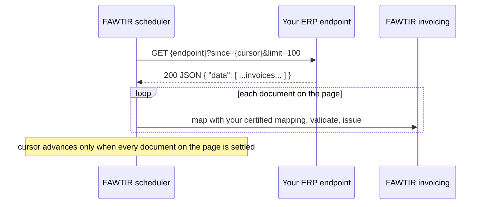
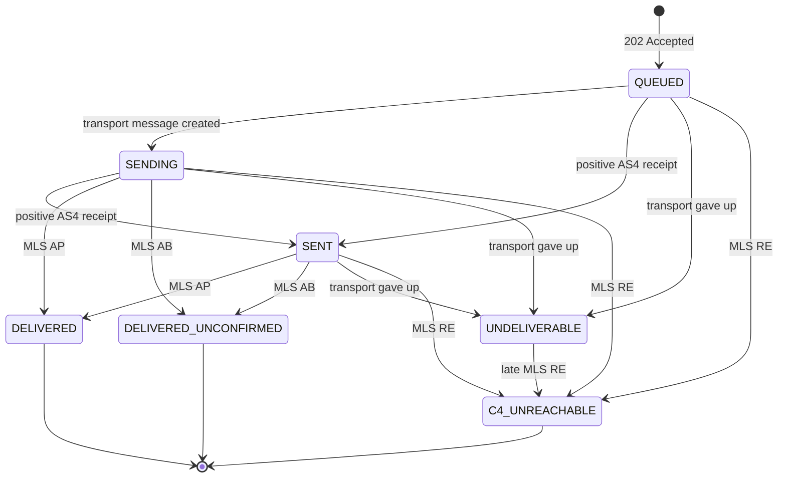
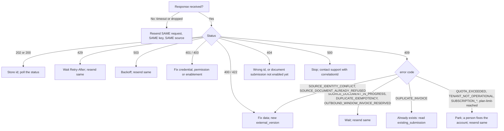
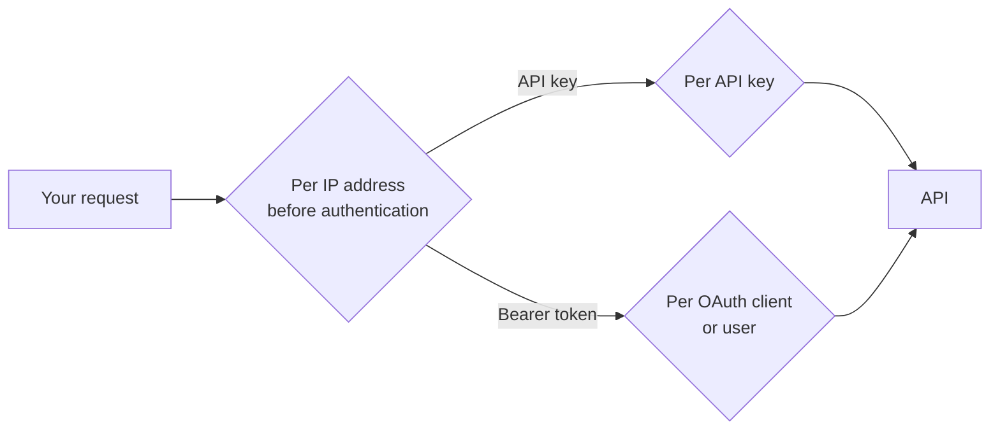

# FAWTIR ERP Developer Guide: synchronization, lifecycle and errors

## Invoice synchronization

This page explains how to move invoices from your ERP into FAWTIR so that each document is issued exactly once, even when requests time out or are retried. It covers the three channels, what FAWTIR guarantees, and how to design the ERP side.

FAWTIR has three channels. There is no installable connector, agent or SDK for any of them.

| Channel | Who starts the transfer | Who calls whom | Documents | Details |
|---|---|---|---|---|
| **API Push** | Your ERP | Your ERP calls FAWTIR's REST API | Invoices, credit notes, debit notes, self-billed documents | [API Push](#api-push) |
| **Managed Pull** | FAWTIR, on a schedule | FAWTIR calls your ERP's REST API | Tax invoices only | [Managed Pull](#managed-pull), [ERP connector](#erp-connector) |
| **Bridge Upload** | A person in the FAWTIR app | The person uploads one file | Tax invoices only | [Bridge Upload](#bridge-upload) |

Document submission is switched on by FAWTIR for a whole environment; which routes answer `404` while it is off is listed in the [API reference](2-api-reference-and-data-mapping.md#endpoint-inventory). Where it is on, an organisation that is not yet ready to issue is refused with `409 TENANT_NOT_OPERATIONAL`.

All names, numbers and identifiers in the examples on this page are fictitious.

### Terms used on this page

| Term | Meaning |
|---|---|
| **Source identity** | The pair `external_document_id` + `external_version` that names a document in your ERP's own terms. |
| **Source ledger** | FAWTIR's permanent record of every source identity it has received, and what became of it. |
| **Content fingerprint** | A hash FAWTIR computes over the request so it can tell "the same document again" from "a different document under the same identity". |
| **Idempotency-Key** | A header you send on every submission. FAWTIR keeps the answer to a successful request under that key for 24 hours. |

### API Push

#### FAWTIR behaviour

**Routes.** Your ERP sends one document per request with `POST` to one of four routes: `/api/v1/invoices`, `/api/v1/creditnotes`, `/api/v1/debitnotes` or `/api/v1/selfbilling`. The request and response fields are in the [API reference](2-api-reference-and-data-mapping.md#api-reference). How to authenticate is in [Authentication](1-getting-started.md#authentication).

**Two layers of duplicate protection (FAWTIR rule).** They work together and have different lifetimes.

| Layer | What it is keyed on | How long it lasts | What it protects against |
|---|---|---|---|
| `Idempotency-Key` header | Your organisation, the route, the document kind and the key value | 24 hours, and only for a request that succeeded | The same HTTP request arriving twice, for example after a timeout |
| Source ledger (`source` block) | Your organisation, the channel, `external_document_id`, `external_version` | Permanent | The same ERP document being issued twice, at any time, even with a new key or a rotated API key |

The source ledger applies only when the request carries a `source` block, and only an API key created with the **ERP ingestion** profile may send one. A push without `source` is protected by the `Idempotency-Key` and by FAWTIR's invoice-number check (see [Duplicate submission](#duplicate-submission)), but it does not appear in the ERP activity reports.

> **Note:** The source identity belongs to your organisation, not to the API key. Rotating or replacing the key does not reset it. Everything that pushes into one organisation shares one namespace, so two systems that reuse the same `external_document_id` for different documents will collide.

**The content fingerprint (FAWTIR rule).** When a request names a source identity that FAWTIR has seen, FAWTIR compares fingerprints. The fingerprint covers:

- the route and `document_kind`;
- `format`;
- every `supplement` field (`issue_time`, `transaction_type`, the `preceding_invoice_*` fields, `credit_note_reason_code`, `profit_margin`);
- `receiver_override`;
- the `document` itself.

Whitespace between JSON tokens in `document` does not change the fingerprint; an XML `document` is taken exactly as sent, whitespace included. **Key order does**: if your ERP serialises the same invoice with its JSON keys in a different order, FAWTIR sees different content. Produce `document` with a stable serialiser.

**Outcomes for a pushed document with a `source` block.**

| What FAWTIR finds | HTTP status | Body field | What happened |
|---|---|---|---|
| A new source identity, and the document is valid | `202 Accepted` | `source.disposition: "ACCEPTED"` | The invoice was created and queued. |
| The same identity with the same content, already accepted | `200 OK` | `source.disposition: "DUPLICATE"` | Nothing new was created. The body describes the earlier submission, with its current `state`. |
| The same identity with different content | `409` | `error: "SOURCE_IDENTITY_CONFLICT"` | Nothing was created. |
| The same identity and content were refused before | `409` | `error: "SOURCE_DOCUMENT_ALREADY_REFUSED"` plus `earlier_outcome` | Nothing was created. The earlier refusal is final for this identity. |
| Another request is working on this identity now, or an interrupted attempt has not been resolved yet | `409` | `error: "SOURCE_DOCUMENT_IN_PROGRESS"` | Nothing was created. |
| The document itself is refused (validation, mapping, and so on) | `4xx` | The refusal's own code | The refusal is recorded against the identity. |

Both `202` and `200` carry a `Location` header that points to the submission (`/api/v1/invoices/{id}`). In both, `peppol_send.status` and `tdd.status` are fixed receipt values (`"queued"`); they are not the live status. See [Invoice lifecycle](#invoice-lifecycle).

A push refused for a reason outside the document is the exception: the record stays retryable, and the same document under the same version goes through once the cause is gone. This covers your mapping not being ready (no active mapping, or not certified), your Peppol participant not being verified, the document allowance being used up, your organisation or subscription not allowing issuing, and temporary platform conditions such as `MAPPING_CAPACITY_UNAVAILABLE`, `OUTBOUND_WINDOW_INVOICE_RESERVED`, `OUTBOUND_TRANSPORT_UNAVAILABLE`, `EMISSION_BLOCKED` and `VALIDATION_UNAVAILABLE`.

> **Note:** Platform faults such as `EMISSION_BLOCKED` and `VALIDATION_UNAVAILABLE` count against a budget of 5 attempts per source identity, as in Managed Pull; the other reasons above do not. Once the 5 are spent, a resend of that identity is answered `409 SOURCE_DOCUMENT_ALREADY_REFUSED` with `earlier_outcome: "ATTEMPTS_EXHAUSTED"`. Send the document under a new `external_version` once the platform has recovered.

**Choosing `external_document_id` and `external_version`.**

| Field | Rules (FAWTIR rule) | Recommendation |
|---|---|---|
| `external_document_id` | Required inside `source`, up to 200 characters | Use your ERP's own, permanent identifier for the document, for example `ERP-INV-000145`. It must not change when the document is corrected. |
| `external_version` | Optional, up to 80 characters. Blank counts as absent. | Start at `1`. Increase it whenever the content you send changes, for example after you fix a document that FAWTIR refused. |

> **Warning:** A new `external_version` is for re-sending a document that FAWTIR **refused**. Once FAWTIR has accepted an invoice, changing it is a credit note or a debit note, not a new version. A new version of an accepted invoice with the same invoice number is refused as `DUPLICATE_INVOICE`. See [Invoice corrections](#invoice-corrections).

**The `Idempotency-Key` header (FAWTIR rule).**

- Required on every submission. Missing: `400 validation-failed`.
- 16 to 128 characters from `A-Z a-z 0-9 . _ : -`. Otherwise: `400 INVALID_IDEMPOTENCY_KEY`.
- Scoped to your organisation, the route and the document kind. The same value on `/invoices` and on `/creditnotes` counts as two different keys.
- Only a **successful** answer is stored, for 24 hours. A repeat of the same request with the same key within that time returns the stored answer, and nothing is processed again.
- A refused request (any `4xx` or `5xx`) stores nothing under the key. The same key can be used again. With a `source` block, the refusal is still recorded against the source identity (see the outcomes table above).
- The same key with a different body, after a successful use, is refused with `409 DUPLICATE_IDEMPOTENCY`.
- While a request with a key is still being processed, a second request with the same key is also refused with `409 DUPLICATE_IDEMPOTENCY`, and the message says to retry shortly. The two cases share one code; only the `detail` text differs.

#### Recommended ERP design

1. **Keep an outbox in the ERP.** Write one outbox row per document version you intend to send, in the same database transaction that finalises the document in the ERP. Send from the outbox, never from the user's click.
2. **Always send a `source` block** (this needs an API key with the ERP ingestion profile). It is the only protection that outlives 24 hours.
3. **Derive the Idempotency-Key from the source identity**, and store it on the outbox row before the first attempt. For example `waha-inv-000145-v1-7f3c9a2e`: organisation prefix, document, version, and a random suffix created once. Every retry of that row reuses the stored key. A new version gets a new key.
4. **Never generate a new invoice number to work around an error.** The invoice number is a legal identifier. If a request failed or its outcome is unknown, resend the same document.
5. **Record what FAWTIR returned**: `id` (the `invc_…` submission id), `invoice_uuid`, and the `Location` header. You need them to poll the status and to reconcile.
6. **Serialise `document` deterministically** (stable key order), so a retry produces the same fingerprint.

### Network timeouts and unknown outcomes

If your request times out, the connection drops, or you receive a `5xx` without a FAWTIR problem body, you do not know whether FAWTIR created the invoice.

**What to do: resend the same request, with the same `Idempotency-Key` and the same source identity.** Do not change any data. Do not assign a new invoice number. Do not create a new key.

What FAWTIR does with that resend:

| What happened to the first request | What the resend gets |
|---|---|
| It succeeded, less than 24 hours ago | The stored answer (`202` or `200`) |
| It is still being processed | `409 DUPLICATE_IDEMPOTENCY` ("already in progress; retry shortly"). Wait and resend again. |
| It succeeded more than 24 hours ago, and you sent `source` | `200` with `source.disposition: "DUPLICATE"` |
| It succeeded more than 24 hours ago, without `source` | `409 DUPLICATE_INVOICE` with `existing_submission`. Read that submission; do not resend. |
| It never arrived, or was refused for a reason outside the document | It is processed now as if it were the first time |
| It was refused because of the document, and you sent `source` | `409 SOURCE_DOCUMENT_ALREADY_REFUSED`. Fix the document and send it under a new `external_version`. |

> **Recommendation:** FAWTIR's edge waits up to 60 seconds for an answer from the platform. Set your HTTP client's read timeout a little above that, so you do not give up on a request that is still being answered.

#### Safe push-with-retry loop (Python)

This example uses only the headers, fields and codes documented in this guide. `document` is your ERP's own JSON, exactly as your certified mapping expects it (see [ERP data mapping](2-api-reference-and-data-mapping.md#data-mapping)).

```python
import random
import time
import uuid

import requests

BASE_URL = "{BASE_URL}"                     # see the Environments page
API_KEY = "fawt_sk_<your-key>"              # ERP ingestion key, kept in a secret store

# Answers that mean "retry later with the same request and the same key".
RETRY_LATER = {
    "SOURCE_DOCUMENT_IN_PROGRESS",
    "DUPLICATE_IDEMPOTENCY",          # in-progress variant; see note in the loop
    "OUTBOUND_WINDOW_INVOICE_RESERVED",
    "MAPPING_CAPACITY_UNAVAILABLE",
    "EMISSION_BLOCKED",
    "VALIDATION_UNAVAILABLE",
    "OUTBOUND_TRANSPORT_UNAVAILABLE",
}

# Answers where a person must act first (pay, verify the company, buy documents).
# Park the outbox row; resend the SAME request once the cause is fixed.
PARK = {
    "QUOTA_EXCEEDED",
    "TENANT_NOT_OPERATIONAL",
    "SUBSCRIPTION_SUSPENDED",
    "SUBSCRIPTION_CANCELLED",
    "SUBSCRIPTION_NOT_STARTED",
}


def push_invoice(outbox_row, document):
    """Send one outbox row. Returns ('accepted' | 'duplicate' | 'refused' | 'parked' | 'unknown', body)."""
    body = {
        "format": "JSON",
        "document_kind": "STANDARD_INVOICE",
        "document": document,
        "supplement": {
            "issue_time": "10:15:00",
            "transaction_type": "1XXXXXXXXXXXXXXXXXXX",
        },
        "source": {
            "external_document_id": outbox_row["external_document_id"],   # "ERP-INV-000145"
            "external_version": outbox_row["external_version"],           # "1"
        },
    }
    headers = {
        "X-API-Key": API_KEY,
        "Idempotency-Key": outbox_row["idempotency_key"],   # stored once: "waha-inv-000145-v1-7f3c9a2e"
        "X-Correlation-Id": str(uuid.uuid4()),               # optional; a non-UUID value is replaced
        "Content-Type": "application/json",
    }

    delay = 2.0
    for attempt in range(1, 9):
        try:
            response = requests.post(
                f"{BASE_URL}/api/v1/invoices",
                json=body, headers=headers, timeout=(5, 70),
            )
        except requests.RequestException:
            # Timeout or dropped connection: the outcome is unknown.
            # Resend the identical request with the identical key.
            time.sleep(delay + random.uniform(0, delay))
            delay = min(delay * 2, 300)
            continue

        problem = {}
        if response.headers.get("Content-Type", "").startswith("application/problem+json"):
            problem = response.json()
        code = problem.get("error") or problem.get("code")   # 429/413 bodies carry neither

        if response.status_code == 202:
            return "accepted", response.json()        # store id, invoice_uuid, Location
        if response.status_code == 200:
            return "duplicate", response.json()       # source.disposition == "DUPLICATE"

        if response.status_code == 429:
            wait = float(response.headers.get("Retry-After", delay))
            time.sleep(wait)
            continue

        if code in RETRY_LATER or response.status_code == 503:
            # A persistent DUPLICATE_IDEMPOTENCY after several waits means the key was
            # reused with a different body: a defect in key derivation. Stop and alert.
            wait = float(response.headers.get("Retry-After", delay))
            time.sleep(wait + random.uniform(0, delay))
            delay = min(delay * 2, 300)
            continue

        if code in PARK:
            return "parked", problem

        # Everything else is a decision, not a retry: 400, 401, 403, 404, 413, 422,
        # DUPLICATE_INVOICE, SOURCE_IDENTITY_CONFLICT, SOURCE_DOCUMENT_ALREADY_REFUSED,
        # SALES_APPROVAL_REQUIRED, 500 INTERNAL_ERROR. Keep the correlationId for support.
        return "refused", problem

    # Still no answer: leave the row as "unknown outcome" and let reconciliation
    # (or a later run with the SAME key and source) settle it. Never renumber.
    return "unknown", None
```

What the loop deliberately does not do:

- It never changes `body`, the key or the source identity between attempts.
- It never retries a deterministic refusal such as `VALIDATION_FAILED`. Fix the data, increase `external_version`, create the new version's key, and send it as a new outbox row.
- It stops on `DUPLICATE_INVOICE`. The invoice already exists; read the submission named in `existing_submission`.
- It retries `EMISSION_BLOCKED` and `VALIDATION_UNAVAILABLE` with backoff, and each of those answers spends one of the 5 attempts of that source identity (see the note under API Push). If they persist, stop and park the row rather than looping.

Every error code above is described in the [Error reference](#error-reference).

### Retries and backoff advice

**Recommendation:**

| Situation | Retry? | How |
|---|---|---|
| Timeout, dropped connection | Yes | Same request, same key, exponential backoff with jitter |
| `429` | Yes | Wait for `Retry-After` (seconds), then the same request |
| `503` (any code) | Yes | Backoff; honour `Retry-After` when present (`MAPPING_CAPACITY_UNAVAILABLE` sends `Retry-After: 4`) |
| `409 SOURCE_DOCUMENT_IN_PROGRESS` | Yes | Wait, then the same request |
| `409 DUPLICATE_IDEMPOTENCY` | A few times | Wait, then the same request; if it persists, stop and check your key derivation |
| `409 OUTBOUND_WINDOW_INVOICE_RESERVED` | Yes, later | The body says `retryable: true` |
| `409 QUOTA_EXCEEDED`, `TENANT_NOT_OPERATIONAL`, `SUBSCRIPTION_*` | After a person fixes the cause | Same request, same key |
| `4xx` refusals of the document | No | Fix the data, new `external_version`, new key |
| `500` | No loop | Contact support with the `correlationId` |

Limits that affect your retry rate are listed in [Platform limits](#platform-limits). An ERP ingestion key allows 600 requests a minute.

### Managed Pull

With Managed Pull, FAWTIR calls your ERP's REST API on a schedule and submits what it finds. The endpoint your ERP must offer, and how to set up a connection, are in [ERP connector](#erp-connector). This section describes how FAWTIR keeps its place and retries.

> **Note:** FAWTIR switches the Managed Pull scheduler on per deployment. Ask FAWTIR whether it is on for your organisation before you plan on it.

#### FAWTIR behaviour

**Cursors (FAWTIR rule).** FAWTIR remembers a position (a "cursor") per connection and asks your ERP only for what comes after it. You choose one of four cursor kinds:

| Cursor kind | What FAWTIR sends back to your ERP | How your ERP must filter |
|---|---|---|
| `TIMESTAMP` | The highest ISO-8601 instant found on the last page | Return documents at or after that instant (inclusive) |
| `SEQUENCE` | The highest sequence number found on the last page | Return documents after that number (exclusive) |
| `CONTINUATION_TOKEN` | The token your ERP returned in the response | Continue the stream from that token |
| `PAGE_TOKEN` | The token your ERP returned in the response | Return the next page of the same traversal |

For `TIMESTAMP` and `SEQUENCE`, FAWTIR takes the **highest** value on the page, not the last one, so your ERP does not have to sort. Because `TIMESTAMP` re-reads inclusively, the document at the boundary comes back on the next run; the source ledger recognises it and does not issue it twice.

**Paging.** FAWTIR asks for up to 100 documents a page and reads at most 20 pages per run. It assumes there may be more when a page is full (`TIMESTAMP`, `SEQUENCE`) or when the response carries a next token (`CONTINUATION_TOKEN`, `PAGE_TOKEN`). If your ERP returns more than the page size, FAWTIR processes only the first 100 and moves its position to the highest cursor value among them. Documents further down that response with a lower cursor value are not read again. If your endpoint cannot honour the page size parameter, return documents in ascending cursor order.

**The cursor moves only when every document on the page is settled.** If one document on the page is still waiting for a retry, FAWTIR reads the same window again on the next run.

**Interval.** Default one hour. You may set an ISO-8601 duration, such as `PT30M`. Values below 5 minutes run every 5 minutes, and values above 24 hours run every 24 hours.

**Backoff after a failed run.** When a whole run fails for a temporary reason (for example, your ERP is down), FAWTIR waits 5 minutes, then 10, 20, 40 and so on, up to 6 hours, and returns to the normal interval after the next successful run. A run that fails for a permanent reason is tried again at the normal interval.

**Attempts per document.** Each document gets up to 5 attempts for temporary problems: your ERP unavailable or slow, your ERP refusing the credential, or a temporary platform fault. Some reasons do not use an attempt: the mapping is not ready or not certified, your Peppol participant is not yet verified, the document allowance is used up, or your organisation cannot issue right now. A document whose 5 attempts are spent is rejected with `ATTEMPTS_EXHAUSTED`, and collection moves past it. A person can then ask FAWTIR to try it again (see [ERP connector](#recovery)).

**One bad document does not hold the others.** A document with no identifier is refused on its own and the rest of the page is processed. A whole page response may be at most 4 MiB: a larger response is refused before any document in it is read, and the run fails. Keep your pages well below that size.

> **Warning:** Managed Pull submits **tax invoices only**. Credit notes, debit notes and self-billed documents must be sent with API Push.

#### Recommended ERP design

- Give every invoice a stable identifier and a version that increases when its content changes.
- For `TIMESTAMP`, use a value that changes when the invoice is finalised and never moves backwards. If a full page of 100 documents all carry the timestamp FAWTIR already holds, the run fails and the position does not move, so collection is stuck on that value.

**Recommendation:** Prefer a strictly increasing `SEQUENCE` cursor. If you use `TIMESTAMP`, make sure fewer than 100 documents can ever share one timestamp value, for example by including fractions of a second.
- Expose only finalised (posted) invoices on the endpoint. Drafts must not appear.

### Bridge Upload

#### FAWTIR behaviour

Bridge Upload is a page in the FAWTIR app: **Settings → ERP integration → Bridge upload**. A signed-in person with permission to submit invoices uploads **one** document file, JSON or XML, up to 4 MiB, and fills in **Document ID in your ERP** and, optionally, **Version**.

- It is not an installed program, and API keys and OAuth clients cannot use it.
- It submits tax invoices only.
- It uses the same source ledger rules as API Push, but in its own namespace: an upload and a push with the same identity are different documents to FAWTIR.
- The answers are the same as for API Push: accepted, already uploaded (`DUPLICATE`), or refused with `SOURCE_IDENTITY_CONFLICT`, `SOURCE_DOCUMENT_IN_PROGRESS` or `SOURCE_DOCUMENT_ALREADY_REFUSED`.

#### Recommended ERP design

Use Bridge Upload for low volumes, for testing a mapping with a real document, or as a manual fallback. It is not a synchronisation mechanism: nothing on the ERP side is updated.

### Incremental sync and filtering

**FAWTIR behaviour.**

- FAWTIR never reads changes from your ERP on its own, except through Managed Pull.
- FAWTIR does not write anything back to your ERP. There is no write-back channel.
- An API key can only submit. It cannot read status or lists. To read, use a Bearer token: a signed-in user, or an OAuth client that holds `invoice.read`.

Lists you can filter, with a Bearer token:

| Route | Useful filters |
|---|---|
| `GET /api/v1/invoices` | `state`, `document_kind`, `invoice_number`, `receiver`, `received_from`, `received_to`, `page`, `page_size` |
| `GET /api/v1/erp/source-documents` | `source_kind`, `external_document_id`, `invoice_number`, `processing_state`, `reason_code`, `retryable`, `delivery_state`, `from`, `to`, `page`, `page_size` |
| `GET /api/v1/erp/source-documents/reconciliation` | `label`, `source_kind`, `connection_id`, `from`, `to` (at most 367 days) |

The `state` and `document_kind` filters on `GET /api/v1/invoices` are case-sensitive: send `DELIVERED`, not `delivered`. Any other value is refused with `400`.

> **Note:** The platform's access rules let an OAuth client that holds `invoice.read` read these lists. Confirm this set-up with FAWTIR during onboarding before you rely on it.

**Recommended ERP design.** Poll only documents your outbox marks as "sent, outcome not final", oldest first, and stop polling a document once its delivery state and tax report are final (see [Invoice lifecycle](#invoice-lifecycle)).

### Batching

**FAWTIR behaviour.** API Push takes **one document per request**. Two batch routes exist (`POST /api/v1/invoices/batch` for up to 10 documents, and `POST /api/v1/invoices/batches` for up to 1000, processed asynchronously), but:

- an API key cannot call them;
- they refuse a `source` block, so batched documents get no source-ledger protection and do not appear in the ERP activity reports.

> **Note:** Ask FAWTIR before you call the batch routes with an OAuth client.

**Recommended ERP design.** Send documents one per request from your outbox, with a small number of parallel workers. Keep the per-key limit of 600 requests a minute in mind.

### Partial failures

Each document is accepted or refused on its own. There is no "all or nothing" across documents.

| Situation | What it means | What to do |
|---|---|---|
| Some documents accepted, some refused | Each refused document carries its own code | Fix and resend only the refused ones, each under a new `external_version` |
| A Managed Pull run "completed with rejections" | Some documents on the run were rejected; the rest were accepted or recognised as duplicates | Look at the rejected documents in **Activity → Source documents** |
| Accepted, then delivery failed | The invoice exists in FAWTIR; transport or the recipient did not complete delivery | See [Invoice lifecycle](#invoice-lifecycle). Do not resend the same invoice. |
| Accepted, then the tax report has a problem | The invoice exists; its TDD needs attention | See [Invoice lifecycle](#tdd-status) |

### Reconciliation with your ERP reports

**FAWTIR behaviour.** The ERP activity reports list every document that arrived with a source identity (API Push with `source`, Bridge Upload, Managed Pull). In the app they are under **Settings → ERP integration → Activity**, on the tabs **Source documents**, **Needs attention** and **Extraction runs**. Through the API they are at `/api/v1/erp/source-documents`, `/summary`, `/reconciliation` and `/{recordId}`, which need `invoice.read`.

The **Needs attention** labels:

| Label | Meaning |
|---|---|
| `RECOVERY_PENDING` | A document was left claimed by an interrupted process; FAWTIR is releasing it |
| `WAITING_FOR_MAPPING` | Waiting for your mapping to be ready or certified |
| `RETRYABLE_FAILURE` | The last attempt failed for a temporary reason |
| `ATTEMPTS_EXHAUSTED` | All attempts are spent; a person must act |
| `ACCEPTED_WITHOUT_INVOICE` | Accepted, but no invoice is linked. Contact support. Do not resend. |
| `TRANSPORT_PENDING` | The invoice is still queued or sending more than 6 hours after FAWTIR accepted it |
| `RESPONSE_PENDING` | The invoice was sent 24 hours ago or more, and the recipient's side has not answered yet |
| `DELIVERY_FAILED` | The invoice could not be delivered, or the recipient's side refused it |
| `TAX_REPORT_ATTENTION` | The TDD failed, was rejected, or is past its deadline |

**Recommended ERP design.** Once a day, compare your outbox with FAWTIR:

1. For every outbox row older than a few minutes with no stored `invc_…` id, look it up by `external_document_id` in `/api/v1/erp/source-documents`. If FAWTIR has it, store the id. If not, resend it unchanged (same key if still within 24 hours; the source ledger protects you after that).
2. Read `/api/v1/erp/source-documents/reconciliation` for the last day and route each label to the team that can act on it.
3. Compare counts for the day: the documents you posted in the ERP, and what `/api/v1/erp/source-documents/summary` reports as received, accepted, rejected and duplicate.

A push without a `source` block is not in these reports. Reconcile those with `GET /api/v1/invoices?invoice_number=…`.

## ERP connector

This page tells you what "connecting your ERP" means in FAWTIR today, and walks you through Managed Pull: the endpoint your ERP must expose, the connection set-up in the app, and how to run and troubleshoot it.

### There is no installable connector

FAWTIR does not ship an installable connector, agent, service or SDK for ERP integration. Nothing has to be installed on your servers, and nothing can be. Your ERP reaches FAWTIR in one of three ways:

| Approach | What you build | When it fits |
|---|---|---|
| **API Push** | Code in or next to your ERP that calls FAWTIR's REST API, one document per request | You control the ERP's integration layer; you need credit notes, debit notes or self-billing |
| **Managed Pull** | A REST endpoint in your ERP (or in a thin service in front of it) that lists finalised invoices as JSON; FAWTIR calls it on a schedule | Your ERP can expose such an endpoint on the internet, and you send tax invoices only |
| **Bridge Upload** | Nothing. A person uploads one document file at a time in the app | Low volumes, tests, manual fallback |

All three need a **certified mapping**: a conversion, owned by your organisation, from your ERP's invoice format into FAWTIR's invoice model. See [ERP data mapping](2-api-reference-and-data-mapping.md#data-mapping).

**Example mappings.** Example mappings for Odoo 17 and Oracle Fusion invoice exports are available. FAWTIR's own certification tests exercise them, but their sample data is representative, not captured from a live ERP. Treat them as a starting point and check them against your own instance with a dry run. They are mappings of the invoice document; they do not mean that the ERP's own API can be called by Managed Pull as it is. Whether your ERP's API meets the [endpoint contract](#what-your-erp-endpoint-must-offer) below is for you to check.

FAWTIR does not write anything back to your ERP. There is no write-back feature.

FAWTIR switches document submission on per deployment, not per organisation. While it is off, the submission routes and Bridge Upload answer `404`; the full list is in the [API reference](2-api-reference-and-data-mapping.md#endpoint-inventory). Separately, FAWTIR must enable ERP integration for your organisation before an ERP ingestion key or a `source` block is accepted (`403 erp-entitlement-required`).

All names, addresses and identifiers in the examples on this page are fictitious.

### Managed Pull in one picture



> **Note:** FAWTIR switches the Managed Pull scheduler on per deployment. While it is off, every connection shows **Automation off** and nothing is collected, even with everything else set up. Ask FAWTIR whether it is on for you.

> **Warning:** Managed Pull submits **tax invoices only**. Send credit notes, debit notes and self-billed documents with API Push.

### What your ERP endpoint must offer

Every rule in this section is a FAWTIR rule.

#### Address and network

| Requirement | Detail |
|---|---|
| HTTPS | The endpoint must be `https`. Plain `http` is refused. The certificate must be valid for the host; FAWTIR never relaxes this check. |
| Public address | The host name must resolve, and every address it resolves to must be publicly routable. Private, loopback and internal addresses are refused. |
| No credentials in the URL | No `user:password@` part, and no query parameter that looks like a secret (for example `token`, `key`, `apikey`, `password`, `secret`, `signature`, `auth`). Credentials go in the connection's sign-in details. |
| No fragment | The URL must not contain `#…`. |
| Length | Up to 2048 characters. |
| No redirects | FAWTIR does not follow redirects. A `3xx` answer counts as a failure. |

#### The connection check: `HEAD` must answer `2xx`

When someone clicks **Check connection**, FAWTIR sends **one `HEAD` request** to the endpoint, with the credential and `Accept: */*`, and gives it 15 seconds in all.

| Your endpoint answers | Result shown |
|---|---|
| `2xx` | Reached and signed in |
| `401` or `403` | The system refused the sign-in details |
| `5xx` | The system answered that it is unavailable |
| `3xx` or another `4xx` | The system gave an answer FAWTIR cannot accept |

Many frameworks do not answer `HEAD` on a `GET` route by default. Make sure yours does, or the check fails even though collection would work.

#### Authentication

| Sign-in kind in the app | What FAWTIR sends |
|---|---|
| **API token** | `Authorization: Bearer <secret>` |
| **Username and password** | `Authorization: Basic <base64 of the secret>`. Enter the secret as `user:password`. |

The secret can be up to 4096 characters. It is stored encrypted and never shown again. OAuth 2.0 client credentials and SSH keys can be stored but cannot be used today.

#### The request FAWTIR makes

```http
GET /erp/api/invoices?since=2026-11-10T00:00:00Z&limit=100 HTTP/1.1
Host: erp.alwaha.example.om
Authorization: Bearer <your-erp-token>
Accept: application/json
```

- Method `GET`, with no body, no cookies, and no automatic retries.
- `{cursorParameter}={cursor}` is added when FAWTIR has a position. On the very first run it uses your **Start from** value, if you set one.
- `{pageSizeParameter}=100` is added when you configured a page size parameter. The page size is a FAWTIR setting (100); you cannot choose it.
- Your endpoint's own query parameters are kept.

#### The response FAWTIR expects

- Status `2xx` with a JSON body. Managed Pull reads JSON only; for XML exports use API Push or Bridge Upload.
- A JSON **array** of invoices at the **Documents pointer**.
- On each invoice: an identifier at the **Document id pointer**, optionally a version at the **Document version pointer**, an issue time at the **Issue time pointer**, and, for `TIMESTAMP` or `SEQUENCE`, a cursor value at the **Document cursor pointer**.
- For `CONTINUATION_TOKEN` or `PAGE_TOKEN`: the next token at the **Next cursor pointer** in the response envelope. No token means "no more pages".

The pointers are JSON Pointers (RFC 6901): they start with `/`, and `/data` means "the `data` member of the top-level object".

Example response for an endpoint configured with `TIMESTAMP` and the pointers `/data`, `/id`, `/version`, `/updated_at`, `/issued_at`:

```json
{
  "data": [
    {
      "id": "ERP-INV-000145",
      "version": "1",
      "updated_at": "2026-11-10T06:20:00Z",
      "issued_at": "2026-11-10T10:15:00+04:00",
      "name": "INV-2026-000145",
      "move_type": "out_invoice",
      "invoice_date": "2026-11-10",
      "invoice_date_due": "2026-12-10",
      "currency_id": [12, "OMR"]
    }
  ]
}
```

Each invoice object is handed to your mapping unchanged. The fields after `issued_at` above are the start of an Odoo-style invoice export; the full document must contain every field your certified mapping reads.

| Value | Format |
|---|---|
| Identifier | String, number or boolean, not blank, up to 200 characters. A document without one is refused on its own (`SOURCE_IDENTITY_INVALID`). |
| Version | Up to 80 characters. Optional. |
| Issue time | `HH:mm:ss` (Oman local time) or an ISO-8601 date-time with an offset. |
| `TIMESTAMP` cursor | An ISO-8601 instant, such as `2026-11-10T06:20:00Z` |
| `SEQUENCE` cursor | A whole number |
| Tokens | Any string, returned to you unchanged |

#### Cursor and paging behaviour your endpoint must honour

| Cursor kind (app label) | FAWTIR sends | Your endpoint must return |
|---|---|---|
| `TIMESTAMP` (**Updated-at timestamp**) | the highest timestamp on the previous page | documents with a timestamp **at or after** it |
| `SEQUENCE` (**Sequence number**) | the highest sequence number on the previous page | documents with a number **greater than** it |
| `CONTINUATION_TOKEN` (**Continuation token**) | the token from your previous response | the continuation of the stream |
| `PAGE_TOKEN` (**Page token**) | the token from your previous response | the next page of the same traversal |

- Your endpoint does not need to sort, provided it honours the page size; FAWTIR takes the highest cursor value on a page.
- Every document must carry the cursor value for `TIMESTAMP` and `SEQUENCE`. If one document lacks it, the whole page fails.
- A full page (100 documents) means "there may be more" for `TIMESTAMP` and `SEQUENCE`.
- If your endpoint ignores the page size and returns more, FAWTIR processes the first 100 and moves its position to the highest cursor value among them. Documents further down with a lower value are not read again, so return documents in ascending cursor order.
- With `TIMESTAMP`, a full page whose documents all share the timestamp FAWTIR already holds makes the run fail, and the position does not move. Keep the number of documents that can share one timestamp value below 100, or use `SEQUENCE`.
- **Cursor query parameter** is required for every kind except **Page token**. A page-token connection without one only ever reads the first page.

#### Size and time limits

| Limit | Value |
|---|---|
| Connect timeout | 5 seconds |
| Response timeout (waiting for data) | 15 seconds |
| Whole exchange | 60 seconds |
| Response body | 4 MiB |
| One document | 4 MiB |
| Page size | 100 documents |
| Pages per run | 20 |

A page response larger than 4 MiB is refused as a whole, and collection stops at that page until the response is smaller. FAWTIR does not read a `Retry-After` header from your ERP.

How FAWTIR classifies your endpoint's answers during collection. A page that cannot be read fails the whole run; the position does not move, so the same window is read again on a later run.

| Your endpoint answers | Reason recorded | Temporary? | What happens next |
|---|---|---|---|
| `401`, `403` | `SOURCE_AUTHENTICATION_REJECTED` | yes | Run fails; **Retry backoff** (5 minutes, doubling, up to 6 hours) |
| `408`, `429`, `5xx`, or the connection or TLS handshake fails | `SOURCE_UNAVAILABLE` | yes | Run fails; **Retry backoff** |
| No answer within the time limits above | `SOURCE_TIMEOUT` | yes | Run fails; **Retry backoff** |
| any other non-`2xx`, including `3xx` | `SOURCE_PAYLOAD_UNREADABLE` | no | Run fails; **Last run failed**; tried again at the normal interval |
| `2xx` that is not JSON, or has no array at the Documents pointer | `SOURCE_PAYLOAD_UNREADABLE` | no | Same as above; fix the endpoint or the pointers |

### Setting up a connection in the app

Connections are managed by signed-in people only. API keys and OAuth clients cannot create, change, test or enable them.

Go to **Settings → ERP integration → Connections**. The area's tabs are **Overview · Connections · Bridge upload · API push · Mapping · Activity · Access and history**. If you see "ERP integration is not enabled", FAWTIR has not switched ERP integration on for your organisation yet.

1. **Add a connection.** Click **Add a connection** and fill in **Name**, **ERP system** (a label only), **Version** (optional), **How it works** = **Fawtir collects from your ERP**, **How Fawtir connects** = **REST API**, and **Address** (your endpoint). Click **Save as draft**. "How it works" and the ERP system cannot be changed later.
2. **Add sign-in details.** Click **Add sign-in details**, choose **Username and password** or **API token**, enter the **Secret** and an optional **Label** (a non-secret hint, such as the user name). Replacing the secret later takes effect immediately; the old one stops working.
3. **Check the connection.** Click **Check connection**. A successful check does not turn anything on.
4. **Configure extraction.** On the **Extraction** tab, open **Configure extraction**, fill in the fields below, and click **Save settings**.
5. **Fetch a sample.** Click **Fetch sample**. FAWTIR collects one document exactly as production would, from **Start from**, and shows it unchanged. Nothing is recorded and no invoice is created. Use **Open mapping** to build and test your mapping with it.
6. **Certify the mapping** for tax invoices with this connection's transaction type. See [ERP data mapping](2-api-reference-and-data-mapping.md#data-mapping).
7. **Mark ready.** Click **Mark ready** on the connection.
8. **Enable production collection.** On the **Extraction** tab, click **Enable production collection**.

#### Extraction settings

| App label | Field | Rule |
|---|---|---|
| **How often to collect** | `interval` | ISO-8601 duration, for example `PT30M`. Empty means one hour. Below 5 minutes runs every 5 minutes; above 24 hours runs every 24 hours. |
| **Transaction type** | `transactionType` | Required. The 20-character BTOM-001 flags, each `1` or `X`, for every invoice on this connection, for example `1XXXXXXXXXXXXXXXXXXX` for a full tax invoice. The mapping certification is scoped to this value. |
| **Documents pointer** | `documentsPointer` | Required. Points to the array of invoices, for example `/data`. Up to 200 characters. |
| **Document id pointer** | `documentIdPointer` | Required, relative to one invoice, for example `/id`. |
| **Document version pointer** | `documentVersionPointer` | Optional, relative to one invoice. |
| **How to continue** | `cursorKind` | `TIMESTAMP`, `SEQUENCE`, `CONTINUATION_TOKEN` or `PAGE_TOKEN`. |
| **Cursor query parameter** | `cursorParameter` | Required except for **Page token**. Up to 60 characters: letters, digits, `_`, `.`, `-`. |
| **Document cursor pointer** | `documentCursorPointer` | Required for `TIMESTAMP` and `SEQUENCE`; not allowed for the token kinds. |
| **Next cursor pointer** | `nextCursorPointer` | Required for `CONTINUATION_TOKEN` and `PAGE_TOKEN`. |
| **Page size parameter** | `pageSizeParameter` | Optional. The query parameter name only; the size is set by FAWTIR. |
| **Start from** | `initialCursor` | Optional, up to 500 characters. Where the first collection begins, and what a sample reads from. |
| **Issue time pointer** | `documentIssueTimePointer` | Optional to save, **required to enable**. Points to each invoice's issue time. |

The `transactionType` positions are explained in [ERP data mapping](2-api-reference-and-data-mapping.md#data-mapping). Send `X` for "does not apply"; FAWTIR writes `0` for it in the PINT-OM document, because PINT-OM rule IBR-001-OM requires BTOM-001 to be "a 20-character string consisting only of '1' and '0'".

#### Connection states

| State | App label | Meaning |
|---|---|---|
| `DRAFT` | **Draft** | Still being configured. Nothing runs. You can edit, add sign-in details, check, and fetch samples. |
| `READY` | **Ready** | Configuration is complete. Collection runs only if production collection is also enabled. |
| `DISABLED` | **Paused** | Paused on purpose. **Turn back on** makes it ready again. |
| `ARCHIVED` | **Retired** | Read-only, permanently. Its name can be reused. |

Allowed moves: **Draft → Ready**, **Ready → Paused** (**Pause**), **Paused → Ready** (**Turn back on**), and any state → **Retired** (**Retire**). A connection never goes back to Draft. If someone else changed the connection while you were working, your change is refused and you must reload it.

#### Enablement prerequisites

**Enable production collection** is refused until all of these hold, checked in this order:

1. You have permission to manage connections.
2. FAWTIR has enabled ERP integration for your organisation (`403 erp-entitlement-required`).
3. The connection is **Ready** (`EXTRACTION_CONNECTION_NOT_READY`).
4. Extraction settings are saved and valid.
5. The **Issue time pointer** is set (`EXTRACTION_ISSUE_TIME_POINTER_REQUIRED`).
6. Your JSON mapping is certified for tax invoices with this connection's transaction type (`EXTRACTION_MAPPING_NOT_CERTIFIED`).

The app shows these as a checklist: **Extraction settings saved**, **Connection marked ready**, **Issue time pointer set**, **Mapping certified for this transaction type**. **Disable production collection** is always allowed, so a broken channel can always be stopped.

### Status values

The **Collection status** panel on the **Extraction** tab shows one status, the first that applies:

| Status | App label | Meaning | What to do |
|---|---|---|---|
| `GLOBALLY_DISABLED` | **Automation off** | The Managed Pull scheduler is off on this deployment. The connection keeps its settings. | Ask FAWTIR. |
| `NOT_CONFIGURED` | **Not configured** | No extraction settings, or no issue time pointer. | Save the settings, including **Issue time pointer**. |
| `CONNECTION_NOT_READY` | **Connection not ready** | The connection is not Ready, or is not a REST Managed Pull connection. | **Mark ready**. |
| `DISABLED_BY_OPERATOR` | **Production off** | Production collection is switched off. | **Enable production collection** when ready. |
| `MAPPING_NOT_CERTIFIED` | **Mapping not certified** | The mapping changed after enablement, so its certification no longer applies. | Certify the mapping again. |
| `RUNNING` | **Running** | A collection run is in progress. | Nothing. |
| `BACKOFF` | **Retry backoff** | A run failed, so the next one is held back. | See **Last failure**. It clears after a successful run. |
| `FAILED_LAST_RUN` | **Last run failed** | The newest run failed, and no backoff applies. | See **Last failure**. |
| `WAITING` | **Ready, waiting** | Nothing is wrong. The next run is scheduled. | Nothing. |

The panel also shows **Platform automation** (on or off), **Effective cadence**, **Next run**, **Consecutive failures**, **Held until**, **Last run**, **Last run documents** and **Last failure**.

`SENDER_PARTICIPANT_NOT_REGISTERED`, `SENDER_PARTICIPANT_CLAIM_CONFLICT` and `SENDER_PARTICIPANT_NOT_AUTHORIZED` are **not** statuses. They are reasons recorded on individual documents. See [Error reference](#managed-pull-1).

Each run has a state: **Created**, **Running**, **Completed**, **Completed with rejections**, **Failed** or **Cancelled**.

### Recovery

**Automatic.** Every minute, FAWTIR closes runs that an interrupted process left open and releases documents it left claimed. Nothing is needed from you.

**Manual.** A Managed Pull document whose 5 attempts are spent is rejected with `ATTEMPTS_EXHAUSTED`, and collection moves past it. Once you have fixed the cause, a signed-in person with the recovery permission can recover it: find it under **Activity → Source documents**, filtered to Managed Pull, Rejected and attempts exhausted. Recovery:

- works only for Managed Pull documents rejected with `ATTEMPTS_EXHAUSTED` that have no invoice;
- repeats the exact page request FAWTIR made the first time, once;
- requires the same document identifier, version and content to come back;
- never moves the collection position.

If your ERP now returns different content for that document, recovery is refused (`ERP_RECOVERY_SOURCE_DOCUMENT_CHANGED`). Give the document a new version in your ERP instead.

Documents sent by API Push or Bridge Upload cannot be recovered this way. FAWTIR does not keep their content; send them again.

### Monitoring

| What to watch | Where |
|---|---|
| The connection's status and last failure | **Extraction** tab, **Collection status** |
| Each run: found, accepted, rejected, duplicate | **Runs** tab, or **Activity → Extraction runs** |
| Each document and its invoice | **Activity → Source documents** |
| Documents that need a person | **Activity → Needs attention** |

The same data is available with a Bearer token holding `invoice.read`, at `/api/v1/erp/source-documents` and `/api/v1/erp/extraction/runs`. The connection status route itself is for signed-in people only.

> **Note:** The platform's access rules let an OAuth client that holds `invoice.read` read these reports. Confirm this set-up with FAWTIR during onboarding before you rely on it.

### Troubleshooting

| Symptom | Likely cause | What to do |
|---|---|---|
| **Check connection**: "The address is not one Fawtir may contact" | Not `https`, resolves to a private address, or has credentials in the URL | Use a public `https` address with no secrets in it |
| **Check connection**: "The system gave an answer Fawtir cannot accept" | `HEAD` not supported, a redirect, or a `404` | Answer `HEAD` with `2xx` on the exact endpoint URL |
| **Check connection**: "The secure connection could not be established" | Certificate expired, self-signed or for another host | Fix the certificate |
| **Fetch sample**: `EXTRACTION_SAMPLE_NO_DOCUMENTS` | Wrong **Documents pointer**, or **Start from** after your last invoice | Check the pointer and the start value |
| **Fetch sample**: `EXTRACTION_SAMPLE_SOURCE_UNREADABLE` | Not JSON, or no array at the pointer | Check the endpoint and the pointers |
| **Fetch sample**: `EXTRACTION_SAMPLE_SOURCE_UNAVAILABLE` (`503`) | Your ERP was slow or answered `5xx` | Try again; check the ERP |
| Status **Automation off** | Scheduler off on the deployment | Ask FAWTIR |
| Status **Not configured** although settings are saved | **Issue time pointer** missing | Set it |
| Status **Retry backoff**, last failure `SOURCE_UNAVAILABLE` or `SOURCE_TIMEOUT` | ERP down, too slow, or answering `429`/`5xx` | Fix the ERP; collection resumes by itself |
| Status **Retry backoff**, last failure `SOURCE_AUTHENTICATION_REJECTED` | Token expired or rotated | **Replace sign-in details** |
| The same invoices come back every run, the position never moves | One document on the page keeps failing temporarily, or more than 100 documents share one timestamp | Look at **Needs attention**; spread timestamps |
| Documents rejected with `INVOICE_VALIDATION_FAILED` | The invoice data breaks a validation rule | Fix the invoice in the ERP and give it a new version |
| Documents waiting with `SENDER_PARTICIPANT_NOT_REGISTERED` | Your Peppol participant is not verified yet | Finish participant verification; documents wait without using attempts |
| Documents refused with `SENDER_PARTICIPANT_NOT_AUTHORIZED` | The seller endpoint in the invoice is not your participant | Correct the seller endpoint in the ERP or the mapping |

All connection, sample and recovery codes are listed in the [Error reference](#managed-pull-1).

## Invoice lifecycle

This page lets you map FAWTIR's status values to your ERP's own invoice states, and tells you when an invoice is final and when you must act.

An invoice in FAWTIR has **several independent status dimensions**. Do not merge them into one field in your ERP:

| Dimension | Question it answers | Where you read it |
|---|---|---|
| [Submission and processing](#submission-and-processing) | Did FAWTIR accept the document? | The HTTP answer to your push; `processing_state` in the ERP reports |
| [Peppol transport (delivery state)](#peppol-transport-delivery-state) | Where is the invoice on its way to the buyer's access point? | `state` on `GET /api/v1/invoices/{id}`; `delivery_state` in the ERP reports |
| [Recipient response (MLS)](#recipient-response-mls) | What did the buyer's access point answer? | `recipient_response` in the ERP reports; `/api/v1/compliance/activity` |
| [TDD status](#tdd-status) | What happened to the tax report sent to the Tax Authority's corner? | `tdd[]` on `GET /api/v1/invoices/{id}`; `tax_report` in the ERP reports |

There is **no OTA verdict** dimension. See [No OTA verdict](#no-ota-verdict).

The examples on this page use fictitious data.

Document submission is switched on by FAWTIR for a whole environment; while it is off, `GET /api/v1/invoices` and `GET /api/v1/invoices/{id}` answer `404` too (see the [API reference](2-api-reference-and-data-mapping.md#endpoint-inventory)). Where it is on, an organisation that is not yet ready to issue is refused with `409 TENANT_NOT_OPERATIONAL`.

> **Note:** Reading status needs a Bearer token (a signed-in user, or an OAuth client holding `invoice.read`). An API key can only submit. Polling is the primary way to learn an outcome; [webhooks](#webhooks) are optional and do not cover every change.
>
> The platform's access rules allow polling with an OAuth client that holds `invoice.read`. Confirm this set-up with FAWTIR during onboarding before you rely on it.

### Submission and processing

**FAWTIR rule:** FAWTIR checks the document **while you wait**: mapping, five validation layers, and platform rules. The answer is in the HTTP response.

| HTTP answer | Meaning | Is there an invoice? |
|---|---|---|
| `202 Accepted` | Accepted and queued for delivery and tax reporting. `state` is `QUEUED`. | Yes |
| `200 OK` with `source.disposition: "DUPLICATE"` | This source document was accepted earlier. `state` is that invoice's current state. | Yes, the earlier one |
| `4xx` or `5xx` | Refused. No invoice is stored and no quota is used. With a `source` block, the refusal is recorded against the source identity. | No |

A refused submission is not a state. There is no `REJECTED`, `FAILED` or `ACCEPTED` value on the invoice. The refusal codes are in the [Error reference](#error-reference).

**ERP reports.** For a document that arrived with a source identity (API Push with `source`, Bridge Upload, Managed Pull), the ERP reports at `/api/v1/erp/source-documents` show its `processing_state`:

| `processing_state` | Meaning |
|---|---|
| `DISCOVERED` | Received or found, not yet worked on |
| `CLAIMED` | Being worked on now |
| `ACCEPTED` | An invoice was created |
| `REJECTED` | Refused for good; `reason_code` says why |
| `DUPLICATE` | The same document as one already accepted; nothing new was created |
| `FAILED` | Failed for a temporary reason; it may still be accepted |

The reports also give `display_status`, one word for a badge that combines processing and delivery: `REJECTED`, `DUPLICATE`, `WAITING_FOR_MAPPING`, `RETRYABLE_FAILURE`, `PROCESSING`, `ACCEPTED`, `SUBMITTED`, `SENT`, `DELIVERED_UNCONFIRMED`, `DELIVERED`, `OFF_NETWORK`, `DELIVERY_FAILED`. Use it for display only. Base your ERP logic on the separate fields.

### Peppol transport (delivery state)

After acceptance, FAWTIR sends the invoice over the Peppol network to the buyer's access point. Peppol's four-corner model calls the seller's access point C2 and the buyer's C3. The invoice's `state` (`delivery_state` in the ERP reports) tracks this leg.

| `state` | Meaning |
|---|---|
| `QUEUED` | Validated, stored, and queued. **Not sent and not delivered.** |
| `SENDING` | A transport message exists and FAWTIR is sending or retrying it. |
| `SENT` | The buyer's access point returned a positive AS4 receipt. FAWTIR is waiting for its message-level response (MLS). |
| `DELIVERED` | The buyer's access point answered MLS **AP**: it validated the invoice and delivered it to the buyer. |
| `DELIVERED_UNCONFIRMED` | The buyer's access point answered MLS **AB**: it forwarded the invoice but cannot confirm it arrived. |
| `UNDELIVERABLE` | The transport gave up: no positive receipt after all retries, or a permanent transport error. |
| `C4_UNREACHABLE` | The buyer's access point answered MLS **RE**: it refused the invoice or could not deliver it. |



Rules for reading the transport state (FAWTIR rule):

- **The first valid MLS answer is final.** A later AP, AB or RE does not change `DELIVERED` or `DELIVERED_UNCONFIRMED`, and a late transport failure cannot undo them.
- `UNDELIVERABLE` can still become `C4_UNREACHABLE` if an RE arrives later.
- An RE always leads to `C4_UNREACHABLE`, never to `UNDELIVERABLE`. `UNDELIVERABLE` comes only from transport failure.
- `C4_UNREACHABLE` is never retried automatically. FAWTIR also sends a "disregard" tax report for that invoice (see [TDD status](#tdd-status)).
- FAWTIR retries the transport by itself: up to 10 attempts, waiting 1 minute and doubling up to 1 hour, about 4 hours in all (defaults; may differ per environment). The reconciliation label `TRANSPORT_PENDING` appears only when an invoice accepted more than 6 hours ago is still `QUEUED` or `SENDING`.

On `GET /api/v1/invoices/{id}`, `sending_at`, `sent_at` and `delivered_at` give the times, and `failure_reason` names the cause for `UNDELIVERABLE`. It also carries `INVOICE_MLS_UNCONFIRMED` on `DELIVERED_UNCONFIRMED` and `INVOICE_MLS_REJECTED` on `C4_UNREACHABLE`. Values you may see for `UNDELIVERABLE` include `AS4_MDN_MISSING_OR_NEGATIVE`, `AS4_MAX_ATTEMPTS_EXCEEDED`, `AS4_TRANSPORT_TERMINAL`, `AS4_PEER_CERTIFICATE_UNTRUSTED`, `AS4_UNEXPECTED_DISPATCH_FAILURE`, `AS4_SENDING_LEASE_EXPIRED`, `AS4_QUEUE_NOT_CREATED` and `AS4_SIGNED_PAYLOAD_MISSING`.

> **Warning:** `QUEUED` is not delivered, and `SENT` is not delivered. A positive transport receipt only says the buyer's access point received the message. Only `DELIVERED` (and, with less certainty, `DELIVERED_UNCONFIRMED`) say it reached the buyer.

**Buyers outside the Peppol network (substitute participants).** Some invoices are addressed to a fixed substitute participant instead of a real buyer on the network. The most common is a Simplified (B2C) or profit-margin invoice, addressed to `0248:997770000099`. Others cover deemed supply (`0248:997770000096`), exports to receivers not on Peppol (`0248:997770000097`), out-of-scope self-billed imports (`0248:997770000098`) and domestic buyers not yet on Peppol (`0248:997770000095`).

For these invoices FAWTIR creates the TDD but **no transport leg**. The delivery state therefore behaves in a way that looks like a failure but is not:

1. `state` stays `QUEUED`, because no transport message is ever created.
2. A clean-up sweep for stale queued invoices later sets it to `UNDELIVERABLE`, although nothing failed.
3. The ERP reports read the delivery route first: `delivery.route` is `OUTSIDE_PEPPOL`, and `display_status` is `OFF_NETWORK`. `recipient_response.applicable` is `false`, because no MLS can come.

`GET /api/v1/invoices/{id}` does not show the route. Check the receiver (or read the ERP report) before you treat `UNDELIVERABLE` as a failure. The buyer must receive a readable invoice by other means; FAWTIR does not record whether it reached them.

> **Note:** For some substitute-addressed invoices FAWTIR itself queues a readable copy for the buyer. Ask FAWTIR which invoices this covers, and whether your ERP must still deliver them, before you send copies yourself, so that the buyer does not receive two.

### Recipient response (MLS)

The **message-level status (MLS)** is a Peppol message the buyer's access point (C3) sends back to FAWTIR (C2) about an invoice.

| Code | Meaning (Peppol MLS specification) |
|---|---|
| `AP` | Delivered to the buyer, with confirmation |
| `AB` | Delivered without confirmation |
| `RE` | Rejected, or delivery failed |
| `NONE` | FAWTIR has recorded no MLS yet. This is silence, not a refusal. |

`GET /api/v1/invoices/{id}` does not carry the MLS code. Read it from `recipient_response.code` on `/api/v1/erp/source-documents/{recordId}`, or from `/api/v1/compliance/activity`.

> **Warning:** An MLS comes from the buyer's access point. It is not a message from the Tax Authority, and an MLS acknowledgement is never OTA acceptance.

#### RESPONSE_PENDING and "no answer yet"

`RESPONSE_PENDING` is a **reconciliation label, not a state**. FAWTIR attaches it to an invoice that is `SENT` and has no MLS (`NONE`) once 24 hours have passed since `sent_at`. The 24 hours are fixed.

- **Silence never changes the state.** The invoice stays `SENT`. FAWTIR does not turn silence into `DELIVERED_UNCONFIRMED`, `UNDELIVERABLE` or any other state.
- **Do not resend because no MLS arrived.** FAWTIR does not resend an invoice because no MLS came. A resend from your ERP creates nothing new: it gets the stored answer (same `Idempotency-Key` within 24 hours), `200` with `DUPLICATE` (with a `source` block), or `409 DUPLICATE_INVOICE`.
- "No answer yet" means: the buyer's access point has the message (positive receipt), and it has not said whether it delivered it. Treat the invoice as issued and sent. Follow up with the buyer by other means if you need confirmation.

### TDD status

The **Tax Data Document (TDD)** is the tax report FAWTIR generates for each invoice and sends over the Peppol network to the Tax Authority's corner (C5). Each invoice has one or more TDD "legs": `SUBMIT` first, and later `RESUBMIT` or `DISREGARD` if needed. `GET /api/v1/invoices/{id}` lists them in `tdd[]` with `variant`, `status`, `sla_deadline`, `submitted_at` and `failure_reason`.

| `status` | Meaning |
|---|---|
| `PENDING` | The obligation is recorded; the TDD is not sent yet |
| `SUBMITTED` | Generated, validated and queued for sending to C5; waiting for C5's MLS |
| `GENERATION_FAILED` | The TDD could not be generated or failed its own pre-check |
| `ACCEPTED` | C5 answered MLS **AP** |
| `DELIVERED_UNCONFIRMED` | C5 answered MLS **AB** |
| `REJECTED` | C5 answered MLS **RE**. This is a rejection of the message, not a tax decision. |
| `TO_DISREGARD` | The invoice was refused by the buyer's access point; a disregard leg is being prepared |
| `DISREGARD_SUBMITTED` | The disregard TDD was sent |
| `DEAD_LETTERED` | The TDD was not transmitted before FAWTIR's deadline |
| `NOT_TESTED` | Used only during a TEST interoperability window |

FAWTIR rules for the TDD:

- `sla_deadline` is FAWTIR's own deadline for transmitting the TDD: 15 minutes after validation for business buyers, 30 minutes for consumers (defaults; may differ per environment). A TDD not transmitted by then becomes `DEAD_LETTERED`, and a late MLS cannot bring it back.
- After `REJECTED`, a signed-in person can resubmit a corrected TDD with `POST /api/v1/invoices/{id}/tdd/resubmit`, at most 3 times. Nothing resubmits automatically.
- `GET /api/v1/invoices/tdd/triage` lists the TDDs that need attention (`REJECTED`, `GENERATION_FAILED`, `DEAD_LETTERED`, and a `TO_DISREGARD` whose disregard leg was never raised).

> **Warning:** `ACCEPTED` on a TDD means C5 received and validated the message. It does not mean the Tax Authority approved the invoice or its tax.

### No OTA verdict

FAWTIR has no direct connection to the Oman Tax Authority's systems. The TDD reaches the Tax Authority as a Peppol message to C5, and C5 answers with an MLS like any access point. There is no channel through which the Tax Authority returns a tax verdict on an invoice, so FAWTIR never shows one. Never record "accepted by OTA" in your ERP on the basis of anything FAWTIR returns.

### When is an invoice final?

| Dimension | Final values |
|---|---|
| Delivery | `DELIVERED`, `DELIVERED_UNCONFIRMED`, `C4_UNREACHABLE`; `UNDELIVERABLE` (can still become `C4_UNREACHABLE`) |
| TDD (newest leg) | `ACCEPTED`, `DELIVERED_UNCONFIRMED`, `DEAD_LETTERED`, `DISREGARD_SUBMITTED`, `NOT_TESTED`; `REJECTED` until a person resubmits |

Stop polling an invoice when both dimensions are final.

### Mapping FAWTIR states to your ERP

**Recommendation:** keep one ERP field per dimension.

| FAWTIR state | What it means for the ERP | What the ERP should do |
|---|---|---|
| HTTP `202` (`QUEUED`) | FAWTIR has issued the e-invoice; it is not sent yet | Mark "issued in FAWTIR"; store `id`, `invoice_uuid`; lock the invoice against editing; poll |
| HTTP `200` `DUPLICATE` | Already issued earlier | Same as `202`, using the returned `id` |
| HTTP `4xx` refusal | Not issued | Show the error; fix the data; resend under a new `external_version` |
| Timeout, no answer | Unknown | Resend the same request with the same key; never renumber |
| `SENDING` | In transport | Wait |
| `SENT` | Received by the buyer's access point; no answer yet | Mark "sent"; wait |
| `SENT` + `RESPONSE_PENDING` | No MLS after 24 hours | Do not resend; follow up with the buyer if needed |
| `DELIVERED` | Delivered with confirmation | Mark "delivered" |
| `DELIVERED_UNCONFIRMED` | Forwarded, delivery not confirmed | Mark "delivered, unconfirmed"; follow up with the buyer if needed |
| `UNDELIVERABLE` (on the Peppol route) | Transport failed after its retries | Alert; contact the buyer or FAWTIR support; do not resend the same invoice |
| `UNDELIVERABLE` with route not on the network (`OFF_NETWORK`) | No Peppol leg was expected | Make sure the buyer receives a readable invoice by other means (see the note on copies under [Peppol transport](#peppol-transport-delivery-state)) |
| `C4_UNREACHABLE` | The buyer's access point refused it; FAWTIR sends a disregard TDD | A person decides: re-issue to a corrected receiver identifier, or deliver the invoice outside Peppol. See [Invoice corrections](#invoice-corrections). |
| TDD `SUBMITTED` | Tax report sent, waiting for C5 | Wait |
| TDD `ACCEPTED` / `DELIVERED_UNCONFIRMED` | C5 received the tax report | Mark "tax report delivered to C5"; not an OTA approval |
| TDD `REJECTED` | C5 refused the tax report message | Alert; a person corrects and resubmits in FAWTIR |
| TDD `GENERATION_FAILED` / `DEAD_LETTERED` | The tax report was not transmitted | Alert FAWTIR support with the invoice id |

> **Note:** Resending the identical invoice is refused as a duplicate. Ask FAWTIR for the procedure to follow after `UNDELIVERABLE` on the Peppol route and after `C4_UNREACHABLE` (for example, whether a credit note must come before a re-issued invoice) before you automate it.

## Error reference

This page lets you look up any error FAWTIR returns to an ERP integration and decide what to do: retry the same request, fix the data, or ask a person to act.

All examples on this page use fictitious data.

### How to read an error

Every error body is JSON with `Content-Type: application/problem+json` (RFC 9457). The members you can rely on are `type`, `title`, `status` and `detail`. The machine code is in **different members on different routes**:

| Where the error comes from | Machine code in | Also present |
|---|---|---|
| Submission routes (`/api/v1/invoices`, `/creditnotes`, `/debitnotes`, `/selfbilling`, `/invoices/bridge`) | `error`; many also repeat it in `code` | `instance`, `timestamp`, `trace_id` and `correlationId` (same value), often `quota_charged: false` |
| ERP connection, report and recovery routes | `code` | `instance`, `timestamp` |
| Authentication refusals | `code` on `401` `UNAUTHENTICATED` and `INVALID_API_KEY`; none on the others | n/a |
| Field validation | none; `errors[]` lists `{field, message}` | `correlationId` |
| Rate limits and size limits at the edge | **none**; use `status` and `type` | `Retry-After` header on `429` |

Read the code as `error`, then `code`, then the last segment of `type`. Every `type` is `https://api.fawtir.om/problems/<slug>`; the table entries below give the slug.

Keep `correlationId` (or the `X-Fawtir-Trace-Id` response header) when you contact support. Some edge refusals carry neither.

**Column meanings in the tables.**

- **Retry same?** Can you send the identical request again (same body, same `Idempotency-Key`) and expect a different result, and when?
- **New key?** Do you need a new `Idempotency-Key`? A refused request stores nothing under its key, so the answer is almost always **no**: the key you used is still unspent. You need a new key only when you send a **different body** after the key was used successfully.
- **Fix data?** Must the document or the request change first?

> **Note:** If you fix the document and you send a `source` block, also increase `external_version`. If your keys are derived from the version, as [Invoice synchronization](#recommended-erp-design) recommends, the new version brings a new key. That is good practice, not a FAWTIR requirement.



### Authentication

| Code (field) | HTTP | Meaning and likely causes | Action | Retry same? | New key? | Fix data? |
|---|---|---|---|---|---|---|
| `UNAUTHENTICATED` (`code`) | 401 | No Bearer token, or it is invalid, expired or revoked. **Also what an API key gets on any route other than the four submission `POST`s**, because the key is not accepted there. | Get a new token; for reads, use a Bearer token, not an API key | After re-authenticating | No | No |
| `INVALID_API_KEY` (`code`) | 401 | The API key is unknown, expired or revoked | Use a valid key; rotate before expiry | No | No | No |
| type `authentication-failed` (no code) | 401 | `/api/v1/auth/token`: wrong client id or secret | Check the OAuth client credentials | No | No | No |
| type `oauth-client-ip-mismatch` (no code) | 401 | The OAuth token is used from outside the networks the client is bound to | Call from an allowed network | No | No | No |
| type `ambiguous-credentials` (no code) | 400 | Both `X-API-Key` and `Authorization` were sent | Send one of them | After removing one | No | No |

```json
{"type":"https://api.fawtir.om/problems/unauthenticated","title":"Authentication required","status":401,
 "detail":"The access token is missing, invalid, expired, or its session is inactive.","code":"UNAUTHENTICATED"}
```

```json
{"type":"https://api.fawtir.om/problems/invalid-api-key","title":"API key rejected","status":401,
 "detail":"The API key is invalid, expired, or revoked.","instance":"/api/v1/invoices",
 "timestamp":"2026-11-10T06:15:02Z","code":"INVALID_API_KEY"}
```

See [Authentication](1-getting-started.md#authentication).

### Authorisation

| Code (field) | HTTP | Meaning and likely causes | Action | Retry same? | New key? | Fix data? |
|---|---|---|---|---|---|---|
| type `insufficient-permission` (no code) | 403 | The credential lacks the permission, for example an ERP ingestion key without `creditnote.submit` used on `/creditnotes` | Issue a credential with the permission | After the change | No | No |
| type `human-principal-required` (no code) | 403 | The operation is reserved for a signed-in person (for example creating API keys or OAuth clients) | Do it in the app | No | No | No |
| type `erp-entitlement-required` (no code) | 403 | ERP integration is not enabled for your organisation, and the request used a `source` block or an ERP ingestion key | Ask FAWTIR to enable ERP integration | After enablement | No | No |
| type `plan-limit-reached` (no code) | 409 | The plan does not include API access (general API keys and OAuth clients; also at key creation) | Change plan | After the change | No | No |
| `SUBSCRIPTION_SUSPENDED`, `SUBSCRIPTION_CANCELLED`, `SUBSCRIPTION_NOT_STARTED` (`code`; on submission routes also `error`; plus `action`), type `subscription-restricted`, title on submission routes `Subscription is read-only` | 409 | The subscription is read-only | Settle the subscription | After it is fixed | No | No |
| `TENANT_NOT_OPERATIONAL` (`error`) | 409 | Your organisation is disabled, suspended, or not yet verified | Complete verification or contact FAWTIR | After it is fixed | No | No |
| `QUOTA_EXCEEDED` (`error`, `code`) | 409 | The plan's documents for this month and any extra documents are used up | Buy extra documents, or wait for the monthly reset | After the change or the reset | No | No |
| `SALES_APPROVAL_REQUIRED` (`error`, `code`) | 409 | A company sales-approval rule covers this document; a pushed document cannot be approved | Change the approval rule, or issue the invoice in the app | No | No | Possibly |

```json
{"type":"https://api.fawtir.om/problems/erp-entitlement-required","title":"Access denied","status":403,
 "detail":"ERP is not enabled for this organization.","instance":"/api/v1/invoices",
 "timestamp":"2026-11-10T06:15:02Z","correlationId":"3d1f6a52-7b0e-4c55-9a1e-0c2f4b8e9d10"}
```

### Validation

These errors concern the shape of the HTTP request. They are raised before the invoice itself is checked.

| Code (field) | HTTP | Meaning and likely causes | Action | Retry same? | New key? | Fix data? |
|---|---|---|---|---|---|---|
| `MALFORMED_REQUEST` (`code`) | 400 | The body is not readable JSON, or has a field this API does not know (unknown fields are refused) | Send valid JSON with only the documented fields | No | No | Yes |
| type `validation-failed` with `errors[]` (no code) | 400 | A field breaks a rule, for example `supplement.issue_time` missing or `transaction_type` not 20 characters of `1`/`X` | Fix each listed field | No | No | Yes |
| type `validation-failed`, no `errors[]` | 400 | A required header or query value is missing or invalid, most often a missing `Idempotency-Key` | Add the header or fix the parameter | No | No | Yes |
| `MAPPING_FAILED` (`error`) | 422 | Your mapping could not turn the document into an invoice: no active mapping exists for the `format`, a field the mapping reads is missing, the mapping raised an error, or its output breaks one of FAWTIR's own invoice-model checks. With a `source` block, the case of no active mapping is held, not final (see [Refused, held and resent documents](#refused-held-and-resent-documents)). **A goods line whose HS code is not exactly 12 digits** is refused here, with this fixed message and no rule ID, before PINT-OM validation runs. | Check the document against the mapping with a dry run | No | No | Yes |
| `SUBMISSION_NOT_SUPPORTED` with `field` (`error`) | 422 | The mapped invoice lacks a field FAWTIR needs, named in `field`. Example: `serviceTypeCode` is required on every line where the goods-or-services code is mapped; for a goods line use `00000000` (PINT-OM code list CL-12-OM). | Map the named field | No | No | Yes |
| title `Request rejected`, detail `Unknown state ... one of: [...]` | 400 | A `state` or `document_kind` filter on `GET /api/v1/invoices` is not an exact value. These filters are case-sensitive: `delivered` is refused, `DELIVERED` is accepted. | Send the value in upper case, exactly as listed in the [API reference](2-api-reference-and-data-mapping.md#api-reference) | No | n/a | Yes |
| type `unsupported-media-type` | 415 | `Content-Type` is not `application/json` | Send JSON | No | No | Yes |
| type `method-not-allowed` | 405 | Wrong HTTP method | Use `POST` for submissions | No | No | Yes |

```json
{"type":"https://api.fawtir.om/problems/validation-failed","title":"Validation failed","status":400,
 "detail":"One or more request fields are invalid.","instance":"/api/v1/invoices",
 "timestamp":"2026-11-10T06:15:02Z","correlationId":"3d1f6a52-7b0e-4c55-9a1e-0c2f4b8e9d10",
 "errors":[{"field":"supplement.transactionType",
            "message":"transaction_type (BTOM-001) must be a 20-char bitmap of '1'/'X' per IBR-001-OM"}]}
```

The `field` in `errors[]` names the camelCase property (`supplement.transactionType`), not the JSON member name (`supplement.transaction_type`).

```json
{"type":"https://api.fawtir.om/problems/mapping-failed","title":"Invoice mapping failed","status":422,
 "detail":"The submitted document could not be mapped by the active tenant profile. Correct the payload or mapping profile and retry.",
 "instance":"/api/v1/invoices","timestamp":"2026-11-10T06:15:02Z",
 "trace_id":"3d1f6a52-7b0e-4c55-9a1e-0c2f4b8e9d10","correlationId":"3d1f6a52-7b0e-4c55-9a1e-0c2f4b8e9d10",
 "error":"MAPPING_FAILED","quota_charged":false}
```

### PINT-OM compliance

| Code (field) | HTTP | Meaning and likely causes | Action | Retry same? | New key? | Fix data? |
|---|---|---|---|---|---|---|
| `VALIDATION_FAILED` (`error`) + `layer_results[]` | 422 | The invoice failed one of the five validation layers. Each layer entry has `layer`, `layer_name` (`L1_XSD`, `L2_ARITHMETIC`, `L3_CODE_LISTS`, `L4_EN16931_BIS`, `L5_PINT_OM`), `status` (`pass`, `fail`, `skipped`) and `issues[]` with `rule`, `field_id`, `xpath`, `message`, `severity`. | Fix every issue; the `rule` is the PINT-OM or EN 16931 rule ID | No | No | Yes |
| type `validation-failed`, title `Request rejected` (no code; `detail` names the rule) | 400 | A transaction-type rule checked before mapping, for example both Full Tax Invoice and Simplified Tax Invoice set (PINT-OM rule CL-03-OM-1), or neither set (PINT-OM rule IBR-043-OM) | Correct `transaction_type` | No | No | Yes |
| `SUBMISSION_NOT_SUPPORTED` (`error`) | 422 | The document cannot be accepted as sent. Causes: mapping not certified for this format, document kind, route and transaction type; a credit or debit note without its preceding-invoice references; a `preceding_invoice_uuid` that does not match the invoice FAWTIR holds; `document_kind` contradicting the route; `format` `CSV` or `EDIFACT`; Simplified combined with self-billed (PINT-OM rule IBR-149-OM), or a self-billed import or profit-margin combination FAWTIR does not accept; a `source` block from a credential other than an ERP ingestion key | Read `detail`; certify the mapping or fix the request | No | No | Yes |
| `CORRECTION_ORIGINAL_AUTHORED_USE_CORRECTION_ROUTE` (`error`, `code`) + `authored_invoice_id`, `correction_route` | 422 | The credit or debit note corrects an invoice that was issued in the FAWTIR app | Issue the correction in FAWTIR on that invoice | No | No | Yes |
| `SENDER_PARTICIPANT_NOT_AUTHORIZED` (`error`, `code`) | 422 | The seller (or, for self-billing, the buyer) endpoint in the document is not your organisation's Peppol participant | Correct the seller endpoint in the ERP or mapping | No | No | Yes |

A layer marked `skipped` can still list issues: FAWTIR runs some layers together and reports what it found.

```json
{"type":"https://api.fawtir.om/problems/validation-failed","title":"Invoice validation failed","status":422,
 "detail":"The invoice failed the five-layer validation pipeline at layer L5_PINT_OM. Correct the findings and resubmit.",
 "instance":"/api/v1/invoices","timestamp":"2026-11-10T06:15:02Z",
 "trace_id":"3d1f6a52-7b0e-4c55-9a1e-0c2f4b8e9d10","correlationId":"3d1f6a52-7b0e-4c55-9a1e-0c2f4b8e9d10",
 "error":"VALIDATION_FAILED",
 "layer_results":[
   {"layer":1,"layer_name":"L1_XSD","status":"pass"},
   {"layer":2,"layer_name":"L2_ARITHMETIC","status":"pass"},
   {"layer":3,"layer_name":"L3_CODE_LISTS","status":"pass"},
   {"layer":4,"layer_name":"L4_EN16931_BIS","status":"pass"},
   {"layer":5,"layer_name":"L5_PINT_OM","status":"fail","issues":[
     {"rule":"IBR-079-OM","field_id":"…","xpath":"…","message":"…","severity":"ERROR"}]}],
 "quota_charged":false}
```

The example is shortened; a real answer fills `field_id`, `xpath` and `message`.

**HS codes.** PINT-OM rule IBR-079-OM exempts Simplified Tax Invoices from the HS code. PINT-OM 1.0.1 as published also contains rule IBR-174-OM, which applies the same check without the Simplified exemption. Until this is clarified, provide an HS code on every goods line. The code must be 12 digits (PINT-OM rule IBR-080-OM) and on the Oman HS list (CL-08-OM-HS). A code that is not 12 digits is refused earlier, as `MAPPING_FAILED` (see [Validation](#validation)).

### VAT and tax

VAT problems are almost always reported as `VALIDATION_FAILED` issues. The rules you are most likely to meet:

| Rule (kind) | What it checks | Typical cause |
|---|---|---|
| IBR-003-OM (PINT-OM rule) | Seller, buyer and third-party VAT numbers are `OM` + 10 digits | VAT number with spaces or missing prefix |
| CL-04-OM (PINT-OM rule) | VAT category is `S`, `E`, `O` or `Z` only | ERP category codes such as `AE` or `K` passed through |
| CL-05-OM / CL-10-OM (PINT-OM rule) | Exempt (`E`) needs a `VATEX-OM-..` reason; zero-rated (`Z`) needs a `VATZR-OM-..` reason | Reason code missing |
| IBR-046-OM (PINT-OM rule) | VAT rate between 0 and 100, at most 2 decimals, no `%` | Rate sent as `"5%"` |
| IBR-168-OM (PINT-OM rule) | Line VAT = line net × rate | Rounding per line in the ERP differs |
| `BR-CO-10`, `BR-CO-13`, `BR-CO-15`, `BR-CO-16`, `BR-CO-17` in layer `L2_ARITHMETIC` (**FAWTIR rule**, tolerance 0.005 by default) | Totals add up; subtotal VAT = taxable × rate | Header totals not equal to the sum of lines |

FAWTIR's own invoice model also requires that categories `E` and `O` carry no rate and every other category carries one. A mapping that breaks this is refused as `MAPPING_FAILED`.

Action for all of them: fix the data or the mapping, then send it under a new `external_version`. Retrying the same request does not help.

### Invoice numbering

| Code (field) | HTTP | Meaning and likely causes | Action | Retry same? | New key? | Fix data? |
|---|---|---|---|---|---|---|
| `DUPLICATE_INVOICE` (`error`) + `existing_submission` when known | 409 | An invoice with identical business content, or with the same invoice number in the same issue year, already exists in your organisation (**FAWTIR rule:** invoice number + year is unique per organisation). `existing_submission` is present for identical content and absent for a reused number. Happens with a new `Idempotency-Key`; the same key with the same body within 24 hours replays the first answer instead. | Read the submission at `existing_submission`, or find it by invoice number. If it is yours, store its id. If it is a different invoice, your ERP reused a number: stop and investigate. | No | No | Depends |
| `OUTBOUND_WINDOW_INVOICE_RESERVED` (`error`, `code`, `retryable: true`) | 409 | FAWTIR has reserved this invoice number for a short controlled test transmission | Wait and send the same request later | Yes, later | No | No |

```json
{"type":"https://api.fawtir.om/problems/duplicate-invoice","title":"Invoice already submitted","status":409,
 "detail":"This invoice was already submitted as invc_<id> - identical business content produces the same Invoice UUID.",
 "instance":"/api/v1/invoices","timestamp":"2026-11-10T06:15:02Z",
 "trace_id":"3d1f6a52-7b0e-4c55-9a1e-0c2f4b8e9d10","correlationId":"3d1f6a52-7b0e-4c55-9a1e-0c2f4b8e9d10",
 "error":"DUPLICATE_INVOICE","existing_submission":"/api/v1/invoices/invc_<id>"}
```

> **Warning:** Never respond to `DUPLICATE_INVOICE` by giving the invoice a new number. The first invoice exists and has been, or is being, reported.

### Branch

| Code (field) | HTTP | Meaning and likely causes | Action | Retry same? | New key? | Fix data? |
|---|---|---|---|---|---|---|
| type `branch-not-in-scope` (no code) | 403 | The caller is a person limited to some branches. A document submitted through the API belongs to no branch, so only a caller who sees every branch may submit one. | Submit with a credential that covers all branches, or issue the invoice from a branch in the app | No | No | No |

Branch invoice-number prefixes apply only to invoices issued in the FAWTIR app. An API-pushed invoice keeps your ERP's invoice number unchanged.

### Duplicate submission

These protect against the same ERP document being issued twice. They apply when the request has a `source` block.

| Code (field) | HTTP | Meaning and likely causes | Action | Retry same? | New key? | Fix data? |
|---|---|---|---|---|---|---|
| `200 OK` with `source.disposition: "DUPLICATE"` | 200 | Not an error. This document (same identity, same content) was already accepted. | Store the returned `id` | n/a | n/a | n/a |
| `SOURCE_IDENTITY_CONFLICT` (`error`) | 409 | The same `external_document_id` + `external_version` already exists with different content. Causes: the document changed without a new version; your ERP serialises JSON keys in a different order; two systems share one identifier. | Send changed content under a new `external_version`; make serialisation stable | No | No | Yes |
| `SOURCE_DOCUMENT_ALREADY_REFUSED` (`error`) + `earlier_outcome` | 409 | This identity and content were refused before; the refusal is final. `earlier_outcome` gives the earlier reason, for example `INVOICE_VALIDATION_FAILED`. | Fix the document and send it under a new `external_version` | No | No | Yes |
| `SOURCE_DOCUMENT_IN_PROGRESS` (`error`) | 409 | Another request is working on this identity, or an interrupted attempt is not yet resolved | Wait, then send the same request | Yes, after a wait | No | No |

```json
{"type":"https://api.fawtir.om/problems/source-document-conflict","title":"Source document not submitted","status":409,
 "detail":"This source document was sent before with the same content and was not accepted. ...",
 "instance":"/api/v1/invoices","timestamp":"2026-11-10T06:15:02Z",
 "trace_id":"3d1f6a52-7b0e-4c55-9a1e-0c2f4b8e9d10","correlationId":"3d1f6a52-7b0e-4c55-9a1e-0c2f4b8e9d10",
 "error":"SOURCE_DOCUMENT_ALREADY_REFUSED","quota_charged":false,"earlier_outcome":"INVOICE_VALIDATION_FAILED"}
```

`DUPLICATE_INVOICE` is described under [Invoice numbering](#invoice-numbering).

### Idempotency

| Code (field) | HTTP | Meaning and likely causes | Action | Retry same? | New key? | Fix data? |
|---|---|---|---|---|---|---|
| type `validation-failed` (no code) | 400 | `Idempotency-Key` header missing | Add it | After adding it | n/a | No |
| `INVALID_IDEMPOTENCY_KEY` (`error`) | 400 | The key is not 16 to 128 characters from `A-Z a-z 0-9 . _ : -` | Fix the key format | No | Yes (a valid one) | No |
| `DUPLICATE_IDEMPOTENCY` (`error`), detail "already in progress; retry shortly" | 409 | A request with this key is still being processed | Wait a few seconds, send the same request | Yes | No | No |
| `DUPLICATE_IDEMPOTENCY` (`error`), detail "already used with a different request" | 409 | The key was used successfully with a different body in the last 24 hours | Find out why the body changed. If the change is intended, it is a new version: use a new key. | No | Yes | Check |

```json
{"type":"https://api.fawtir.om/problems/duplicate-idempotency","title":"Idempotency conflict","status":409,
 "detail":"The Idempotency-Key was already used with a different request.",
 "instance":"/api/v1/invoices","timestamp":"2026-11-10T06:15:02Z",
 "trace_id":"3d1f6a52-7b0e-4c55-9a1e-0c2f4b8e9d10","correlationId":"3d1f6a52-7b0e-4c55-9a1e-0c2f4b8e9d10",
 "error":"DUPLICATE_IDEMPOTENCY"}
```

The two `DUPLICATE_IDEMPOTENCY` cases have the same code. If you do not want to read `detail`, retry the same request a few times with a delay; if it keeps failing, treat it as the "different request" case.

### Peppol transport

Errors returned while you submit:

| Code (field) | HTTP | Meaning and likely causes | Action | Retry same? | New key? | Fix data? |
|---|---|---|---|---|---|---|
| `SENDER_PARTICIPANT_NOT_REGISTERED` (`error`, `code`) | 422 | Your organisation has no verified Peppol participant yet | Finish participant verification | After verification | No | No |
| `SENDER_PARTICIPANT_CLAIM_CONFLICT` (`error`, `code`) | 422 | Your participant is also claimed by another organisation | Contact FAWTIR support | After FAWTIR resolves it | No | No |
| `OUTBOUND_TRANSPORT_UNAVAILABLE` (`error`, `code`, `retryable: true`) | 503 | This deployment cannot send over Peppol (a TEST deployment without transport) | Wait until FAWTIR reconfigures it | Yes, later | No | No |
| `EMISSION_BLOCKED` (`error`) | 503 | FAWTIR has suspended issuing PINT-OM documents pending a compliance-rule approval | Retry after FAWTIR's announcement | Yes, later | No | No |

Problems after acceptance are not HTTP errors. They appear in the invoice's state: `UNDELIVERABLE` with a `failure_reason` such as `AS4_MAX_ATTEMPTS_EXCEEDED`, or `C4_UNREACHABLE` after an MLS `RE`. See [Invoice lifecycle](#peppol-transport-delivery-state). Do not resend the same invoice: it is refused as `DUPLICATE_INVOICE`.

### TDD

| Code (field) | HTTP | Meaning and likely causes | Action | Retry same? | New key? | Fix data? |
|---|---|---|---|---|---|---|
| `TDD_RESUBMIT_NOT_AVAILABLE` (`error`, `code`) | 409 | `POST /api/v1/invoices/{id}/tdd/resubmit` when the newest TDD is not `REJECTED`, is already in flight, 3 resubmissions were used, or the invoice cannot be regenerated | Read the TDD status first | No | n/a | n/a |
| `TDD_CORRECTION_HELD` (`error`, `code`) | 409 | A TDD correction is held | Read `detail` | Per `detail` | n/a | n/a |
| `SENDER_PARTICIPANT_NOT_REGISTERED`, `SENDER_PARTICIPANT_CLAIM_CONFLICT`, `SENDER_NOT_REGISTERED_HISTORICAL_ELIGIBLE` (`error`, `code`), title `TDD correction held` | 409 | A TDD correction is held because of your organisation's Peppol participant standing | Finish participant verification, or contact support | After the fix | n/a | n/a |

TDD outcomes after acceptance (`GENERATION_FAILED`, `REJECTED`, `DEAD_LETTERED`) are statuses, not HTTP errors. See [Invoice lifecycle](#tdd-status). A TDD `REJECTED` is a rejection of the message by C5, not a tax decision.

### Managed Pull

ERP connection, sample and recovery routes are used by signed-in people (in the app). Their errors carry the code in `code`.

**Connection and settings.**

| Code | HTTP | Meaning | Action |
|---|---|---|---|
| `CONNECTION_NOT_FOUND`, `CREDENTIAL_NOT_FOUND` | 404 | Unknown connection or credential | Reload |
| `CONNECTION_NAME_DUPLICATE` | 409 | Another active connection has that name | Choose another name |
| `CONNECTION_VERSION_CONFLICT`, `CREDENTIAL_VERSION_CONFLICT` | 409 | Someone else changed it meanwhile | Reload and repeat |
| `CREDENTIAL_STILL_REFERENCED`, `CONNECTION_PERSISTENCE_CONFLICT` | 409 | Concurrent change | Reload and repeat |
| `CONNECTION_ENDPOINT_INVALID`, `CONNECTION_VALUE_INVALID`, `CONNECTION_CONFIGURATION_INVALID` | 400 | Endpoint or field breaks a rule (for example credentials in the URL, or a transport other than REST) | Fix the value |
| `CONNECTION_TRANSITION_INVALID`, `CONNECTION_NOT_READY_COMPLETE` | 400 | The state change is not allowed, or the connection lacks an endpoint, transport or credential | Complete the connection |
| `CREDENTIAL_SECRET_REQUIRED`, `CREDENTIAL_SECRET_TOO_LONG` | 400 | Secret missing or over 4096 characters | Fix the secret |
| `CREDENTIAL_ENCRYPTION_UNAVAILABLE` | 503 | FAWTIR cannot store credentials right now | Contact support |
| `EXTRACTION_SOURCE_SETTINGS_ABSENT`, `EXTRACTION_SOURCE_SETTINGS_INVALID` | 400 | No usable extraction settings | Save valid settings |
| `EXTRACTION_CONNECTION_NOT_READY` | 400 | Enabling while the connection is not Ready | Mark ready |
| `EXTRACTION_ISSUE_TIME_POINTER_REQUIRED` | 400 | Enabling without an issue time pointer | Set it |
| `EXTRACTION_MAPPING_NOT_CERTIFIED` | 400 | No certified JSON mapping for tax invoices with this transaction type | Certify the mapping |
| `ERP_REQUEST_FAILED` | 500 | Unexpected failure | Contact support |

**Sample** (`Fetch sample`).

| Code | HTTP | Meaning | Action |
|---|---|---|---|
| `EXTRACTION_SAMPLE_NO_DOCUMENTS` | 400 | The ERP answered, but no invoice was found | Check **Documents pointer** and **Start from** |
| `EXTRACTION_SAMPLE_SOURCE_UNAVAILABLE` | 503 | The ERP was slow or unavailable | Try again |
| `EXTRACTION_SAMPLE_SOURCE_AUTHENTICATION_REJECTED` | 400 | The ERP refused the credential | Replace sign-in details |
| `EXTRACTION_SAMPLE_SOURCE_UNREADABLE` | 400 | The answer could not be used, or the endpoint is not permitted | Check endpoint and pointers |
| `EXTRACTION_SAMPLE_CREDENTIAL_UNAVAILABLE` | 400 | No usable credential | Add sign-in details |
| `EXTRACTION_SAMPLE_IN_PROGRESS` | 400 | A sample is already running | Wait |
| `EXTRACTION_SAMPLE_CONNECTION_ARCHIVED`, `EXTRACTION_SAMPLE_MODE_UNSUPPORTED`, `EXTRACTION_SAMPLE_TRANSPORT_UNSUPPORTED` | 400 | Retired connection, or not a REST Managed Pull connection | Use a suitable connection |

**Recovery** (`POST /api/v1/erp/source-documents/{recordId}/recovery`).

| Code | HTTP | Meaning |
|---|---|---|
| `ERP_RECOVERY_NOT_ELIGIBLE` | 409 | Only Managed Pull documents rejected with `ATTEMPTS_EXHAUSTED` and without an invoice can be recovered |
| `ERP_RECOVERY_IN_PROGRESS` | 409 | Another recovery of this document is running |
| `ERP_RECOVERY_SOURCE_DOCUMENT_CHANGED` | 409 | The ERP returned different content for the document; give it a new version in the ERP |
| `ERP_RECOVERY_CHANNEL_UNSUPPORTED`, `ERP_RECOVERY_CONTEXT_UNAVAILABLE`, `ERP_RECOVERY_CONNECTION_UNUSABLE`, `ERP_RECOVERY_SOURCE_DOCUMENT_MISSING`, `ERP_RECOVERY_SOURCE_REPLAY_UNAVAILABLE`, `ERP_RECOVERY_SOURCE_AUTHENTICATION_REJECTED` | 422 | The recovery cannot run as things stand (wrong channel, connection unusable, document no longer returned, credential refused) |
| `ERP_RECOVERY_SOURCE_UNAVAILABLE`, `ERP_RECOVERY_CREDENTIAL_ENCRYPTION_UNAVAILABLE` | 503 | Temporary; try again later |
| `ERP_RECOVERY_FAILED` | 500 | Unexpected failure; contact support |

**Reasons recorded on documents** (`reason_code` in the ERP reports). These are not HTTP errors and not connection statuses.

| `reason_code` | Temporary? | Uses an attempt? | What to do |
|---|---|---|---|
| `SOURCE_UNAVAILABLE`, `SOURCE_TIMEOUT` | yes | yes | Check the ERP's availability |
| `SOURCE_AUTHENTICATION_REJECTED` | yes | yes | Replace sign-in details |
| `INFRASTRUCTURE_ERROR` | yes | yes | Nothing; FAWTIR retries |
| `MAPPING_CAPACITY_UNAVAILABLE`, `OUTBOUND_WINDOW_INVOICE_RESERVED`, `OUTBOUND_TRANSPORT_UNAVAILABLE` | yes | no | Nothing; retried on a later run |
| `MAPPING_PROFILE_ABSENT`, `MAPPING_NOT_CERTIFIED` | yes | no | Create or certify the mapping |
| `SENDER_PARTICIPANT_NOT_REGISTERED` | yes | no | Finish participant verification |
| `SENDER_PARTICIPANT_CLAIM_CONFLICT` | yes | no | Contact support |
| `ALLOWANCE_EXHAUSTED` | yes | no | Buy extra documents or wait for the reset |
| `TENANT_NOT_READY` | yes | no | Restore your organisation's ability to issue |
| `ATTEMPTS_EXHAUSTED` | no | n/a | Fix the cause, then recover the document |
| `SOURCE_PAYLOAD_UNREADABLE`, `SOURCE_IDENTITY_INVALID`, `SOURCE_CONTENT_CHANGED`, `SOURCE_PAYLOAD_TOO_LARGE`, `DUPLICATE_SOURCE_RECORD` | no | yes | Fix the document in the ERP; give it a new version |
| `MAPPING_FAILED`, `INVOICE_VALIDATION_FAILED`, `SENDER_PARTICIPANT_NOT_AUTHORIZED` | no | yes | Fix the data or mapping; new version |

`validation_findings` on `/api/v1/erp/source-documents/{recordId}` gives up to 50 findings in `items[]` as `{layer, rule_id, field_path, explanation}`, with `truncated: true` when there were more.

| Code | HTTP | Meaning | Action |
|---|---|---|---|
| `ERP_REPORT_TIMEOUT` (`code`) | 503 | A report took too long | Narrow the date window and retry |

### Rate limits

| Code (field) | HTTP | Meaning and likely causes | Action | Retry same? | New key? | Fix data? |
|---|---|---|---|---|---|---|
| type `api-key-rate-limited` (no code) | 429 | This API key used its allowance (600 requests a minute). Headers `Retry-After`, `X-RateLimit-Limit`, `X-RateLimit-Remaining`. | Wait `Retry-After` seconds | Yes | No | No |
| type `rate-limited` (no code) | 429 | An edge limit: per client address, or per authenticated subject for Bearer tokens. Header `Retry-After`. | Wait `Retry-After` seconds; reduce parallelism | Yes | No | No |
| type `rate-limit-unavailable` (no code) | 503 | On the `/api/v1/auth/` paths, on deployments that run the hardened rate-limit profile and share rate-limit counts between servers: the edge cannot check limits right now, so it refuses rather than let requests through. Header `Retry-After`. | Back off and retry | Yes | No | No |
| type `payload-too-large` (no code) | 413 | The body exceeds the size limit for the route | Make the document smaller | No | No | Yes |

```json
{"type":"https://api.fawtir.om/problems/rate-limited","title":"Rate limit exceeded","status":429,
 "detail":"Too many requests. Retry after the indicated delay."}
```

Exact limits are in [Platform limits](#platform-limits).

### Server errors

| Code (field) | HTTP | Meaning and likely causes | Action | Retry same? | New key? | Fix data? |
|---|---|---|---|---|---|---|
| `MAPPING_CAPACITY_UNAVAILABLE` (`error`) | 503 | FAWTIR's mapping service is busy. Header `Retry-After: 4`. | Wait, then send the same request | Yes | No | No |
| `VALIDATION_UNAVAILABLE` (`error`) | 503 | Validation could not run on FAWTIR's side; the invoice was not judged and nothing was recorded | Retry later | Yes | No | No |
| `INTERNAL_ERROR` (`error`) | 500 | The XML FAWTIR generated failed its own pre-check; a FAWTIR defect | Contact support with `correlationId` | Not useful | No | No |
| type `internal-error` (no code) | 500 | Unexpected failure | Contact support with `correlationId` | Not useful | No | No |
| type `resource-conflict` (no code) | 409 | A concurrent update collided | Reload and retry | Yes | No | No |
| type `resource-not-found` (no code) | 404 | Unknown id, or another organisation's or branch's id. **Also the submission routes (including Bridge Upload and the batch routes), `GET /api/v1/invoices`, `GET /api/v1/invoices/{id}`, `GET /api/v1/invoices/tdd/triage`, `POST /api/v1/invoices/{id}/tdd/resubmit` and `POST /api/v1/erp/source-documents/{recordId}/recovery` while document submission is not enabled on the deployment** (a platform-wide switch, not a per-organisation one). The document reads (`/document`, `/tdd`, `/qr`, `/pdf`), compliance activity and the ERP reports exist either way. | Check the id; ask FAWTIR whether submission is enabled | No | No | No |

## Invoice corrections

This page explains how to correct a document after your ERP has pushed it to FAWTIR: when to send a credit note or a debit note, which reference fields they need, what FAWTIR checks and what it leaves to your ERP.

### Drafts and issued documents

FAWTIR has drafts only for invoices that people create in the FAWTIR app. A document your ERP pushes over the API never exists as a FAWTIR draft. Your ERP's own draft is the draft: once FAWTIR has accepted the push (`202 Accepted`), the document is issued and queued for delivery.

| | Created in the FAWTIR app | Pushed by your ERP |
|---|---|---|
| Draft stage | Yes. Can be edited or discarded until it is issued. | No. The ERP holds the draft. |
| After issue | Immutable | Immutable |
| How to correct | Correction actions in the FAWTIR app | A credit note or debit note pushed by your ERP |
| Withdraw or edit route | None after issue | None. There is no cancel, edit or delete route for a pushed document. |

**FAWTIR rule:** An issued document is never edited. Every correction is a new document that references the original.

### Which document to send

| Situation | Document | Type code | Route | Permission |
|---|---|---|---|---|
| Reduce what the buyer owes: returned goods, overcharge, cancellation | Credit note | `381` | `POST /api/v1/creditnotes` | `creditnote.submit` |
| Increase what the buyer owes: undercharge, extra quantity | Debit note | `383` | `POST /api/v1/debitnotes` | `debitnote.submit` |
| Correct a self-billed invoice | Self-billed credit note | `261` | `POST /api/v1/selfbilling` with `document_kind` `SELF_BILLING_CREDIT_NOTE` | `selfbilling.submit` |

- The type code comes from your mapping (`header.invoiceTypeCode`). **FAWTIR rule:** it must match the route. The invoice route `POST /api/v1/invoices` refuses 381, 383, 261 and 389.
- A credit note is built as a UBL `CreditNote`. A debit note is a UBL `Invoice` with type code 383.
- Each route needs its own certification of your mapping (route `CREDIT_NOTE`, `DEBIT_NOTE` or `SELF_BILLING`), for the transaction type you send. A mapping certified only for invoices cannot send credit notes. See [Data mapping](2-api-reference-and-data-mapping.md#certification).
- The Odoo 17 example mapping derives `381` from Odoo's `out_refund` and has no debit-note branch. FAWTIR's own tests certify that example on the invoice route only.

### Required references to the original invoice

Corrections carry the original invoice's identity in the envelope's `supplement`. FAWTIR writes it to `cac:BillingReference/cac:InvoiceDocumentReference`.

| Envelope field | Business term | Content |
|---|---|---|
| `preceding_invoice_number` | IBT-025 | The original's invoice number, exactly as it was sent |
| `preceding_invoice_date` | IBT-026 | The original's issue date, `yyyy-MM-dd` |
| `preceding_invoice_uuid` | BTOM-031 | The original's invoice UUID |
| `credit_note_reason_code` | BTOM-032 | The reason code, from PINT-OM code list CL-02-OM |

**PINT-OM rules IBR-032-OM and IBR-023-OM:** for type codes 381, 383 and 261, the preceding invoice reference, issue date and UUID, and the reason code, must all be present. **FAWTIR rule:** FAWTIR checks that all four are present before it builds the document. If one is missing, the request is refused with `422 SUBMISSION_NOT_SUPPORTED`, and nothing is stored or sent.

The reason codes (PINT-OM code list CL-02-OM):

| Code | Meaning |
|---|---|
| `CAN` | Cancellation or return |
| `VAT` | Change in VAT treatment |
| `VAL` | Change in value |
| `QTY` | Change in quantity |
| `OTH` | Other |

FAWTIR checks that the reason code is present. Whether it is one of these values is checked by the PINT-OM validation, which answers `422 VALIDATION_FAILED` for any other value.

**Where the UUID comes from.** When FAWTIR accepts a document, the `202` response carries `invoice_uuid`. Under PINT-OM 1.0.1 this is the UUID written in the document as `cbc:UUID` (BTOM-002). Store it in your ERP with the invoice, because every later correction needs it. You can also read it again with `GET /api/v1/invoices/{id}`.

**FAWTIR rule:** If FAWTIR holds the original invoice (same number and issue year in your company's submissions), `preceding_invoice_uuid` must equal the UUID that invoice was sent with. A different UUID is refused with `422 SUBMISSION_NOT_SUPPORTED`. If the original was never submitted through FAWTIR, FAWTIR has nothing to compare it with, and your ERP is responsible for the value.

> **Warning:** Do not use `instance_uuid` from the `202` response as the preceding UUID. Use `invoice_uuid`.

### Full and partial credit

A credit note can credit the whole original invoice or part of it.

| | Full credit | Partial credit |
|---|---|---|
| Lines | Every line of the original, with the same quantities and amounts | Only the lines, quantities or amounts being credited |
| Typical reason code | `CAN` | `CAN` (return of some items), `QTY`, `VAL` |
| Amounts | Positive, with the same signs as the original | Positive |

**PINT-OM rule:** A credit note keeps the same signs as the original invoice. Amounts are positive (PINT-OM rule IBR-137-OM forbids negative amounts). Do not send a negative invoice instead of a credit note.

Every other rule from [Data mapping](2-api-reference-and-data-mapping.md#data-mapping) still applies to a credit note: HS codes on goods lines, VAT categories, item codes and decimals.

### What FAWTIR checks, and what it does not

| Check | Done by FAWTIR? |
|---|---|
| Type code matches the route | Yes |
| All four references present | Yes |
| Preceding UUID matches the original, when FAWTIR sent the original | Yes |
| Reason code is on CL-02-OM | Yes, during PINT-OM validation |
| The whole credit note passes PINT-OM validation | Yes |
| Credit note number not already used | Yes, see [Duplicate prevention](#duplicate-prevention) |
| Original invoice was sent through FAWTIR | No |
| Credit note total does not exceed what is left to credit on the original | **No** |
| Original has not already been fully credited | **No** |
| Credited quantities and lines exist on the original | **No** |

**FAWTIR rule:** On the API Push routes there is no credit cap. FAWTIR treats the original as your ERP's own invoice and does not compare a credit note with the original's amounts, lines or state. Several credit notes against the same ERP invoice are all accepted if each one is valid on its own.

> **Recommendation:** Your ERP is responsible for not over-crediting. Before pushing a credit note, check in your ERP that the total credited for the original, including earlier credit notes and debit notes, does not exceed the original's amount, per line and per VAT category. Block the push in your ERP if it would.

#### Corrections of invoices created in FAWTIR

If the referenced invoice was created in the FAWTIR app rather than pushed by your ERP, FAWTIR refuses the pushed correction. FAWTIR recognises the original by its UUID, or by its number and issue year. The answer is `422` with code `CORRECTION_ORIGINAL_AUTHORED_USE_CORRECTION_ROUTE`:

```json
{
  "type": "https://api.fawtir.om/problems/submission-not-supported",
  "title": "Submission type not enabled",
  "status": 422,
  "detail": "The document this correction references (INV-2026-000145) was issued in Fawtir, so its corrections are issued there too, where they are counted against it: POST /api/v1/authored-invoices/<authored_invoice_id>/credit-notes. Nothing was recorded or sent.",
  "instance": "/api/v1/creditnotes",
  "timestamp": "2026-11-20T05:30:00Z",
  "error": "CORRECTION_ORIGINAL_AUTHORED_USE_CORRECTION_ROUTE",
  "code": "CORRECTION_ORIGINAL_AUTHORED_USE_CORRECTION_ROUTE",
  "authored_invoice_id": "<authored_invoice_id>",
  "correction_route": "/api/v1/authored-invoices/<authored_invoice_id>/credit-notes",
  "quota_charged": false
}
```

- `correction_route` names the FAWTIR route that takes this kind of correction of that original. It is left out when no route would take it, for example a credit note that names a self-billed invoice. Then check the reference.
- The correction must be issued in FAWTIR, against the original. That is where FAWTIR counts it against the original invoice and applies the credit limit. These routes are not open to API keys.
- Resending the same pushed correction gives the same answer. Do not retry it.
- The example is shortened: a real answer also carries `trace_id` and `correlationId`.

The same refusal applies to debit notes (383) and self-billed credit notes (261) that reference an invoice created in FAWTIR.

### Before and after sending

| When the mistake is found | What to do |
|---|---|
| Before your ERP pushes the invoice | Correct it in your ERP and push the corrected version. FAWTIR has nothing to correct. |
| The push was refused (`4xx`) | Nothing was stored or sent. Fix the data or the mapping and push again. See [Refused, held and resent documents](#refused-held-and-resent-documents). |
| The push was accepted (`202`) | The invoice is issued. Send a credit note, a debit note, or a credit note followed by a new invoice. |
| The invoice was accepted but not delivered | See [Invoice lifecycle](#invoice-lifecycle). |

> **Note:** For a wrong buyer, the Oman Tax Authority's Service Provider FAQ describes a credit note followed by a new invoice. That is the only correction scenario the official sources reviewed for this guide describe.

> **Note:** For an accepted invoice that ends `UNDELIVERABLE` or `C4_UNREACHABLE`, ask FAWTIR whether it needs a credit note and a new invoice number before you correct it.

### Refused, held and resent documents

A refused push creates no invoice and uses no quota. With a `source` block, the refusal is recorded against the source identity, so a fixed document goes under a new `external_version`, except in the held cases below. How you resend depends on whether your request carried a `source` block (`external_document_id` and `external_version`).

| Answer | Meaning | How to resend |
|---|---|---|
| `422 VALIDATION_FAILED`, `MAPPING_FAILED`, `SUBMISSION_NOT_SUPPORTED` | The document or mapping was refused for good, except in the held case below | Fix the cause. With a `source` block, send the corrected document under a **new** `external_version`. |
| `409 SOURCE_DOCUMENT_ALREADY_REFUSED` | The same document, unchanged, was refused before. FAWTIR does not evaluate it again. | Send a corrected document under a new `external_version`. |
| `409 SOURCE_IDENTITY_CONFLICT` | A different document is already recorded under this `external_document_id` and `external_version` | Send it under a new `external_version`. |
| `422 MAPPING_FAILED` because no active mapping exists, or `422 SUBMISSION_NOT_SUPPORTED` because the mapping is not certified | The document is held until the mapping is ready | Once the mapping exists and is certified, the same document under the same `external_version` goes through. |
| `409 SOURCE_DOCUMENT_IN_PROGRESS` | Another request is processing the same document | Retry later with the same request. |
| `409 SALES_APPROVAL_REQUIRED` | Your company's sales approval rule covers this document, and a pushed document cannot be approved | Create it in FAWTIR as a draft, have it approved, then issue it. |

Without a `source` block, fix the document and resend it. A refused request is not stored under its `Idempotency-Key`, so the same key can be used again.

**Example: a missing HS code.** Your ERP pushes an invoice whose goods line has no HS code.

1. FAWTIR answers `422 VALIDATION_FAILED`. The finding names rule IBR-079-OM or IBR-174-OM and the line. Nothing was stored or sent.
2. Add the 12-digit HS code to the item in your ERP, or fix the mapping if the code exists but was not mapped. A code that is not 12 digits is refused as `422 MAPPING_FAILED`. A 12-digit code that is not on the Oman HS list fails rule CL-08-OM-HS.
3. If you changed the mapping, certify it again before pushing.
4. Push the invoice again. If you use a `source` block, raise `external_version`, for example from `1` to `2`. The invoice number stays the same, because no invoice was issued.

> **Note:** Ask FAWTIR how to correct an invoice that was accepted with a valid but wrong HS code.

Tax Data Documents (TDDs) that the Tax Authority's corner (C5) rejects are resubmitted by a person; see [Invoice lifecycle](#invoice-lifecycle).

### Duplicate prevention

Corrections are protected against duplicates in the same three ways as invoices:

| Protection | Window | What it stops |
|---|---|---|
| `Idempotency-Key` | 24 hours | A retry of the same request returns the stored answer instead of a second document. Keys are scoped per route, so the same key on `/invoices` and on `/creditnotes` counts as two keys. |
| `source` block | No time limit | The same ERP document pushed again returns `200` with `source.disposition` `DUPLICATE` and the earlier submission. |
| Number and content | No time limit | `409 DUPLICATE_INVOICE` if the number was already used in the same issue year, or the business content is identical to an earlier document. |

**FAWTIR rule:** Invoices, credit notes and debit notes share one number space per company and issue year. `CN-2026-000012` cannot be used again for any document in 2026.

> **Recommendation:** Give credit notes and debit notes their own number series in your ERP, and build the `Idempotency-Key` from the document number and version, for example `waha-cn-000012-v1-4b8e1d07`.

### Audit trail

| What FAWTIR records | Where you see it |
|---|---|
| Each accepted document, its state, delivery timestamps and tax data reporting legs | `GET /api/v1/invoices/{id}` and `GET /api/v1/invoices` |
| Each push that carries a `source` block: accepted, duplicate, held, refused, or in conflict | The ERP activity reports in the app |
| Each certification attempt for your mapping | `GET /api/v1/peppol/mapping-profiles/{format}/certification/history` |
| Each refusal because a mapping was not certified | Recorded in FAWTIR's audit records |
| Each saved mapping version | `GET /api/v1/peppol/mapping-profiles` |

A refused push stores no document, so the correction history of an invoice is the set of accepted credit and debit notes that reference it.

> **Recommendation:** In your ERP, keep for each credit or debit note the original invoice number, date and `invoice_uuid`, the reason code, the FAWTIR `id` of the note, and the `Idempotency-Key` you used. FAWTIR does not link pushed corrections to their original for you.

### Example: crediting two returned pipes

All names and numbers are fictitious. Sahil Engineering SAOC returns 2 of the 10 steel pipes invoiced on `INV-2026-000145` (10 November 2026). Al Waha Trading LLC issues credit note `CN-2026-000012` on 20 November 2026.

| | Net | VAT 5% | With VAT |
|---|---|---|---|
| Line 1: 2 × 12.500 | 25.000 | 1.250 | 26.250 |
| Totals as written (2 decimals) | 25.00 | 1.25 | 26.25 |

The request posts the ERP's credit note in the same Odoo-shaped format as the [mapping example](2-api-reference-and-data-mapping.md#worked-example-odoo-17). Odoo's `move_type` `out_refund` makes the mapping output type code `381`. The `preceding_invoice_uuid` shown is an example value: use the `invoice_uuid` FAWTIR returned when INV-2026-000145 was accepted.

```http
POST {BASE_URL}/api/v1/creditnotes
X-API-Key: fawt_sk_<your-key>
Idempotency-Key: waha-cn-000012-v1-4b8e1d07
Content-Type: application/json
```

```json
{
  "format": "JSON",
  "document_kind": "CREDIT_NOTE",
  "document": {
    "name": "CN-2026-000012",
    "move_type": "out_refund",
    "invoice_date": "2026-11-20",
    "currency_id": [12, "OMR"],
    "ref": "PO-2026-0381",
    "amount_untaxed": 25.000,
    "amount_tax": 1.250,
    "amount_total": 26.250,
    "company_data": {
      "name": "Al Waha Trading",
      "legal_name": "Al Waha Trading LLC",
      "vat": "OM1999000101",
      "company_registry": "1234567",
      "street": "Al Khuwair",
      "street2": "PO Box 123",
      "city": "Muscat",
      "zip": "133",
      "country_code": "OM",
      "phone": "+96800000000",
      "email": "billing@alwaha.example"
    },
    "partner_data": {
      "name": "Sahil Engineering",
      "legal_name": "Sahil Engineering SAOC",
      "vat": "OM1999000202",
      "street": "Sohar Industrial Area",
      "street2": "Building 7",
      "city": "Sohar",
      "zip": "311",
      "country_code": "OM"
    },
    "invoice_line_ids": [
      {
        "sequence": 1,
        "name": "Steel pipe 2 inch, returned",
        "product_id": [101, "Steel pipe 2 inch"],
        "default_code": "SP-2IN",
        "quantity": 2,
        "x_unece_unit_code": "H87",
        "price_unit": 12.500,
        "price_subtotal": 25.000,
        "x_btom_goods_or_service": "G",
        "x_btom_industrial_classification": "466203",
        "x_btom_service_type": "00000000",
        "x_btom_hs_code": "730630000002",
        "tax_ids": [ { "name": "VAT 5%", "amount": 5.0, "tax_group": "S" } ]
      }
    ]
  },
  "supplement": {
    "issue_time": "09:30:00",
    "transaction_type": "1XXXXXXXXXXXXXXXXXXX",
    "preceding_invoice_number": "INV-2026-000145",
    "preceding_invoice_date": "2026-11-10",
    "preceding_invoice_uuid": "3f6d2a9e-8c41-5b7e-9a12-6c0e4f8b2d17",
    "credit_note_reason_code": "CAN"
  },
  "source": {
    "external_document_id": "ERP-CN-000012",
    "external_version": "1"
  }
}
```

Before this request is accepted:

- your mapping must be certified for format `JSON`, route `CREDIT_NOTE` and the Full Tax Invoice transaction type;
- your ERP must have checked that INV-2026-000145 still has at least 26.250 OMR, and at least 2 pipes, left to credit.

`document_kind` can also be left out on this route. A value other than `CREDIT_NOTE` or `STANDARD_INVOICE` is refused.

### Related pages

- [Data mapping](2-api-reference-and-data-mapping.md#references-to-original-invoices): the reference fields
- [Invoice lifecycle](#invoice-lifecycle): what happens after `202`
- [Error reference](#error-reference): every refusal code

## Webhooks

This page lets you receive FAWTIR events in your ERP over HTTPS, verify that they come from FAWTIR, and process them safely alongside polling.

All names, numbers and identifiers in the examples on this page are fictitious.

### Position of webhooks

- **Polling is the primary way to learn an outcome.** Read `GET /api/v1/invoices/{id}` and the ERP reports as described in [Invoice synchronization](#incremental-sync-and-filtering) and [Invoice lifecycle](#invoice-lifecycle).
- **Webhooks are a secondary, optional channel, available on request.** They are implemented, but sending is off by default and FAWTIR switches it on per deployment. Ask FAWTIR before you rely on them.
- Several changes raise **no** webhook: an invoice being sent, a Tax Data Document (TDD) being submitted, an MLS `AB`, and a Peppol transport failure. Your ERP only learns about those by polling.

> **Note:** Confirm with FAWTIR during onboarding whether webhook sending is switched on in your environment.

> **Warning:** A webhook is a notification, not a record. FAWTIR does not send events that happened before you registered, does not guarantee order, and stops retrying after 24 hours. Keep polling so that a missed event never leaves an invoice in the wrong state in your ERP.

### Events

`GET /api/v1/webhooks/events` lists the catalogue with an `emitted` flag. Only the events below are sent. Subscribing to an event whose `emitted` flag is `false` is allowed but nothing arrives.

| Event | Sent when | Meaning for your ERP |
|---|---|---|
| `invoice.validated` | FAWTIR accepted your document: it passed the five validation layers and entered dispatch | Submission accepted. **Not** delivered. |
| `invoice.delivered` | The buyer's access point answered with an MLS `AP` | Delivered and confirmed by the receiving access point |
| `invoice.undeliverable` | The buyer's access point answered with an MLS `RE` | The receiving access point refused the invoice. `data.reason_code` is `INVOICE_MLS_REJECTED`, `data.next_step` is `C1_DECISION_REQUIRED`: a person in your organisation must decide what to do. |
| `tdd.accepted` | The Tax Authority's corner (C5) answered the TDD with an MLS `AP` | The TDD was received and accepted as a message. It is **not** an OTA verdict on the invoice. |
| `tdd.rejected` | C5 answered the TDD with an MLS `RE` | The TDD message was refused. `data.reason_code` is `REMOTE_MLS_REJECTED`. See [TDD status](#tdd-status). |
| `quota.warning_80`, `quota.warning_90`, `quota.exhausted` | Your monthly document allowance reached 80%, 90% or 100% | Plan for extra documents or the reset date |
| `invoice.rejected` | An invoice issued **in the FAWTIR app** was permanently refused during dispatch | Not sent for API-pushed documents: those are refused in the HTTP answer |
| `dlq.entry` | Dispatch of an invoice issued in the FAWTIR app was dead-lettered | A person must decide |
| `webhook.test` | Someone asked for a test ping | Check your receiver |

Not sent: `invoice.sent`, `tdd.submitted`, `certificate.expiring`. An MLS `AB` (delivered, not confirmed) and a transport failure (`UNDELIVERABLE` after the send attempts ran out) raise no event either.

> **Note:** The catalogue's `description` texts for `tdd.accepted` and `tdd.rejected` speak of the "tax authority" accepting or rejecting. Read them as above: the MLS answers whether the message was received and processed, and FAWTIR has no OTA verdict to report. See [No OTA verdict](#no-ota-verdict).

> **Warning:** `invoice.undeliverable` comes only from an MLS `RE`. In the invoice's own state that is `C4_UNREACHABLE`, not `UNDELIVERABLE`. A transport-level `UNDELIVERABLE` is visible only by polling.

### Payload

Every delivery is a `POST` with this JSON envelope (snake_case):

| Field | Meaning |
|---|---|
| `event_id` | Unique id of the event |
| `event` | Event code, for example `invoice.delivered` |
| `occurred_at` | When the fact happened (ISO-8601, UTC) |
| `tenant_id` | Your organisation's id in FAWTIR |
| `data` | Event-specific fields, below |

Fields in `data`:

| Event | Fields |
|---|---|
| `invoice.validated` | `invoice_uuid`, `document_kind`, `delivers_over_peppol`, `b2c`, `validated_at`, `state` (`VALIDATED`), and, when FAWTIR finds the submission, `invoice_id`, `invoice_number`, `warning_count` |
| `invoice.delivered`, `invoice.undeliverable` | `invoice_uuid`, `mls_code`, `sbdh_instance_identifier`, `message_history_row_id`, `invoice_id`, `invoice_number`, `warning_count`; `invoice.undeliverable` adds `reason_code`, `next_step` |
| `tdd.accepted`, `tdd.rejected` | `invoice_uuid`, `mls_code`, `sbdh_instance_identifier`, `message_history_row_id`; `tdd.rejected` adds `reason_code` |
| `quota.*` | `plan_code`, `used`, `quota`, `usage_percent`, `threshold_percent`, `period_start`, `period_end`, `resets_on`, `days_to_reset`, `overage_enabled`, `issued`, `received`, `extra_documents` |
| `invoice.rejected` | `invoice_id`, `invoice_number`, `reason_code`, and further detail fields |
| `dlq.entry` | `invoice_id`, `invoice_number`, `queue`, `reason_code`, `attempts` |
| `webhook.test` | `endpoint_id`, `requested_by` |

When FAWTIR holds a source record for the invoice (an API Push request with a `source` block, a Managed Pull document or a Bridge Upload), invoice and TDD events also carry `data.source`: `source_kind` (`API_PUSH`, `MANAGED_PULL` or `BRIDGE_UPLOAD`), `connection_id` (Managed Pull only, otherwise `null`), `external_document_id`, `external_version`. Use it to find the document in your ERP. When there is no such record, `data.source` is absent; fall back to `invoice_id` or `invoice_number`.

Example `invoice.delivered` body:

```json
{
  "event_id": "8f2c1d4e-5a6b-4c7d-9e0f-1a2b3c4d5e6f",
  "event": "invoice.delivered",
  "occurred_at": "2026-11-10T06:16:41.512Z",
  "tenant_id": "<your-tenant-id>",
  "data": {
    "invoice_uuid": "<invoice-uuid>",
    "mls_code": "AP",
    "sbdh_instance_identifier": "<sbdh-instance-id>",
    "message_history_row_id": "<row-id>",
    "invoice_id": "invc_01JCQ7Z8K4M2N6P9R3T5V7X9YB",
    "invoice_number": "INV-2026-000145",
    "warning_count": 0,
    "source": {
      "source_kind": "API_PUSH",
      "connection_id": null,
      "external_document_id": "ERP-INV-000145",
      "external_version": "1"
    }
  }
}
```

### Registering an endpoint

Only a **signed-in person** can register, rotate, test or delete an endpoint. The person needs the `webhooks.manage` permission and access to all branches. API keys cannot call the webhook routes at all. An OAuth client holding `webhooks.manage` can only read them (the list, the catalogue, one endpoint and its deliveries).

> **Note:** Confirm with FAWTIR during onboarding before you build on OAuth read access to the webhook routes.

```http
POST {BASE_URL}/api/v1/webhooks
Content-Type: application/json

{
  "url": "https://erp.alwaha.example.om/fawtir/webhooks",
  "events": ["invoice.validated", "invoice.delivered", "invoice.undeliverable", "tdd.accepted", "tdd.rejected", "webhook.test"],
  "description": "Al Waha ERP status receiver"
}
```

The answer is `201` and includes `secret` (starting `whsec_`). **It is shown once.** Store it in your secret store; FAWTIR cannot show it again.

Rules for the URL (**FAWTIR rule**):

- `https` only, with a public, ASCII host name. No user name or password in the URL, no `#fragment`.
- At most 2048 characters. One endpoint per URL. At most 10 endpoints per organisation (default; may differ per environment).
- FAWTIR does not follow redirects. Answer on the exact URL.

| Route | What it does |
|---|---|
| `GET /api/v1/webhooks` | List your endpoints |
| `GET /api/v1/webhooks/events` | The event catalogue |
| `GET /api/v1/webhooks/{webhookId}` | One endpoint, with counts of pending, delivered, dead-lettered and cancelled deliveries |
| `GET /api/v1/webhooks/{webhookId}/deliveries?limit=50` | Recent deliveries with `status`, `attempts`, `lastStatusCode`, `lastError`, `nextAttemptAt` (at most 200) |
| `POST /api/v1/webhooks/{webhookId}/rotate-secret` | Issue a new secret, shown once |
| `POST /api/v1/webhooks/{webhookId}/test` | Queue a `webhook.test` event; answers `202` with `pingId` |
| `DELETE /api/v1/webhooks/{webhookId}` | Remove the endpoint; answers `204` |

Webhook management responses use camelCase field names; the delivered envelope uses snake_case.

> **Note:** A test ping is delivered to **every** enabled endpoint of your organisation that subscribes to `webhook.test`, not only to the endpoint you test. The endpoint you test receives nothing if it does not subscribe to `webhook.test`. `data.endpoint_id` says which endpoint the ping was requested for.

### Verifying the signature

Each delivery carries these headers:

| Header | Value |
|---|---|
| `Content-Type` | `application/json; charset=UTF-8` |
| `User-Agent` | `Fawtir-Webhooks/1` |
| `X-Fawtir-Event` | Event code |
| `X-Fawtir-Event-Id` | Same as `event_id` |
| `X-Fawtir-Delivery-Id` | Id of this delivery (one per event and endpoint; the same on every retry) |
| `X-Fawtir-Signature` | `t=<unix seconds>,v1=<hex HMAC-SHA256>` |

How the signature is built (**FAWTIR rule**):

1. Take `t` from the header: the time of this attempt in Unix seconds.
2. Build the signed bytes: the ASCII digits of `t`, a `.`, then the **raw request body bytes** exactly as received.
3. Compute HMAC-SHA256 with the key = the UTF-8 bytes of the **whole secret string, including `whsec_`**. Do not Base64-decode it.
4. Compare the lower-case hex result with `v1` in constant time.

**Recommendation:** refuse a delivery whose `t` is more than 5 minutes from your clock, to limit replays. Verify before you parse the JSON: re-serialising the body changes the bytes.

```javascript
// Node.js (Express): keep the raw body for verification.
const crypto = require("crypto");
const express = require("express");
const app = express();

const SECRET = loadSecretFromYourVault(); // the whole whsec_... string

function verify(header, rawBody, toleranceSeconds = 300) {
  const parts = Object.fromEntries(header.split(",").map(p => p.trim().split("=", 2)));
  const t = Number(parts.t);
  if (!Number.isInteger(t) || !parts.v1) return false;
  if (Math.abs(Date.now() / 1000 - t) > toleranceSeconds) return false;
  const mac = crypto.createHmac("sha256", Buffer.from(SECRET, "utf8"));
  mac.update(Buffer.from(String(t), "ascii"));
  mac.update(Buffer.from(".", "ascii"));
  mac.update(rawBody);
  const expected = Buffer.from(mac.digest("hex"), "ascii");
  const given = Buffer.from(parts.v1, "ascii");
  return expected.length === given.length && crypto.timingSafeEqual(expected, given);
}

app.post("/fawtir/webhooks", express.raw({ type: "application/json" }), (req, res) => {
  if (!verify(req.get("X-Fawtir-Signature") || "", req.body)) return res.sendStatus(401);
  storeForProcessing(req.get("X-Fawtir-Delivery-Id"), JSON.parse(req.body.toString("utf8")));
  res.sendStatus(204); // answer quickly; process later
});
```

```python
import hashlib, hmac, time

def verify(header: str, raw_body: bytes, secret: str, tolerance: int = 300) -> bool:
    parts = dict(p.strip().split("=", 1) for p in header.split(",") if "=" in p)
    try:
        t = int(parts["t"])
    except (KeyError, ValueError):
        return False
    if abs(time.time() - t) > tolerance:
        return False
    expected = hmac.new(secret.encode("utf-8"), str(t).encode("ascii") + b"." + raw_body,
                        hashlib.sha256).hexdigest()
    return hmac.compare_digest(expected.encode("ascii"), parts.get("v1", "").encode("utf-8"))
```

> **Warning:** Never log the secret or the full signature header, and keep the secret out of source control.

### Delivery and retries

- FAWTIR waits 5 seconds to connect and 5 seconds for the answer. **Only a `2xx` answer counts as delivered.** A `3xx` is a failure, because redirects are not followed.
- After a failure FAWTIR retries after 30 s, 1 min, 2 min, 5 min, 15 min, 30 min and 1 h, then hourly, as long as the attempt falls within 24 hours of the first attempt. After that the delivery is `DEAD_LETTERED` and is not sent again.
- Delivery `status` values: `PENDING`, `DELIVERED`, `DEAD_LETTERED`, `CANCELLED`.
- The body is stored once, so every retry sends **byte-identical** content. The `t` in the signature changes with each attempt.
- An event is only created for endpoints that subscribe to it **at that moment**. Events from before your registration are never sent.

**Recommendation:** answer `2xx` as soon as the signature checks out and you have stored the event, and do the work afterwards. A receiver that takes longer than 5 seconds causes retries of work it already did.

#### Rotating the secret

`POST /api/v1/webhooks/{webhookId}/rotate-secret` takes effect immediately. There is no overlap period: every attempt from then on, including retries of older events, is signed with the new secret. Deploy the new secret to your receiver straight away; deliveries that fail meanwhile are retried on the schedule above.

### Duplicates and ordering

- FAWTIR records each fact once (for example, one `invoice.delivered` per invoice), and creates one delivery per event and endpoint.
- Your receiver can still see the same delivery more than once, for example when it processed a request but the answer did not reach FAWTIR.
- **Order is not guaranteed.** A `tdd.accepted` can arrive before `invoice.delivered`, and a retry can arrive after a later event.

**Recommendation: idempotent consumer.**

1. Store `X-Fawtir-Delivery-Id` (or `event_id` if several endpoints feed the same system) with a unique constraint. If it is already stored, answer `2xx` and stop.
2. Do not apply the event's meaning blindly. Read the current state with `GET /api/v1/invoices/{id}` and update your ERP from that answer.
3. Never move an invoice backwards in your ERP because an older event arrived late.

### Reconciliation by polling

Webhooks shorten the time to learn an outcome; they do not replace polling.

1. Keep your normal polling of documents whose outcome is not final (see [Invoice synchronization](#reconciliation-with-your-erp-reports)).
2. When a webhook arrives, poll that document at once instead of waiting for its turn.
3. Once a day, check `GET /api/v1/webhooks/{webhookId}/deliveries` for `DEAD_LETTERED` deliveries and fix the receiver.

### Webhook errors

All carry the code in `code`; the `type` ends in the same code in lower-kebab case.

| Code | HTTP | Meaning | Action |
|---|---|---|---|
| `WEBHOOK_EVENT_UNKNOWN` | 400 | An event code is not in the catalogue | Use codes from `GET /api/v1/webhooks/events` |
| `WEBHOOK_URL_INVALID` | 400 | Not an absolute `https` URL, contains user info or a fragment, or has a non-ASCII host | Fix the URL |
| `WEBHOOK_URL_UNSAFE` | 400 | The host does not resolve, resolves to a non-public address, or resolves to more than 16 addresses | Use a publicly reachable host |
| `WEBHOOK_NOT_FOUND` | 404 | Unknown endpoint id | Reload the list |
| `WEBHOOK_LIMIT_REACHED` | 409 | Already at the endpoint limit (10 by default) | Delete one |
| `WEBHOOK_URL_EXISTS` | 409 | That URL is already registered | Use the existing endpoint |
| `WEBHOOKS_NOT_CONFIGURED` | 503 | Webhooks are not set up in this FAWTIR environment | Ask FAWTIR; webhooks are available on request |

A missing URL, a URL over 2048 characters, an empty `events` list or a description over 200 characters is refused earlier, by request validation: `400` with type `.../validation-failed`, no `code`, and an `errors` list naming the field.

Authentication and permission errors on these routes are the same as elsewhere; see [Error reference](#authorisation).

## Platform limits

This page lists the limits your integration must stay within: request sizes, rate limits,
idempotency, paging, mapping and Managed Pull bounds, timeouts, decimal precision, date formats and
invoice-number uniqueness. Use it to size batches, set client timeouts and design retries.

Every limit below is a **FAWTIR rule** unless it is labelled otherwise. Values marked "may differ
per environment" are deployment settings: the value shown is the default, and FAWTIR can set a
different one for an environment. Ask FAWTIR for the values of your environment before you rely on
them. Values not marked that way are fixed in the platform.

### Request size

| Route | Largest request body |
| --- | --- |
| `POST /api/v1/invoices` and `POST /api/v1/invoices/bridge` (every path starting `/api/v1/invoices`, except the invoice import upload) | 4 MiB (4,194,304 bytes). May differ per environment. |
| `POST /api/v1/creditnotes`, `/api/v1/debitnotes`, `/api/v1/selfbilling` | 1 MiB (1,048,576 bytes). May differ per environment. |
| Other API routes, including `/api/v1/auth/token` | 1 MiB; some file-upload routes of the app allow more. May differ per environment. |
| Request headers, all routes | 16 KB in total. |
| Generated PINT-OM XML | 4 MiB. Fixed. |

A body over the limit is refused before authentication with `413`:

```json
{
  "type": "https://api.fawtir.om/problems/payload-too-large",
  "title": "Payload too large",
  "status": 413,
  "detail": "The request body exceeds the permitted size."
}
```

This body has no `correlationId`. Do not retry it unchanged: make the document smaller.

If the PINT-OM XML that FAWTIR generates from your document is larger than 4 MiB, the submission is
refused with `422 SUBMISSION_NOT_SUPPORTED`, and the message asks you to split the invoice into
smaller documents.

> **Note:** Credit notes, debit notes and self-billing documents have a smaller body limit than
> invoices. **Recommendation:** if a correction can be large, test it against the 1 MiB limit, and
> ask FAWTIR before you go live if you need more.

### Rate limits

FAWTIR applies three kinds of rate limit. All windows are one minute.



#### Per IP address, before authentication

Every request is counted against the address it comes from, before FAWTIR knows who you are. API-key
requests are always counted here, because the key is checked later.

| Paths | Requests per minute per IP address |
| --- | --- |
| `/api/v1/auth/refresh` | 30 (default); 20 in the hardened profile. May differ per environment. |
| `/api/v1/auth/token`, `/api/v1/auth/revoke` and other `/api/v1/auth/` paths | 40 (default); 20 in the hardened profile. May differ per environment. |
| Other `/api/` paths, including the submission routes and the reads | 600 (a few public and set-up paths have lower limits). May differ per environment. |

Callers behind one network address translation (NAT) address share one budget.

When the budget is spent the answer is `429` with a `Retry-After` header (seconds, at least 1) and
this body:

```json
{
  "type": "https://api.fawtir.om/problems/rate-limited",
  "title": "Rate limit exceeded",
  "status": 429,
  "detail": "Too many requests. Retry after the indicated delay."
}
```

No `X-RateLimit-Remaining` header is sent at this stage. On the `/api/v1/auth/` paths, a deployment that runs the hardened profile and shares rate-limit
counts between its servers fails closed: if that shared store is unavailable, the answer is `503` with type
`https://api.fawtir.om/problems/rate-limit-unavailable` and a `Retry-After` header.

#### Per API key

Each API key may make 600 requests per minute (sliding window). May differ per environment.

Every answer carries `X-RateLimit-Limit` and `X-RateLimit-Remaining`. When the allowance is spent
the answer is `429` with `Retry-After`:

```json
{
  "type": "https://api.fawtir.om/problems/api-key-rate-limited",
  "title": "API key rate limit exceeded",
  "status": 429,
  "detail": "This API key has exhausted its current request allowance.",
  "instance": "/api/v1/invoices",
  "timestamp": "2026-11-10T06:15:04Z"
}
```

#### Per OAuth client or signed-in user

Requests with a Bearer token are counted per organisation and per subject (the OAuth client or the
user).

| Paths | Requests per minute per subject |
| --- | --- |
| `/api/v1/invoices…` (submission, Bridge Upload and the status reads), `/api/v1/creditnotes`, `/api/v1/debitnotes`, `/api/v1/selfbilling` | 1,200, shared by all these paths. May differ per environment. |
| `/api/v1/auth/` paths used with a token | 30 (default); 5 in the hardened profile. May differ per environment. |
| Other paths, including `/api/v1/compliance/activity…` and `/api/v1/erp/…` reports | 600. May differ per environment. |

Every answer carries `X-RateLimit-Limit`, `X-RateLimit-Remaining` and `X-RateLimit-Scope`. When
`X-RateLimit-Scope` is `local` or `degraded`, the count is for one FAWTIR server only, so the real
remaining budget can be lower than shown. The `429` body is the `rate-limited` body shown above,
with `Retry-After`.

> **Note:** Some deployments run a hardened rate-limit profile with the tighter values shown above.
> Which profile your environment uses is set by FAWTIR.

**Recommendation:** on `429`, wait for `Retry-After` and resend the same request with the same
`Idempotency-Key`. Spread a backlog over time instead of sending it in a burst.

### Idempotency-Key

| Item | Value |
| --- | --- |
| Required on | Among the routes an ERP uses: the four submission routes, Bridge Upload, API key creation and rotation, OAuth client registration and secret rotation. |
| Format | 16 to 128 characters from `A-Z`, `a-z`, `0-9`, `.`, `_`, `:` and `-` (pattern `^[A-Za-z0-9._:-]{16,128}$`). |
| Retention | 24 hours from the successful request. Fixed. |
| Scope | Your organisation, the route and the document kind. Bridge Upload has its own scope. |
| In-flight lock | While a request with a key is being processed, the same key is refused with `409 DUPLICATE_IDEMPOTENCY` for up to 2 minutes. Fixed. |
| Stored | Only successful answers. A refused request leaves the key usable. |

A missing key is `400 validation-failed`. A key that breaks the format is
`400 INVALID_IDEMPOTENCY_KEY` with detail `Idempotency-Key must contain 16-128 safe characters.`

The source ledger, used with `source` on an `ERP_INGESTION` API key, has no time limit. Its
identifiers have these limits: `external_document_id` at most 200 characters and not blank;
`external_version` at most 80 characters. See [API reference](2-api-reference-and-data-mapping.md#retry-and-idempotency-for-submissions).

### Paging and report windows

| Route | `page` | `page_size` | Default size | Date window |
| --- | --- | --- | --- | --- |
| `GET /api/v1/invoices` | 0 to 500 | 1 to 100 | 20 | Optional `received_from` / `received_to`, no maximum |
| `GET /api/v1/compliance/activity` | 0 to 500 | 1 to 100 | 20 | Optional `from` / `to`, no maximum |
| `GET /api/v1/compliance/activity/summary` | n/a | n/a | n/a | `from` and `to` required, at most 366 days |
| `GET /api/v1/erp/source-documents` | 0 to 500 | 1 to 100 | 20 | `from` and `to` required unless `run_id` is given, at most 367 days |
| `GET /api/v1/erp/source-documents/summary` | n/a | n/a | n/a | `from` and `to` required, at most 367 days |
| `GET /api/v1/erp/source-documents/reconciliation` | 0 to 500 | 1 to 100 | 20 | `from` and `to` required, at most 367 days |
| `GET /api/v1/erp/extraction/runs` | 0 to 500 | 1 to 100 | 20 | Optional `from` / `to`, no maximum |
| `GET /api/v1/webhooks/{webhookId}/deliveries` | n/a | `limit`, default 50; a value outside 1 to 200 is clamped to that range | n/a | n/a |

These bounds are fixed. Except for the webhook deliveries `limit`, a value outside them is a `400`; FAWTIR does not shrink it silently.
Lists return `has_more` and no total count. To reach older entries than page 500, narrow the date
window.

An ERP report query that runs longer than 15 seconds is stopped and answered with
`503 ERP_REPORT_TIMEOUT`. May differ per environment. Retry with a narrower window.

### Mapping execution limits

Your mapping runs inside FAWTIR for every submission. These bounds stop a faulty mapping from
running forever. A mapping that exceeds them fails the submission with `422 MAPPING_FAILED`.

| Limit | JSONata (JSON documents) | XSLT 3.0 (XML documents) |
| --- | --- | --- |
| Time per document | 2 seconds | 5 seconds |
| Other bounds | Expression depth 500; memory 256 MiB; sequences of at most 10,000 items | Output at most 16 MiB; no external documents, stylesheets or DOCTYPE |

All these values may differ per environment, except the XSLT ban on external documents, stylesheets and DOCTYPE, which is fixed.

When every mapping worker is busy, the submission is refused with
`503 MAPPING_CAPACITY_UNAVAILABLE` and `Retry-After: 4`. Retry the same request with the same
`Idempotency-Key`.

### Managed Pull limits

Managed Pull is the channel where FAWTIR calls your ERP's REST endpoint on a schedule. See
[ERP connector](#erp-connector). All values below may differ per environment, except the largest document and the stored cursor, which are fixed.

| Limit | Default |
| --- | --- |
| Scheduler | Off unless FAWTIR switches it on for the deployment |
| Collection interval | 1 hour; a configured interval is held between 5 minutes and 24 hours |
| Connection timeout | 5 seconds |
| Response timeout | 15 seconds |
| Whole exchange per page | 60 seconds |
| Largest response | 4 MiB per page |
| Largest document | 4 MiB |
| Page size sent to your ERP | 100 (at most 200) |
| Pages per collection cycle | 20 |
| Attempts per document | 5; then the document is `ATTEMPTS_EXHAUSTED` |
| Backoff after a failed run | 5 minutes, doubling up to 6 hours |
| Stored cursor | At most 500 characters |
| Connection check | One `HEAD` request, 15 seconds in total |
| Transport | HTTPS, JSON only, no redirects, publicly routable addresses only |

### Timeouts

| What | Value |
| --- | --- |
| A request through the API gateway to FAWTIR | 60 seconds. May differ per environment. |
| OAuth access token lifetime | 15 minutes. May differ per environment. |
| OAuth refresh token lifetime | 24 hours, one use. |
| Clock tolerance on token expiry | 30 seconds |
| ERP report query | 15 seconds, then `503 ERP_REPORT_TIMEOUT`. May differ per environment. |
| Webhook delivery attempt | 5 seconds. May differ per environment. |

**Recommendation:** set your HTTP client timeout for submissions above 60 seconds. If your client
times out first, the outcome is unknown: resend the same request with the same `Idempotency-Key`.

FAWTIR aims to transmit the Tax Data Document (TDD) within 15 minutes of validation for a
business customer (B2B) and within 30 minutes for a consumer (B2C). The deadline is returned as `tdd.sla_deadline`.
May differ per environment.

### Decimal precision and rounding

Amounts are in Omani rial (OMR). One baisa is 0.001 OMR.

| Amounts | Decimals FAWTIR writes | Kind of rule |
| --- | --- | --- |
| Document totals: line total (IBT-106), allowances and charges totals (IBT-107, IBT-108), total without VAT (IBT-109), total VAT (IBT-110), total with VAT (IBT-112), prepaid (IBT-113), rounding (IBT-114), amount due (IBT-115) | 2 | **PINT-OM rule** (ibr-091, ibr-121 to ibr-125); FAWTIR writes all document totals at 2 |
| Line net amount (IBT-131), VAT breakdown taxable amount and VAT amount (IBT-116, IBT-117), line VAT amount (BTOM-016), line amount with VAT (BTOM-017) | 3 | **PINT-OM rule** IBR-DEC-03-OM allows at most 3; FAWTIR writes 3 |
| Unit price (IBT-146) | As you send it; FAWTIR does not round it | **PINT-OM rule** IBR-DEC-03-OM allows at most 3 |
| VAT rate | 2 | **PINT-OM rule** IBR-046-OM: 0.00 to 100.00, at most 2 decimals |
| Exchange rate (BTOM-003) | As you send it | **PINT-OM rule** IBR-005-OM: at most 7 decimals |

**FAWTIR rule:** FAWTIR does not recalculate the amounts your mapping produces. It only writes them
at the scale above, rounding half up (0.0005 becomes 0.001; 0.005 becomes 0.01). Its arithmetic
check compares your totals with each other with a tolerance of 0.005. If no line VAT amount is
mapped, FAWTIR derives it as net × rate ÷ 100, rounded half up to 3 decimals.

For the example invoice INV-2026-000145 (fictitious): line amounts 125.000 and 100.000, line VAT
6.250 and 5.000, VAT breakdown 225.000 and 11.250; document totals 225.00 without VAT, 11.25 VAT and
236.25 with VAT.

> **Warning:** Round document totals to 2 decimals in your ERP before you send them. If you send a
> total with 3 decimals, FAWTIR rounds it when it writes the document, and the PDF or your ERP may then
> show a different amount from the e-invoice.

> **Note:** The PINT-OM sources differ on the VAT breakdown amount (IBT-117). PINT-OM rule
> IBR-DEC-03-OM allows 3 decimals there, and FAWTIR writes 3. The PINT-OM billing guidance gives
> 2 decimals for document-level VAT amounts. FAWTIR writes document-level allowance and charge
> amounts (IBT-092, IBT-099) at 2 decimals. Ask FAWTIR if your ERP or your buyers need IBT-117
> at 2 decimals.

### Dates and times

| Value | Format | Example |
| --- | --- | --- |
| `supplement.issue_time` (IBT-168) | `HH:mm:ss`, no time zone | `10:15:00` |
| `supplement.preceding_invoice_date` (IBT-026) | ISO date `yyyy-MM-dd` | `2026-11-10` |
| Dates your mapping produces (issue date, due date, periods) | ISO date `yyyy-MM-dd` | `2026-12-10` |
| Query filters `from`, `to`, `received_from`, `received_to` | ISO-8601 instant, or a date read as a UTC day | `2026-11-10T06:15:04Z` or `2026-11-10` |
| Timestamps in answers | ISO-8601 instant in UTC | `2026-11-10T06:15:04Z` |
| `expiresAt` on API key creation | ISO-8601 instant | `2027-11-10T00:00:00Z` |

When a date filter is a plain date, `to` includes the whole day: `to=2026-11-30` covers up to the
end of 30 November UTC.

**Recommendation:** send `issue_time` in Oman local time (UTC+4), the same clock as the issue date.
FAWTIR does not convert it.

### Invoice-number uniqueness

**FAWTIR rule:** within your organisation, an invoice number may be used once per issue year. The
year is taken from the document's issue date. A second document with the same number and the same
issue year is refused with `409 DUPLICATE_INVOICE` when it carries a new `Idempotency-Key`. The body
does not name the existing submission in this case.

FAWTIR also derives the invoice UUID (BTOM-002) from the document's business content. Submitting
identical content again gives the same UUID and is refused with `409 DUPLICATE_INVOICE` too; this
body names the existing submission in `existing_submission`.

Notes:

- The rule covers every document you submit through the API, so a credit note number cannot repeat
  an invoice number of the same year.
- If your organisation issues for several sellers, they share one number series in FAWTIR.
- Branch number prefixes in FAWTIR apply to invoices created in FAWTIR, not to documents your ERP
  pushes. FAWTIR uses your ERP's number as it is.

> **Warning:** Never reuse an invoice number for a different invoice. To change an issued invoice,
> issue a credit note or a debit note. See [Invoice corrections](#invoice-corrections).

### Configurable and fixed values

| May differ per environment | Fixed in the platform |
| --- | --- |
| Request body limits | Idempotency-Key format, 24-hour retention and 2-minute lock |
| All rate limits and the rate-limit profile | Paging bounds (page 0 to 500, size 1 to 100, default 20) |
| ERP report query timeout | Report windows (367 days; 366 days for the activity summary) |
| Mapping time, memory and output limits | Decimal scales (2 for totals, 3 for line and breakdown amounts) and half-up rounding |
| Managed Pull timeouts, response size, page size and count, attempts and schedule | 4 MiB limit on the generated PINT-OM XML; Managed Pull document size (4 MiB) and stored cursor (500 characters) |
| Access token lifetime | Refresh token lifetime (24 hours) |
| Tax Data Document transmission targets | Invoice-number uniqueness per organisation, number and issue year |
| API key lifetime defaults and rotation grace | `source` identifier lengths (200 and 80 characters) |
| Webhook timeouts and the limit of 10 endpoints | The XSLT ban on external documents, stylesheets and DOCTYPE |
