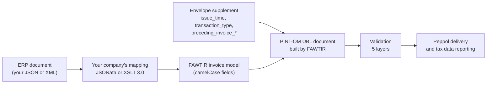

This page explains how the document your ERP already produces is turned into a PINT-OM e-invoice, which fields your mapping must output, and which rules apply to each of them. Use it while you write or review your company's mapping.

## How mapping works

Your ERP does not send a FAWTIR invoice format. It sends **its own document**, JSON or XML, inside a small submission envelope. Your company's **certified mapping** converts that document into FAWTIR's invoice model. FAWTIR then builds the PINT-OM UBL document from the model, validates it, and sends it.



| Format your ERP sends | Mapping language | What the mapping outputs |
|---|---|---|
| JSON | JSONata | A JSON object shaped like the FAWTIR invoice model |
| XML | XSLT 3.0 | JSON, using `<xsl:output method="json"/>` |

CSV and EDIFACT are not accepted on the submission routes.

A few values never come from the mapping. They travel in the envelope's `supplement` object, or FAWTIR sets them itself:

| Value | Where it comes from |
|---|---|
| Issue time (IBT-168) | `supplement.issue_time` |
| Transaction type bitmap (BTOM-001) | `supplement.transaction_type` |
| Preceding invoice number, date and UUID (IBT-025, IBT-026, BTOM-031) and the correction reason (BTOM-032) | `supplement.preceding_invoice_*` and `supplement.credit_note_reason_code` |
| Invoice UUID (BTOM-002) | Generated by FAWTIR. Under PINT-OM 1.0.1 it is a deterministic UUID version 5. |
| `cbc:CustomizationID`, `cbc:ProfileID` | Set by FAWTIR from the route you post to. Your mapping must still output `customizationId` and `profileId`, but their values are not used. |

The envelope itself is described in the [API reference](/api/reference/).

:::note
The mapping is the only place where your ERP's field names meet PINT-OM. When you change a field in your ERP, change the mapping and certify it again.
:::

### Guided mapping and advanced mapping

There are two ways to write a JSON mapping. Both end as one JSONata expression, run by the same engine.

| | Guided mapping | Advanced mapping |
|---|---|---|
| Formats | JSON only | JSON (JSONata) and XML (XSLT 3.0) |
| How you write it | In the app, you pick, field by field, where each invoice value is found in a sample document from your ERP. | You write the JSONata expression or the XSLT stylesheet yourself and save it. |
| Platform values | FAWTIR fills in fixed values for you: the tax scheme `VAT`, the `HS` scheme on a goods classification, and the service type `00000000` when you map the goods/services flag but no service type. | You write every value yourself, including constants such as the `0248` participant scheme. |
| Best for | Flat exports where each value sits in one place | Lookups, conditions, several tax categories, XML sources |

In the app, both are under **ERP integration**, on the **Mapping** tab. The app's mapping screens author and certify the JSON mapping. An XML mapping is saved and certified through the mapping API by a signed-in user.

Your company has one active mapping per format. Every channel (API Push, Managed Pull and Bridge Upload) uses the active mapping for the format it receives. Each save creates a new version. A dry run (`POST /api/v1/peppol/mapping-profiles/{format}/dry-run`) shows the invoice model your mapping produces from a sample document, without saving or sending anything. It does not run the full validation.

### Certification

<span class="rule rule--fawtir">FAWTIR rule</span> a document is accepted only if the mapping that converted it has passed **certification**: a test invoice run through the whole pipeline, including all five validation layers and the PINT-OM rules. Nothing is sent during certification.

A pass covers exactly:

| Dimension | What must match |
|---|---|
| Mapping content | The exact mapping text that ran. Any change, even one character, retires its certifications. Saving identical content keeps them. |
| Format | `JSON` or `XML` |
| Route and document kind | `INVOICE`, `CREDIT_NOTE`, `DEBIT_NOTE` or `SELF_BILLING`. Certify each route you use. |
| Transaction type | Positions 1 to 15 of the `transaction_type` bitmap, with `X` read as `0`. Positions 16 to 20 are ignored. |

So a mapping certified for full tax invoices (`1XXXXXXXXXXXXXXXXXXX`) does not cover Simplified invoices, export invoices or credit notes. A document outside its certified scope is refused with `422 SUBMISSION_NOT_SUPPORTED`, and the message names the certification call to run.

Certification is done by people. Saving, dry-running and certifying a mapping are refused for every machine credential (API key or OAuth client), whatever permissions it holds. A user with the mapping permissions certifies the mapping in the app (or through `POST /api/v1/peppol/mapping-profiles/{format}/certification?route=...` while signed in). Your ERP integration cannot certify its own mapping.

:::caution[Warning]
Every mapping edit invalidates its certifications. Plan a certification run, for every route and transaction type you use, as part of each mapping release. Until it passes, documents are refused.
:::

## Reading the field tables

- **FAWTIR model field** is the exact camelCase key your mapping must output. Nested keys are written with dots, and `[]` marks a list. Use only these names. The model does not accept keys it does not define, so a misspelt or extra key makes the mapping fail (`MAPPING_FAILED`) rather than being ignored.
- **ERP field** is a typical example of where the value lives in an ERP export. Your ERP's names will differ.
- **PINT-OM element** gives the business term and the UBL XPath, relative to the document root (`Invoice`, or `CreditNote` for a credit note). Shorthand: `{S}` = `cac:AccountingSupplierParty/cac:Party`, `{B}` = `cac:AccountingCustomerParty/cac:Party`, `{L}` = `cac:InvoiceLine` (`cac:CreditNoteLine` in a credit note).
- **Req.**: R = required, O = optional, C = conditional.
- Amounts are `Money` objects: `{ "amount": 125.000, "currencyCode": "OMR" }`. Both members are required, and the currency code has three letters.
- Dates are ISO strings, `yyyy-MM-dd`.
- The rule kind is labelled in the Validation column: <span class="rule rule--pint">PINT-OM rule</span> (with its rule ID), <span class="rule rule--fawtir">FAWTIR rule</span> or <span class="rule rule--advice">Recommendation</span>.

All company names, numbers and codes in the examples on this page are fictitious.

## Field tables

### Supplier (seller)

The supplier is your company, the FAWTIR tenant. Its object is `supplier.party`.

| ERP field (example) | FAWTIR model field | PINT-OM element | Type | Req. | Validation | Example | Notes |
|---|---|---|---|---|---|---|---|
| Company VAT number | `supplier.party.endpoint.schemeId` + `.value` | IBT-034, IBT-034-1 `{S}/cbc:EndpointID/@schemeID` | object | R | FAWTIR rule: required for the seller, and must be your company's verified Peppol participant. FAWTIR rule: the value is bare, a `0248:` prefix is refused. | `{"schemeId":"0248","value":"OM1999000101"}` | Scheme `0248` is Oman's VAT-based participant scheme. |
| Company display name | `supplier.party.partyName` | IBT-028 `{S}/cac:PartyName/cbc:Name` | string | R | FAWTIR rule: required | `Al Waha Trading` | |
| Company legal name | `supplier.party.registrationName` | IBT-027 `{S}/cac:PartyLegalEntity/cbc:RegistrationName` | string | R | FAWTIR rule: required | `Al Waha Trading LLC` | |
| Commercial registration | `supplier.party.companyId` | IBT-030 `{S}/cac:PartyLegalEntity/cbc:CompanyID` | string | O | | `1234567` | |
| Other identifiers | `supplier.party.partyIdentifications[]` `{schemeId, value, schemeName}` | IBT-029 `{S}/cac:PartyIdentification/cbc:ID` | list | O | FAWTIR rule: `value` required in each entry. PINT-OM rule CL-06-OM: `schemeName` is one of CR, TIN, CID, PASNUM, OTHID, ICID, SZLN. | `[{"schemeId":"0248","value":"OM1999000101"}]` | |
| Street | `supplier.party.postalAddress.streetName` | IBT-035 `{S}/cac:PostalAddress/cbc:StreetName` | string | R | PINT-OM rule IBR-010-OM: street, additional street, address line, city and postal code are all required for the seller | `Al Khuwair` | |
| Street 2 | `supplier.party.postalAddress.additionalStreetName` | IBT-036 `.../cbc:AdditionalStreetName` | string | R | IBR-010-OM | `PO Box 123` | |
| Address line | `supplier.party.postalAddress.addressLine` | IBT-162 `.../cac:AddressLine/cbc:Line` | string | R | IBR-010-OM | `Al Khuwair` | |
| City | `supplier.party.postalAddress.cityName` | IBT-037 `.../cbc:CityName` | string | R | IBR-010-OM | `Muscat` | |
| Postal code | `supplier.party.postalAddress.postalZone` | IBT-038 `.../cbc:PostalZone` | string | R | IBR-010-OM | `133` | |
| Region code | `supplier.party.postalAddress.countrySubentityCode` | BTOM-024 | string | O | FAWTIR rule and CL-13-OM: one of SHRFZ, SEZAD, SLLFZ, AFZ, MO, OTH | | |
| Country | `supplier.party.postalAddress.countryCode` | IBT-040 `.../cac:Country/cbc:IdentificationCode` | string(2) | R | FAWTIR rule: required, two letters | `OM` | |
| Phone | `supplier.party.contact.telephone` | IBT-042 `{S}/cac:Contact/cbc:Telephone` | string | R | PINT-OM rule IBR-011-OM: seller telephone always required | `+96800000000` | |
| Contact name, email | `supplier.party.contact.name`, `.electronicMail` | IBT-041, IBT-043 | string | O | | `billing@alwaha.example` | |

### Buyer

| ERP field (example) | FAWTIR model field | PINT-OM element | Type | Req. | Validation | Example | Notes |
|---|---|---|---|---|---|---|---|
| Customer VAT number | `customer.party.endpoint.schemeId` + `.value` | IBT-049, IBT-049-1 `{B}/cbc:EndpointID/@schemeID` | object | O | FAWTIR rule: bare value, no scheme prefix | `{"schemeId":"0248","value":"OM1999000202"}` | If absent, FAWTIR resolves the buyer's address from the buyer VAT number and your customer records, or uses the routing rules for buyers who are not on Peppol. |
| Customer display name | `customer.party.partyName` | IBT-045 `{B}/cac:PartyName/cbc:Name` | string | R | FAWTIR rule: required on every document | `Sahil Engineering` | |
| Customer legal name | `customer.party.registrationName` | IBT-044 `{B}/cac:PartyLegalEntity/cbc:RegistrationName` | string | R | FAWTIR rule: required on every document | `Sahil Engineering SAOC` | |
| Customer registration | `customer.party.companyId` | IBT-047 | string | O | | | |
| Customer identifiers | `customer.party.partyIdentifications[]` | IBT-046 `{B}/cac:PartyIdentification/cbc:ID` | list | C | PINT-OM rule IBR-016-OM: buyer identifier or buyer VAT number required on the transaction types listed under [VAT registrations](#vat-registrations) | | |
| Customer address | `customer.party.postalAddress.*` (same keys as the supplier) | IBG-08, IBT-050 to IBT-055, IBT-163 | object | R | FAWTIR rule: the object and `countryCode` are required. PINT-OM rule IBR-019-OM: street, additional street, address line, city and postal code are required on full tax, third-party, self-billed, export, import of services (RCM), import of goods, profit-margin, profit-margin self-invoice, special-zone and summary invoices | `Sohar`, `311` | A Simplified invoice still needs the address object with a country code. |

### VAT registrations

| ERP field (example) | FAWTIR model field | PINT-OM element | Type | Req. | Validation | Example | Notes |
|---|---|---|---|---|---|---|---|
| Company VAT number | `supplier.party.partyTaxScheme.companyId` and `.taxScheme` | IBT-031 `{S}/cac:PartyTaxScheme/cbc:CompanyID`, `cac:TaxScheme/cbc:ID` | object | C | PINT-OM rule IBR-003-OM: `OM` + 10 digits. PINT-OM rule IBR-006-OM: required except on import of goods, import of services (RCM) and profit-margin self-invoices. FAWTIR rule: both keys required when the object is present. | `{"companyId":"OM1999000101","taxScheme":"VAT"}` | `taxScheme` is always `VAT`. |
| Customer VAT number | `customer.party.partyTaxScheme.companyId` and `.taxScheme` | IBT-048 `{B}/cac:PartyTaxScheme/cbc:CompanyID` | object | C | PINT-OM rule IBR-003-OM: `OM` + 10 digits. IBR-016-OM and IBR-017-OM, see below. | `{"companyId":"OM1999000202","taxScheme":"VAT"}` | Leave it out for a consumer on a Simplified invoice. Never put a placeholder in it. |
| Agent (third party) | `supplier.thirdParty` `{name, vatin, taxScheme, postalAddress}` | BTOM-006 and agent address, `cac:AgentParty` | object | C | Needed for transaction type position 4. FAWTIR rule: `vatin` is `OM` + 10 digits, `taxScheme` is `VAT`, and the address needs street, additional street, address line, city, postal code and country (IBR-015-OM, IBR-003-OM, IBR-009-OM). | | |

**Format.** PINT-OM rule IBR-003-OM: "Seller VATIN (IBT-031), Buyer VATIN (IBT-048) and Third party VATIN (BTOM-006) MUST be 12 characters: 'OM' followed by exactly 10 digits." FAWTIR checks the third-party VAT number itself. The seller and buyer VAT numbers are checked by the PINT-OM validation layer, so a wrong format comes back as a `422 VALIDATION_FAILED` naming IBR-003-OM.

**When the buyer VAT number is required.**

| Rule | Applies to (BTOM-001) | Requirement |
|---|---|---|
| PINT-OM rule IBR-006-OM | All except import of goods, import of services (RCM), profit-margin self-invoice | The **seller** VAT number must be present. |
| PINT-OM rule IBR-016-OM | Full tax, third party, summary, continuous supply, export, profit margin, e-commerce | The buyer identifier (IBT-046) **or** the buyer VAT number (IBT-048) must be present. |
| PINT-OM rule IBR-017-OM | Self-billed invoice or credit note, import of services (RCM), profit-margin self-invoice, import of goods | The buyer VAT number (IBT-048) must be present. |

A Simplified invoice is in neither buyer list.

:::tip[Recommendation]
For a VAT-registered business buyer, always send the buyer VAT number, even where IBR-016-OM would accept another identifier. It also lets FAWTIR find the buyer's Peppol address.
:::

### Invoice number

| ERP field (example) | FAWTIR model field | PINT-OM element | Type | Req. | Validation | Example | Notes |
|---|---|---|---|---|---|---|---|
| Document number | `header.invoiceNumber` | IBT-001 `cbc:ID` | string | R | FAWTIR rule: not blank. FAWTIR rule: unique per company and issue year, across all document kinds. | `INV-2026-000145` | Used exactly as sent. FAWTIR does not renumber an API document. |

<span class="rule rule--fawtir">FAWTIR rule</span> a second document with the same number in the same issue year, or with identical business content, is refused with `409 DUPLICATE_INVOICE`, whatever Idempotency-Key you use. When the business content is identical, the response also links to the existing submission. Credit notes and debit notes share the number space with invoices. See [Error reference](/reference/errors/).

### Branch identifiers

There is no branch field in the FAWTIR invoice model, and none in the PINT-OM document FAWTIR builds from an API submission.

- <span class="rule rule--fawtir">FAWTIR rule</span> a document submitted through the API belongs to no branch. FAWTIR's branch number series are used only for invoices created in the FAWTIR app. They are never applied to API documents.
- <span class="rule rule--fawtir">FAWTIR rule</span> a user limited to some branches cannot submit through these routes. The request is refused with `403` and type `https://api.fawtir.om/problems/branch-not-in-scope`.
- If your ERP numbers invoices per branch (for example with a branch prefix), that prefix is part of `header.invoiceNumber`. FAWTIR checks uniqueness per company and year, not per branch, so two branches must never produce the same full number in the same year.

:::tip[Recommendation]
Keep a branch code inside the invoice number if your branches number independently. FAWTIR will not separate the series for you.
:::

### Dates and issue time

| ERP field (example) | FAWTIR model field | PINT-OM element | Type | Req. | Validation | Example | Notes |
|---|---|---|---|---|---|---|---|
| Invoice date | `header.issueDate` | IBT-002 `cbc:IssueDate` | date | R | FAWTIR rule: required | `2026-11-10` | The issue year also keys invoice-number uniqueness. |
| (envelope) | `supplement.issue_time` | IBT-168 `cbc:IssueTime` | `HH:mm:ss` | R | FAWTIR rule: required | `10:15:00` | Sent in the envelope, not by the mapping. |
| Due date | `header.dueDate` | IBT-009 `cbc:DueDate` | date | O | | `2026-12-10` | Emitted on invoices only. |
| Tax point date | `header.taxPointDate` | IBT-007 `cbc:TaxPointDate` | date | O | | | |
| Billing period | `invoicePeriod.startDate`, `.endDate` | IBT-073, IBT-074 `cac:InvoicePeriod` | dates | C | PINT-OM rule IBR-037-OM: summary and continuous-supply invoices | | |
| Line period | `lines[].period.startDate`, `.endDate` | IBT-134, IBT-135 `{L}/cac:InvoicePeriod` | dates | C | PINT-OM rule IBR-072-OM: required on a full tax summary invoice (bitmap positions 1 and 5 both set) | | |

FAWTIR does not convert time zones on the API path. It uses the date your mapping outputs and the time in `issue_time` as they are.

:::tip[Recommendation]
Send the date and time at which the invoice was issued in Oman local time, and take both from the same timestamp in your ERP.
:::

**PINT-OM rule IBR-171-OM:** the issue date must not be in the future, judged in Oman time (UTC+04:00). A post-dated invoice fails validation, so do not issue an invoice with a future date and send it early.

### Currency

| ERP field (example) | FAWTIR model field | PINT-OM element | Type | Req. | Validation | Example | Notes |
|---|---|---|---|---|---|---|---|
| Currency | `header.documentCurrencyCode` | IBT-005 `cbc:DocumentCurrencyCode` | string(3) | R | FAWTIR rule: three characters. PINT-OM rule ibr-cl-04: ISO 4217 | `OMR` | |
| VAT accounting currency | `header.taxCurrencyCode` | IBT-006 `cbc:TaxCurrencyCode` | string(3) | C | PINT-OM rule IBR-034-OM: required when the document currency is not OMR. FAWTIR rule: it must then be `OMR`. PINT-OM rule ibr-077: when present it must differ from the document currency | | Leave it out for an OMR invoice. |
| Exchange rate | `header.currencyExchange` `{sourceCurrencyCode, targetCurrencyCode, calculationRate}` | BTOM-028, BTOM-029, BTOM-003 `cac:TaxExchangeRate` | object | C | PINT-OM rule IBR-004-OM: required when the currency is not OMR. IBR-172-OM: forbidden on OMR. FAWTIR rule: rate above 0, at most 7 decimals (IBR-005-OM), source = document currency, target = `OMR`. | | |
| (second tax total) | `taxTotals[]` with `role: "ACCOUNTING_CURRENCY"` | IBT-111 | object | C | FAWTIR rule: exactly one document-currency tax total, plus one accounting-currency tax total only when the tax currency differs | | |

### Invoice type and transaction type

| ERP field (example) | FAWTIR model field | PINT-OM element | Type | Req. | Validation | Example | Notes |
|---|---|---|---|---|---|---|---|
| Document type (for example Odoo `move_type`) | `header.invoiceTypeCode` | IBT-003 `cbc:InvoiceTypeCode` or `cbc:CreditNoteTypeCode` | string | R | FAWTIR rule: must match the route, see below. PINT-OM rule ibr-cl-01: UNTDID 1001 subset. | `380` | Usually derived by the mapping from the ERP's document type. |
| (envelope) | `supplement.transaction_type` | BTOM-001 `cbc:InvoiceTypeCode/@name` | 20 characters | R | FAWTIR rule: `^[X1]{20}$` | `1XXXXXXXXXXXXXXXXXXX` | See [The transaction type bitmap](#the-transaction-type-bitmap). |
| (none) | `header.customizationId`, `header.profileId` | IBT-024, IBT-023 | string | R | FAWTIR rule: must be present | `urn:peppol:pint:billing-1@om-1`, `urn:peppol:bis:billing` | Values are ignored. FAWTIR sets them from the route. |

**FAWTIR rule: type code per route.**

| Route | Type code the mapping must output |
|---|---|
| `POST /api/v1/invoices` | Any code in the PINT-OM invoice list **except** 381, 383, 261 and 389, which have their own routes. A normal tax invoice is `380` (commercial invoice) or `388` (tax invoice). |
| `POST /api/v1/creditnotes` | `381` |
| `POST /api/v1/debitnotes` | `383` |
| `POST /api/v1/selfbilling` | `389` (self-billed invoice) or `261` (self-billed credit note) |

**PINT-OM rule IBR-177-OM:** a `389` or `261` document must set at least one of bitmap positions 3 (self-billed), 9 (import of services, RCM), 11 (profit-margin self-invoice) or 13 (import of goods). The FAWTIR rules in the bitmap table below narrow which combinations FAWTIR accepts.

#### The transaction type bitmap

BTOM-001 is a 20-position flag string. Each position is one transaction type. The positions are defined by the PINT-OM code list CL-03-OM:

| Pos. | Transaction type | Notes |
|---|---|---|
| 1 | Full tax invoice | PINT-OM rule: exactly one of positions 1 and 2 is set. |
| 2 | Simplified tax invoice | Mainly B2C. Relaxes several buyer and item rules. |
| 3 | Self-billed | Use `POST /api/v1/selfbilling`. FAWTIR rule: refused together with 2 (IBR-149-OM), with 9 or 13, or with 10. |
| 4 | Third party | Needs `supplier.thirdParty`. |
| 5 | Summary invoice | Needs `invoicePeriod` (IBR-037-OM). |
| 6 | Continuous supply | Needs `invoicePeriod` (IBR-037-OM). |
| 7 | Export | Needs `delivery` (IBR-014-OM). |
| 8 | Deemed supply | |
| 9 | Import of services (RCM) | |
| 10 | Profit margin | Needs `profitMargin` and preceding-invoice references (IBR-175-OM). |
| 11 | Profit-margin self-invoice | FAWTIR rule: refused. |
| 12 | E-commerce | |
| 13 | Import of goods | |
| 14 | Special zone supplies | |
| 15 | Prepayment | FAWTIR rule: a non-zero `monetaryTotal.prepaidAmount` is refused (IBR-058-OM references cannot be carried yet). |
| 16 to 20 | Reserved | Send `X`. |

Several positions can be set at once, for example a full tax export invoice.

**FAWTIR rule: send `X` or `1`, never `0`.** The PINT-OM 1.0.1 specification writes the bitmap with `0` and `1`. The FAWTIR API accepts only `X` (not set) and `1` (set), and FAWTIR writes `0` for every `X` when it builds the document. A bitmap containing `0` is refused with `400 validation-failed`.

| Case | Send |
|---|---|
| Full tax invoice, B2B | `1XXXXXXXXXXXXXXXXXXX` |
| Simplified tax invoice | `X1XXXXXXXXXXXXXXXXXX` |
| Full tax export invoice | `1XXXXX1XXXXXXXXXXXXX` |

:::caution[Warning]
The bitmap is part of the certification scope. Certify every combination you send.
:::

### Tax categories and amounts

| ERP field (example) | FAWTIR model field | PINT-OM element | Type | Req. | Validation | Example | Notes |
|---|---|---|---|---|---|---|---|
| Line tax code | `lines[].item.classifiedTaxCategory` `{id, percent, taxScheme, taxExemptionReasonCode, taxExemptionReason}` | IBT-151, IBT-152, IBT-121, IBT-120 `{L}/cac:Item/cac:ClassifiedTaxCategory` | object | R | See the category rules below | `{"id":"S","percent":5,"taxScheme":"VAT"}` | PINT-OM rule IBR-076-OM: every line has a category. |
| Tax total | `taxTotals[].taxAmount` | IBT-110 `cac:TaxTotal/cbc:TaxAmount` | Money | R | | `11.250` | Emitted at 2 decimals. |
| Breakdown taxable amount | `taxTotals[].subtotals[].taxableAmount` | IBT-116 `cac:TaxSubtotal/cbc:TaxableAmount` | Money | R | | `225.000` | One subtotal per category and rate. |
| Breakdown tax amount | `taxTotals[].subtotals[].taxAmount` | IBT-117 `cac:TaxSubtotal/cbc:TaxAmount` | Money | R | FAWTIR rule: taxable × rate ÷ 100, within 0.005 | `11.250` | |
| Breakdown category | `taxTotals[].subtotals[].taxCategory` | IBT-118, IBT-119, IBT-121 `cac:TaxSubtotal/cac:TaxCategory` | object | R | Same rules as the line category | | |
| Line VAT amount | `lines[].taxAmount` | BTOM-016 | Money | O | FAWTIR rule: zero or more (IBR-137-OM), at most 3 decimals (IBR-DEC-03-OM) | `6.250` | If absent, FAWTIR computes net × rate ÷ 100, rounded to 3 decimals. |
| Totals | `monetaryTotal.lineExtensionAmount`, `.taxExclusiveAmount`, `.taxInclusiveAmount`, `.payableAmount` | IBT-106, IBT-109, IBT-112, IBT-115 `cac:LegalMonetaryTotal` | Money | R | FAWTIR rule: arithmetic checks within 0.005 | `225.000`, `225.000`, `236.250`, `236.250` | Emitted at 2 decimals. |
| Allowance and charge totals | `monetaryTotal.allowanceTotalAmount`, `.chargeTotalAmount` | IBT-107, IBT-108 | Money | C | Required when document-level allowances or charges exist | | |
| Prepaid amount | `monetaryTotal.prepaidAmount` | IBT-113 | Money | O | FAWTIR rule: must be absent or 0 | | |
| Rounding amount | `monetaryTotal.payableRoundingAmount` | IBT-114 | Money | O | | | |

**VAT categories.** PINT-OM rule CL-04-OM allows only four category codes, on lines, breakdowns, and document allowances and charges:

| Code | Meaning | Rate | Exemption reason code |
|---|---|---|---|
| `S` | Standard rate | Required. PINT-OM rule ALIGNED-IBRP-S-05-OM: must be `5`. | Not used |
| `Z` | Zero rated | Required. PINT-OM rule ALIGNED-IBRP-Z-05-OM: must be `0`. | Required. PINT-OM rule CL-10-OM: `VATZR-OM-01` to `VATZR-OM-16`. |
| `E` | Exempt | FAWTIR rule: must be absent (ALIGNED-IBRP-E-05-OM). | Required. PINT-OM rule CL-05-OM: `VATEX-OM-01` to `VATEX-OM-12`. |
| `O` | Outside the scope of VAT | FAWTIR rule: must be absent (ALIGNED-IBRP-O-05-OM). | |

Any other code, such as `AE`, `K` or `G`, fails validation. FAWTIR refuses an `E` or `O` category that carries a rate, and any other category that has none, before validation runs. Rates have at most two decimals (PINT-OM rule IBR-046-OM).

:::note
A mapping that copies the ERP's tax percentage into `percent` for every category, as the Odoo 17 example does, fails on `E` and `O` lines. Add a condition if you use those categories.
:::

### Allowances and charges

| ERP field (example) | FAWTIR model field | PINT-OM element | Type | Req. | Validation | Example | Notes |
|---|---|---|---|---|---|---|---|
| Header discount or fee | `allowanceCharges[]` | IBG-20, IBG-21 `cac:AllowanceCharge` | list | O | | | |
| Discount or charge | `…chargeIndicator` | `cbc:ChargeIndicator` | boolean | R | | `false` | `false` = allowance, `true` = charge. |
| Amount | `…amount` | IBT-092, IBT-099 `cbc:Amount` | Money | R | See [Decimals](#decimals-and-the-baisa-tolerance) | | |
| Base amount, percentage | `…baseAmount`, `…multiplierFactorNumeric` | IBT-093, IBT-094, IBT-100, IBT-101 | Money, number | O | | | |
| Reason | `…reasonCode`, `…reason` | IBT-097, IBT-098, IBT-104, IBT-105 | string | R (one of the two) | FAWTIR rule: at least one. PINT-OM rules ibr-cl-19 / ibr-cl-20: code from UNCL 5189 (allowances) or UNCL 7161 (charges). | | |
| Tax category | `…taxCategory` | IBT-095, IBT-102 | object | R at document level | CL-04-OM: S, E, O or Z | | |
| Line discount or fee | `lines[].allowanceCharges[]` | IBG-27, IBG-28 `{L}/cac:AllowanceCharge` | list | O | Same keys, no tax category | | |
| Price discount | `lines[].price.allowanceCharge` | `{L}/cac:Price/cac:AllowanceCharge` | object | O | | | |

### Lines, quantities and units

| ERP field (example) | FAWTIR model field | PINT-OM element | Type | Req. | Validation | Example | Notes |
|---|---|---|---|---|---|---|---|
| Line sequence | `lines[].id` | IBT-126 `{L}/cbc:ID` | string | R | FAWTIR rule: at least one line, each with an id | `"1"` | Convert integers to strings. |
| Line note | `lines[].note` | IBT-127 `{L}/cbc:Note` | string | O | | | |
| Quantity | `lines[].invoicedQuantity` | IBT-129 `{L}/cbc:InvoicedQuantity` (`cbc:CreditedQuantity` in a credit note) | number | R | | `10` | |
| Unit of measure | `lines[].unitCode` | IBT-130 `…Quantity/@unitCode` | string | R | FAWTIR rule: required. PINT-OM rule ibr-cl-23: UN/ECE Recommendation 20, with the Recommendation 21 codes. | `H87`, `HUR` | FAWTIR has no unit list of its own. Map your ERP units to these codes in the mapping. |
| Line net amount | `lines[].lineExtensionAmount` | IBT-131 `{L}/cbc:LineExtensionAmount` | Money | R | Written at 3 decimals, see [Decimals](#decimals-and-the-baisa-tolerance) | `125.000` | |
| Unit price | `lines[].price.priceAmount` | IBT-146 `{L}/cac:Price/cbc:PriceAmount` | Money | R | | `12.500` | Emitted as sent, not rounded. |
| Price base quantity, unit | `lines[].price.baseQuantity`, `.baseQuantityUnitCode` | IBT-149, IBT-150 | number, string | O | ibr-cl-23 for the unit | `1`, `H87` | |
| Item name | `lines[].item.name` | IBT-153 `{L}/cac:Item/cbc:Name` | string | R | FAWTIR rule: required | `Steel pipe 2 inch` | |
| Description | `lines[].item.description` | IBT-154 | string | O | | | |
| Seller item code | `lines[].item.sellersItemIdentification` | IBT-155 | string | O | | `SP-2IN` | |
| Buyer item code | `lines[].item.buyersItemIdentification` | IBT-156 | string | O | | | |
| Standard item id (for example GTIN) | `lines[].item.standardItemIdentification` + `…SchemeId` | IBT-157 | string | O | FAWTIR rule: scheme required when the id is present | | |
| Country of origin | `lines[].item.countryOfOrigin` | IBT-159 | string(2) | C | Required for import of goods (IBR-084-OM) | | |
| Total sale value (profit margin) | `lines[].itemTotalSaleValue` | BTOM-017 override | Money | C | Profit-margin lines only | | |

:::tip[Recommendation]
Hold the UN/ECE unit code on the ERP line or unit record, or keep a unit table in your mapping, and make the mapping fail on a line without a known unit. Do not default unknown units to `H87`.
:::

### HS codes and goods or service classification

| ERP field (example) | FAWTIR model field | PINT-OM element | Type | Req. | Validation | Example | Notes |
|---|---|---|---|---|---|---|---|
| Goods or service flag | `lines[].item.goodsOrServiceCode` | BTOM-019 `{L}/cac:Item/cac:ItemSpecificationDocumentReference/cbc:DocumentTypeCode` | `G` or `S` | C | PINT-OM rule IBR-078-OM: required on every line except on Simplified invoices | `G` | Most ERPs need a custom field for this. |
| Service type | `lines[].item.serviceTypeCode` | BTOM-034 `…ItemSpecificationDocumentReference/cbc:ID[@schemeName='MP']` | 8 digits | C | FAWTIR rule: required whenever `goodsOrServiceCode` is sent, on goods lines too; otherwise `422 SUBMISSION_NOT_SUPPORTED` with `field` `serviceTypeCode`. PINT-OM rule CL-12-OM: from the service type list. PINT-OM rule IBR-155-OM: on an export invoice (position 7) where a line is zero rated for export of services (`VATZR-OM-09`), a service type must be present. | `00000000` | `00000000` is "Other", used for goods lines and for services that are not exported. |
| Industrial classification (ISIC) | `lines[].item.industrialClassificationCode` | BTOM-033 `{L}/cac:Item/cac:AdditionalItemIdentification/cbc:ID[@schemeName='CC']` | 6 digits | C | PINT-OM rule IBR-081-OM: required except on Simplified, import of goods, import of services (RCM) and profit-margin self-invoices. CL-08-OM-ISIC: from the Oman ISIC list. | `466203` | |
| HS code | `lines[].item.itemClassifications[]` `{code, schemeId: "HS"}` | IBT-158, IBT-158-1 `{L}/cac:Item/cac:CommodityClassification/cbc:ItemClassificationCode[@listID='HS']` | 12 digits | C | See below | `730630000002` | |
| Other classification | `lines[].item.itemClassifications[]` `{code, schemeId, schemeVersionId}` | IBT-158, IBT-158-1, IBT-158-2 | list | O | FAWTIR rule and PINT-OM rule IBR-056-OM: `schemeId` is `HS` or `MP` | | |

**HS codes, as enforced.**

- **PINT-OM rule IBR-079-OM:** "When Goods or Services identification (BTOM-019) is 'Goods' then Item classification identifier (IBT-158, HS code) must be provided except when Invoice transaction type (BTOM-001) is 'Simplified Tax Invoice' (01000000000000000000)"
- **PINT-OM rule IBR-174-OM:** PINT-OM 1.0.1 as published also contains this rule, which applies the same check without the Simplified exemption. Until this is clarified, provide an HS code on every goods line.
- <span class="rule rule--fawtir">FAWTIR rule</span> an HS code (`schemeId` `HS`) must be exactly 12 digits. FAWTIR checks this when it reads your mapping's output, before validation, so a shorter or longer code is refused with `422 MAPPING_FAILED`, without a rule ID. PINT-OM rule IBR-080-OM states the same length requirement.
- **PINT-OM rule CL-08-OM-HS:** a 12-digit code must also be on the published Oman HS code list. A 12-digit code that is not on the list fails validation with `422 VALIDATION_FAILED`. For example, `730630000000` is not on the list, while `730630000001` and `730630000002` are.

:::caution[Warning]
A missing or unlisted HS code on a goods line refuses the whole document with `422 VALIDATION_FAILED`. Check your item master data for HS codes before go-live, including on items you sell to consumers.
:::

The current lists are linked from [Official references](/reference/official-references/#code-lists).

### Payment means and terms

| ERP field (example) | FAWTIR model field | PINT-OM element | Type | Req. | Validation | Example | Notes |
|---|---|---|---|---|---|---|---|
| Payment method | `paymentMeans[].paymentMeansCode` | IBT-081 `cac:PaymentMeans/cbc:PaymentMeansCode` | string | R in each entry | FAWTIR rule: required. PINT-OM rule ibr-cl-16: UNCL4461. | `30` (credit transfer), `10` (in cash), `48` (bank card) | `paymentMeans` itself is optional. FAWTIR has no code list of its own. |
| Payment reference | `paymentMeans[].paymentId` | IBT-083 `cac:PaymentMeans/cbc:PaymentID` | string | O | | `INV-2026-000145` | |
| Bank account | `paymentMeans[].payeeFinancialAccount` `{id, name, financialInstitutionBranchId}` | IBT-084, IBT-085, IBT-086 `cac:PayeeFinancialAccount` | object | O | FAWTIR rule: `id` required when present | | |
| Payment due date | `paymentMeans[].paymentDueDate` | `cac:PaymentMeans/cbc:PaymentDueDate` | date | O | | | |
| Payment terms text | `paymentTerms.note` | IBT-020 `cac:PaymentTerms/cbc:Note` | string | O | Free text only | `30 days net` | |
| Payee (if not the seller) | `payee` `{partyName, identifications, companyId}` | IBT-059 to IBT-061 `cac:PayeeParty` | object | O | FAWTIR rule: must differ from the supplier | | |

### References to original invoices

These values come from the envelope's `supplement`, not from the mapping. They become `cac:BillingReference/cac:InvoiceDocumentReference`.

| ERP field (example) | Envelope field | PINT-OM element | Type | Req. | Validation | Example | Notes |
|---|---|---|---|---|---|---|---|
| Original invoice number | `supplement.preceding_invoice_number` | IBT-025 `…/cbc:ID` | string | C | PINT-OM rule IBR-032-OM, FAWTIR rule: required for type codes 381, 383 and 261 | `INV-2026-000145` | |
| Original issue date | `supplement.preceding_invoice_date` | IBT-026 `…/cbc:IssueDate` | `yyyy-MM-dd` | C | Same | `2026-11-10` | |
| Original UUID | `supplement.preceding_invoice_uuid` | BTOM-031 `…/cbc:UUID` | UUID | C | Same. FAWTIR rule: if FAWTIR sent the original, it must equal the `invoice_uuid` FAWTIR returned for it. | | |
| Reason | `supplement.credit_note_reason_code` | BTOM-032 `…/cbc:DocumentStatusCode` | string | C | PINT-OM rule IBR-023-OM: required for 381, 383 and 261. PINT-OM rule CL-02-OM: `CAN`, `VAT`, `VAL`, `QTY` or `OTH`. | `CAN` | FAWTIR checks presence. The value is checked by validation. |

Profit-margin invoices (position 10) also need the preceding invoice number and UUID (PINT-OM rule IBR-175-OM).

### Credit and debit note fields

A credit note or debit note uses the same model as an invoice. What changes:

| Item | Credit note | Debit note |
|---|---|---|
| Route | `POST /api/v1/creditnotes` | `POST /api/v1/debitnotes` |
| `header.invoiceTypeCode` | `381` | `383` |
| UBL root | `CreditNote`, with `cbc:CreditNoteTypeCode` and `cac:CreditNoteLine` / `cbc:CreditedQuantity` | `Invoice` |
| Amounts | Positive, with the same signs as the original invoice | Positive |
| References | All four preceding-invoice fields above | All four preceding-invoice fields above |
| Certification | Its own pass on route `CREDIT_NOTE` | Its own pass on route `DEBIT_NOTE` |

How to issue corrections is explained in [Invoice corrections](/integrate/corrections/).

## Decimals and the baisa tolerance

Omani amounts use three decimals (1 baisa = 0.001 OMR), but PINT-OM requires two decimals on the document totals.

**What FAWTIR does (FAWTIR rule).** FAWTIR takes the amounts your mapping outputs and writes them at a fixed number of decimals, rounding half up. It does not recompute your amounts.

| Amounts | Written with |
|---|---|
| Document totals: IBT-106 to IBT-115, the document tax total IBT-110, and document-level allowance and charge amounts (IBT-092, IBT-099) | 2 decimals |
| Line net amount (IBT-131), line VAT (BTOM-016), line total with VAT (BTOM-017), breakdown taxable and tax amounts (IBT-116, IBT-117) | 3 decimals |
| Unit price (IBT-146) | As sent |
| VAT rates | 2 decimals |

**What FAWTIR checks (FAWTIR rule).** Before the PINT-OM rules run, FAWTIR checks that the line amounts add up to the totals and that each breakdown's tax equals its taxable amount × rate ÷ 100, rounded half up to 3 decimals. A difference of up to 0.005 is accepted.

**What PINT-OM checks (PINT-OM rules).**

| Rule | Check |
|---|---|
| IBR-DEC-03-OM | At most 3 decimals on any amount (the exchange rate is covered by IBR-005-OM). The 2-decimal rules below are stricter for the document totals. |
| ibr-091, ibr-121 to ibr-125 | At most 2 decimals on IBT-107, IBT-108, IBT-109, IBT-110, IBT-112 and IBT-115. |
| IBR-168-OM | Line VAT (BTOM-016) = line net × rate ÷ 100, at 3 decimals. A difference of one baisa (0.001) per line raises a warning (IBR-168-OM-WARN), not an error. |
| ALIGNED-IBRP-S-09-OM | Breakdown tax for `S` = the sum of the line VAT amounts. A difference up to 0.001 × number of lines raises a warning. |
| IBR-005-OM | Exchange rate at most 7 decimals. |

Worked figures for the shared example:

| | Net | VAT 5% | With VAT |
|---|---|---|---|
| Line 1: 10 × 12.500 | 125.000 | 6.250 | 131.250 |
| Line 2: 4 × 25.000 | 100.000 | 5.000 | 105.000 |
| Breakdown S 5% (3 decimals) | 225.000 | 11.250 | |
| Totals as written (2 decimals) | 225.00 | 11.25 | 236.25 |

:::tip[Recommendation]
Compute VAT per line at 3 decimals, sum the lines for each breakdown, and round only the document totals to 2 decimals. Send FAWTIR the same figures your ERP posts, so the e-invoice and your ledger agree.
:::

:::caution[Warning]
If a document total has a third decimal that is not zero, FAWTIR rounds it to 2 decimals when it writes the document, and the payable amount changes by up to 0.005 OMR (5 baisa). Decide how your ERP handles that difference before go-live. The published specification is not fully consistent on decimals; see [Conflicts and open points](/reference/official-references/#conflicts-and-open-points-in-the-published-specifications).
:::

## Worked example: Odoo 17

FAWTIR publishes example mappings for Odoo 17 and Oracle Fusion invoice exports. They are starting points. Their sample data is representative, not captured from a live ERP, and your ERP's fields will differ.

This example adapts the Odoo 17 example to the shared example data used across this guide. Everything in it is fictitious: Al Waha Trading LLC (`OM1999000101`) invoices Sahil Engineering SAOC (`OM1999000202`) for 10 steel pipes and 4 hours of installation.

### The ERP document

This is an Odoo `account.move` record read through JSON-RPC, with its partner records expanded. Odoo returns many-to-one fields as `[id, label]` pairs, which is why the mapping reads `[1]`. The `x_btom_*` fields and `x_unece_unit_code` are not standard Odoo fields: they are custom fields added to the invoice line, because PINT-OM needs per-line codes that Odoo does not hold. `x_unece_unit_code` carries the UN/ECE Recommendation 20 unit code and `x_btom_hs_code` the 12-digit Oman HS code.

```json
{
  "name": "INV-2026-000145",
  "move_type": "out_invoice",
  "invoice_date": "2026-11-10",
  "invoice_date_due": "2026-12-10",
  "currency_id": [12, "OMR"],
  "ref": "PO-2026-0381",
  "amount_untaxed": 225.000,
  "amount_tax": 11.250,
  "amount_total": 236.250,
  "company_data": {
    "name": "Al Waha Trading",
    "legal_name": "Al Waha Trading LLC",
    "vat": "OM1999000101",
    "company_registry": "1234567",
    "street": "Al Khuwair",
    "street2": "PO Box 123",
    "city": "Muscat",
    "zip": "133",
    "country_code": "OM",
    "phone": "+96800000000",
    "email": "billing@alwaha.example"
  },
  "partner_data": {
    "name": "Sahil Engineering",
    "legal_name": "Sahil Engineering SAOC",
    "vat": "OM1999000202",
    "street": "Sohar Industrial Area",
    "street2": "Building 7",
    "city": "Sohar",
    "zip": "311",
    "country_code": "OM"
  },
  "invoice_line_ids": [
    {
      "sequence": 1,
      "name": "Steel pipe 2 inch",
      "product_id": [101, "Steel pipe 2 inch"],
      "default_code": "SP-2IN",
      "quantity": 10,
      "x_unece_unit_code": "H87",
      "price_unit": 12.500,
      "price_subtotal": 125.000,
      "x_btom_goods_or_service": "G",
      "x_btom_industrial_classification": "466203",
      "x_btom_service_type": "00000000",
      "x_btom_hs_code": "730630000002",
      "tax_ids": [ { "name": "VAT 5%", "amount": 5.0, "tax_group": "S" } ]
    },
    {
      "sequence": 2,
      "name": "Installation service",
      "product_id": [205, "Installation service"],
      "default_code": "SV-INST",
      "quantity": 4,
      "x_unece_unit_code": "HUR",
      "price_unit": 25.000,
      "price_subtotal": 100.000,
      "x_btom_goods_or_service": "S",
      "x_btom_industrial_classification": "432205",
      "x_btom_service_type": "72000000",
      "tax_ids": [ { "name": "VAT 5%", "amount": 5.0, "tax_group": "S" } ]
    }
  ]
}
```

### The mapping (excerpt)

The published Odoo 17 example mapping must be extended before it can handle this invoice:

- **Units.** It fixes every line's unit to `H87`. This invoice also has an hourly line, so the excerpt reads `x_unece_unit_code` instead.
- **HS codes.** It maps no HS code, because its sample has one service line. A goods line needs one, so the excerpt reads `x_btom_hs_code`.
- **Debit notes.** It turns `out_invoice` into `380` and `out_refund` into `381`, and stops on anything else. It has no branch for a debit note (`383`), so add one if your ERP issues debit notes.

The changes are marked `ADDED`. They are **not** part of the example that FAWTIR's own certification tests exercise, and the excerpt has not itself been certified. Your mapping is only trusted once it passes your own certification.

```jsonata
(
  $currency  := currency_id[1];
  $sellerVat := company_data.vat;
  $buyerVat  := partner_data.vat;
  $typeCode  := move_type = "out_invoice" ? "380"
              : move_type = "out_refund"  ? "381"
              : $error("unmapped Odoo move_type: " & move_type);

  /* ADDED: read the unit code from the line, and fail on a line that has none. */
  $unit := function($l) {
    $l.x_unece_unit_code ? $l.x_unece_unit_code
                         : $error("no unit code on line " & $string($l.sequence))
  };

  {
    "header": {
      "invoiceNumber": name,
      "issueDate": invoice_date,
      "dueDate": invoice_date_due,
      "invoiceTypeCode": $typeCode,
      "documentCurrencyCode": $currency,
      "buyerReference": ref,
      "purchaseOrderReference": ref,
      "customizationId": "urn:peppol:pint:billing-1@om-1",
      "profileId": "urn:peppol:bis:billing"
    },

    "supplier": { "party": {
      "endpoint": { "schemeId": "0248", "value": $sellerVat },
      "partyIdentifications": [ { "schemeId": "0248", "value": $sellerVat } ],
      "partyName": company_data.name,
      "registrationName": company_data.legal_name,
      "companyId": company_data.company_registry,
      "postalAddress": {
        "streetName": company_data.street,
        "additionalStreetName": company_data.street2,
        "cityName": company_data.city,
        "postalZone": company_data.zip,
        "countryCode": company_data.country_code,
        "addressLine": company_data.street
      },
      "partyTaxScheme": { "companyId": $sellerVat, "taxScheme": "VAT" },
      "contact": { "name": "Billing", "telephone": company_data.phone,
                   "electronicMail": company_data.email }
    } },

    /* "customer" follows the same pattern from partner_data, without "contact". */

    "lines": [ invoice_line_ids ~> $map(function($l) { {
      "id": $string($l.sequence),
      "invoicedQuantity": $l.quantity,
      "unitCode": $unit($l),                          /* ADDED: was "H87" */
      "lineExtensionAmount": { "amount": $l.price_subtotal, "currencyCode": $currency },
      "item": {
        "name": $l.product_id[1],
        "description": $l.name,
        "sellersItemIdentification": $l.default_code,
        "classifiedTaxCategory": {
          "id": $l.tax_ids[0].tax_group,
          "percent": $l.tax_ids[0].amount,
          "taxScheme": "VAT"
        },
        "goodsOrServiceCode": $l.x_btom_goods_or_service,
        "industrialClassificationCode": $l.x_btom_industrial_classification,
        "serviceTypeCode": $l.x_btom_service_type,
        /* ADDED: HS code for goods lines */
        "itemClassifications": $l.x_btom_hs_code
          ? [ { "code": $l.x_btom_hs_code, "schemeId": "HS" } ] : []
      },
      "price": {
        "priceAmount": { "amount": $l.price_unit, "currencyCode": $currency },
        "baseQuantity": 1,
        "baseQuantityUnitCode": $unit($l)            /* ADDED: was "H87" */
      }
    } }) ],

    "taxTotals": [ {
      "taxAmount": { "amount": amount_tax, "currencyCode": $currency },
      "subtotals": [ {
        "taxableAmount": { "amount": amount_untaxed, "currencyCode": $currency },
        "taxAmount":     { "amount": amount_tax,     "currencyCode": $currency },
        "taxCategory": {
          "id": invoice_line_ids[0].tax_ids[0].tax_group,
          "percent": invoice_line_ids[0].tax_ids[0].amount,
          "taxScheme": "VAT"
        }
      } ]
    } ],

    "monetaryTotal": {
      "lineExtensionAmount": { "amount": amount_untaxed, "currencyCode": $currency },
      "taxExclusiveAmount":  { "amount": amount_untaxed, "currencyCode": $currency },
      "taxInclusiveAmount":  { "amount": amount_total,   "currencyCode": $currency },
      "payableAmount":       { "amount": amount_total,   "currencyCode": $currency }
    }
  }
)
```

Points worth copying from it:

- The `[ ... ~> $map(...) ]` brackets around the lines matter. JSONata turns a one-element result into a bare object, and the model needs a list even for a one-line invoice.
- Values your ERP does not hold are set as constants in the mapping: the `0248` scheme, the tax scheme `VAT`, and the customization and profile identifiers.
- The example builds a single tax breakdown from the first line's tax. That is correct only when every line has the same category and rate. With mixed rates, group the lines by category and rate and output one subtotal per group.
- The document type is derived from Odoo's `move_type`, and an unexpected value stops the mapping instead of guessing.

### The submission envelope

```http
POST {BASE_URL}/api/v1/invoices
X-API-Key: fawt_sk_<your-key>
Idempotency-Key: waha-inv-000145-v1-7f3c9a2e
Content-Type: application/json
```

```json
{
  "format": "JSON",
  "document_kind": "STANDARD_INVOICE",
  "document": { "name": "INV-2026-000145", "move_type": "out_invoice", "...": "the ERP document shown above, unchanged" },
  "supplement": {
    "issue_time": "10:15:00",
    "transaction_type": "1XXXXXXXXXXXXXXXXXXX"
  },
  "source": {
    "external_document_id": "ERP-INV-000145",
    "external_version": "1"
  }
}
```

- `document` carries the ERP document exactly as your ERP produced it. For XML, `document` is a JSON string holding the XML text.
- The `source` block is accepted only from an API key issued for ERP ingestion. It lets FAWTIR recognise the same ERP document if you push it again.
- Unknown envelope fields are refused.
- Before this request is accepted, the mapping must be certified for format `JSON`, route `INVOICE` and the full tax transaction type.

No expected output file is published for this example, so it shows the input and the mapping only. To see the invoice model your own mapping produces from your own document, use the dry run, then certify.

## Related pages

- [API reference](/api/reference/): the envelope and the submission routes
- [Invoice corrections](/integrate/corrections/): credit notes and debit notes
- [Error reference](/reference/errors/): `MAPPING_FAILED`, `VALIDATION_FAILED`, `SUBMISSION_NOT_SUPPORTED`
- [Official references](/reference/official-references/): the PINT-OM rules and code lists
