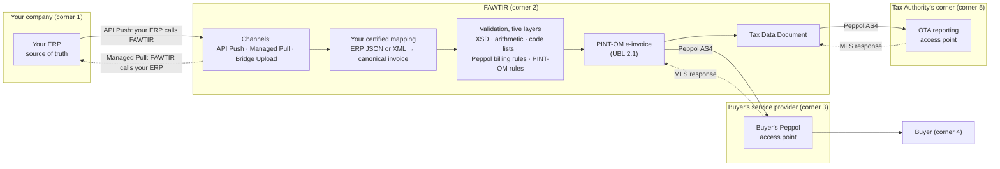

This section explains what FAWTIR does with the invoices your ERP produces, which of the three
integration channels to use, and where the line falls between your ERP's job and FAWTIR's.

## What FAWTIR does

Oman's e-invoicing programme (Fawtara) uses a five-corner model. The Oman Tax Authority (OTA)
describes it like this: the supplier issues an invoice (corner 1); it goes through the supplier's
service provider (corner 2); it is validated and exchanged with the customer's service provider
(corner 3); the customer receives it (corner 4); and at the same time invoice data is sent to the
OTA system (corner 5). The OTA's service-provider FAQ gives the service providers the job "to
validate and exchange e-Invoices … while also reporting specific Tax data to OTA's system".
See [Official references](/reference/official-references/).

FAWTIR is the supplier's service provider, corner 2. Your ERP is corner 1. For each document your
ERP sends, FAWTIR:

1. converts your ERP's own invoice data into FAWTIR's canonical invoice model, using a mapping
   that your company has certified;
2. validates the result in five layers: XML schema, arithmetic, code lists, the generic Peppol
   billing rules, and the PINT-OM rules for Oman;
3. builds the PINT-OM e-invoice (UBL 2.1 XML);
4. sends it over the Peppol network (AS4 protocol) to the buyer's Peppol access point, corner 3;
5. builds a Tax Data Document (TDD) for the invoice and sends it over the same Peppol network to
   the Tax Authority's corner, corner 5.

FAWTIR then records what comes back: the transport receipt, the buyer access point's Message
Level Status (MLS) response, and the MLS response from the Tax Authority's corner. The
[Invoice lifecycle](/integrate/lifecycle/) section explains each of these.

:::caution[Warning]
There is no direct API to the Tax Authority and FAWTIR never receives a tax verdict.
The TDD reaches the Tax Authority's corner as a Peppol message. A successful Peppol delivery is
not OTA acceptance, and a queued document is not a delivered one.
:::

## Why an ERP integrates

Your ERP already holds the invoice: the customer, the lines, the prices and the VAT. Integrating
means that every invoice the ERP issues reaches FAWTIR without anyone typing it again, and that
FAWTIR's outcome can flow back to the ERP. The ERP stays the system where invoices are created.
FAWTIR handles the Peppol and PINT-OM work that the ERP was not built for.

## The three channels

There is no installable connector, agent or SDK for ERP integration. You connect through one of
three channels, and you can use more than one.

| Channel | Who moves the document | What you build | Documents | Use it when |
|---|---|---|---|---|
| **API Push** | Your ERP calls FAWTIR's REST API, one document per request | A small sender in or beside your ERP that posts each document with an `ERP_INGESTION` API key | Invoices, credit notes, debit notes, self-billed invoices and self-billed credit notes | You can run code that reacts when an invoice is issued. This is the usual choice. |
| **Managed Pull** | FAWTIR calls your ERP's HTTPS JSON endpoint on a schedule and collects new invoices | A REST endpoint on your side that lists invoices with a cursor, and a connection set up in FAWTIR | Tax invoices only | Your ERP already exposes invoices over a REST API, and you cannot or prefer not to add outbound calls. |
| **Bridge Upload** | A person signed in to the FAWTIR web app uploads one exported document | An export of the invoice from your ERP, as JSON or XML | Invoices only (not credit notes, debit notes or self-billed documents), one per upload, up to 4 MiB | Low volume, a pilot, or recovering a single document by hand. |

All three channels use the same certified mapping and the same validation, and produce the same
PINT-OM document.

:::note
Automatic collection for Managed Pull is switched on by FAWTIR. Ask FAWTIR whether it
is available to your organisation before you design for it. See
[ERP connector](/integrate/managed-pull/).
:::

Example mappings for Odoo 17 and Oracle Fusion invoice exports are available as a starting point.
FAWTIR does not claim support for any named ERP product: you certify a mapping for your own ERP's
data.

## Architecture

For some transaction types the document is not delivered to a buyer over Peppol at all: for
example a simplified (B2C) invoice, a profit-margin invoice, a deemed supply or a self-billed
import. FAWTIR then addresses it to the routing substitute the transaction type requires, and the
TDD is still reported. The [Invoice lifecycle](/integrate/lifecycle/) section covers this.

## What your ERP owns and what FAWTIR does

| Your ERP owns | FAWTIR does |
|---|---|
| The invoice data: customer, lines, prices, quantities, VAT category and rate, and all amounts | Converts that data with your certified mapping. It checks the arithmetic but does not recalculate your amounts. |
| The invoice number. FAWTIR uses the number your mapping supplies, unchanged. | Refuses a second document with the same invoice number in the same issue year for your company (`409 DUPLICATE_INVOICE`). |
| Its own document identity: `source.external_document_id` and `source.external_version` | Uses that identity to recognise a document it already has, so a resend does not create a second invoice. |
| The decision to issue, correct or cancel | Generates the invoice UUID (BTOM-002) and the other identifiers PINT-OM requires. |
| Remaining the source of truth | Delivers over Peppol, reports the TDD, and records the responses. FAWTIR does not write back into your ERP. |
| Two values an ERP document does not usually carry: the issue time and the 20-position transaction type (BTOM-001), sent in `supplement` | Applies the PINT-OM rules for that transaction type. |

FAWTIR rule amounts are taken from your mapping and only rescaled when the XML is written:
document totals at 2 decimals and line amounts at 3. If your ERP's figures do not add up, the
document is refused. FAWTIR does not correct them.

### You do not need to recreate your master data in FAWTIR

A pushed document carries its own seller, buyer and line data, which your mapping converts. Your
customers and items do not have to exist in FAWTIR's customer list or product catalogue for an
invoice to be accepted.

One thing does have to exist: **your company's own Peppol participant**.

FAWTIR rule the seller endpoint on each document must be the Peppol participant your company
was verified for. On a self-billed document, where your company is the buyer, FAWTIR checks the
buyer endpoint instead. A document that names any other sender, or a company with no verified
participant, is refused.

:::note
If your mapping does not supply a buyer endpoint, FAWTIR looks up the buyer's VAT
number in your FAWTIR customer list and uses a Peppol participant it has verified there. Keeping
customers in FAWTIR is therefore optional, and only helps when your ERP export has no buyer
endpoint.
:::

## How a pushed document reaches the right company

You do not name your company in the request. FAWTIR works it out from the credential:

- An API key belongs to exactly one company. FAWTIR files every document sent with that key under
  that company.
- An OAuth client also belongs to exactly one company, and so does every access token it obtains.
- The seller on the document must be your company's verified Peppol participant (see above). A key
  for company A cannot send an invoice in the name of company B.

Branches work differently for pushed documents:

- **Branch invoice-number prefixes do not apply.** They are used only when FAWTIR numbers an
  invoice that someone creates in the FAWTIR web app. A pushed document keeps the number your ERP
  gave it.
- **A pushed document belongs to no branch.** API keys and OAuth clients are company credentials
  and see all branches. A person whose access is limited to some branches is refused when they
  submit through the API or Bridge Upload (`403 branch-not-in-scope`). Such a person issues
  invoices from the web app instead.

## Where to go next

- [Quick start](/get-started/quick-start/): send your first test invoice.
- [Environments](/get-started/environments/): TEST, production and base URLs.
- [Authentication](/get-started/authentication/): API keys and OAuth clients.
- [ERP data mapping](/api/data-mapping/): how your fields become PINT-OM.
