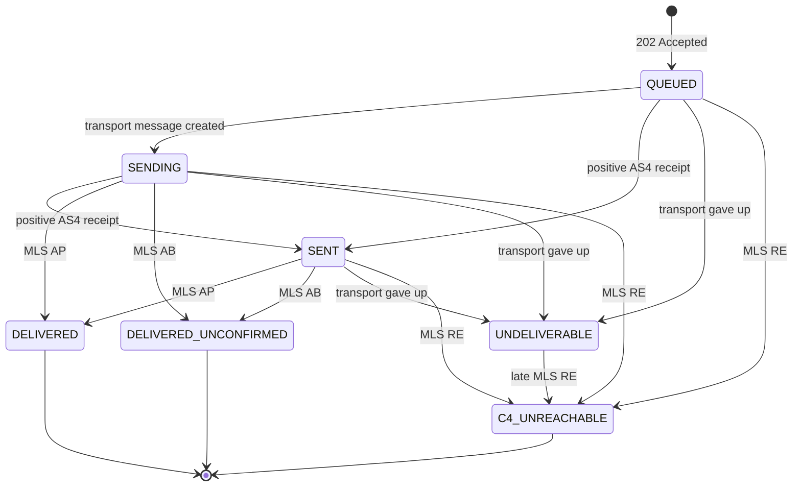

This page lets you map FAWTIR's status values to your ERP's own invoice states, and tells you when an invoice is final and when you must act.

An invoice in FAWTIR has **several independent status dimensions**. Do not merge them into one field in your ERP:

| Dimension | Question it answers | Where you read it |
|---|---|---|
| [Submission and processing](#submission-and-processing) | Did FAWTIR accept the document? | The HTTP answer to your push; `processing_state` in the ERP reports |
| [Peppol transport (delivery state)](#peppol-transport-delivery-state) | Where is the invoice on its way to the buyer's access point? | `state` on `GET /api/v1/invoices/{id}`; `delivery_state` in the ERP reports |
| [Recipient response (MLS)](#recipient-response-mls) | What did the buyer's access point answer? | `recipient_response` in the ERP reports; `/api/v1/compliance/activity` |
| [TDD status](#tdd-status) | What happened to the tax report sent to the Tax Authority's corner? | `tdd[]` on `GET /api/v1/invoices/{id}`; `tax_report` in the ERP reports |

There is **no OTA verdict** dimension. See [No OTA verdict](#no-ota-verdict).

The examples on this page use fictitious data.

Document submission is switched on by FAWTIR for a whole environment; while it is off, `GET /api/v1/invoices` and `GET /api/v1/invoices/{id}` answer `404` too (see the [API reference](/api/reference/#endpoint-inventory)). Where it is on, an organisation that is not yet ready to issue is refused with `409 TENANT_NOT_OPERATIONAL`.

:::note
Reading status needs a Bearer token (a signed-in user, or an OAuth client holding `invoice.read`). An API key can only submit. Polling is the primary way to learn an outcome; [webhooks](/integrate/webhooks/) are optional and do not cover every change.

The platform's access rules allow polling with an OAuth client that holds `invoice.read`. Confirm this set-up with FAWTIR during onboarding before you rely on it.
:::

## Submission and processing

FAWTIR rule FAWTIR checks the document **while you wait**: mapping, five validation layers, and platform rules. The answer is in the HTTP response.

| HTTP answer | Meaning | Is there an invoice? |
|---|---|---|
| `202 Accepted` | Accepted and queued for delivery and tax reporting. `state` is `QUEUED`. | Yes |
| `200 OK` with `source.disposition: "DUPLICATE"` | This source document was accepted earlier. `state` is that invoice's current state. | Yes, the earlier one |
| `4xx` or `5xx` | Refused. No invoice is stored and no quota is used. With a `source` block, the refusal is recorded against the source identity. | No |

A refused submission is not a state. There is no `REJECTED`, `FAILED` or `ACCEPTED` value on the invoice. The refusal codes are in the [Error reference](/reference/errors/).

**ERP reports.** For a document that arrived with a source identity (API Push with `source`, Bridge Upload, Managed Pull), the ERP reports at `/api/v1/erp/source-documents` show its `processing_state`:

| `processing_state` | Meaning |
|---|---|
| `DISCOVERED` | Received or found, not yet worked on |
| `CLAIMED` | Being worked on now |
| `ACCEPTED` | An invoice was created |
| `REJECTED` | Refused for good; `reason_code` says why |
| `DUPLICATE` | The same document as one already accepted; nothing new was created |
| `FAILED` | Failed for a temporary reason; it may still be accepted |

The reports also give `display_status`, one word for a badge that combines processing and delivery: `REJECTED`, `DUPLICATE`, `WAITING_FOR_MAPPING`, `RETRYABLE_FAILURE`, `PROCESSING`, `ACCEPTED`, `SUBMITTED`, `SENT`, `DELIVERED_UNCONFIRMED`, `DELIVERED`, `OFF_NETWORK`, `DELIVERY_FAILED`. Use it for display only. Base your ERP logic on the separate fields.

## Peppol transport (delivery state)

After acceptance, FAWTIR sends the invoice over the Peppol network to the buyer's access point. Peppol's four-corner model calls the seller's access point C2 and the buyer's C3. The invoice's `state` (`delivery_state` in the ERP reports) tracks this leg.

| `state` | Meaning |
|---|---|
| `QUEUED` | Validated, stored, and queued. **Not sent and not delivered.** |
| `SENDING` | A transport message exists and FAWTIR is sending or retrying it. |
| `SENT` | The buyer's access point returned a positive AS4 receipt. FAWTIR is waiting for its message-level response (MLS). |
| `DELIVERED` | The buyer's access point answered MLS **AP**: it validated the invoice and delivered it to the buyer. |
| `DELIVERED_UNCONFIRMED` | The buyer's access point answered MLS **AB**: it forwarded the invoice but cannot confirm it arrived. |
| `UNDELIVERABLE` | The transport gave up: no positive receipt after all retries, or a permanent transport error. |
| `C4_UNREACHABLE` | The buyer's access point answered MLS **RE**: it refused the invoice or could not deliver it. |

Rules for reading the transport state (FAWTIR rule):

- **The first valid MLS answer is final.** A later AP, AB or RE does not change `DELIVERED` or `DELIVERED_UNCONFIRMED`, and a late transport failure cannot undo them.
- `UNDELIVERABLE` can still become `C4_UNREACHABLE` if an RE arrives later.
- An RE always leads to `C4_UNREACHABLE`, never to `UNDELIVERABLE`. `UNDELIVERABLE` comes only from transport failure.
- `C4_UNREACHABLE` is never retried automatically. FAWTIR also sends a "disregard" tax report for that invoice (see [TDD status](#tdd-status)).
- FAWTIR retries the transport by itself: up to 10 attempts, waiting 1 minute and doubling up to 1 hour, about 4 hours in all (defaults; may differ per environment). The reconciliation label `TRANSPORT_PENDING` appears only when an invoice accepted more than 6 hours ago is still `QUEUED` or `SENDING`.

On `GET /api/v1/invoices/{id}`, `sending_at`, `sent_at` and `delivered_at` give the times, and `failure_reason` names the cause for `UNDELIVERABLE`. It also carries `INVOICE_MLS_UNCONFIRMED` on `DELIVERED_UNCONFIRMED` and `INVOICE_MLS_REJECTED` on `C4_UNREACHABLE`. Values you may see for `UNDELIVERABLE` include `AS4_MDN_MISSING_OR_NEGATIVE`, `AS4_MAX_ATTEMPTS_EXCEEDED`, `AS4_TRANSPORT_TERMINAL`, `AS4_PEER_CERTIFICATE_UNTRUSTED`, `AS4_UNEXPECTED_DISPATCH_FAILURE`, `AS4_SENDING_LEASE_EXPIRED`, `AS4_QUEUE_NOT_CREATED` and `AS4_SIGNED_PAYLOAD_MISSING`.

:::caution[Warning]
`QUEUED` is not delivered, and `SENT` is not delivered. A positive transport receipt only says the buyer's access point received the message. Only `DELIVERED` (and, with less certainty, `DELIVERED_UNCONFIRMED`) say it reached the buyer.
:::

**Buyers outside the Peppol network (substitute participants).** Some invoices are addressed to a fixed substitute participant instead of a real buyer on the network. The most common is a Simplified (B2C) or profit-margin invoice, addressed to `0248:997770000099`. Others cover deemed supply (`0248:997770000096`), exports to receivers not on Peppol (`0248:997770000097`), out-of-scope self-billed imports (`0248:997770000098`) and domestic buyers not yet on Peppol (`0248:997770000095`).

For these invoices FAWTIR creates the TDD but **no transport leg**. The delivery state therefore behaves in a way that looks like a failure but is not:

1. `state` stays `QUEUED`, because no transport message is ever created.
2. A clean-up sweep for stale queued invoices later sets it to `UNDELIVERABLE`, although nothing failed.
3. The ERP reports read the delivery route first: `delivery.route` is `OUTSIDE_PEPPOL`, and `display_status` is `OFF_NETWORK`. `recipient_response.applicable` is `false`, because no MLS can come.

`GET /api/v1/invoices/{id}` does not show the route. Check the receiver (or read the ERP report) before you treat `UNDELIVERABLE` as a failure. The buyer must receive a readable invoice by other means; FAWTIR does not record whether it reached them.

:::note
For some substitute-addressed invoices FAWTIR itself queues a readable copy for the buyer. Ask FAWTIR which invoices this covers, and whether your ERP must still deliver them, before you send copies yourself, so that the buyer does not receive two.
:::

## Recipient response (MLS)

The **message-level status (MLS)** is a Peppol message the buyer's access point (C3) sends back to FAWTIR (C2) about an invoice.

| Code | Meaning (Peppol MLS specification) |
|---|---|
| `AP` | Delivered to the buyer, with confirmation |
| `AB` | Delivered without confirmation |
| `RE` | Rejected, or delivery failed |
| `NONE` | FAWTIR has recorded no MLS yet. This is silence, not a refusal. |

`GET /api/v1/invoices/{id}` does not carry the MLS code. Read it from `recipient_response.code` on `/api/v1/erp/source-documents/{recordId}`, or from `/api/v1/compliance/activity`.

:::caution[Warning]
An MLS comes from the buyer's access point. It is not a message from the Tax Authority, and an MLS acknowledgement is never OTA acceptance.
:::

### RESPONSE_PENDING and "no answer yet"

`RESPONSE_PENDING` is a **reconciliation label, not a state**. FAWTIR attaches it to an invoice that is `SENT` and has no MLS (`NONE`) once 24 hours have passed since `sent_at`. The 24 hours are fixed.

- **Silence never changes the state.** The invoice stays `SENT`. FAWTIR does not turn silence into `DELIVERED_UNCONFIRMED`, `UNDELIVERABLE` or any other state.
- **Do not resend because no MLS arrived.** FAWTIR does not resend an invoice because no MLS came. A resend from your ERP creates nothing new: it gets the stored answer (same `Idempotency-Key` within 24 hours), `200` with `DUPLICATE` (with a `source` block), or `409 DUPLICATE_INVOICE`.
- "No answer yet" means: the buyer's access point has the message (positive receipt), and it has not said whether it delivered it. Treat the invoice as issued and sent. Follow up with the buyer by other means if you need confirmation.

## TDD status

The **Tax Data Document (TDD)** is the tax report FAWTIR generates for each invoice and sends over the Peppol network to the Tax Authority's corner (C5). Each invoice has one or more TDD "legs": `SUBMIT` first, and later `RESUBMIT` or `DISREGARD` if needed. `GET /api/v1/invoices/{id}` lists them in `tdd[]` with `variant`, `status`, `sla_deadline`, `submitted_at` and `failure_reason`.

| `status` | Meaning |
|---|---|
| `PENDING` | The obligation is recorded; the TDD is not sent yet |
| `SUBMITTED` | Generated, validated and queued for sending to C5; waiting for C5's MLS |
| `GENERATION_FAILED` | The TDD could not be generated or failed its own pre-check |
| `ACCEPTED` | C5 answered MLS **AP** |
| `DELIVERED_UNCONFIRMED` | C5 answered MLS **AB** |
| `REJECTED` | C5 answered MLS **RE**. This is a rejection of the message, not a tax decision. |
| `TO_DISREGARD` | The invoice was refused by the buyer's access point; a disregard leg is being prepared |
| `DISREGARD_SUBMITTED` | The disregard TDD was sent |
| `DEAD_LETTERED` | The TDD was not transmitted before FAWTIR's deadline |
| `NOT_TESTED` | Used only during a TEST interoperability window |

FAWTIR rules for the TDD:

- `sla_deadline` is FAWTIR's own deadline for transmitting the TDD: 15 minutes after validation for business buyers, 30 minutes for consumers (defaults; may differ per environment). A TDD not transmitted by then becomes `DEAD_LETTERED`, and a late MLS cannot bring it back.
- After `REJECTED`, a signed-in person can resubmit a corrected TDD with `POST /api/v1/invoices/{id}/tdd/resubmit`, at most 3 times. Nothing resubmits automatically.
- `GET /api/v1/invoices/tdd/triage` lists the TDDs that need attention (`REJECTED`, `GENERATION_FAILED`, `DEAD_LETTERED`, and a `TO_DISREGARD` whose disregard leg was never raised).

:::caution[Warning]
`ACCEPTED` on a TDD means C5 received and validated the message. It does not mean the Tax Authority approved the invoice or its tax.
:::

## No OTA verdict

FAWTIR has no direct connection to the Oman Tax Authority's systems. The TDD reaches the Tax Authority as a Peppol message to C5, and C5 answers with an MLS like any access point. There is no channel through which the Tax Authority returns a tax verdict on an invoice, so FAWTIR never shows one. Never record "accepted by OTA" in your ERP on the basis of anything FAWTIR returns.

## When is an invoice final?

| Dimension | Final values |
|---|---|
| Delivery | `DELIVERED`, `DELIVERED_UNCONFIRMED`, `C4_UNREACHABLE`; `UNDELIVERABLE` (can still become `C4_UNREACHABLE`) |
| TDD (newest leg) | `ACCEPTED`, `DELIVERED_UNCONFIRMED`, `DEAD_LETTERED`, `DISREGARD_SUBMITTED`, `NOT_TESTED`; `REJECTED` until a person resubmits |

Stop polling an invoice when both dimensions are final.

## Mapping FAWTIR states to your ERP

Recommendation keep one ERP field per dimension.

| FAWTIR state | What it means for the ERP | What the ERP should do |
|---|---|---|
| HTTP `202` (`QUEUED`) | FAWTIR has issued the e-invoice; it is not sent yet | Mark "issued in FAWTIR"; store `id`, `invoice_uuid`; lock the invoice against editing; poll |
| HTTP `200` `DUPLICATE` | Already issued earlier | Same as `202`, using the returned `id` |
| HTTP `4xx` refusal | Not issued | Show the error; fix the data; resend under a new `external_version` |
| Timeout, no answer | Unknown | Resend the same request with the same key; never renumber |
| `SENDING` | In transport | Wait |
| `SENT` | Received by the buyer's access point; no answer yet | Mark "sent"; wait |
| `SENT` + `RESPONSE_PENDING` | No MLS after 24 hours | Do not resend; follow up with the buyer if needed |
| `DELIVERED` | Delivered with confirmation | Mark "delivered" |
| `DELIVERED_UNCONFIRMED` | Forwarded, delivery not confirmed | Mark "delivered, unconfirmed"; follow up with the buyer if needed |
| `UNDELIVERABLE` (on the Peppol route) | Transport failed after its retries | Alert; contact the buyer or FAWTIR support; do not resend the same invoice |
| `UNDELIVERABLE` with route not on the network (`OFF_NETWORK`) | No Peppol leg was expected | Make sure the buyer receives a readable invoice by other means (see the note on copies under [Peppol transport](#peppol-transport-delivery-state)) |
| `C4_UNREACHABLE` | The buyer's access point refused it; FAWTIR sends a disregard TDD | A person decides: re-issue to a corrected receiver identifier, or deliver the invoice outside Peppol. See [Invoice corrections](/integrate/corrections/). |
| TDD `SUBMITTED` | Tax report sent, waiting for C5 | Wait |
| TDD `ACCEPTED` / `DELIVERED_UNCONFIRMED` | C5 received the tax report | Mark "tax report delivered to C5"; not an OTA approval |
| TDD `REJECTED` | C5 refused the tax report message | Alert; a person corrects and resubmits in FAWTIR |
| TDD `GENERATION_FAILED` / `DEAD_LETTERED` | The tax report was not transmitted | Alert FAWTIR support with the invoice id |

:::note
Resending the identical invoice is refused as a duplicate. Ask FAWTIR for the procedure to follow after `UNDELIVERABLE` on the Peppol route and after `C4_UNREACHABLE` (for example, whether a credit note must come before a re-issued invoice) before you automate it.
:::
