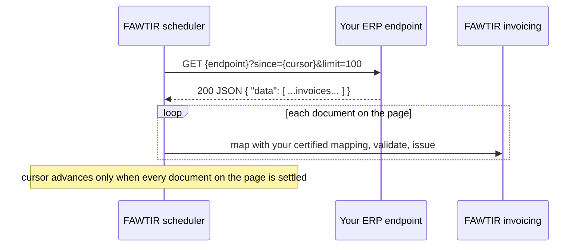

This page tells you what "connecting your ERP" means in FAWTIR today, and walks you through Managed Pull: the endpoint your ERP must expose, the connection set-up in the app, and how to run and troubleshoot it.

## There is no installable connector

FAWTIR does not ship an installable connector, agent, service or SDK for ERP integration. Nothing has to be installed on your servers, and nothing can be. Your ERP reaches FAWTIR in one of three ways:

| Approach | What you build | When it fits |
|---|---|---|
| **API Push** | Code in or next to your ERP that calls FAWTIR's REST API, one document per request | You control the ERP's integration layer; you need credit notes, debit notes or self-billing |
| **Managed Pull** | A REST endpoint in your ERP (or in a thin service in front of it) that lists finalised invoices as JSON; FAWTIR calls it on a schedule | Your ERP can expose such an endpoint on the internet, and you send tax invoices only |
| **Bridge Upload** | Nothing. A person uploads one document file at a time in the app | Low volumes, tests, manual fallback |

All three need a **certified mapping**: a conversion, owned by your organisation, from your ERP's invoice format into FAWTIR's invoice model. See [ERP data mapping](/api/data-mapping/).

**Example mappings.** Example mappings for Odoo 17 and Oracle Fusion invoice exports are available. FAWTIR's own certification tests exercise them, but their sample data is representative, not captured from a live ERP. Treat them as a starting point and check them against your own instance with a dry run. They are mappings of the invoice document; they do not mean that the ERP's own API can be called by Managed Pull as it is. Whether your ERP's API meets the [endpoint contract](#what-your-erp-endpoint-must-offer) below is for you to check.

FAWTIR does not write anything back to your ERP. There is no write-back feature.

FAWTIR switches document submission on per deployment, not per organisation. While it is off, the submission routes and Bridge Upload answer `404`; the full list is in the [API reference](/api/reference/#endpoint-inventory). Separately, FAWTIR must enable ERP integration for your organisation before an ERP ingestion key or a `source` block is accepted (`403 erp-entitlement-required`).

All names, addresses and identifiers in the examples on this page are fictitious.

## Managed Pull in one picture



:::note
FAWTIR switches the Managed Pull scheduler on per deployment. While it is off, every connection shows **Automation off** and nothing is collected, even with everything else set up. Ask FAWTIR whether it is on for you.
:::

:::caution[Warning]
Managed Pull submits **tax invoices only**. Send credit notes, debit notes and self-billed documents with API Push.
:::

## What your ERP endpoint must offer

Every rule in this section is a FAWTIR rule.

### Address and network

| Requirement | Detail |
|---|---|
| HTTPS | The endpoint must be `https`. Plain `http` is refused. The certificate must be valid for the host; FAWTIR never relaxes this check. |
| Public address | The host name must resolve, and every address it resolves to must be publicly routable. Private, loopback and internal addresses are refused. |
| No credentials in the URL | No `user:password@` part, and no query parameter that looks like a secret (for example `token`, `key`, `apikey`, `password`, `secret`, `signature`, `auth`). Credentials go in the connection's sign-in details. |
| No fragment | The URL must not contain `#…`. |
| Length | Up to 2048 characters. |
| No redirects | FAWTIR does not follow redirects. A `3xx` answer counts as a failure. |

### The connection check: `HEAD` must answer `2xx`

When someone clicks **Check connection**, FAWTIR sends **one `HEAD` request** to the endpoint, with the credential and `Accept: */*`, and gives it 15 seconds in all.

| Your endpoint answers | Result shown |
|---|---|
| `2xx` | Reached and signed in |
| `401` or `403` | The system refused the sign-in details |
| `5xx` | The system answered that it is unavailable |
| `3xx` or another `4xx` | The system gave an answer FAWTIR cannot accept |

Many frameworks do not answer `HEAD` on a `GET` route by default. Make sure yours does, or the check fails even though collection would work.

### Authentication

| Sign-in kind in the app | What FAWTIR sends |
|---|---|
| **API token** | `Authorization: Bearer <secret>` |
| **Username and password** | `Authorization: Basic <base64 of the secret>`. Enter the secret as `user:password`. |

The secret can be up to 4096 characters. It is stored encrypted and never shown again. OAuth 2.0 client credentials and SSH keys can be stored but cannot be used today.

### The request FAWTIR makes

```http
GET /erp/api/invoices?since=2026-11-10T00:00:00Z&limit=100 HTTP/1.1
Host: erp.alwaha.example.om
Authorization: Bearer <your-erp-token>
Accept: application/json
```

- Method `GET`, with no body, no cookies, and no automatic retries.
- `{cursorParameter}={cursor}` is added when FAWTIR has a position. On the very first run it uses your **Start from** value, if you set one.
- `{pageSizeParameter}=100` is added when you configured a page size parameter. The page size is a FAWTIR setting (100); you cannot choose it.
- Your endpoint's own query parameters are kept.

### The response FAWTIR expects

- Status `2xx` with a JSON body. Managed Pull reads JSON only; for XML exports use API Push or Bridge Upload.
- A JSON **array** of invoices at the **Documents pointer**.
- On each invoice: an identifier at the **Document id pointer**, optionally a version at the **Document version pointer**, an issue time at the **Issue time pointer**, and, for `TIMESTAMP` or `SEQUENCE`, a cursor value at the **Document cursor pointer**.
- For `CONTINUATION_TOKEN` or `PAGE_TOKEN`: the next token at the **Next cursor pointer** in the response envelope. No token means "no more pages".

The pointers are JSON Pointers (RFC 6901): they start with `/`, and `/data` means "the `data` member of the top-level object".

Example response for an endpoint configured with `TIMESTAMP` and the pointers `/data`, `/id`, `/version`, `/updated_at`, `/issued_at`:

```json
{
  "data": [
    {
      "id": "ERP-INV-000145",
      "version": "1",
      "updated_at": "2026-11-10T06:20:00Z",
      "issued_at": "2026-11-10T10:15:00+04:00",
      "name": "INV-2026-000145",
      "move_type": "out_invoice",
      "invoice_date": "2026-11-10",
      "invoice_date_due": "2026-12-10",
      "currency_id": [12, "OMR"]
    }
  ]
}
```

Each invoice object is handed to your mapping unchanged. The fields after `issued_at` above are the start of an Odoo-style invoice export; the full document must contain every field your certified mapping reads.

| Value | Format |
|---|---|
| Identifier | String, number or boolean, not blank, up to 200 characters. A document without one is refused on its own (`SOURCE_IDENTITY_INVALID`). |
| Version | Up to 80 characters. Optional. |
| Issue time | `HH:mm:ss` (Oman local time) or an ISO-8601 date-time with an offset. |
| `TIMESTAMP` cursor | An ISO-8601 instant, such as `2026-11-10T06:20:00Z` |
| `SEQUENCE` cursor | A whole number |
| Tokens | Any string, returned to you unchanged |

### Cursor and paging behaviour your endpoint must honour

| Cursor kind (app label) | FAWTIR sends | Your endpoint must return |
|---|---|---|
| `TIMESTAMP` (**Updated-at timestamp**) | the highest timestamp on the previous page | documents with a timestamp **at or after** it |
| `SEQUENCE` (**Sequence number**) | the highest sequence number on the previous page | documents with a number **greater than** it |
| `CONTINUATION_TOKEN` (**Continuation token**) | the token from your previous response | the continuation of the stream |
| `PAGE_TOKEN` (**Page token**) | the token from your previous response | the next page of the same traversal |

- Your endpoint does not need to sort, provided it honours the page size; FAWTIR takes the highest cursor value on a page.
- Every document must carry the cursor value for `TIMESTAMP` and `SEQUENCE`. If one document lacks it, the whole page fails.
- A full page (100 documents) means "there may be more" for `TIMESTAMP` and `SEQUENCE`.
- If your endpoint ignores the page size and returns more, FAWTIR processes the first 100 and moves its position to the highest cursor value among them. Documents further down with a lower value are not read again, so return documents in ascending cursor order.
- With `TIMESTAMP`, a full page whose documents all share the timestamp FAWTIR already holds makes the run fail, and the position does not move. Keep the number of documents that can share one timestamp value below 100, or use `SEQUENCE`.
- **Cursor query parameter** is required for every kind except **Page token**. A page-token connection without one only ever reads the first page.

### Size and time limits

| Limit | Value |
|---|---|
| Connect timeout | 5 seconds |
| Response timeout (waiting for data) | 15 seconds |
| Whole exchange | 60 seconds |
| Response body | 4 MiB |
| One document | 4 MiB |
| Page size | 100 documents |
| Pages per run | 20 |

A page response larger than 4 MiB is refused as a whole, and collection stops at that page until the response is smaller. FAWTIR does not read a `Retry-After` header from your ERP.

How FAWTIR classifies your endpoint's answers during collection. A page that cannot be read fails the whole run; the position does not move, so the same window is read again on a later run.

| Your endpoint answers | Reason recorded | Temporary? | What happens next |
|---|---|---|---|
| `401`, `403` | `SOURCE_AUTHENTICATION_REJECTED` | yes | Run fails; **Retry backoff** (5 minutes, doubling, up to 6 hours) |
| `408`, `429`, `5xx`, or the connection or TLS handshake fails | `SOURCE_UNAVAILABLE` | yes | Run fails; **Retry backoff** |
| No answer within the time limits above | `SOURCE_TIMEOUT` | yes | Run fails; **Retry backoff** |
| any other non-`2xx`, including `3xx` | `SOURCE_PAYLOAD_UNREADABLE` | no | Run fails; **Last run failed**; tried again at the normal interval |
| `2xx` that is not JSON, or has no array at the Documents pointer | `SOURCE_PAYLOAD_UNREADABLE` | no | Same as above; fix the endpoint or the pointers |

## Setting up a connection in the app

Connections are managed by signed-in people only. API keys and OAuth clients cannot create, change, test or enable them.

Go to **Settings → ERP integration → Connections**. The area's tabs are **Overview · Connections · Bridge upload · API push · Mapping · Activity · Access and history**. If you see "ERP integration is not enabled", FAWTIR has not switched ERP integration on for your organisation yet.

1. **Add a connection.** Click **Add a connection** and fill in **Name**, **ERP system** (a label only), **Version** (optional), **How it works** = **Fawtir collects from your ERP**, **How Fawtir connects** = **REST API**, and **Address** (your endpoint). Click **Save as draft**. "How it works" and the ERP system cannot be changed later.
2. **Add sign-in details.** Click **Add sign-in details**, choose **Username and password** or **API token**, enter the **Secret** and an optional **Label** (a non-secret hint, such as the user name). Replacing the secret later takes effect immediately; the old one stops working.
3. **Check the connection.** Click **Check connection**. A successful check does not turn anything on.
4. **Configure extraction.** On the **Extraction** tab, open **Configure extraction**, fill in the fields below, and click **Save settings**.
5. **Fetch a sample.** Click **Fetch sample**. FAWTIR collects one document exactly as production would, from **Start from**, and shows it unchanged. Nothing is recorded and no invoice is created. Use **Open mapping** to build and test your mapping with it.
6. **Certify the mapping** for tax invoices with this connection's transaction type. See [ERP data mapping](/api/data-mapping/).
7. **Mark ready.** Click **Mark ready** on the connection.
8. **Enable production collection.** On the **Extraction** tab, click **Enable production collection**.

### Extraction settings

| App label | Field | Rule |
|---|---|---|
| **How often to collect** | `interval` | ISO-8601 duration, for example `PT30M`. Empty means one hour. Below 5 minutes runs every 5 minutes; above 24 hours runs every 24 hours. |
| **Transaction type** | `transactionType` | Required. The 20-character BTOM-001 flags, each `1` or `X`, for every invoice on this connection, for example `1XXXXXXXXXXXXXXXXXXX` for a full tax invoice. The mapping certification is scoped to this value. |
| **Documents pointer** | `documentsPointer` | Required. Points to the array of invoices, for example `/data`. Up to 200 characters. |
| **Document id pointer** | `documentIdPointer` | Required, relative to one invoice, for example `/id`. |
| **Document version pointer** | `documentVersionPointer` | Optional, relative to one invoice. |
| **How to continue** | `cursorKind` | `TIMESTAMP`, `SEQUENCE`, `CONTINUATION_TOKEN` or `PAGE_TOKEN`. |
| **Cursor query parameter** | `cursorParameter` | Required except for **Page token**. Up to 60 characters: letters, digits, `_`, `.`, `-`. |
| **Document cursor pointer** | `documentCursorPointer` | Required for `TIMESTAMP` and `SEQUENCE`; not allowed for the token kinds. |
| **Next cursor pointer** | `nextCursorPointer` | Required for `CONTINUATION_TOKEN` and `PAGE_TOKEN`. |
| **Page size parameter** | `pageSizeParameter` | Optional. The query parameter name only; the size is set by FAWTIR. |
| **Start from** | `initialCursor` | Optional, up to 500 characters. Where the first collection begins, and what a sample reads from. |
| **Issue time pointer** | `documentIssueTimePointer` | Optional to save, **required to enable**. Points to each invoice's issue time. |

The `transactionType` positions are explained in [ERP data mapping](/api/data-mapping/). Send `X` for "does not apply"; FAWTIR writes `0` for it in the PINT-OM document, because PINT-OM rule IBR-001-OM requires BTOM-001 to be "a 20-character string consisting only of '1' and '0'".

### Connection states

| State | App label | Meaning |
|---|---|---|
| `DRAFT` | **Draft** | Still being configured. Nothing runs. You can edit, add sign-in details, check, and fetch samples. |
| `READY` | **Ready** | Configuration is complete. Collection runs only if production collection is also enabled. |
| `DISABLED` | **Paused** | Paused on purpose. **Turn back on** makes it ready again. |
| `ARCHIVED` | **Retired** | Read-only, permanently. Its name can be reused. |

Allowed moves: **Draft → Ready**, **Ready → Paused** (**Pause**), **Paused → Ready** (**Turn back on**), and any state → **Retired** (**Retire**). A connection never goes back to Draft. If someone else changed the connection while you were working, your change is refused and you must reload it.

### Enablement prerequisites

**Enable production collection** is refused until all of these hold, checked in this order:

1. You have permission to manage connections.
2. FAWTIR has enabled ERP integration for your organisation (`403 erp-entitlement-required`).
3. The connection is **Ready** (`EXTRACTION_CONNECTION_NOT_READY`).
4. Extraction settings are saved and valid.
5. The **Issue time pointer** is set (`EXTRACTION_ISSUE_TIME_POINTER_REQUIRED`).
6. Your JSON mapping is certified for tax invoices with this connection's transaction type (`EXTRACTION_MAPPING_NOT_CERTIFIED`).

The app shows these as a checklist: **Extraction settings saved**, **Connection marked ready**, **Issue time pointer set**, **Mapping certified for this transaction type**. **Disable production collection** is always allowed, so a broken channel can always be stopped.

## Status values

The **Collection status** panel on the **Extraction** tab shows one status, the first that applies:

| Status | App label | Meaning | What to do |
|---|---|---|---|
| `GLOBALLY_DISABLED` | **Automation off** | The Managed Pull scheduler is off on this deployment. The connection keeps its settings. | Ask FAWTIR. |
| `NOT_CONFIGURED` | **Not configured** | No extraction settings, or no issue time pointer. | Save the settings, including **Issue time pointer**. |
| `CONNECTION_NOT_READY` | **Connection not ready** | The connection is not Ready, or is not a REST Managed Pull connection. | **Mark ready**. |
| `DISABLED_BY_OPERATOR` | **Production off** | Production collection is switched off. | **Enable production collection** when ready. |
| `MAPPING_NOT_CERTIFIED` | **Mapping not certified** | The mapping changed after enablement, so its certification no longer applies. | Certify the mapping again. |
| `RUNNING` | **Running** | A collection run is in progress. | Nothing. |
| `BACKOFF` | **Retry backoff** | A run failed, so the next one is held back. | See **Last failure**. It clears after a successful run. |
| `FAILED_LAST_RUN` | **Last run failed** | The newest run failed, and no backoff applies. | See **Last failure**. |
| `WAITING` | **Ready, waiting** | Nothing is wrong. The next run is scheduled. | Nothing. |

The panel also shows **Platform automation** (on or off), **Effective cadence**, **Next run**, **Consecutive failures**, **Held until**, **Last run**, **Last run documents** and **Last failure**.

`SENDER_PARTICIPANT_NOT_REGISTERED`, `SENDER_PARTICIPANT_CLAIM_CONFLICT` and `SENDER_PARTICIPANT_NOT_AUTHORIZED` are **not** statuses. They are reasons recorded on individual documents. See [Error reference](/reference/errors/#managed-pull).

Each run has a state: **Created**, **Running**, **Completed**, **Completed with rejections**, **Failed** or **Cancelled**.

## Recovery

**Automatic.** Every minute, FAWTIR closes runs that an interrupted process left open and releases documents it left claimed. Nothing is needed from you.

**Manual.** A Managed Pull document whose 5 attempts are spent is rejected with `ATTEMPTS_EXHAUSTED`, and collection moves past it. Once you have fixed the cause, a signed-in person with the recovery permission can recover it: find it under **Activity → Source documents**, filtered to Managed Pull, Rejected and attempts exhausted. Recovery:

- works only for Managed Pull documents rejected with `ATTEMPTS_EXHAUSTED` that have no invoice;
- repeats the exact page request FAWTIR made the first time, once;
- requires the same document identifier, version and content to come back;
- never moves the collection position.

If your ERP now returns different content for that document, recovery is refused (`ERP_RECOVERY_SOURCE_DOCUMENT_CHANGED`). Give the document a new version in your ERP instead.

Documents sent by API Push or Bridge Upload cannot be recovered this way. FAWTIR does not keep their content; send them again.

## Monitoring

| What to watch | Where |
|---|---|
| The connection's status and last failure | **Extraction** tab, **Collection status** |
| Each run: found, accepted, rejected, duplicate | **Runs** tab, or **Activity → Extraction runs** |
| Each document and its invoice | **Activity → Source documents** |
| Documents that need a person | **Activity → Needs attention** |

The same data is available with a Bearer token holding `invoice.read`, at `/api/v1/erp/source-documents` and `/api/v1/erp/extraction/runs`. The connection status route itself is for signed-in people only.

:::note
The platform's access rules let an OAuth client that holds `invoice.read` read these reports. Confirm this set-up with FAWTIR during onboarding before you rely on it.
:::

## Troubleshooting

| Symptom | Likely cause | What to do |
|---|---|---|
| **Check connection**: "The address is not one Fawtir may contact" | Not `https`, resolves to a private address, or has credentials in the URL | Use a public `https` address with no secrets in it |
| **Check connection**: "The system gave an answer Fawtir cannot accept" | `HEAD` not supported, a redirect, or a `404` | Answer `HEAD` with `2xx` on the exact endpoint URL |
| **Check connection**: "The secure connection could not be established" | Certificate expired, self-signed or for another host | Fix the certificate |
| **Fetch sample**: `EXTRACTION_SAMPLE_NO_DOCUMENTS` | Wrong **Documents pointer**, or **Start from** after your last invoice | Check the pointer and the start value |
| **Fetch sample**: `EXTRACTION_SAMPLE_SOURCE_UNREADABLE` | Not JSON, or no array at the pointer | Check the endpoint and the pointers |
| **Fetch sample**: `EXTRACTION_SAMPLE_SOURCE_UNAVAILABLE` (`503`) | Your ERP was slow or answered `5xx` | Try again; check the ERP |
| Status **Automation off** | Scheduler off on the deployment | Ask FAWTIR |
| Status **Not configured** although settings are saved | **Issue time pointer** missing | Set it |
| Status **Retry backoff**, last failure `SOURCE_UNAVAILABLE` or `SOURCE_TIMEOUT` | ERP down, too slow, or answering `429`/`5xx` | Fix the ERP; collection resumes by itself |
| Status **Retry backoff**, last failure `SOURCE_AUTHENTICATION_REJECTED` | Token expired or rotated | **Replace sign-in details** |
| The same invoices come back every run, the position never moves | One document on the page keeps failing temporarily, or more than 100 documents share one timestamp | Look at **Needs attention**; spread timestamps |
| Documents rejected with `INVOICE_VALIDATION_FAILED` | The invoice data breaks a validation rule | Fix the invoice in the ERP and give it a new version |
| Documents waiting with `SENDER_PARTICIPANT_NOT_REGISTERED` | Your Peppol participant is not verified yet | Finish participant verification; documents wait without using attempts |
| Documents refused with `SENDER_PARTICIPANT_NOT_AUTHORIZED` | The seller endpoint in the invoice is not your participant | Correct the seller endpoint in the ERP or the mapping |

All connection, sample and recovery codes are listed in the [Error reference](/reference/errors/#managed-pull).
