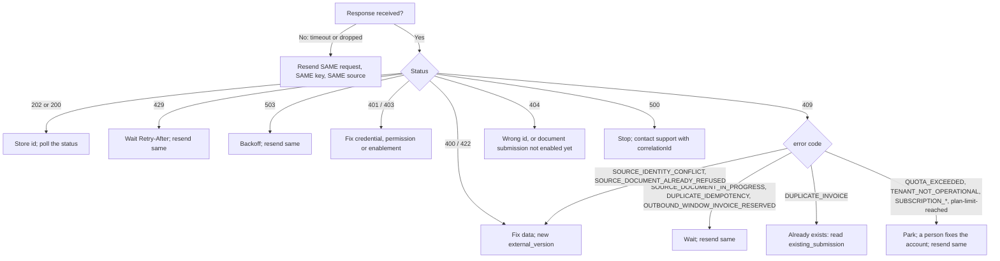

This page lets you look up any error FAWTIR returns to an ERP integration and decide what to do: retry the same request, fix the data, or ask a person to act.

All examples on this page use fictitious data.

## How to read an error

Every error body is JSON with `Content-Type: application/problem+json` (RFC 9457). The members you can rely on are `type`, `title`, `status` and `detail`. The machine code is in **different members on different routes**:

| Where the error comes from | Machine code in | Also present |
|---|---|---|
| Submission routes (`/api/v1/invoices`, `/creditnotes`, `/debitnotes`, `/selfbilling`, `/invoices/bridge`) | `error`; many also repeat it in `code` | `instance`, `timestamp`, `trace_id` and `correlationId` (same value), often `quota_charged: false` |
| ERP connection, report and recovery routes | `code` | `instance`, `timestamp` |
| Authentication refusals | `code` on `401` `UNAUTHENTICATED` and `INVALID_API_KEY`; none on the others | n/a |
| Field validation | none; `errors[]` lists `{field, message}` | `correlationId` |
| Rate limits and size limits at the edge | **none**; use `status` and `type` | `Retry-After` header on `429` |

Read the code as `error`, then `code`, then the last segment of `type`. Every `type` is `https://api.fawtir.om/problems/<slug>`; the table entries below give the slug.

Keep `correlationId` (or the `X-Fawtir-Trace-Id` response header) when you contact support. Some edge refusals carry neither.

**Column meanings in the tables.**

- **Retry same?** Can you send the identical request again (same body, same `Idempotency-Key`) and expect a different result, and when?
- **New key?** Do you need a new `Idempotency-Key`? A refused request stores nothing under its key, so the answer is almost always **no**: the key you used is still unspent. You need a new key only when you send a **different body** after the key was used successfully.
- **Fix data?** Must the document or the request change first?

:::note
If you fix the document and you send a `source` block, also increase `external_version`. If your keys are derived from the version, as [Invoice synchronization](/integrate/synchronization/#recommended-erp-design) recommends, the new version brings a new key. That is good practice, not a FAWTIR requirement.
:::



## Authentication

| Code (field) | HTTP | Meaning and likely causes | Action | Retry same? | New key? | Fix data? |
|---|---|---|---|---|---|---|
| `UNAUTHENTICATED` (`code`) | 401 | No Bearer token, or it is invalid, expired or revoked. **Also what an API key gets on any route other than the four submission `POST`s**, because the key is not accepted there. | Get a new token; for reads, use a Bearer token, not an API key | After re-authenticating | No | No |
| `INVALID_API_KEY` (`code`) | 401 | The API key is unknown, expired or revoked | Use a valid key; rotate before expiry | No | No | No |
| type `authentication-failed` (no code) | 401 | `/api/v1/auth/token`: wrong client id or secret | Check the OAuth client credentials | No | No | No |
| type `oauth-client-ip-mismatch` (no code) | 401 | The OAuth token is used from outside the networks the client is bound to | Call from an allowed network | No | No | No |
| type `ambiguous-credentials` (no code) | 400 | Both `X-API-Key` and `Authorization` were sent | Send one of them | After removing one | No | No |

```json
{"type":"https://api.fawtir.om/problems/unauthenticated","title":"Authentication required","status":401,
 "detail":"The access token is missing, invalid, expired, or its session is inactive.","code":"UNAUTHENTICATED"}
```

```json
{"type":"https://api.fawtir.om/problems/invalid-api-key","title":"API key rejected","status":401,
 "detail":"The API key is invalid, expired, or revoked.","instance":"/api/v1/invoices",
 "timestamp":"2026-11-10T06:15:02Z","code":"INVALID_API_KEY"}
```

See [Authentication](/get-started/authentication/).

## Authorisation

| Code (field) | HTTP | Meaning and likely causes | Action | Retry same? | New key? | Fix data? |
|---|---|---|---|---|---|---|
| type `insufficient-permission` (no code) | 403 | The credential lacks the permission, for example an ERP ingestion key without `creditnote.submit` used on `/creditnotes` | Issue a credential with the permission | After the change | No | No |
| type `human-principal-required` (no code) | 403 | The operation is reserved for a signed-in person (for example creating API keys or OAuth clients) | Do it in the app | No | No | No |
| type `erp-entitlement-required` (no code) | 403 | ERP integration is not enabled for your organisation, and the request used a `source` block or an ERP ingestion key | Ask FAWTIR to enable ERP integration | After enablement | No | No |
| type `plan-limit-reached` (no code) | 409 | The plan does not include API access (general API keys and OAuth clients; also at key creation) | Change plan | After the change | No | No |
| `SUBSCRIPTION_SUSPENDED`, `SUBSCRIPTION_CANCELLED`, `SUBSCRIPTION_NOT_STARTED` (`code`; on submission routes also `error`; plus `action`), type `subscription-restricted`, title on submission routes `Subscription is read-only` | 409 | The subscription is read-only | Settle the subscription | After it is fixed | No | No |
| `TENANT_NOT_OPERATIONAL` (`error`) | 409 | Your organisation is disabled, suspended, or not yet verified | Complete verification or contact FAWTIR | After it is fixed | No | No |
| `QUOTA_EXCEEDED` (`error`, `code`) | 409 | The plan's documents for this month and any extra documents are used up | Buy extra documents, or wait for the monthly reset | After the change or the reset | No | No |
| `SALES_APPROVAL_REQUIRED` (`error`, `code`) | 409 | A company sales-approval rule covers this document; a pushed document cannot be approved | Change the approval rule, or issue the invoice in the app | No | No | Possibly |

```json
{"type":"https://api.fawtir.om/problems/erp-entitlement-required","title":"Access denied","status":403,
 "detail":"ERP is not enabled for this organization.","instance":"/api/v1/invoices",
 "timestamp":"2026-11-10T06:15:02Z","correlationId":"3d1f6a52-7b0e-4c55-9a1e-0c2f4b8e9d10"}
```

## Validation

These errors concern the shape of the HTTP request. They are raised before the invoice itself is checked.

| Code (field) | HTTP | Meaning and likely causes | Action | Retry same? | New key? | Fix data? |
|---|---|---|---|---|---|---|
| `MALFORMED_REQUEST` (`code`) | 400 | The body is not readable JSON, or has a field this API does not know (unknown fields are refused) | Send valid JSON with only the documented fields | No | No | Yes |
| type `validation-failed` with `errors[]` (no code) | 400 | A field breaks a rule, for example `supplement.issue_time` missing or `transaction_type` not 20 characters of `1`/`X` | Fix each listed field | No | No | Yes |
| type `validation-failed`, no `errors[]` | 400 | A required header or query value is missing or invalid, most often a missing `Idempotency-Key` | Add the header or fix the parameter | No | No | Yes |
| `MAPPING_FAILED` (`error`) | 422 | Your mapping could not turn the document into an invoice: no active mapping exists for the `format`, a field the mapping reads is missing, the mapping raised an error, or its output breaks one of FAWTIR's own invoice-model checks. With a `source` block, the case of no active mapping is held, not final (see [Refused, held and resent documents](/integrate/corrections/#refused-held-and-resent-documents)). **A goods line whose HS code is not exactly 12 digits** is refused here, with this fixed message and no rule ID, before PINT-OM validation runs. | Check the document against the mapping with a dry run | No | No | Yes |
| `SUBMISSION_NOT_SUPPORTED` with `field` (`error`) | 422 | The mapped invoice lacks a field FAWTIR needs, named in `field`. Example: `serviceTypeCode` is required on every line where the goods-or-services code is mapped; for a goods line use `00000000` (PINT-OM code list CL-12-OM). | Map the named field | No | No | Yes |
| title `Request rejected`, detail `Unknown state ... one of: [...]` | 400 | A `state` or `document_kind` filter on `GET /api/v1/invoices` is not an exact value. These filters are case-sensitive: `delivered` is refused, `DELIVERED` is accepted. | Send the value in upper case, exactly as listed in the [API reference](/api/reference/) | No | n/a | Yes |
| type `unsupported-media-type` | 415 | `Content-Type` is not `application/json` | Send JSON | No | No | Yes |
| type `method-not-allowed` | 405 | Wrong HTTP method | Use `POST` for submissions | No | No | Yes |

```json
{"type":"https://api.fawtir.om/problems/validation-failed","title":"Validation failed","status":400,
 "detail":"One or more request fields are invalid.","instance":"/api/v1/invoices",
 "timestamp":"2026-11-10T06:15:02Z","correlationId":"3d1f6a52-7b0e-4c55-9a1e-0c2f4b8e9d10",
 "errors":[{"field":"supplement.transactionType",
            "message":"transaction_type (BTOM-001) must be a 20-char bitmap of '1'/'X' per IBR-001-OM"}]}
```

The `field` in `errors[]` names the camelCase property (`supplement.transactionType`), not the JSON member name (`supplement.transaction_type`).

```json
{"type":"https://api.fawtir.om/problems/mapping-failed","title":"Invoice mapping failed","status":422,
 "detail":"The submitted document could not be mapped by the active tenant profile. Correct the payload or mapping profile and retry.",
 "instance":"/api/v1/invoices","timestamp":"2026-11-10T06:15:02Z",
 "trace_id":"3d1f6a52-7b0e-4c55-9a1e-0c2f4b8e9d10","correlationId":"3d1f6a52-7b0e-4c55-9a1e-0c2f4b8e9d10",
 "error":"MAPPING_FAILED","quota_charged":false}
```

## PINT-OM compliance

| Code (field) | HTTP | Meaning and likely causes | Action | Retry same? | New key? | Fix data? |
|---|---|---|---|---|---|---|
| `VALIDATION_FAILED` (`error`) + `layer_results[]` | 422 | The invoice failed one of the five validation layers. Each layer entry has `layer`, `layer_name` (`L1_XSD`, `L2_ARITHMETIC`, `L3_CODE_LISTS`, `L4_EN16931_BIS`, `L5_PINT_OM`), `status` (`pass`, `fail`, `skipped`) and `issues[]` with `rule`, `field_id`, `xpath`, `message`, `severity`. | Fix every issue; the `rule` is the PINT-OM or EN 16931 rule ID | No | No | Yes |
| type `validation-failed`, title `Request rejected` (no code; `detail` names the rule) | 400 | A transaction-type rule checked before mapping, for example both Full Tax Invoice and Simplified Tax Invoice set (PINT-OM rule CL-03-OM-1), or neither set (PINT-OM rule IBR-043-OM) | Correct `transaction_type` | No | No | Yes |
| `SUBMISSION_NOT_SUPPORTED` (`error`) | 422 | The document cannot be accepted as sent. Causes: mapping not certified for this format, document kind, route and transaction type; a credit or debit note without its preceding-invoice references; a `preceding_invoice_uuid` that does not match the invoice FAWTIR holds; `document_kind` contradicting the route; `format` `CSV` or `EDIFACT`; Simplified combined with self-billed (PINT-OM rule IBR-149-OM), or a self-billed import or profit-margin combination FAWTIR does not accept; a `source` block from a credential other than an ERP ingestion key | Read `detail`; certify the mapping or fix the request | No | No | Yes |
| `CORRECTION_ORIGINAL_AUTHORED_USE_CORRECTION_ROUTE` (`error`, `code`) + `authored_invoice_id`, `correction_route` | 422 | The credit or debit note corrects an invoice that was issued in the FAWTIR app | Issue the correction in FAWTIR on that invoice | No | No | Yes |
| `SENDER_PARTICIPANT_NOT_AUTHORIZED` (`error`, `code`) | 422 | The seller (or, for self-billing, the buyer) endpoint in the document is not your organisation's Peppol participant | Correct the seller endpoint in the ERP or mapping | No | No | Yes |

A layer marked `skipped` can still list issues: FAWTIR runs some layers together and reports what it found.

```json
{"type":"https://api.fawtir.om/problems/validation-failed","title":"Invoice validation failed","status":422,
 "detail":"The invoice failed the five-layer validation pipeline at layer L5_PINT_OM. Correct the findings and resubmit.",
 "instance":"/api/v1/invoices","timestamp":"2026-11-10T06:15:02Z",
 "trace_id":"3d1f6a52-7b0e-4c55-9a1e-0c2f4b8e9d10","correlationId":"3d1f6a52-7b0e-4c55-9a1e-0c2f4b8e9d10",
 "error":"VALIDATION_FAILED",
 "layer_results":[
   {"layer":1,"layer_name":"L1_XSD","status":"pass"},
   {"layer":2,"layer_name":"L2_ARITHMETIC","status":"pass"},
   {"layer":3,"layer_name":"L3_CODE_LISTS","status":"pass"},
   {"layer":4,"layer_name":"L4_EN16931_BIS","status":"pass"},
   {"layer":5,"layer_name":"L5_PINT_OM","status":"fail","issues":[
     {"rule":"IBR-079-OM","field_id":"…","xpath":"…","message":"…","severity":"ERROR"}]}],
 "quota_charged":false}
```

The example is shortened; a real answer fills `field_id`, `xpath` and `message`.

**HS codes.** PINT-OM rule IBR-079-OM exempts Simplified Tax Invoices from the HS code. PINT-OM 1.0.1 as published also contains rule IBR-174-OM, which applies the same check without the Simplified exemption. Until this is clarified, provide an HS code on every goods line. The code must be 12 digits (PINT-OM rule IBR-080-OM) and on the Oman HS list (CL-08-OM-HS). A code that is not 12 digits is refused earlier, as `MAPPING_FAILED` (see [Validation](#validation)).

## VAT and tax

VAT problems are almost always reported as `VALIDATION_FAILED` issues. The rules you are most likely to meet:

| Rule (kind) | What it checks | Typical cause |
|---|---|---|
| IBR-003-OM (PINT-OM rule) | Seller, buyer and third-party VAT numbers are `OM` + 10 digits | VAT number with spaces or missing prefix |
| CL-04-OM (PINT-OM rule) | VAT category is `S`, `E`, `O` or `Z` only | ERP category codes such as `AE` or `K` passed through |
| CL-05-OM / CL-10-OM (PINT-OM rule) | Exempt (`E`) needs a `VATEX-OM-..` reason; zero-rated (`Z`) needs a `VATZR-OM-..` reason | Reason code missing |
| IBR-046-OM (PINT-OM rule) | VAT rate between 0 and 100, at most 2 decimals, no `%` | Rate sent as `"5%"` |
| IBR-168-OM (PINT-OM rule) | Line VAT = line net × rate | Rounding per line in the ERP differs |
| `BR-CO-10`, `BR-CO-13`, `BR-CO-15`, `BR-CO-16`, `BR-CO-17` in layer `L2_ARITHMETIC` (<span class="rule rule--fawtir">FAWTIR rule</span>, tolerance 0.005 by default) | Totals add up; subtotal VAT = taxable × rate | Header totals not equal to the sum of lines |

FAWTIR's own invoice model also requires that categories `E` and `O` carry no rate and every other category carries one. A mapping that breaks this is refused as `MAPPING_FAILED`.

Action for all of them: fix the data or the mapping, then send it under a new `external_version`. Retrying the same request does not help.

## Invoice numbering

| Code (field) | HTTP | Meaning and likely causes | Action | Retry same? | New key? | Fix data? |
|---|---|---|---|---|---|---|
| `DUPLICATE_INVOICE` (`error`) + `existing_submission` when known | 409 | An invoice with identical business content, or with the same invoice number in the same issue year, already exists in your organisation (<span class="rule rule--fawtir">FAWTIR rule</span>: invoice number + year is unique per organisation). `existing_submission` is present for identical content and absent for a reused number. Happens with a new `Idempotency-Key`; the same key with the same body within 24 hours replays the first answer instead. | Read the submission at `existing_submission`, or find it by invoice number. If it is yours, store its id. If it is a different invoice, your ERP reused a number: stop and investigate. | No | No | Depends |
| `OUTBOUND_WINDOW_INVOICE_RESERVED` (`error`, `code`, `retryable: true`) | 409 | FAWTIR has reserved this invoice number for a short controlled test transmission | Wait and send the same request later | Yes, later | No | No |

```json
{"type":"https://api.fawtir.om/problems/duplicate-invoice","title":"Invoice already submitted","status":409,
 "detail":"This invoice was already submitted as invc_<id> - identical business content produces the same Invoice UUID.",
 "instance":"/api/v1/invoices","timestamp":"2026-11-10T06:15:02Z",
 "trace_id":"3d1f6a52-7b0e-4c55-9a1e-0c2f4b8e9d10","correlationId":"3d1f6a52-7b0e-4c55-9a1e-0c2f4b8e9d10",
 "error":"DUPLICATE_INVOICE","existing_submission":"/api/v1/invoices/invc_<id>"}
```

:::caution[Warning]
Never respond to `DUPLICATE_INVOICE` by giving the invoice a new number. The first invoice exists and has been, or is being, reported.
:::

## Branch

| Code (field) | HTTP | Meaning and likely causes | Action | Retry same? | New key? | Fix data? |
|---|---|---|---|---|---|---|
| type `branch-not-in-scope` (no code) | 403 | The caller is a person limited to some branches. A document submitted through the API belongs to no branch, so only a caller who sees every branch may submit one. | Submit with a credential that covers all branches, or issue the invoice from a branch in the app | No | No | No |

Branch invoice-number prefixes apply only to invoices issued in the FAWTIR app. An API-pushed invoice keeps your ERP's invoice number unchanged.

## Duplicate submission

These protect against the same ERP document being issued twice. They apply when the request has a `source` block.

| Code (field) | HTTP | Meaning and likely causes | Action | Retry same? | New key? | Fix data? |
|---|---|---|---|---|---|---|
| `200 OK` with `source.disposition: "DUPLICATE"` | 200 | Not an error. This document (same identity, same content) was already accepted. | Store the returned `id` | n/a | n/a | n/a |
| `SOURCE_IDENTITY_CONFLICT` (`error`) | 409 | The same `external_document_id` + `external_version` already exists with different content. Causes: the document changed without a new version; your ERP serialises JSON keys in a different order; two systems share one identifier. | Send changed content under a new `external_version`; make serialisation stable | No | No | Yes |
| `SOURCE_DOCUMENT_ALREADY_REFUSED` (`error`) + `earlier_outcome` | 409 | This identity and content were refused before; the refusal is final. `earlier_outcome` gives the earlier reason, for example `INVOICE_VALIDATION_FAILED`. | Fix the document and send it under a new `external_version` | No | No | Yes |
| `SOURCE_DOCUMENT_IN_PROGRESS` (`error`) | 409 | Another request is working on this identity, or an interrupted attempt is not yet resolved | Wait, then send the same request | Yes, after a wait | No | No |

```json
{"type":"https://api.fawtir.om/problems/source-document-conflict","title":"Source document not submitted","status":409,
 "detail":"This source document was sent before with the same content and was not accepted. ...",
 "instance":"/api/v1/invoices","timestamp":"2026-11-10T06:15:02Z",
 "trace_id":"3d1f6a52-7b0e-4c55-9a1e-0c2f4b8e9d10","correlationId":"3d1f6a52-7b0e-4c55-9a1e-0c2f4b8e9d10",
 "error":"SOURCE_DOCUMENT_ALREADY_REFUSED","quota_charged":false,"earlier_outcome":"INVOICE_VALIDATION_FAILED"}
```

`DUPLICATE_INVOICE` is described under [Invoice numbering](#invoice-numbering).

## Idempotency

| Code (field) | HTTP | Meaning and likely causes | Action | Retry same? | New key? | Fix data? |
|---|---|---|---|---|---|---|
| type `validation-failed` (no code) | 400 | `Idempotency-Key` header missing | Add it | After adding it | n/a | No |
| `INVALID_IDEMPOTENCY_KEY` (`error`) | 400 | The key is not 16 to 128 characters from `A-Z a-z 0-9 . _ : -` | Fix the key format | No | Yes (a valid one) | No |
| `DUPLICATE_IDEMPOTENCY` (`error`), detail "already in progress; retry shortly" | 409 | A request with this key is still being processed | Wait a few seconds, send the same request | Yes | No | No |
| `DUPLICATE_IDEMPOTENCY` (`error`), detail "already used with a different request" | 409 | The key was used successfully with a different body in the last 24 hours | Find out why the body changed. If the change is intended, it is a new version: use a new key. | No | Yes | Check |

```json
{"type":"https://api.fawtir.om/problems/duplicate-idempotency","title":"Idempotency conflict","status":409,
 "detail":"The Idempotency-Key was already used with a different request.",
 "instance":"/api/v1/invoices","timestamp":"2026-11-10T06:15:02Z",
 "trace_id":"3d1f6a52-7b0e-4c55-9a1e-0c2f4b8e9d10","correlationId":"3d1f6a52-7b0e-4c55-9a1e-0c2f4b8e9d10",
 "error":"DUPLICATE_IDEMPOTENCY"}
```

The two `DUPLICATE_IDEMPOTENCY` cases have the same code. If you do not want to read `detail`, retry the same request a few times with a delay; if it keeps failing, treat it as the "different request" case.

## Peppol transport

Errors returned while you submit:

| Code (field) | HTTP | Meaning and likely causes | Action | Retry same? | New key? | Fix data? |
|---|---|---|---|---|---|---|
| `SENDER_PARTICIPANT_NOT_REGISTERED` (`error`, `code`) | 422 | Your organisation has no verified Peppol participant yet | Finish participant verification | After verification | No | No |
| `SENDER_PARTICIPANT_CLAIM_CONFLICT` (`error`, `code`) | 422 | Your participant is also claimed by another organisation | Contact FAWTIR support | After FAWTIR resolves it | No | No |
| `OUTBOUND_TRANSPORT_UNAVAILABLE` (`error`, `code`, `retryable: true`) | 503 | This deployment cannot send over Peppol (a TEST deployment without transport) | Wait until FAWTIR reconfigures it | Yes, later | No | No |
| `EMISSION_BLOCKED` (`error`) | 503 | FAWTIR has suspended issuing PINT-OM documents pending a compliance-rule approval | Retry after FAWTIR's announcement | Yes, later | No | No |

Problems after acceptance are not HTTP errors. They appear in the invoice's state: `UNDELIVERABLE` with a `failure_reason` such as `AS4_MAX_ATTEMPTS_EXCEEDED`, or `C4_UNREACHABLE` after an MLS `RE`. See [Invoice lifecycle](/integrate/lifecycle/#peppol-transport-delivery-state). Do not resend the same invoice: it is refused as `DUPLICATE_INVOICE`.

## TDD

| Code (field) | HTTP | Meaning and likely causes | Action | Retry same? | New key? | Fix data? |
|---|---|---|---|---|---|---|
| `TDD_RESUBMIT_NOT_AVAILABLE` (`error`, `code`) | 409 | `POST /api/v1/invoices/{id}/tdd/resubmit` when the newest TDD is not `REJECTED`, is already in flight, 3 resubmissions were used, or the invoice cannot be regenerated | Read the TDD status first | No | n/a | n/a |
| `TDD_CORRECTION_HELD` (`error`, `code`) | 409 | A TDD correction is held | Read `detail` | Per `detail` | n/a | n/a |
| `SENDER_PARTICIPANT_NOT_REGISTERED`, `SENDER_PARTICIPANT_CLAIM_CONFLICT`, `SENDER_NOT_REGISTERED_HISTORICAL_ELIGIBLE` (`error`, `code`), title `TDD correction held` | 409 | A TDD correction is held because of your organisation's Peppol participant standing | Finish participant verification, or contact support | After the fix | n/a | n/a |

TDD outcomes after acceptance (`GENERATION_FAILED`, `REJECTED`, `DEAD_LETTERED`) are statuses, not HTTP errors. See [Invoice lifecycle](/integrate/lifecycle/#tdd-status). A TDD `REJECTED` is a rejection of the message by C5, not a tax decision.

## Managed Pull

ERP connection, sample and recovery routes are used by signed-in people (in the app). Their errors carry the code in `code`.

**Connection and settings.**

| Code | HTTP | Meaning | Action |
|---|---|---|---|
| `CONNECTION_NOT_FOUND`, `CREDENTIAL_NOT_FOUND` | 404 | Unknown connection or credential | Reload |
| `CONNECTION_NAME_DUPLICATE` | 409 | Another active connection has that name | Choose another name |
| `CONNECTION_VERSION_CONFLICT`, `CREDENTIAL_VERSION_CONFLICT` | 409 | Someone else changed it meanwhile | Reload and repeat |
| `CREDENTIAL_STILL_REFERENCED`, `CONNECTION_PERSISTENCE_CONFLICT` | 409 | Concurrent change | Reload and repeat |
| `CONNECTION_ENDPOINT_INVALID`, `CONNECTION_VALUE_INVALID`, `CONNECTION_CONFIGURATION_INVALID` | 400 | Endpoint or field breaks a rule (for example credentials in the URL, or a transport other than REST) | Fix the value |
| `CONNECTION_TRANSITION_INVALID`, `CONNECTION_NOT_READY_COMPLETE` | 400 | The state change is not allowed, or the connection lacks an endpoint, transport or credential | Complete the connection |
| `CREDENTIAL_SECRET_REQUIRED`, `CREDENTIAL_SECRET_TOO_LONG` | 400 | Secret missing or over 4096 characters | Fix the secret |
| `CREDENTIAL_ENCRYPTION_UNAVAILABLE` | 503 | FAWTIR cannot store credentials right now | Contact support |
| `EXTRACTION_SOURCE_SETTINGS_ABSENT`, `EXTRACTION_SOURCE_SETTINGS_INVALID` | 400 | No usable extraction settings | Save valid settings |
| `EXTRACTION_CONNECTION_NOT_READY` | 400 | Enabling while the connection is not Ready | Mark ready |
| `EXTRACTION_ISSUE_TIME_POINTER_REQUIRED` | 400 | Enabling without an issue time pointer | Set it |
| `EXTRACTION_MAPPING_NOT_CERTIFIED` | 400 | No certified JSON mapping for tax invoices with this transaction type | Certify the mapping |
| `ERP_REQUEST_FAILED` | 500 | Unexpected failure | Contact support |

**Sample** (`Fetch sample`).

| Code | HTTP | Meaning | Action |
|---|---|---|---|
| `EXTRACTION_SAMPLE_NO_DOCUMENTS` | 400 | The ERP answered, but no invoice was found | Check **Documents pointer** and **Start from** |
| `EXTRACTION_SAMPLE_SOURCE_UNAVAILABLE` | 503 | The ERP was slow or unavailable | Try again |
| `EXTRACTION_SAMPLE_SOURCE_AUTHENTICATION_REJECTED` | 400 | The ERP refused the credential | Replace sign-in details |
| `EXTRACTION_SAMPLE_SOURCE_UNREADABLE` | 400 | The answer could not be used, or the endpoint is not permitted | Check endpoint and pointers |
| `EXTRACTION_SAMPLE_CREDENTIAL_UNAVAILABLE` | 400 | No usable credential | Add sign-in details |
| `EXTRACTION_SAMPLE_IN_PROGRESS` | 400 | A sample is already running | Wait |
| `EXTRACTION_SAMPLE_CONNECTION_ARCHIVED`, `EXTRACTION_SAMPLE_MODE_UNSUPPORTED`, `EXTRACTION_SAMPLE_TRANSPORT_UNSUPPORTED` | 400 | Retired connection, or not a REST Managed Pull connection | Use a suitable connection |

**Recovery** (`POST /api/v1/erp/source-documents/{recordId}/recovery`).

| Code | HTTP | Meaning |
|---|---|---|
| `ERP_RECOVERY_NOT_ELIGIBLE` | 409 | Only Managed Pull documents rejected with `ATTEMPTS_EXHAUSTED` and without an invoice can be recovered |
| `ERP_RECOVERY_IN_PROGRESS` | 409 | Another recovery of this document is running |
| `ERP_RECOVERY_SOURCE_DOCUMENT_CHANGED` | 409 | The ERP returned different content for the document; give it a new version in the ERP |
| `ERP_RECOVERY_CHANNEL_UNSUPPORTED`, `ERP_RECOVERY_CONTEXT_UNAVAILABLE`, `ERP_RECOVERY_CONNECTION_UNUSABLE`, `ERP_RECOVERY_SOURCE_DOCUMENT_MISSING`, `ERP_RECOVERY_SOURCE_REPLAY_UNAVAILABLE`, `ERP_RECOVERY_SOURCE_AUTHENTICATION_REJECTED` | 422 | The recovery cannot run as things stand (wrong channel, connection unusable, document no longer returned, credential refused) |
| `ERP_RECOVERY_SOURCE_UNAVAILABLE`, `ERP_RECOVERY_CREDENTIAL_ENCRYPTION_UNAVAILABLE` | 503 | Temporary; try again later |
| `ERP_RECOVERY_FAILED` | 500 | Unexpected failure; contact support |

**Reasons recorded on documents** (`reason_code` in the ERP reports). These are not HTTP errors and not connection statuses.

| `reason_code` | Temporary? | Uses an attempt? | What to do |
|---|---|---|---|
| `SOURCE_UNAVAILABLE`, `SOURCE_TIMEOUT` | yes | yes | Check the ERP's availability |
| `SOURCE_AUTHENTICATION_REJECTED` | yes | yes | Replace sign-in details |
| `INFRASTRUCTURE_ERROR` | yes | yes | Nothing; FAWTIR retries |
| `MAPPING_CAPACITY_UNAVAILABLE`, `OUTBOUND_WINDOW_INVOICE_RESERVED`, `OUTBOUND_TRANSPORT_UNAVAILABLE` | yes | no | Nothing; retried on a later run |
| `MAPPING_PROFILE_ABSENT`, `MAPPING_NOT_CERTIFIED` | yes | no | Create or certify the mapping |
| `SENDER_PARTICIPANT_NOT_REGISTERED` | yes | no | Finish participant verification |
| `SENDER_PARTICIPANT_CLAIM_CONFLICT` | yes | no | Contact support |
| `ALLOWANCE_EXHAUSTED` | yes | no | Buy extra documents or wait for the reset |
| `TENANT_NOT_READY` | yes | no | Restore your organisation's ability to issue |
| `ATTEMPTS_EXHAUSTED` | no | n/a | Fix the cause, then recover the document |
| `SOURCE_PAYLOAD_UNREADABLE`, `SOURCE_IDENTITY_INVALID`, `SOURCE_CONTENT_CHANGED`, `SOURCE_PAYLOAD_TOO_LARGE`, `DUPLICATE_SOURCE_RECORD` | no | yes | Fix the document in the ERP; give it a new version |
| `MAPPING_FAILED`, `INVOICE_VALIDATION_FAILED`, `SENDER_PARTICIPANT_NOT_AUTHORIZED` | no | yes | Fix the data or mapping; new version |

`validation_findings` on `/api/v1/erp/source-documents/{recordId}` gives up to 50 findings in `items[]` as `{layer, rule_id, field_path, explanation}`, with `truncated: true` when there were more.

| Code | HTTP | Meaning | Action |
|---|---|---|---|
| `ERP_REPORT_TIMEOUT` (`code`) | 503 | A report took too long | Narrow the date window and retry |

## Rate limits

| Code (field) | HTTP | Meaning and likely causes | Action | Retry same? | New key? | Fix data? |
|---|---|---|---|---|---|---|
| type `api-key-rate-limited` (no code) | 429 | This API key used its allowance (600 requests a minute). Headers `Retry-After`, `X-RateLimit-Limit`, `X-RateLimit-Remaining`. | Wait `Retry-After` seconds | Yes | No | No |
| type `rate-limited` (no code) | 429 | An edge limit: per client address, or per authenticated subject for Bearer tokens. Header `Retry-After`. | Wait `Retry-After` seconds; reduce parallelism | Yes | No | No |
| type `rate-limit-unavailable` (no code) | 503 | On the `/api/v1/auth/` paths, on deployments that run the hardened rate-limit profile and share rate-limit counts between servers: the edge cannot check limits right now, so it refuses rather than let requests through. Header `Retry-After`. | Back off and retry | Yes | No | No |
| type `payload-too-large` (no code) | 413 | The body exceeds the size limit for the route | Make the document smaller | No | No | Yes |

```json
{"type":"https://api.fawtir.om/problems/rate-limited","title":"Rate limit exceeded","status":429,
 "detail":"Too many requests. Retry after the indicated delay."}
```

Exact limits are in [Platform limits](/reference/limits/).

## Server errors

| Code (field) | HTTP | Meaning and likely causes | Action | Retry same? | New key? | Fix data? |
|---|---|---|---|---|---|---|
| `MAPPING_CAPACITY_UNAVAILABLE` (`error`) | 503 | FAWTIR's mapping service is busy. Header `Retry-After: 4`. | Wait, then send the same request | Yes | No | No |
| `VALIDATION_UNAVAILABLE` (`error`) | 503 | Validation could not run on FAWTIR's side; the invoice was not judged and nothing was recorded | Retry later | Yes | No | No |
| `INTERNAL_ERROR` (`error`) | 500 | The XML FAWTIR generated failed its own pre-check; a FAWTIR defect | Contact support with `correlationId` | Not useful | No | No |
| type `internal-error` (no code) | 500 | Unexpected failure | Contact support with `correlationId` | Not useful | No | No |
| type `resource-conflict` (no code) | 409 | A concurrent update collided | Reload and retry | Yes | No | No |
| type `resource-not-found` (no code) | 404 | Unknown id, or another organisation's or branch's id. **Also the submission routes (including Bridge Upload and the batch routes), `GET /api/v1/invoices`, `GET /api/v1/invoices/{id}`, `GET /api/v1/invoices/tdd/triage`, `POST /api/v1/invoices/{id}/tdd/resubmit` and `POST /api/v1/erp/source-documents/{recordId}/recovery` while document submission is not enabled on the deployment** (a platform-wide switch, not a per-organisation one). The document reads (`/document`, `/tdd`, `/qr`, `/pdf`), compliance activity and the ERP reports exist either way. | Check the id; ask FAWTIR whether submission is enabled | No | No | No |
