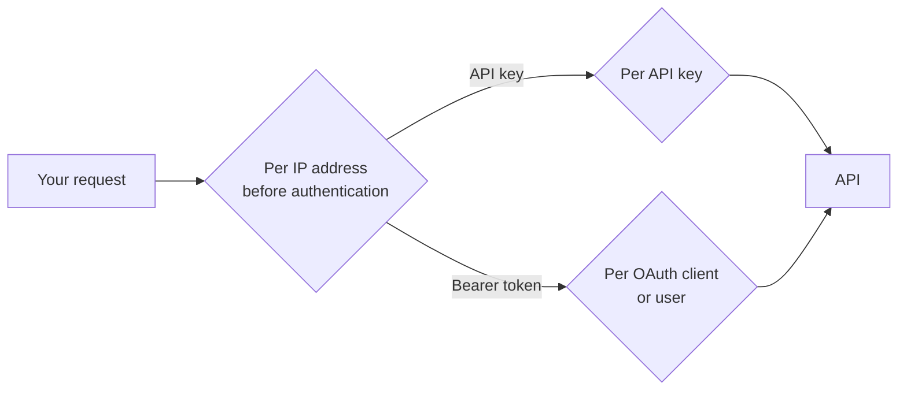

This page lists the limits your integration must stay within: request sizes, rate limits,
idempotency, paging, mapping and Managed Pull bounds, timeouts, decimal precision, date formats and
invoice-number uniqueness. Use it to size batches, set client timeouts and design retries.

Every limit below is a <span class="rule rule--fawtir">FAWTIR rule</span> unless it is labelled otherwise. Values marked "may differ
per environment" are deployment settings: the value shown is the default, and FAWTIR can set a
different one for an environment. Ask FAWTIR for the values of your environment before you rely on
them. Values not marked that way are fixed in the platform.

## Request size

| Route | Largest request body |
| --- | --- |
| `POST /api/v1/invoices` and `POST /api/v1/invoices/bridge` (every path starting `/api/v1/invoices`, except the invoice import upload) | 4 MiB (4,194,304 bytes). May differ per environment. |
| `POST /api/v1/creditnotes`, `/api/v1/debitnotes`, `/api/v1/selfbilling` | 1 MiB (1,048,576 bytes). May differ per environment. |
| Other API routes, including `/api/v1/auth/token` | 1 MiB; some file-upload routes of the app allow more. May differ per environment. |
| Request headers, all routes | 16 KB in total. |
| Generated PINT-OM XML | 4 MiB. Fixed. |

A body over the limit is refused before authentication with `413`:

```json
{
  "type": "https://api.fawtir.om/problems/payload-too-large",
  "title": "Payload too large",
  "status": 413,
  "detail": "The request body exceeds the permitted size."
}
```

This body has no `correlationId`. Do not retry it unchanged: make the document smaller.

If the PINT-OM XML that FAWTIR generates from your document is larger than 4 MiB, the submission is
refused with `422 SUBMISSION_NOT_SUPPORTED`, and the message asks you to split the invoice into
smaller documents.

:::note
Credit notes, debit notes and self-billing documents have a smaller body limit than
invoices. <span class="rule rule--advice">Recommendation</span>: if a correction can be large, test it against the 1 MiB limit, and
ask FAWTIR before you go live if you need more.
:::

## Rate limits

FAWTIR applies three kinds of rate limit. All windows are one minute.



### Per IP address, before authentication

Every request is counted against the address it comes from, before FAWTIR knows who you are. API-key
requests are always counted here, because the key is checked later.

| Paths | Requests per minute per IP address |
| --- | --- |
| `/api/v1/auth/refresh` | 30 (default); 20 in the hardened profile. May differ per environment. |
| `/api/v1/auth/token`, `/api/v1/auth/revoke` and other `/api/v1/auth/` paths | 40 (default); 20 in the hardened profile. May differ per environment. |
| Other `/api/` paths, including the submission routes and the reads | 600 (a few public and set-up paths have lower limits). May differ per environment. |

Callers behind one network address translation (NAT) address share one budget.

When the budget is spent the answer is `429` with a `Retry-After` header (seconds, at least 1) and
this body:

```json
{
  "type": "https://api.fawtir.om/problems/rate-limited",
  "title": "Rate limit exceeded",
  "status": 429,
  "detail": "Too many requests. Retry after the indicated delay."
}
```

No `X-RateLimit-Remaining` header is sent at this stage. On the `/api/v1/auth/` paths, a deployment that runs the hardened profile and shares rate-limit
counts between its servers fails closed: if that shared store is unavailable, the answer is `503` with type
`https://api.fawtir.om/problems/rate-limit-unavailable` and a `Retry-After` header.

### Per API key

Each API key may make 600 requests per minute (sliding window). May differ per environment.

Every answer carries `X-RateLimit-Limit` and `X-RateLimit-Remaining`. When the allowance is spent
the answer is `429` with `Retry-After`:

```json
{
  "type": "https://api.fawtir.om/problems/api-key-rate-limited",
  "title": "API key rate limit exceeded",
  "status": 429,
  "detail": "This API key has exhausted its current request allowance.",
  "instance": "/api/v1/invoices",
  "timestamp": "2026-11-10T06:15:04Z"
}
```

### Per OAuth client or signed-in user

Requests with a Bearer token are counted per organisation and per subject (the OAuth client or the
user).

| Paths | Requests per minute per subject |
| --- | --- |
| `/api/v1/invoices…` (submission, Bridge Upload and the status reads), `/api/v1/creditnotes`, `/api/v1/debitnotes`, `/api/v1/selfbilling` | 1,200, shared by all these paths. May differ per environment. |
| `/api/v1/auth/` paths used with a token | 30 (default); 5 in the hardened profile. May differ per environment. |
| Other paths, including `/api/v1/compliance/activity…` and `/api/v1/erp/…` reports | 600. May differ per environment. |

Every answer carries `X-RateLimit-Limit`, `X-RateLimit-Remaining` and `X-RateLimit-Scope`. When
`X-RateLimit-Scope` is `local` or `degraded`, the count is for one FAWTIR server only, so the real
remaining budget can be lower than shown. The `429` body is the `rate-limited` body shown above,
with `Retry-After`.

:::note
Some deployments run a hardened rate-limit profile with the tighter values shown above.
Which profile your environment uses is set by FAWTIR.
:::

<span class="rule rule--advice">Recommendation</span> on `429`, wait for `Retry-After` and resend the same request with the same
`Idempotency-Key`. Spread a backlog over time instead of sending it in a burst.

## Idempotency-Key

| Item | Value |
| --- | --- |
| Required on | Among the routes an ERP uses: the four submission routes, Bridge Upload, API key creation and rotation, OAuth client registration and secret rotation. |
| Format | 16 to 128 characters from `A-Z`, `a-z`, `0-9`, `.`, `_`, `:` and `-` (pattern `^[A-Za-z0-9._:-]{16,128}$`). |
| Retention | 24 hours from the successful request. Fixed. |
| Scope | Your organisation, the route and the document kind. Bridge Upload has its own scope. |
| In-flight lock | While a request with a key is being processed, the same key is refused with `409 DUPLICATE_IDEMPOTENCY` for up to 2 minutes. Fixed. |
| Stored | Only successful answers. A refused request leaves the key usable. |

A missing key is `400 validation-failed`. A key that breaks the format is
`400 INVALID_IDEMPOTENCY_KEY` with detail `Idempotency-Key must contain 16-128 safe characters.`

The source ledger, used with `source` on an `ERP_INGESTION` API key, has no time limit. Its
identifiers have these limits: `external_document_id` at most 200 characters and not blank;
`external_version` at most 80 characters. See [API reference](/api/reference/#retry-and-idempotency-for-submissions).

## Paging and report windows

| Route | `page` | `page_size` | Default size | Date window |
| --- | --- | --- | --- | --- |
| `GET /api/v1/invoices` | 0 to 500 | 1 to 100 | 20 | Optional `received_from` / `received_to`, no maximum |
| `GET /api/v1/compliance/activity` | 0 to 500 | 1 to 100 | 20 | Optional `from` / `to`, no maximum |
| `GET /api/v1/compliance/activity/summary` | n/a | n/a | n/a | `from` and `to` required, at most 366 days |
| `GET /api/v1/erp/source-documents` | 0 to 500 | 1 to 100 | 20 | `from` and `to` required unless `run_id` is given, at most 367 days |
| `GET /api/v1/erp/source-documents/summary` | n/a | n/a | n/a | `from` and `to` required, at most 367 days |
| `GET /api/v1/erp/source-documents/reconciliation` | 0 to 500 | 1 to 100 | 20 | `from` and `to` required, at most 367 days |
| `GET /api/v1/erp/extraction/runs` | 0 to 500 | 1 to 100 | 20 | Optional `from` / `to`, no maximum |
| `GET /api/v1/webhooks/{webhookId}/deliveries` | n/a | `limit`, default 50; a value outside 1 to 200 is clamped to that range | n/a | n/a |

These bounds are fixed. Except for the webhook deliveries `limit`, a value outside them is a `400`; FAWTIR does not shrink it silently.
Lists return `has_more` and no total count. To reach older entries than page 500, narrow the date
window.

An ERP report query that runs longer than 15 seconds is stopped and answered with
`503 ERP_REPORT_TIMEOUT`. May differ per environment. Retry with a narrower window.

## Mapping execution limits

Your mapping runs inside FAWTIR for every submission. These bounds stop a faulty mapping from
running forever. A mapping that exceeds them fails the submission with `422 MAPPING_FAILED`.

| Limit | JSONata (JSON documents) | XSLT 3.0 (XML documents) |
| --- | --- | --- |
| Time per document | 2 seconds | 5 seconds |
| Other bounds | Expression depth 500; memory 256 MiB; sequences of at most 10,000 items | Output at most 16 MiB; no external documents, stylesheets or DOCTYPE |

All these values may differ per environment, except the XSLT ban on external documents, stylesheets and DOCTYPE, which is fixed.

When every mapping worker is busy, the submission is refused with
`503 MAPPING_CAPACITY_UNAVAILABLE` and `Retry-After: 4`. Retry the same request with the same
`Idempotency-Key`.

## Managed Pull limits

Managed Pull is the channel where FAWTIR calls your ERP's REST endpoint on a schedule. See
[ERP connector](/integrate/managed-pull/). All values below may differ per environment, except the largest document and the stored cursor, which are fixed.

| Limit | Default |
| --- | --- |
| Scheduler | Off unless FAWTIR switches it on for the deployment |
| Collection interval | 1 hour; a configured interval is held between 5 minutes and 24 hours |
| Connection timeout | 5 seconds |
| Response timeout | 15 seconds |
| Whole exchange per page | 60 seconds |
| Largest response | 4 MiB per page |
| Largest document | 4 MiB |
| Page size sent to your ERP | 100 (at most 200) |
| Pages per collection cycle | 20 |
| Attempts per document | 5; then the document is `ATTEMPTS_EXHAUSTED` |
| Backoff after a failed run | 5 minutes, doubling up to 6 hours |
| Stored cursor | At most 500 characters |
| Connection check | One `HEAD` request, 15 seconds in total |
| Transport | HTTPS, JSON only, no redirects, publicly routable addresses only |

## Timeouts

| What | Value |
| --- | --- |
| A request through the API gateway to FAWTIR | 60 seconds. May differ per environment. |
| OAuth access token lifetime | 15 minutes. May differ per environment. |
| OAuth refresh token lifetime | 24 hours, one use. |
| Clock tolerance on token expiry | 30 seconds |
| ERP report query | 15 seconds, then `503 ERP_REPORT_TIMEOUT`. May differ per environment. |
| Webhook delivery attempt | 5 seconds. May differ per environment. |

<span class="rule rule--advice">Recommendation</span> set your HTTP client timeout for submissions above 60 seconds. If your client
times out first, the outcome is unknown: resend the same request with the same `Idempotency-Key`.

FAWTIR aims to transmit the Tax Data Document (TDD) within 15 minutes of validation for a
business customer (B2B) and within 30 minutes for a consumer (B2C). The deadline is returned as `tdd.sla_deadline`.
May differ per environment.

## Decimal precision and rounding

Amounts are in Omani rial (OMR). One baisa is 0.001 OMR.

| Amounts | Decimals FAWTIR writes | Kind of rule |
| --- | --- | --- |
| Document totals: line total (IBT-106), allowances and charges totals (IBT-107, IBT-108), total without VAT (IBT-109), total VAT (IBT-110), total with VAT (IBT-112), prepaid (IBT-113), rounding (IBT-114), amount due (IBT-115) | 2 | <span class="rule rule--pint">PINT-OM rule</span> (ibr-091, ibr-121 to ibr-125); FAWTIR writes all document totals at 2 |
| Line net amount (IBT-131), VAT breakdown taxable amount and VAT amount (IBT-116, IBT-117), line VAT amount (BTOM-016), line amount with VAT (BTOM-017) | 3 | <span class="rule rule--pint">PINT-OM rule</span> IBR-DEC-03-OM allows at most 3; FAWTIR writes 3 |
| Unit price (IBT-146) | As you send it; FAWTIR does not round it | <span class="rule rule--pint">PINT-OM rule</span> IBR-DEC-03-OM allows at most 3 |
| VAT rate | 2 | <span class="rule rule--pint">PINT-OM rule</span> IBR-046-OM: 0.00 to 100.00, at most 2 decimals |
| Exchange rate (BTOM-003) | As you send it | <span class="rule rule--pint">PINT-OM rule</span> IBR-005-OM: at most 7 decimals |

<span class="rule rule--fawtir">FAWTIR rule</span> FAWTIR does not recalculate the amounts your mapping produces. It only writes them
at the scale above, rounding half up (0.0005 becomes 0.001; 0.005 becomes 0.01). Its arithmetic
check compares your totals with each other with a tolerance of 0.005. If no line VAT amount is
mapped, FAWTIR derives it as net × rate ÷ 100, rounded half up to 3 decimals.

For the example invoice INV-2026-000145 (fictitious): line amounts 125.000 and 100.000, line VAT
6.250 and 5.000, VAT breakdown 225.000 and 11.250; document totals 225.00 without VAT, 11.25 VAT and
236.25 with VAT.

:::caution[Warning]
Round document totals to 2 decimals in your ERP before you send them. If you send a
total with 3 decimals, FAWTIR rounds it when it writes the document, and the PDF or your ERP may then
show a different amount from the e-invoice.
:::

:::note
The PINT-OM sources differ on the VAT breakdown amount (IBT-117). PINT-OM rule
IBR-DEC-03-OM allows 3 decimals there, and FAWTIR writes 3. The PINT-OM billing guidance gives
2 decimals for document-level VAT amounts. FAWTIR writes document-level allowance and charge
amounts (IBT-092, IBT-099) at 2 decimals. Ask FAWTIR if your ERP or your buyers need IBT-117
at 2 decimals.
:::

## Dates and times

| Value | Format | Example |
| --- | --- | --- |
| `supplement.issue_time` (IBT-168) | `HH:mm:ss`, no time zone | `10:15:00` |
| `supplement.preceding_invoice_date` (IBT-026) | ISO date `yyyy-MM-dd` | `2026-11-10` |
| Dates your mapping produces (issue date, due date, periods) | ISO date `yyyy-MM-dd` | `2026-12-10` |
| Query filters `from`, `to`, `received_from`, `received_to` | ISO-8601 instant, or a date read as a UTC day | `2026-11-10T06:15:04Z` or `2026-11-10` |
| Timestamps in answers | ISO-8601 instant in UTC | `2026-11-10T06:15:04Z` |
| `expiresAt` on API key creation | ISO-8601 instant | `2027-11-10T00:00:00Z` |

When a date filter is a plain date, `to` includes the whole day: `to=2026-11-30` covers up to the
end of 30 November UTC.

<span class="rule rule--advice">Recommendation</span> send `issue_time` in Oman local time (UTC+4), the same clock as the issue date.
FAWTIR does not convert it.

## Invoice-number uniqueness

<span class="rule rule--fawtir">FAWTIR rule</span> within your organisation, an invoice number may be used once per issue year. The
year is taken from the document's issue date. A second document with the same number and the same
issue year is refused with `409 DUPLICATE_INVOICE` when it carries a new `Idempotency-Key`. The body
does not name the existing submission in this case.

FAWTIR also derives the invoice UUID (BTOM-002) from the document's business content. Submitting
identical content again gives the same UUID and is refused with `409 DUPLICATE_INVOICE` too; this
body names the existing submission in `existing_submission`.

Notes:

- The rule covers every document you submit through the API, so a credit note number cannot repeat
  an invoice number of the same year.
- If your organisation issues for several sellers, they share one number series in FAWTIR.
- Branch number prefixes in FAWTIR apply to invoices created in FAWTIR, not to documents your ERP
  pushes. FAWTIR uses your ERP's number as it is.

:::caution[Warning]
Never reuse an invoice number for a different invoice. To change an issued invoice,
issue a credit note or a debit note. See [Invoice corrections](/integrate/corrections/).
:::

## Configurable and fixed values

| May differ per environment | Fixed in the platform |
| --- | --- |
| Request body limits | Idempotency-Key format, 24-hour retention and 2-minute lock |
| All rate limits and the rate-limit profile | Paging bounds (page 0 to 500, size 1 to 100, default 20) |
| ERP report query timeout | Report windows (367 days; 366 days for the activity summary) |
| Mapping time, memory and output limits | Decimal scales (2 for totals, 3 for line and breakdown amounts) and half-up rounding |
| Managed Pull timeouts, response size, page size and count, attempts and schedule | 4 MiB limit on the generated PINT-OM XML; Managed Pull document size (4 MiB) and stored cursor (500 characters) |
| Access token lifetime | Refresh token lifetime (24 hours) |
| Tax Data Document transmission targets | Invoice-number uniqueness per organisation, number and issue year |
| API key lifetime defaults and rotation grace | `source` identifier lengths (200 and 80 characters) |
| Webhook timeouts and the limit of 10 endpoints | The XSLT ban on external documents, stylesheets and DOCTYPE |
